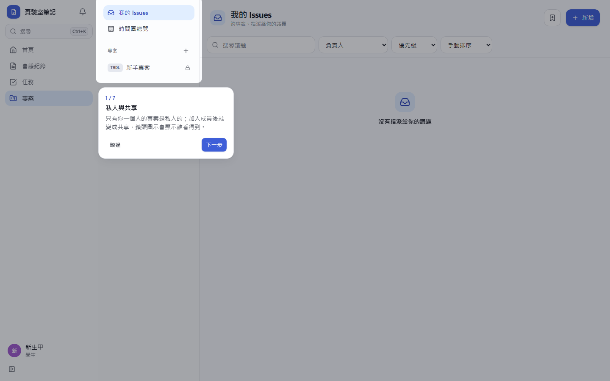
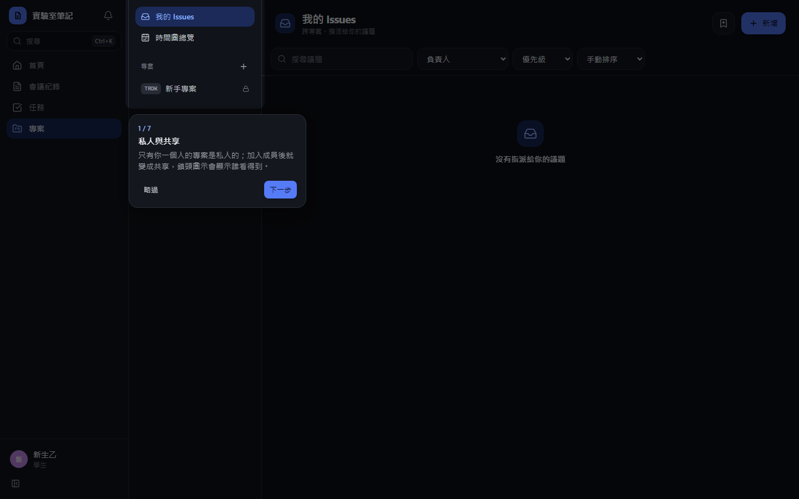
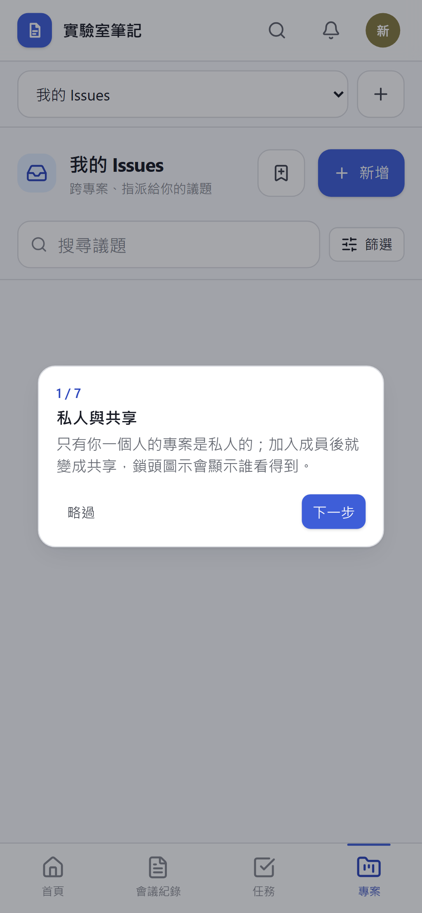
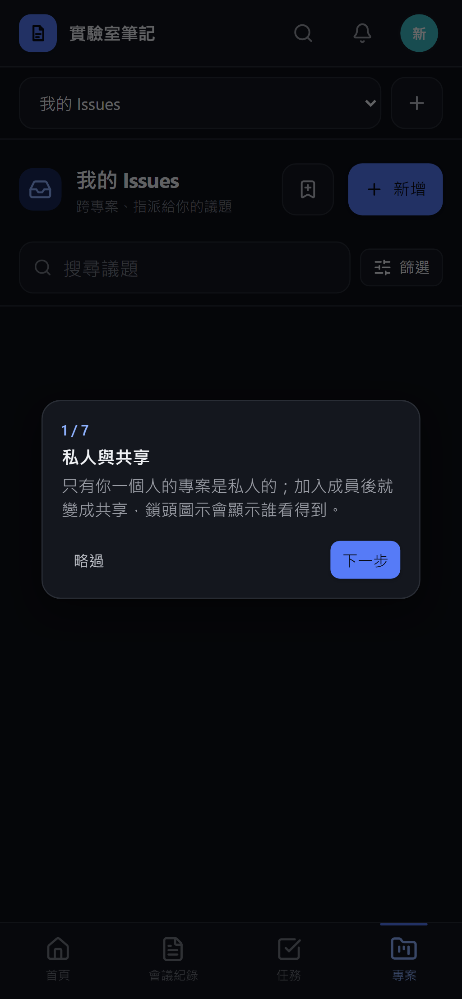

# [MS-10] 建立全站導覽與新手引導

> 狀態：完成

## 內文

### 需求
三大模組（會議紀錄、任務、專案管理）要有清楚的入口，第一次使用的人知道從哪裡開始。

### 來源
使用者 2026-10-19 對話（初始需求）；設計：`design/05-project-management.md` §2、§7

### 驗收條件
- [x] 電腦版有左側導覽（會議紀錄、任務、專案、通知、後台［僅管理員］），可收合；手機版改底部導覽
- [x] 首頁是個人總覽：我最近的會議紀錄、進行中的任務與最近提交結果、指派給我的議題，各區塊有「查看全部」
- [x] 每個模組第一次進入時有簡短引導（3–7 步），看過不再自動出現，可從快捷鍵說明或說明選單重看
- [x] 各列表的空狀態告訴使用者下一步（例如「建立第一份會議紀錄」按鈕）
- [x] 目前位置在導覽上有明顯標示，頁面切換有轉場動畫

### 測試流程
1. 新帳號登入，首頁三區塊都是空狀態引導
2. 點進會議紀錄，出現新手引導，看完後重新整理不再出現
3. 從說明選單重看引導
4. 管理員帳號看得到後台入口，學生看不到

---

# 跟其他票的關係

- Blocks：無
- Blocked by：MS-8、MS-9
- Related：無

---

# Commit-1

## 內文

原本沒有導覽。
現在電腦版有可收合的左側導覽（後台只對管理員顯示），手機版是底部導覽；目前位置有滑動的高亮，頁面切換有淡入轉場。首頁是個人總覽，列出我最近的會議紀錄、進行中的任務、指派給我的議題，空的時候直接給下一步按鈕。
尚未完成：通知入口、各模組第一次進入的新手引導。

### 測試結果

| 項目 | 結果 |
|---|---|
| E2E 首頁（四種組合） | 通過 |

### 截圖

**首頁**

# Commit-2

## 內文

有時從其他頁切換到會議紀錄時，主畫面整片空白，要重新整理才會出現。原因是切換動畫會等上一頁的退場動畫跑完才放入新頁，退場動畫卡住時新頁就一直不出現。
現在新頁一切換就立刻顯示，只保留進場淡入；動畫就算被瀏覽器暫停，內容也已經在畫面上。
驗收：在首頁、會議紀錄、任務、專案之間以 0–170ms 間隔快速連續切換 15 輪、以及從會議紀錄內頁返回列表 8 輪，每次主畫面都有內容且完全不透明。

### 測試結果

| 項目 | 結果 |
|---|---|
| 型別檢查（tsc -b） | 0 錯誤 |
| Lint 與色碼檢查 | 0 錯誤（69 個檔案） |
| 單元／整合測試（vitest） | 通過 29 / 29 |
| 驗收測試（Playwright，電腦／手機 × 深／淺） | 通過 24 / 24 |

### 截圖

**首頁與導覽**

# Commit-3

## 內文

原本第一次進入各模組時沒有任何說明，通知也混在導覽列裡。
現在會議紀錄、任務、專案第一次打開時各有一段 3–7 步的引導：以聚光燈框出對應的按鈕（例如新增、檢視切換、篩選、指令面板），可上一步、下一步、略過或按 Esc 關閉；看完或略過都記在帳號上，換裝置也不會再跳出；按 ? 開啟快捷鍵說明可重看任一模組的引導。手機上找不到對應元件的步驟改在畫面中央顯示。左側導覽可收合，通知改為站名旁的鈴鐺，手機為底部導覽。
驗收：新帳號打開專案自動出現 7 步引導，走完後重新整理不再出現；打開會議紀錄出現自己的引導，略過後從 ? 重看可再次打開；帳號紀錄兩個模組已看過。

### 測試結果

| 項目 | 結果 |
|---|---|
| 型別檢查（tsc -b） | 0 錯誤 |
| Lint 與色碼檢查 | 0 錯誤（79 個檔案） |
| 單元／整合測試（vitest） | 通過 36 / 36 |
| 驗收測試（Playwright 全套，電腦／手機 × 深／淺） | 43 / 44；失敗的 1 項是開發伺服器暫時斷線造成逾時，單獨重跑通過 |

### 截圖

**專案的新手引導**

