# [MS-11] 建立會議紀錄與預設範本

> 狀態：進行中

## 內文

### 需求
學生要能建立會議紀錄，設定會議名稱、時間、地點、記錄人、出席、缺席等欄位，內文自動帶入建議格式，而且前次待辦會自動帶過來。

### 來源
使用者 2026-10-19 對話（初始需求）；設計：`design/03-meeting-notes.md` §1–§3、§7；待確認 #6

### 驗收條件
- [x] 新增會議紀錄時填寫：名稱、日期時間（起訖）、地點（文字或連結，連結可點）、記錄人（預設自己）、出席、缺席與原因、所屬專案（選填）
- [x] 內文自動帶入預設範本（依介面語系），表頭表格由欄位產生，改欄位內文表頭同步更新
- [x] 同系列（同名稱或同專案）上一份紀錄的「五、待辦事項」自動帶入「二、前次待辦追蹤」，狀態預設「進行中」
- [x] 管理員可在後台修改站台預設範本，修改後新建立的紀錄使用新範本
- [x] 出席、記錄人用 @ 選成員，顯示目前名稱
- [x] 權限：預設全站成員可讀；建立者、記錄人、出席者可編輯；管理員與老師可編輯全部；掛在專案下可設為僅限專案成員
- [x] 刪除為軟刪除，只有建立者、管理員、老師可刪，刪除前用確認框說明後果

### 測試流程
1. 建立「每週進度會議」，填入所有欄位，內文出現範本且表頭與欄位一致
2. 修改地點為 Google Meet 連結，表頭同步更新且連結可點
3. 在第一份的待辦事項填兩列，再建立下一週同名會議，前次待辦追蹤出現那兩列
4. 用非出席者的學生帳號開啟，只能讀不能編輯

---

# 跟其他票的關係

- Blocks：MS-12、MS-17、MS-19、MS-20
- Blocked by：MS-2、MS-3、MS-5
- Related：MS-46

---

# Commit-1

## 內文

原本沒有會議紀錄。
現在可以建立會議紀錄並填名稱、起訖時間、地點（連結可點）、記錄人、出席、缺席與原因。內文自動帶入建議格式（依介面語系），會議名稱、時間、地點、記錄人、出席等表頭資訊由欄位產生顯示在頁首，改欄位就同步，不會和內文對不上；複製 Markdown 時會組回完整表頭。同名稱或同專案的上一份紀錄的「待辦事項」會自動帶進「前次待辦追蹤」，狀態預設進行中。預設全站可讀、建立者／記錄人／出席者可編輯，其他人唯讀；刪除是軟刪除並有確認框。
尚未完成：後台修改站台預設範本的介面（伺服器已讀取站台範本設定）。

### 測試結果

| 項目 | 結果 |
|---|---|
| 整合測試：範本帶入與前次待辦延續 | 通過 |
| 整合測試：非出席者唯讀 | 通過 |
| E2E 建立會議紀錄（四種組合） | 通過 |

### 截圖

**新增會議紀錄**

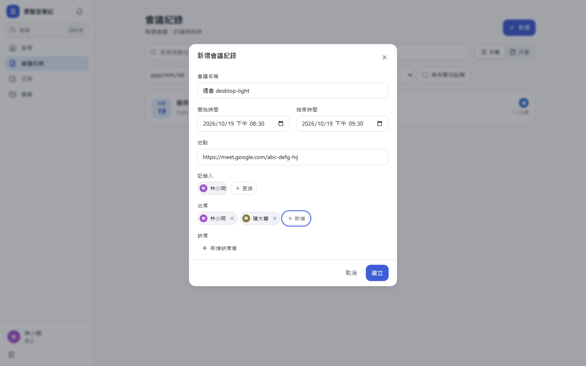
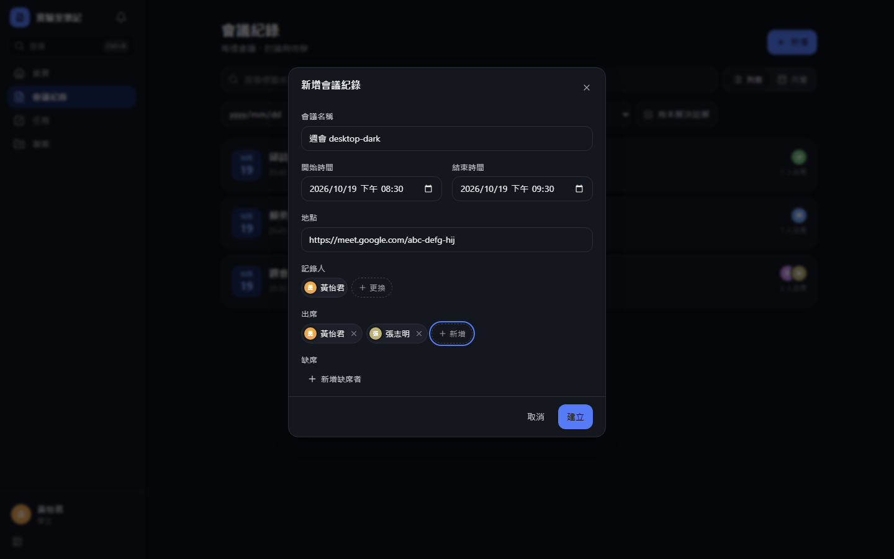
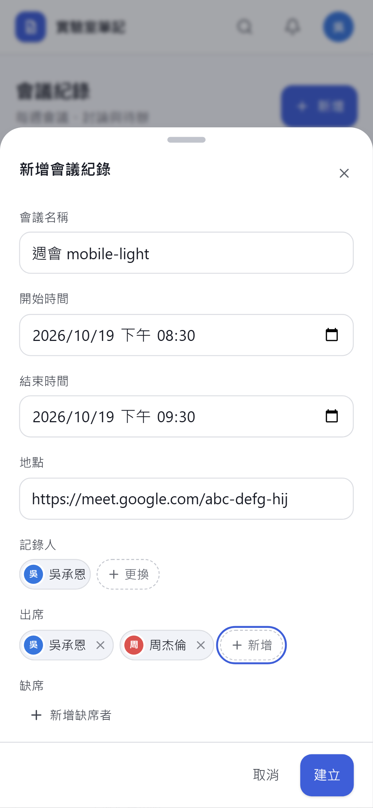
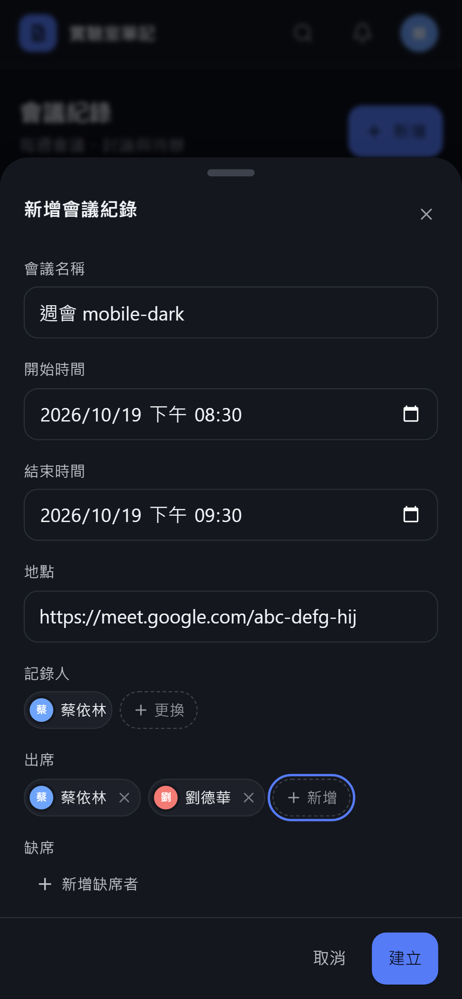

**建立後的會議紀錄**

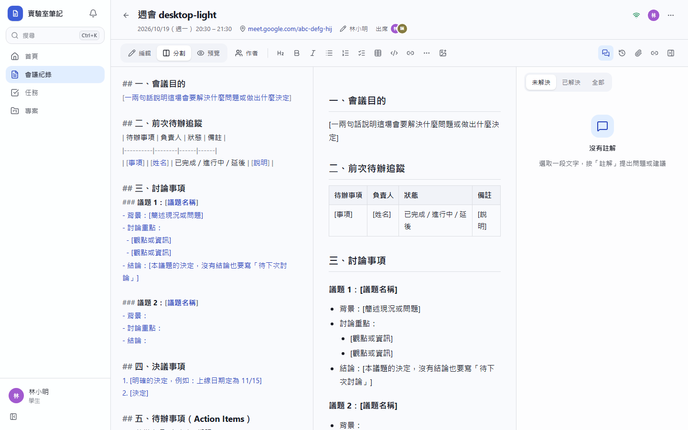
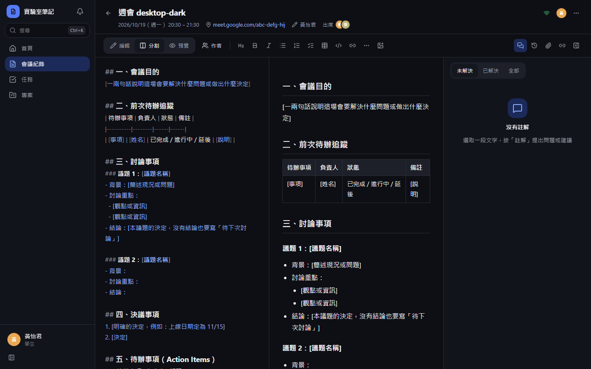
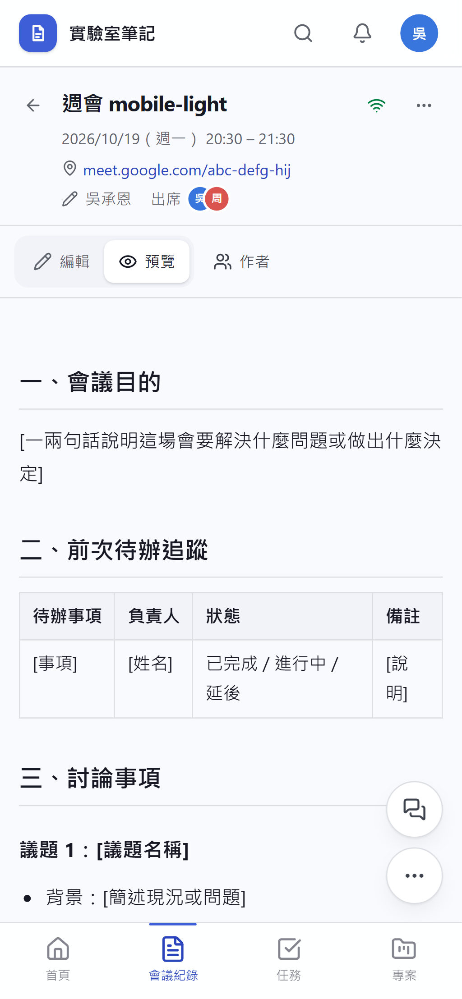
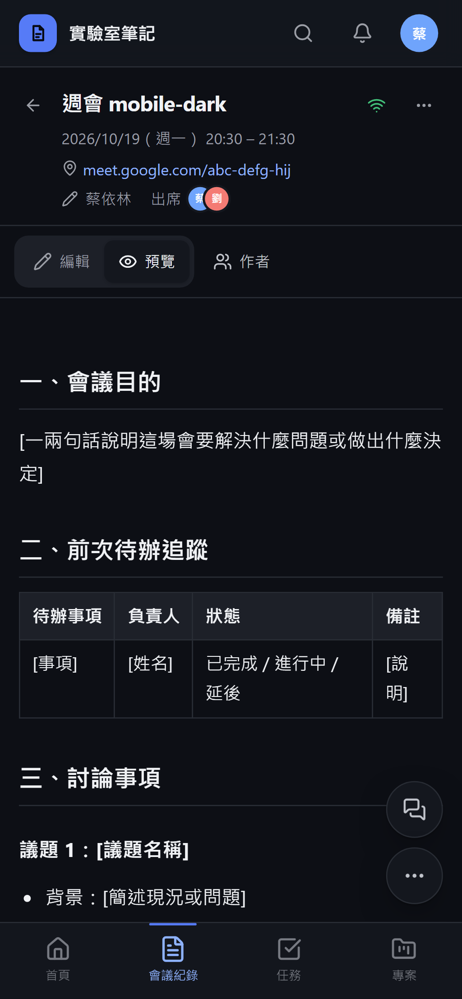

# Commit-2

## 內文

原本預設會議範本寫死在程式裡。
管理員現在可在「後台 → 站台設定 → 會議範本」分別修改中文與英文範本，{{carryover}} 會換成上次會議未完成的待辦；留空或按「改回內建範本」即恢復內建版本。修改後新建立的紀錄使用新範本，舊紀錄不受影響。

### 測試結果

| 項目 | 結果 |
|---|---|
| 型別檢查（tsc -b） | 0 錯誤 |
| Lint 與色碼檢查 | 0 錯誤（73 個檔案） |
| 單元／整合測試（vitest） | 通過 34 / 34 |
| 驗收測試（Playwright，電腦／手機 × 深／淺） | 通過 32 / 32 |

### 截圖

**站台設定（會議範本在同一頁的 Tab）**

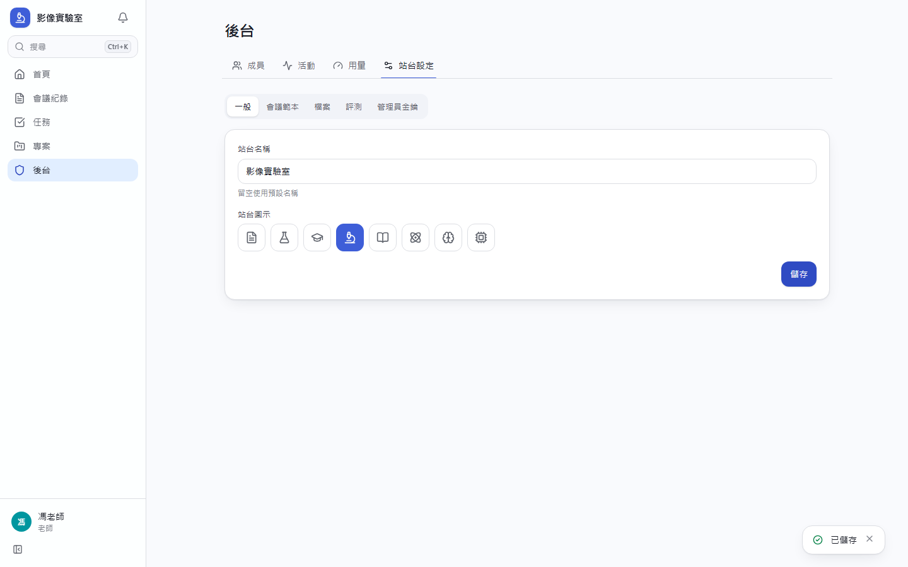
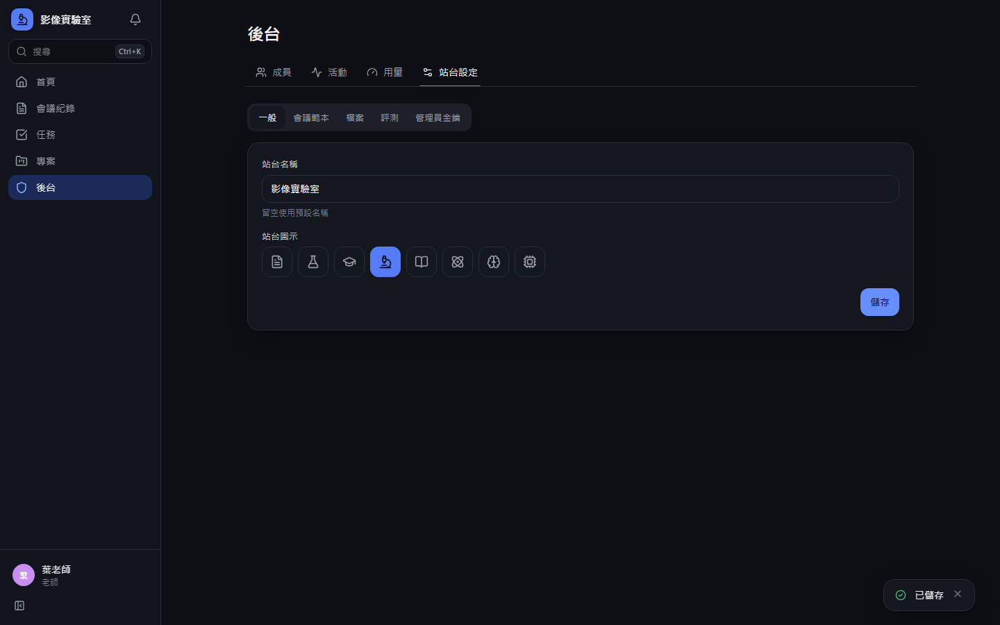
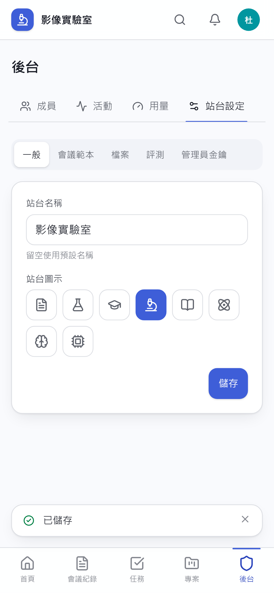
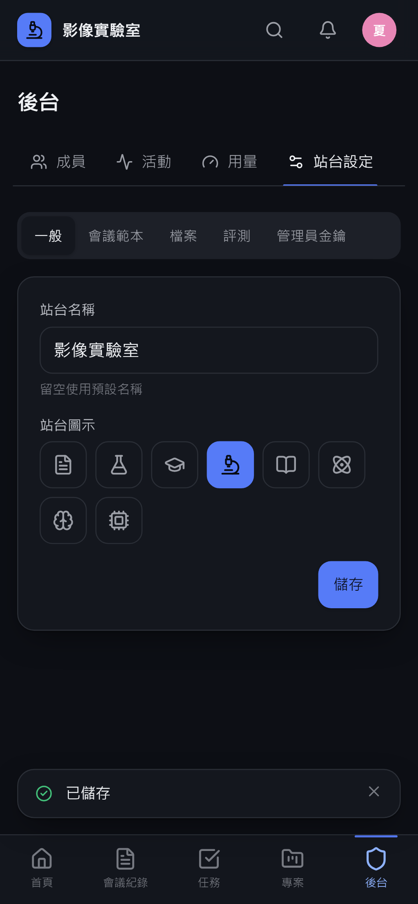
