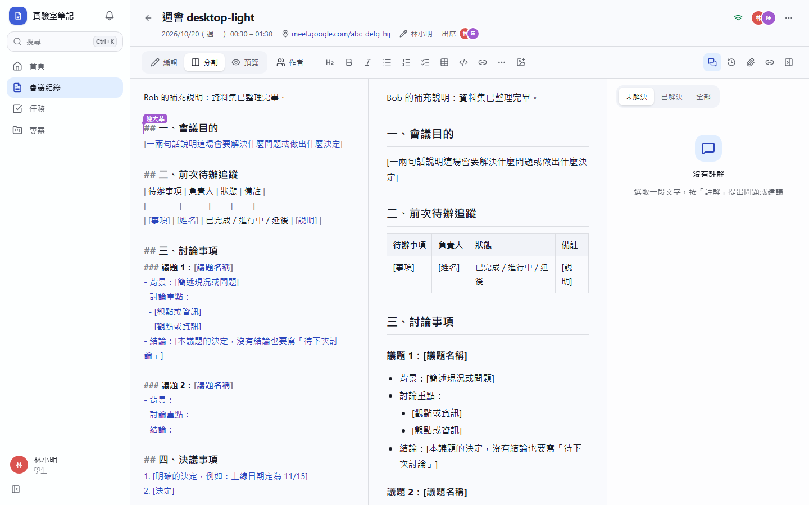
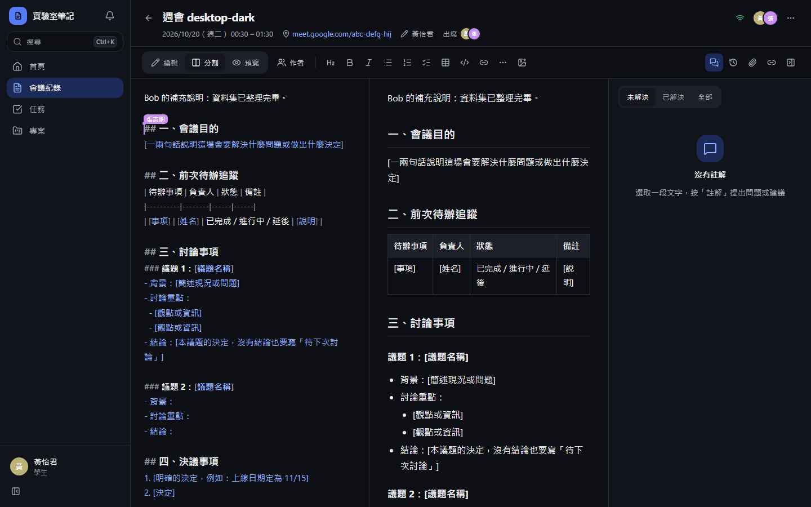
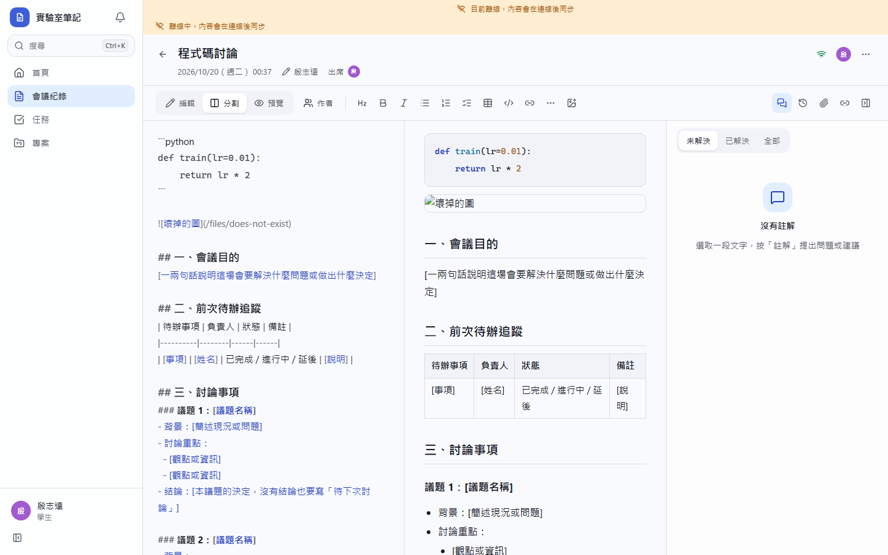
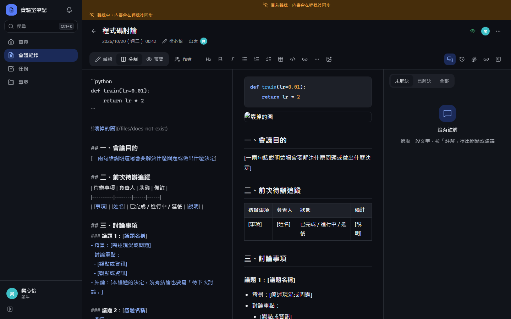
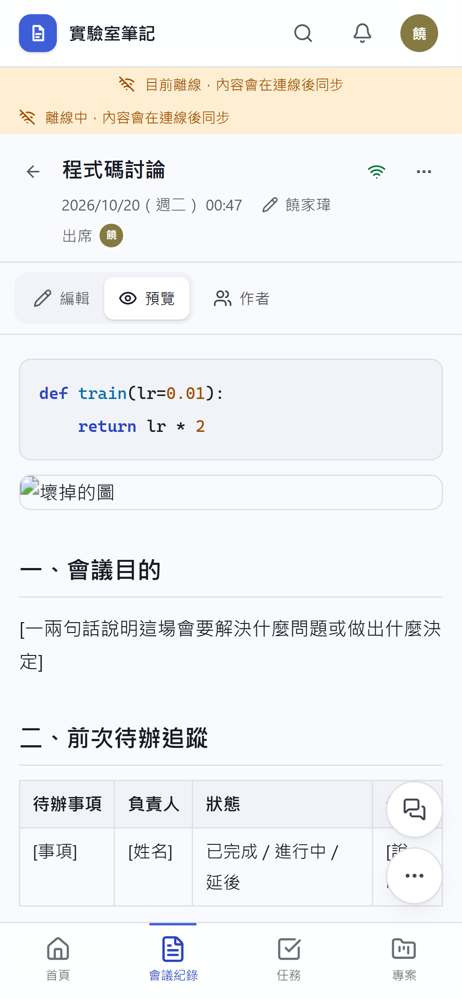
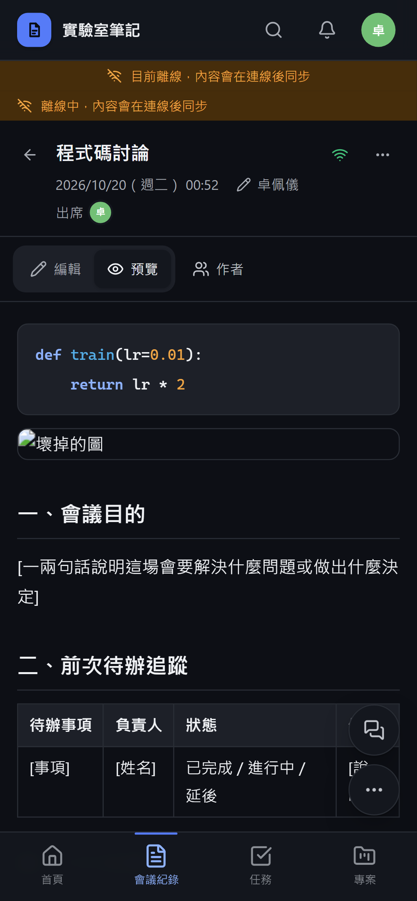

# [MS-12] 多人即時協作編輯會議紀錄

> 狀態：進行中

## 內文

### 需求
開會時多人同時記同一份會議紀錄，要像 HackMD 一樣即時看到彼此打字，不會互相覆蓋。

### 來源
使用者 2026-10-19 對話（初始需求）；設計：`design/02-architecture.md` §4；決策：即時多人協作

### 驗收條件
- [x] 兩人以上同時編輯，對方輸入在 1 秒內出現在自己畫面上，不互相覆蓋
- [x] 看得到其他人的游標與選取範圍，標示對方名稱與顏色；頂端顯示目前在線的人
- [x] 電腦版左右分割（編輯／預覽），可切換只看編輯或只看預覽；手機版用 Tab 切換
- [x] Markdown 工具列：標題、粗體、清單、待辦、表格、程式碼、連結；表格有輔助編輯（新增列、欄）
- [x] 斷線時顯示「離線中，內容會在連線後同步」，繼續編輯不丟字，重連後自動合併
- [x] 沒有編輯權限的人以唯讀模式即時觀看
- [ ] 10 人同時編輯一份 2 萬字的紀錄，打字延遲無明顯卡頓（輸入到畫面 < 50ms）
- [x] 文件閒置後內容同步到列表與搜尋，最遲 30 秒

### 測試流程
1. A、B 兩個帳號在不同瀏覽器打開同一份紀錄，同時在同一段落打字，雙方最後內容一致
2. A 關閉網路繼續打字 1 分鐘，再開網路，B 看到 A 離線時打的內容
3. 用唯讀帳號開啟，看得到即時變化但無法輸入
4. 用壓測腳本模擬 10 人同時輸入，記錄延遲數據

---

# 跟其他票的關係

- Blocks：MS-13、MS-15、MS-16
- Blocked by：MS-11
- Related：無

---

# Commit-1

## 內文

原本會議紀錄不能多人同時寫。
現在每份紀錄有自己的即時協作房間：多人同時打字互不覆蓋，看得到對方游標與名稱，頁首顯示在線的人與連線狀態。電腦版可切換編輯／分割／預覽，手機版預設閱讀、一鍵切到編輯。工具列有標題、粗體、斜體、清單、待辦、表格（含新增列／欄）、程式碼、連結、插入圖片。沒有編輯權限的人即時看得到內容但不能輸入。伺服器把每 2 秒的按鍵合併成一筆寫入，避免超出免費額度。
尚未驗證：斷線編輯後重連的合併、10 人 2 萬字壓測、列表與搜尋 30 秒內同步。

### 測試結果

| 項目 | 結果 |
|---|---|
| 整合測試：兩人同時輸入結果一致 | 通過 |
| 整合測試：唯讀者的更新被忽略 | 通過 |
| E2E 另一人輸入在 5 秒內出現在對方預覽（實測約 1 秒） | 通過（四種組合） |

### 截圖

**兩人同時編輯（左：編輯器顯示對方游標；右：預覽）**

# Commit-2

## 內文

原本斷線只在右上角圖示的提示文字說明，網路剛斷時圖示也可能還顯示已連線。
現在網路中斷（瀏覽器回報離線，或連線斷開超過 2 秒）時，紀錄上方出現「離線中，內容會在連線後同步」橫幅，可以繼續編輯，恢復連線後自動合併並收起橫幅。協作中的內容每 20 秒寫回資料庫，所以列表與搜尋最遲約 20 秒就找得到新內容。
驗收：瀏覽器切成離線後橫幅出現、恢復後消失；即時加入一個詞後觸發同步，列表搜尋立刻找到該紀錄。10 人同時編輯的延遲量測尚未進行。

### 測試結果

| 項目 | 結果 |
|---|---|
| 型別檢查（tsc -b） | 0 錯誤 |
| Lint 與色碼檢查 | 0 錯誤（81 個檔案） |
| 單元／整合測試（vitest） | 通過 42 / 42 |
| 驗收測試（Playwright 全套，電腦／手機 × 深／淺） | 通過 56 / 56 |

### 截圖

**離線橫幅**

