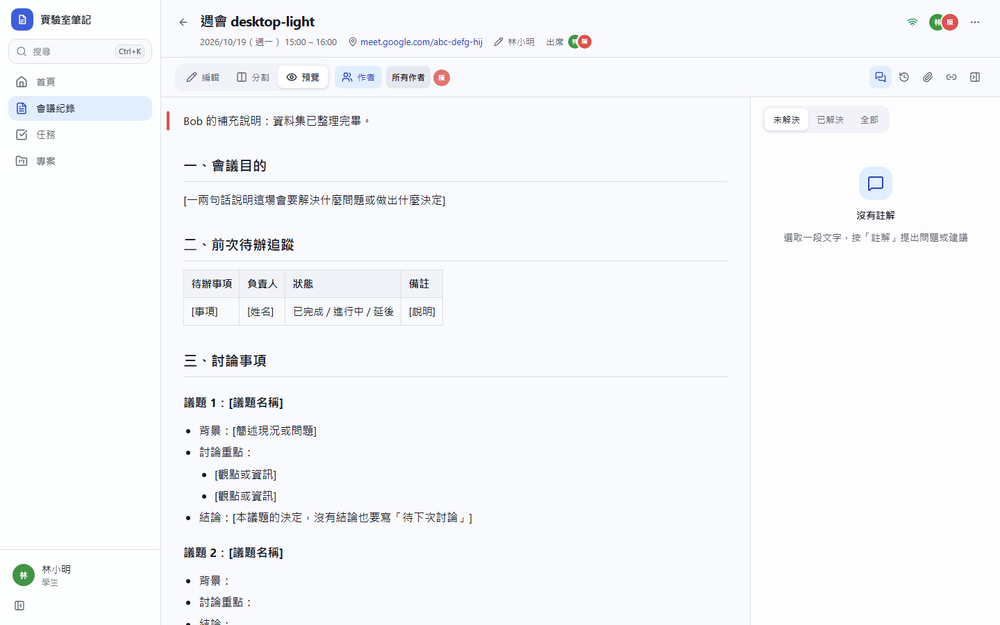
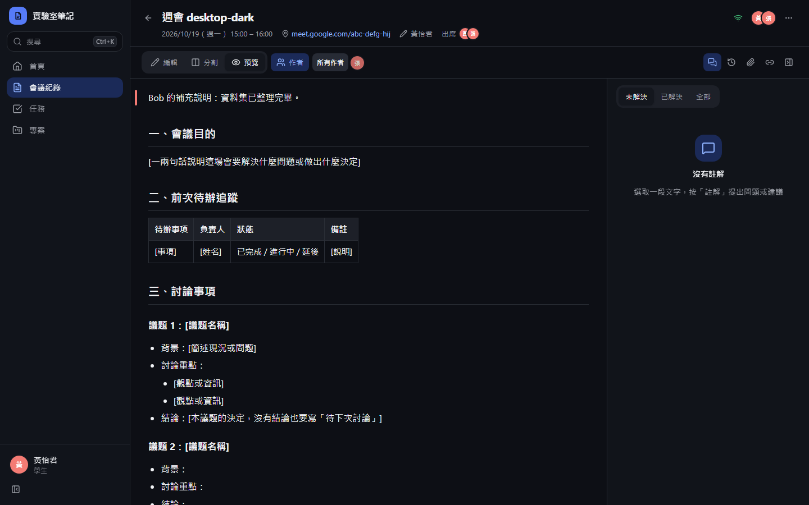
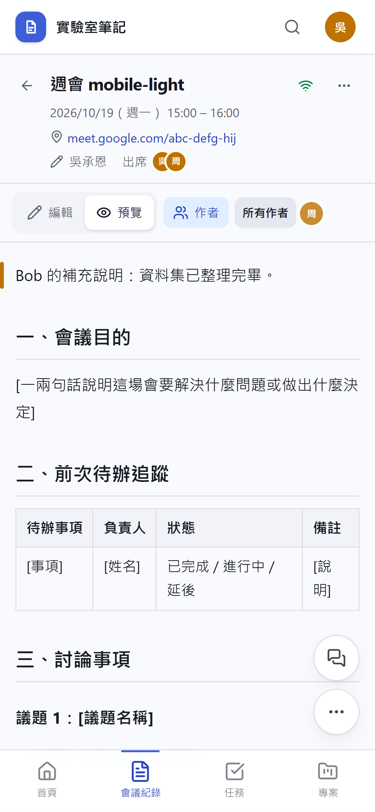
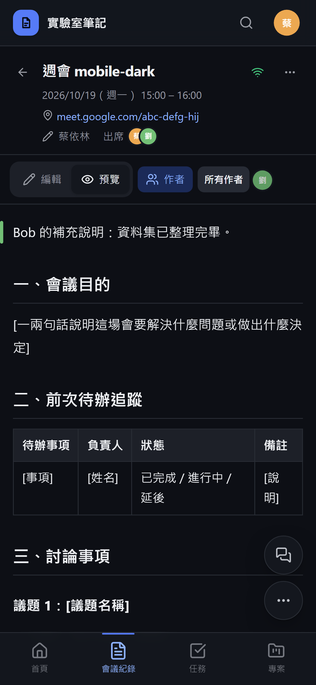

# [MS-13] 標示每段文字的作者

> 狀態：完成

## 內文

### 需求
老師、學長要知道會議紀錄裡每一段是哪個帳號新增或修改的；作者不可被偽造。

### 來源
使用者 2026-10-19 對話（初始需求）；設計：`design/02-architecture.md` §4、`design/03-meeting-notes.md` §4

### 驗收條件
- [x] 切換到「作者」檢視，每段左側色條標示作者，多人寫的段落顯示多個頭像
- [x] hover 段落顯示：作者名稱、最後編輯時間（一行）
- [x] 作者以伺服器認定的登入帳號為準，用竄改過的客戶端冒用他人身分送出的編輯會被拒絕
- [x] 作者名稱跟隨改名即時更新
- [x] 可以用作者篩選：只標示某位成員寫的內容

### 測試流程
1. A 寫第一段、B 寫第二段、A 修改第二段的一個句子
2. 切到作者檢視：第一段標 A；第二段標 B 與 A
3. 用開發者工具竄改送出內容冒充 B，伺服器拒絕並記 log
4. 選擇只看 A，只有 A 寫的文字被標示

---

# 跟其他票的關係

- Blocks：MS-14
- Blocked by：MS-12
- Related：MS-44

---

# Commit-1

## 內文

原本看不出每段是誰寫的。
現在「作者」檢視會在每段左側用作者顏色畫色條，多人寫的段落顯示漸層與多個頭像，hover 顯示作者與最後編輯時間；可只看某位成員寫的內容（其他段落變淡）。作者以伺服器認定的登入帳號為準：每個編輯連線的識別碼綁定登入帳號，有人冒用他人的識別碼送出編輯會被斷線並記 log。名稱即時跟著改名更新。
最後編輯時間以「該作者那次開啟頁面的最後一次編輯」計算。

### 測試結果

| 項目 | 結果 |
|---|---|
| 整合測試：每位編輯者對應到正確帳號 | 通過 |
| 整合測試：偽造他人識別碼被拒（連線關閉 4403、內容未寫入） | 通過 |
| E2E 作者檢視（四種組合） | 通過 |

### 截圖

**作者檢視：另一人寫的第一段標示其顏色**

