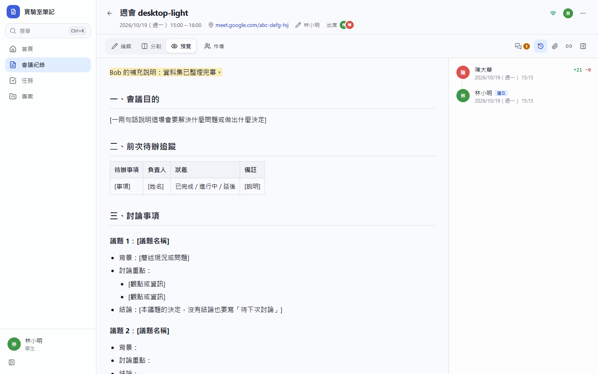
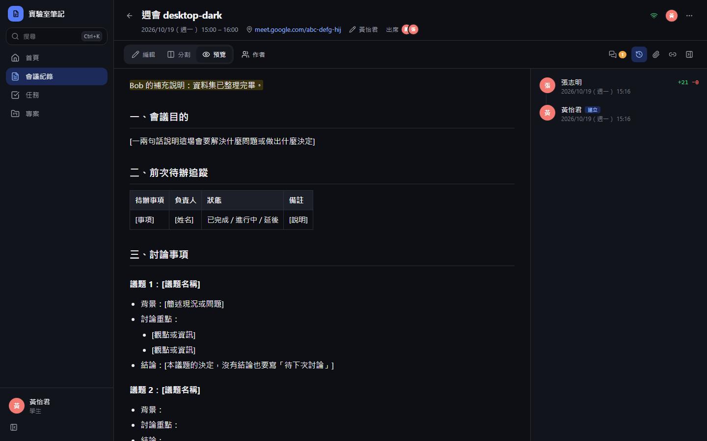
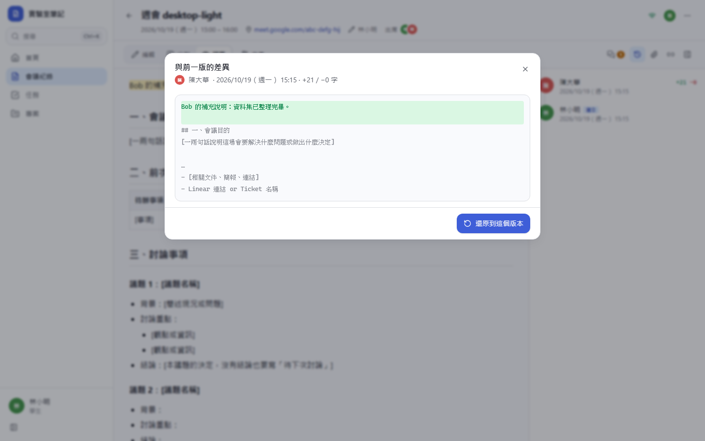
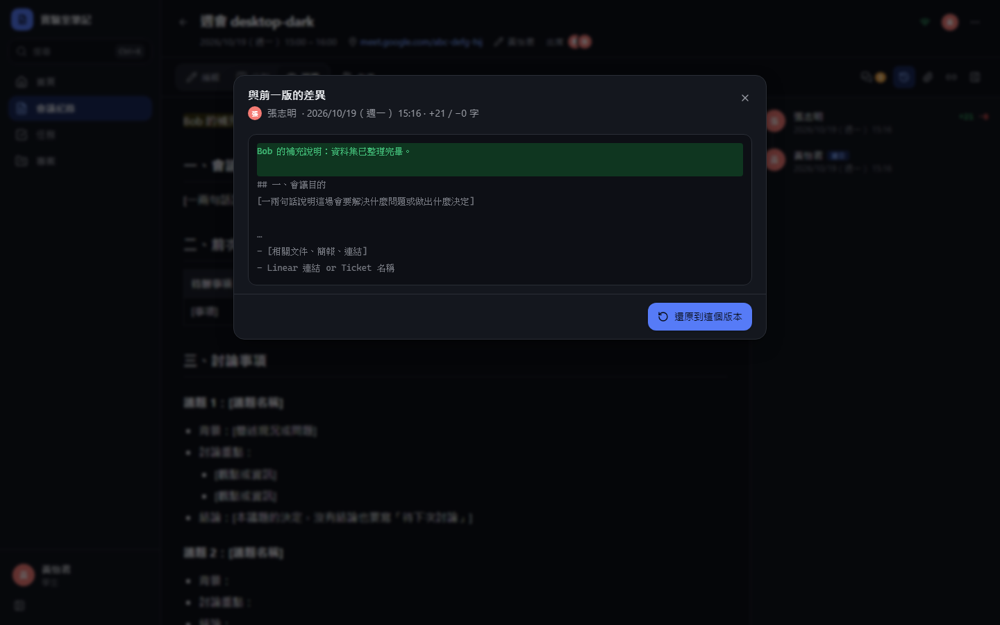
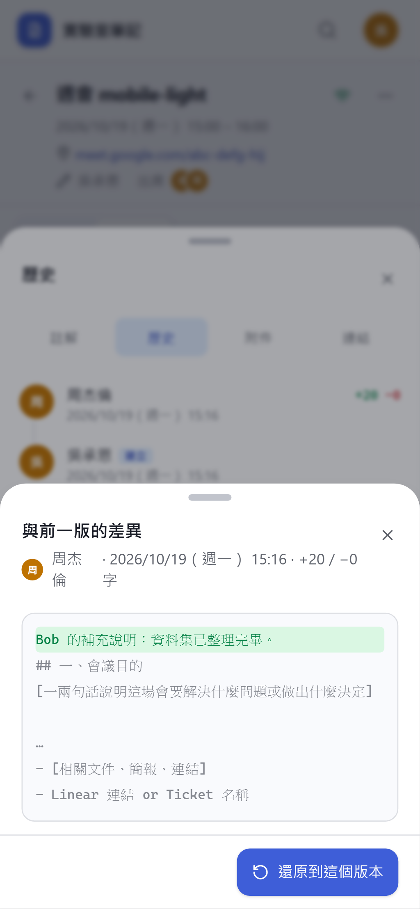
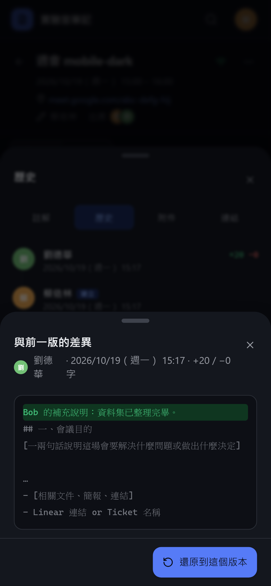

# [MS-14] 查看會議紀錄的編輯歷史

> 狀態：完成

## 內文

### 需求
要能看到誰在什麼時候改了什麼，必要時把內容還原到之前的版本。

### 來源
使用者 2026-10-19 對話（初始需求）；設計：`design/03-meeting-notes.md` §5

### 驗收條件
- [x] 歷史面板列出每個編輯段落：誰、何時、+N／−M 字（同一人閒置 5 分鐘內的編輯合併為一段）
- [x] 點選任一段落顯示該版本與前一版的差異（新增綠色、刪除紅色），手機上可閱讀
- [x] 可以還原到任一版本，還原前用確認框說明「會以目前內容建立新版本，不刪除歷史」；還原本身也記為一筆編輯
- [x] 歷史只增不刪，任何人都無法刪除歷史段落
- [x] 歷史以分頁載入，100 個段落以上仍順暢

### 測試流程
1. A 寫一段，等 5 分鐘；B 刪掉一句
2. 打開歷史，看到兩個段落，各自顯示正確的人與字數
3. 點 B 的段落，看到被刪的那句以紅色顯示
4. 還原到 A 的版本，內容恢復，歷史多一筆「還原」

---

# 跟其他票的關係

- Blocks：MS-44
- Blocked by：MS-13
- Related：無

---

# Commit-1

## 內文

原本看不到誰改了什麼。
現在每個人一段連續的編輯（閒置 5 分鐘或離開頁面即結束）會成為一個版本，歷史面板列出誰、何時、+N／−M 字，建立時的範本是第一個版本。點任一版本會看到與前一版的差異（新增綠色、刪除紅色、未變的部分收合），可還原到該版本：確認框說明不會刪除歷史，還原本身也記為一筆新版本。歷史只增不刪、分頁載入。

### 測試結果

| 項目 | 結果 |
|---|---|
| 整合測試：編輯段落轉成版本、還原後內容回到該版本 | 通過 |
| E2E 歷史與差異（四種組合） | 通過 |

### 截圖

**歷史面板**

**與前一版的差異**

