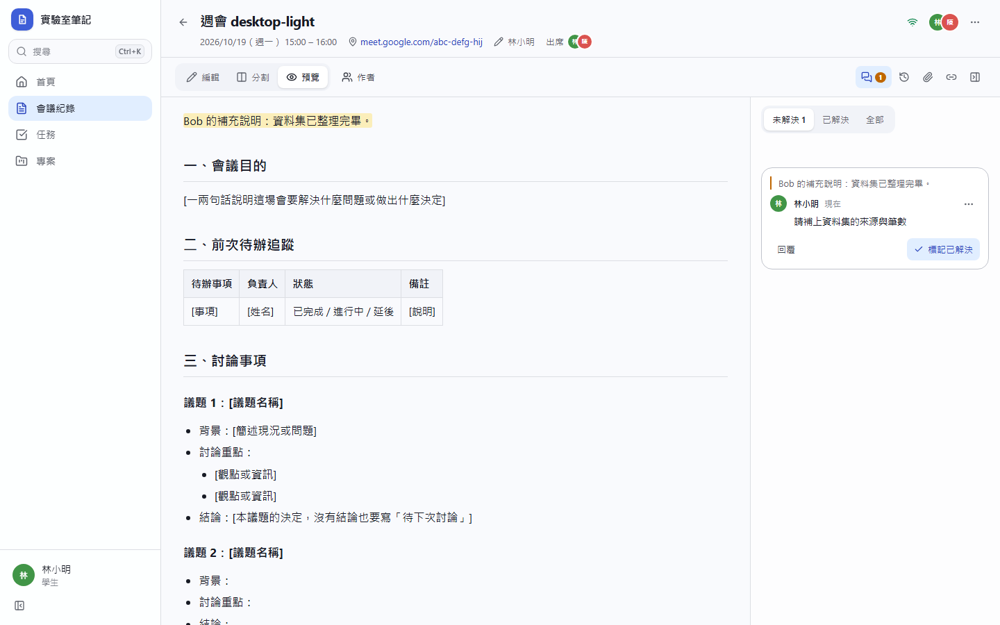
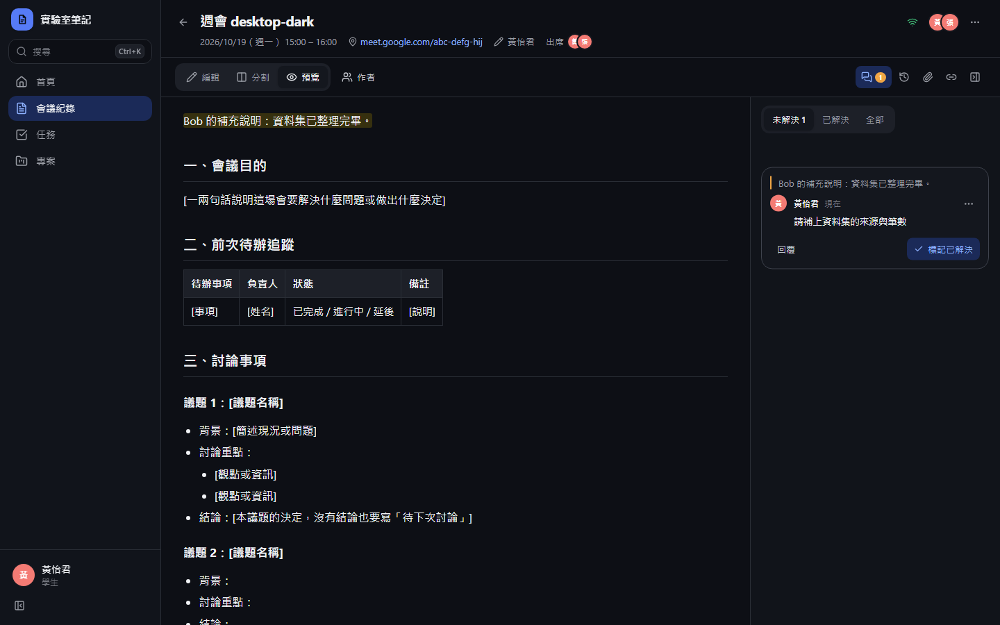
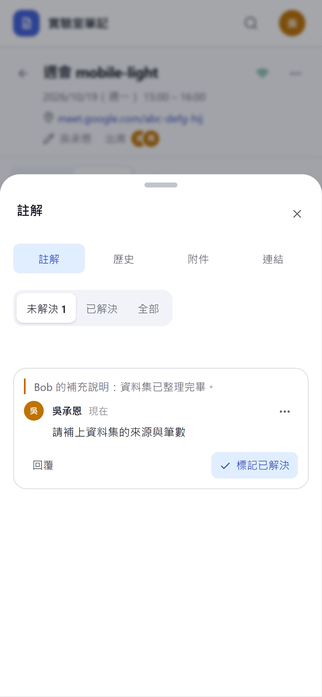
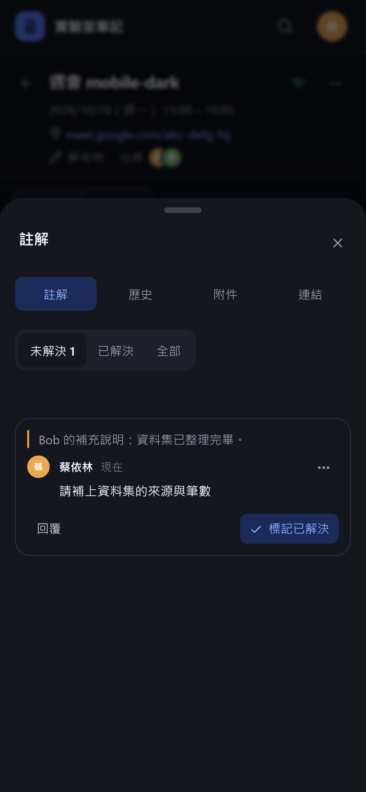

# [MS-15] 選取文字加上註解討論

> 狀態：進行中

## 內文

### 需求
任何人都能選取會議紀錄中的一段文字加註解（像 Word），讓學生知道哪裡有問題、可以怎麼改，並能討論、標記已解決。

### 來源
使用者 2026-10-19 對話（初始需求）；設計：`design/03-meeting-notes.md` §6

### 驗收條件
- [x] 在預覽或編輯器選取文字後出現「註解」按鈕（手機長按選取後出現），輸入內容送出
- [x] 被註解的文字有底色；右側註解欄與段落對齊，點註解捲到原文、點原文打開註解
- [x] 註解可回覆（一層）、@提及成員、編輯與刪除自己的（編輯過顯示「已編輯」）
- [x] 可標記「已解決」與重新開啟；可篩選全部／未解決／已解決
- [x] 原文被修改時註解跟著移動；原文被整段刪除時保留引用文字並標示「原文已刪除」
- [ ] 紀錄的建立者、記錄人、被 @ 的人收到站內通知
- [x] 手機上註解欄改為底部抽屜

### 測試流程
1. 學長選取「上線日期定為 11/15」加註解「日期跟上週不一致」
2. 學生看到底色並點開註解，回覆後學長標記已解決
3. 在被註解文字前面插入一整段，註解仍對到原本那句
4. 刪掉被註解的那句，註解顯示原文已刪除與引用文字

---

# 跟其他票的關係

- Blocks：MS-41
- Blocked by：MS-12
- Related：無

---

# Commit-1

## 內文

原本沒有辦法對內容提出意見。
現在任何能讀這份紀錄的人都能選取文字加註解（電腦在預覽或編輯器選取、手機長按選取後按浮出的「註解」）。被註解的文字有底色，點底色會打開並捲到對應的討論串；討論串可回覆一層、編輯／刪除自己的、標記已解決或重新開啟，並可篩選未解決／已解決／全部。註解錨點會跟著文字移動；原文被刪掉時保留引用並標示「原文已刪除」。手機上註解在底部抽屜。
尚未完成：站內通知的畫面（伺服器已在註解時寫入通知給建立者、記錄人與被 @ 的人，介面隨通知票交付）。

### 測試結果

| 項目 | 結果 |
|---|---|
| 整合測試：建立討論串、回覆、標記解決；非成員 404 | 通過 |
| E2E 選取文字加註解（四種組合） | 通過 |

### 截圖

**註解與文字底色**

