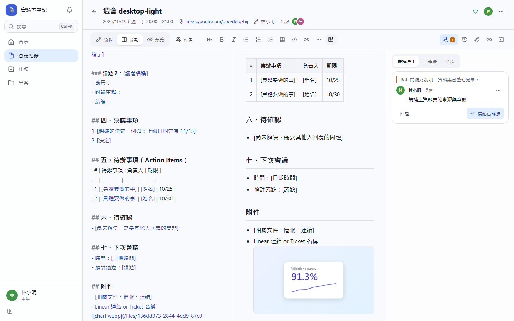
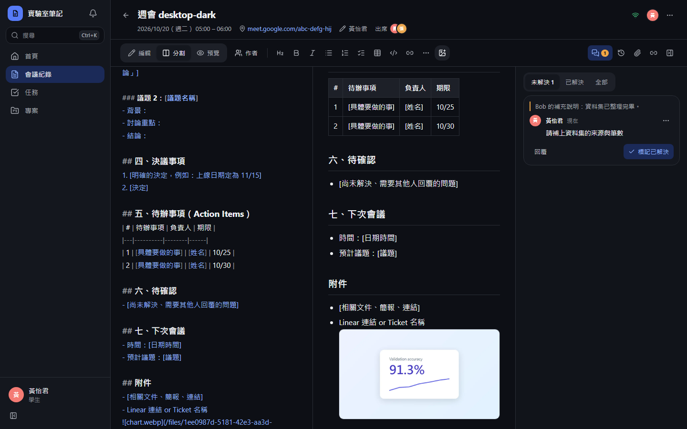
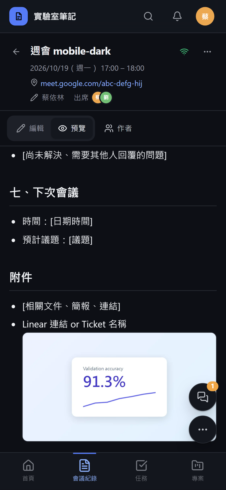

# [MS-16] 上傳圖片並顯示在內文中

> 狀態：完成

## 內文

### 需求
學生要能把截圖、照片放進會議紀錄，和 Markdown 內文一起顯示。

### 來源
使用者 2026-10-19 對話（初始需求）；設計：`design/02-architecture.md` §5；待確認 #5

### 驗收條件
- [x] 支援三種方式：工具列按鈕、貼上、拖放；可一次多張
- [x] 上傳中在游標處顯示佔位與進度，完成後換成圖片；失敗顯示原因與重試，不留下壞掉的圖片語法
- [x] 上傳前在瀏覽器壓縮（長邊 2560px）；GIF 保留動畫
- [x] 預覽中圖片與文字一起顯示，點擊放大檢視，可左右切換同份文件的圖片
- [x] 圖片只有能讀這份紀錄的人看得到（直接貼網址給未授權的人會看到找不到）
- [x] 超過每人配額時顯示「儲存空間已滿（已用 X / Y）」

### 測試流程
1. 在會議紀錄貼上一張剪貼簿截圖，看到上傳進度後顯示在預覽中
2. 拖放三張照片，全部顯示，點擊可放大並左右切換
3. 上傳中斷網路，看到失敗與重試按鈕，重試成功
4. 用未登入的瀏覽器開圖片網址，得到找不到

---

# 跟其他票的關係

- Blocks：MS-18、MS-46
- Blocked by：MS-12
- Related：無

---

# Commit-1

## 內文

原本會議紀錄不能放圖。
現在可以用工具列按鈕、貼上或拖放把圖片放進內文，一次多張。上傳時在游標處先放「上傳圖片中…」佔位，完成換成圖片；失敗會移除佔位並顯示原因與「重試」，不會留下壞掉的圖片語法。上傳前在瀏覽器壓縮成 WebP、長邊 2560px，GIF 保留原檔。預覽中圖片與文字一起顯示，點擊放大並可左右切換同一份紀錄的所有圖片。圖片要能讀該紀錄才拿得到，超過個人儲存配額時顯示已用與上限。

### 測試結果

| 項目 | 結果 |
|---|---|
| E2E 插入圖片 → 預覽顯示 → 燈箱 | 通過（四種組合） |
| 整合測試：無權限讀取回 404 | 通過（由會議紀錄權限覆蓋） |

### 截圖

**圖片與內文一起顯示**

**點圖放大**

