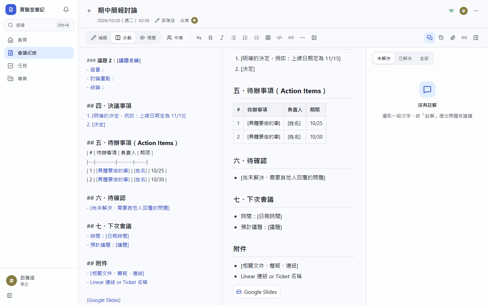
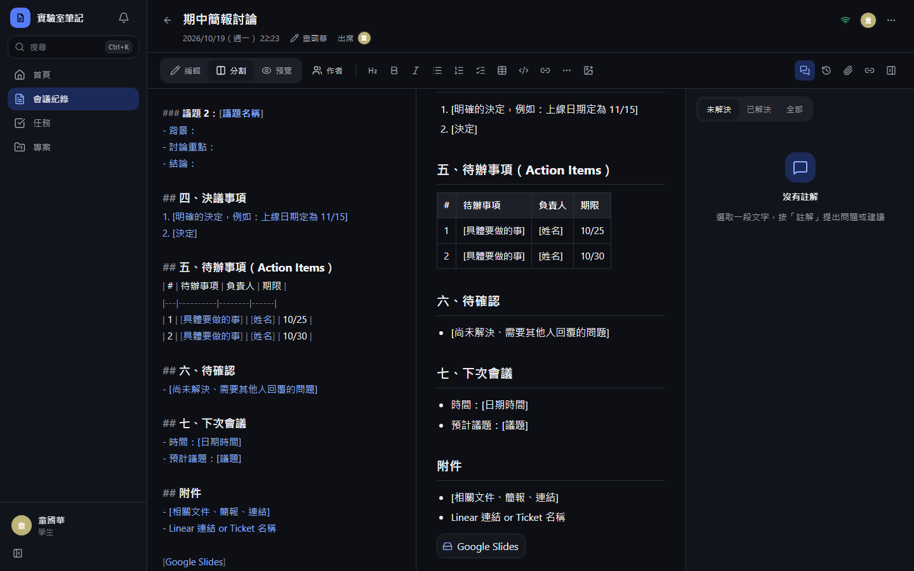
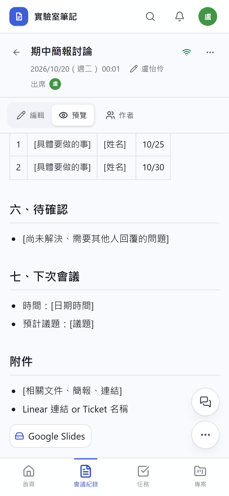
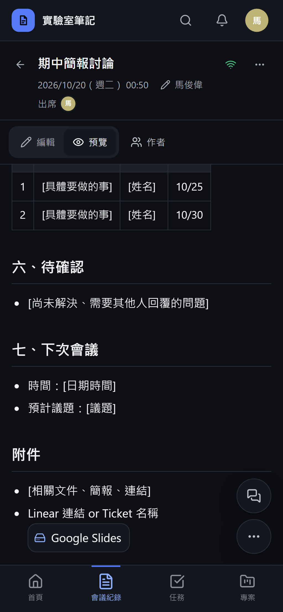
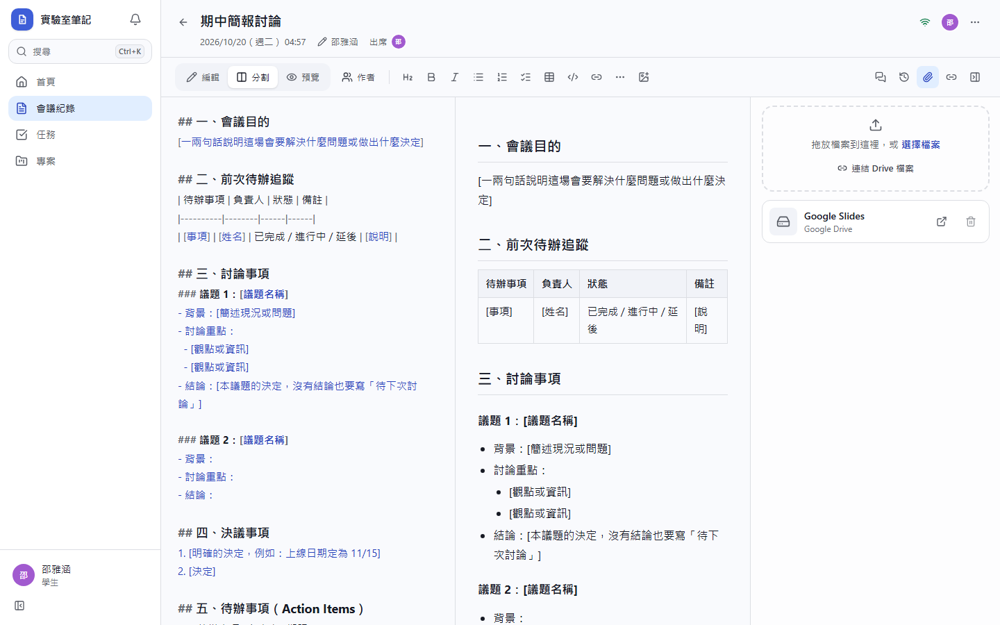
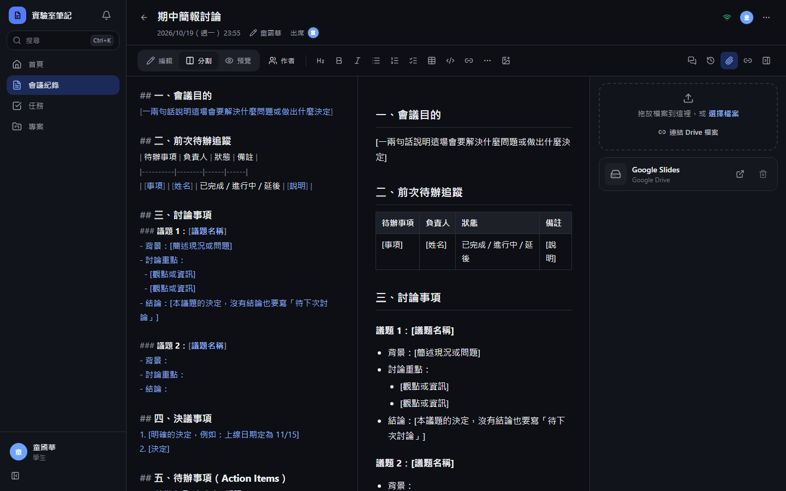
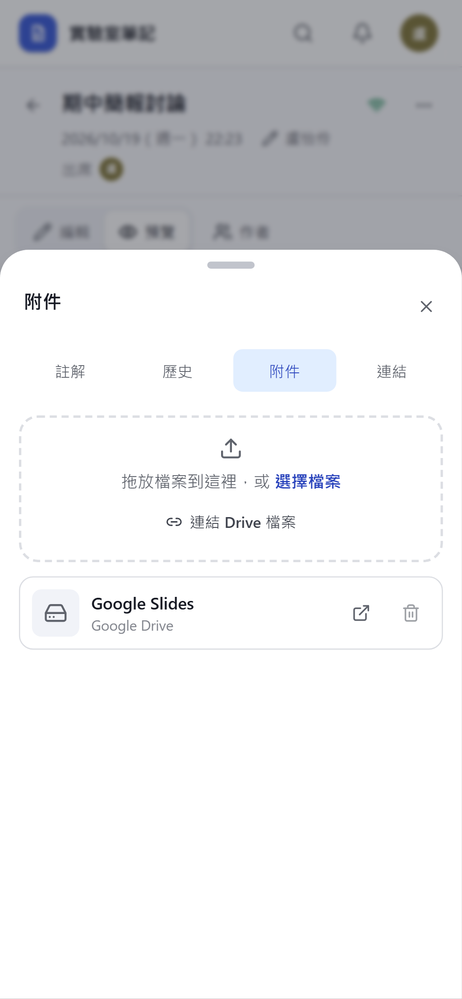
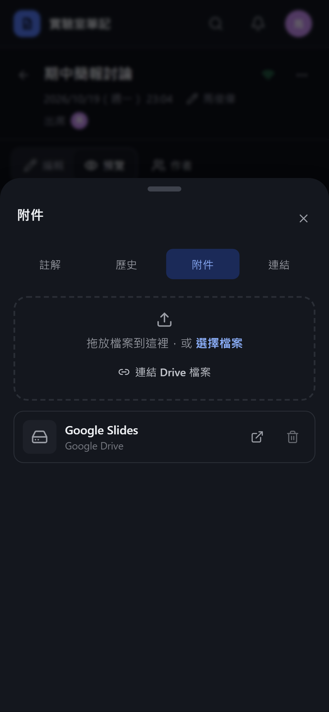

# [MS-17] 連結 Google Drive 檔案

> 狀態：進行中

## 內文

### 需求
會議用到的簡報、文件常在 Google Drive，學生要能直接選擇 Drive 檔案附到會議紀錄。

### 來源
使用者 2026-10-19 對話（初始需求）；設計：`design/02-architecture.md` §5

### 驗收條件
- [ ] 「連結 Drive 檔案」開啟 Google 檔案選擇器；第一次使用才要求授權，只要求存取「使用者選擇的檔案」
- [ ] 選擇後在附件區與內文插入檔案卡片：圖示、檔名、類型、擁有者，點擊在新分頁開啟
- [x] 平台不修改 Drive 檔案權限；看不到檔案的人點開會由 Google 顯示要求存取
- [x] 移除連結不會刪除 Drive 上的檔案
- [ ] 沒授權或授權被撤銷時顯示引導與「連結 Drive」按鈕，不顯示錯誤
- [x] 也可直接貼上 Drive 網址自動轉成檔案卡片

### 測試流程
1. 在會議紀錄按連結 Drive 檔案，授權後選一份簡報
2. 附件區與內文出現卡片，點擊開啟正確檔案
3. 在 Google 帳號撤銷授權，再按一次，看到引導而不是錯誤
4. 貼上一段 Drive 網址，自動變成卡片

---

# 跟其他票的關係

- Blocks：MS-36
- Blocked by：MS-11
- Related：無

---

# Commit-1

## 內文

原本只能在附件區貼 Drive 網址，內文裡的 Drive 連結就是一般藍字，也沒有 Google 檔案選擇器。
現在內文貼上一段 Drive 網址會自動變成檔案卡片（圖示、名稱、Google 文件／試算表／簡報等類型），同時登記為附件；點卡片在新分頁開啟，看不到的人由 Google 顯示要求存取。平台從不修改 Drive 權限，移除附件只刪除平台上的連結。站台設定了 Picker 金鑰後，附件區與議題頁會出現「從 Google Drive 選取」：第一次使用才請求授權，且只要求存取使用者在選擇器裡挑的檔案；選取後附件與內文都加入卡片並記下擁有者；未授權或授權被撤銷時顯示引導與「連結 Drive」按鈕，不跳錯誤。
驗收：在會議紀錄貼上 Google Slides 網址，內文出現卡片、附件區出現該連結、點擊在新分頁開啟、刪除後只少了平台上的連結；非 Drive 網址被拒絕。選擇器需在 Google Cloud 設定 Picker 金鑰後以真實帳號驗收（設定方式見 README），本次尚未驗證。

### 測試結果

| 項目 | 結果 |
|---|---|
| 型別檢查（tsc -b） | 0 錯誤 |
| Lint 與色碼檢查 | 0 錯誤（78 個檔案） |
| 單元／整合測試（vitest） | 通過 36 / 36 |
| 驗收測試（Playwright，Drive 規格，電腦／手機 × 深／淺） | 通過 4 / 4 |

### 截圖

**內文中的 Drive 卡片**

**附件區的 Drive 連結**

