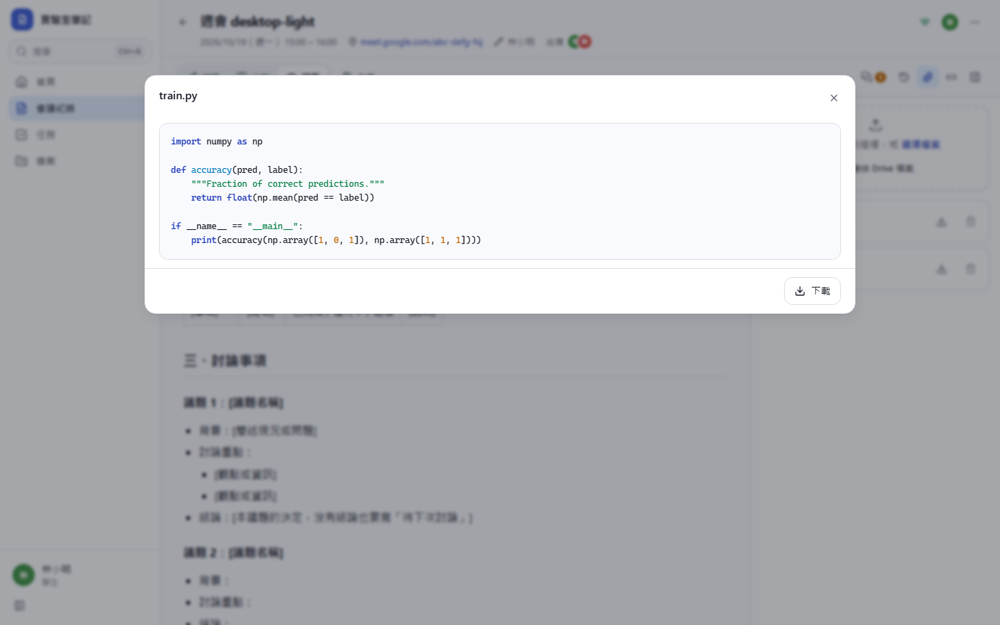
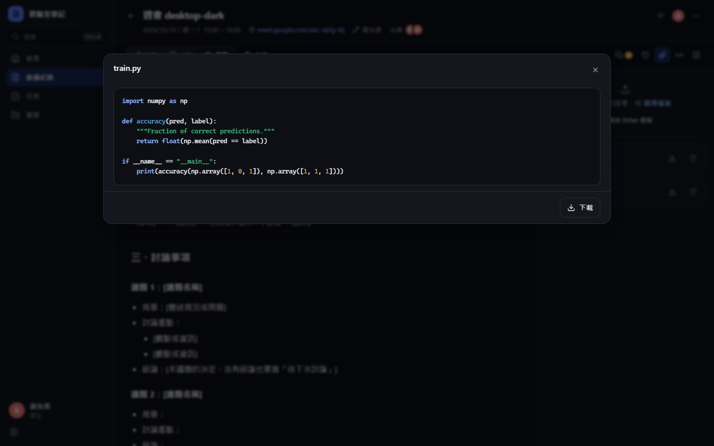
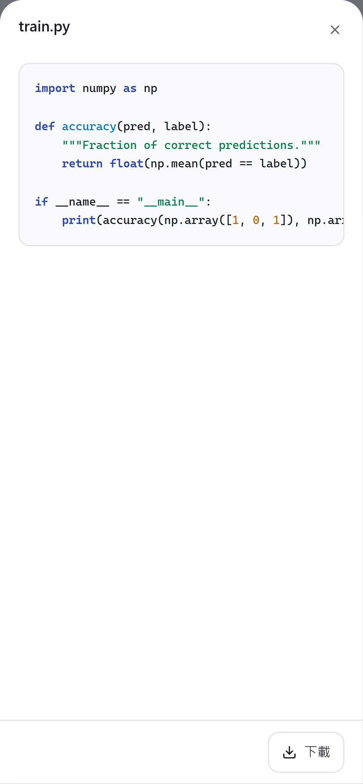
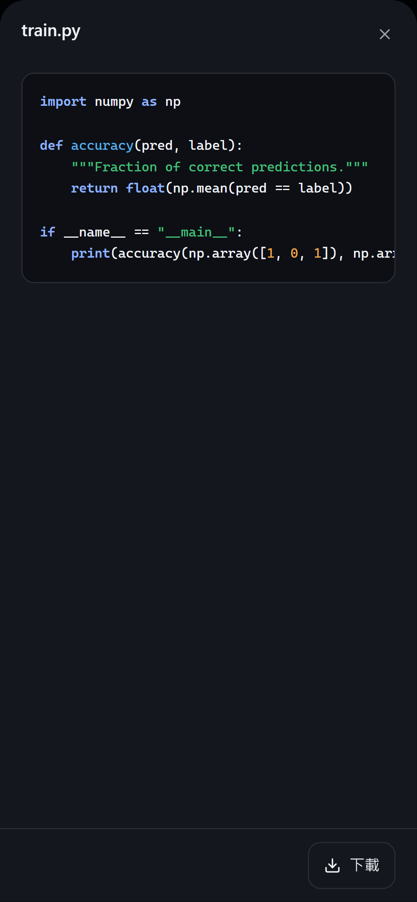

# [MS-18] 上傳檔案與程式碼附件

> 狀態：進行中

## 內文

### 需求
學生要能把一般檔案（PDF、壓縮檔、資料檔）與程式碼附到會議紀錄，程式碼可直接在頁面上看。

### 來源
使用者 2026-10-19 對話（初始需求）；設計：`design/02-architecture.md` §5；待確認 #5

### 驗收條件
- [x] 附件區支援按鈕與拖放上傳任意檔案，單檔上限 50 MB（後台可調），顯示進度、可取消
- [x] 程式碼檔（.py、.ipynb、.js、.cpp 等）可在頁內語法上色預覽；.ipynb 顯示儲存格與輸出
- [x] PDF 與圖片可在頁內預覽，其他檔案顯示圖示與下載
- [x] 上傳中斷不留下孤兒附件；失敗可重試
- [x] 附件的存取權限與會議紀錄一致
- [ ] 也可在內文以 ``` 貼上程式碼並語法上色

### 測試流程
1. 上傳一個 20 MB 的 PDF，看到進度，完成後頁內預覽
2. 上傳 .ipynb，看到儲存格與圖表輸出
3. 上傳 60 MB 檔案，被拒絕並顯示上限
4. 上傳中關閉頁面，重新開啟後附件區沒有殘留項目

---

# 跟其他票的關係

- Blocks：MS-21、MS-36
- Blocked by：MS-16
- Related：無

---

# Commit-1

## 內文

原本不能附檔。
現在附件面板支援按鈕與拖放上傳任意檔案，顯示每個檔案的進度、可取消，單檔上限 50 MB（站台設定可調）。程式碼檔語法上色預覽，.ipynb 顯示儲存格、文字輸出與圖表，PDF 與圖片頁內預覽，其他檔案直接下載。檔案先傳到儲存空間、確認成功才登記，中斷不會留下孤兒附件；失敗可重試。附件權限跟著會議紀錄。不安全的檔案類型一律以下載方式提供，不會在本站直接執行。
尚未完成：內文 ``` 程式碼區塊的語法上色。

### 測試結果

| 項目 | 結果 |
|---|---|
| E2E 上傳 .py 並語法上色預覽 | 通過（四種組合） |

### 截圖

**程式碼附件預覽**





