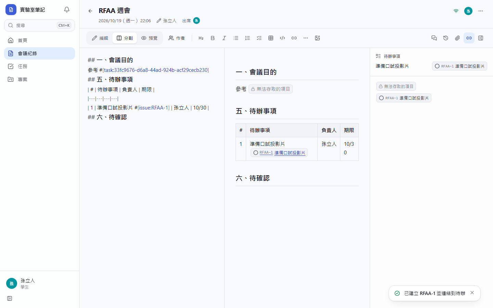
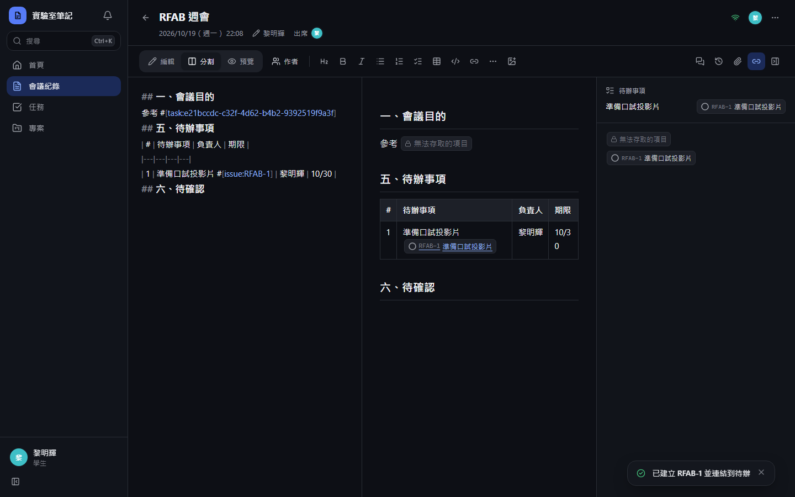
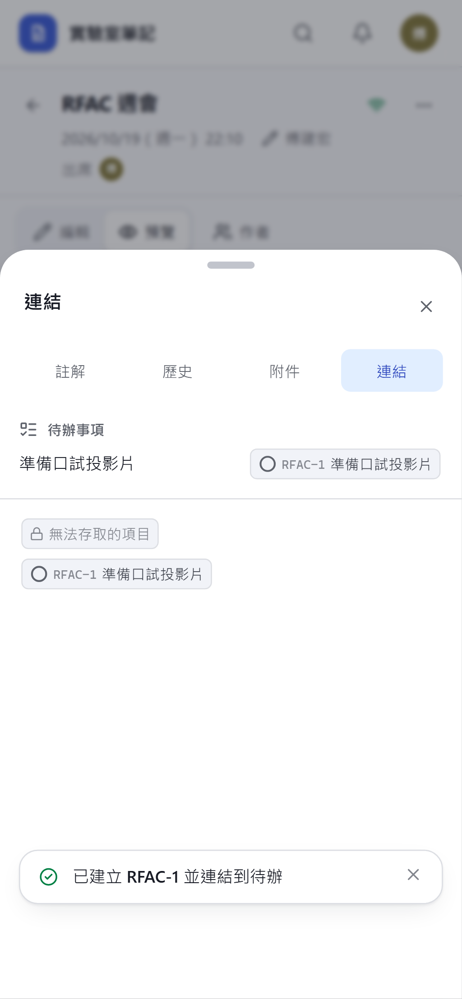
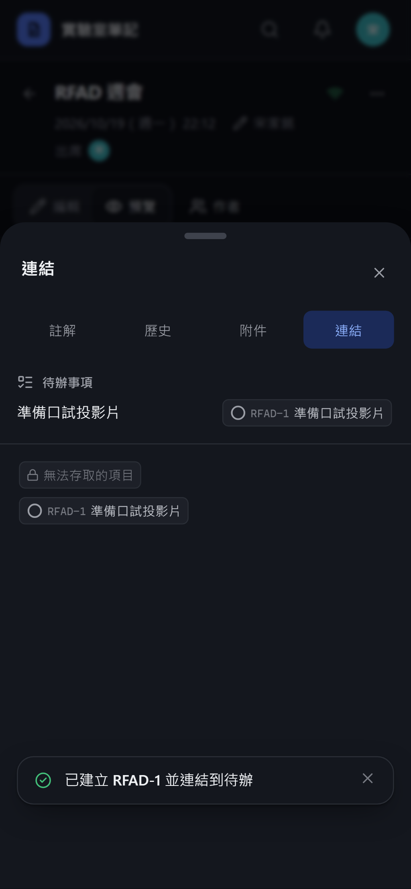
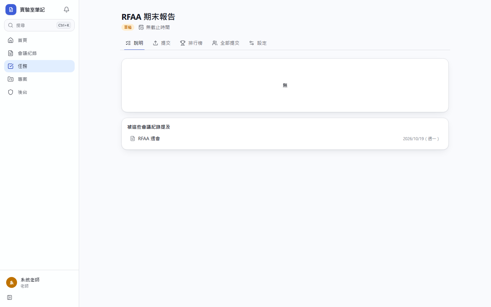
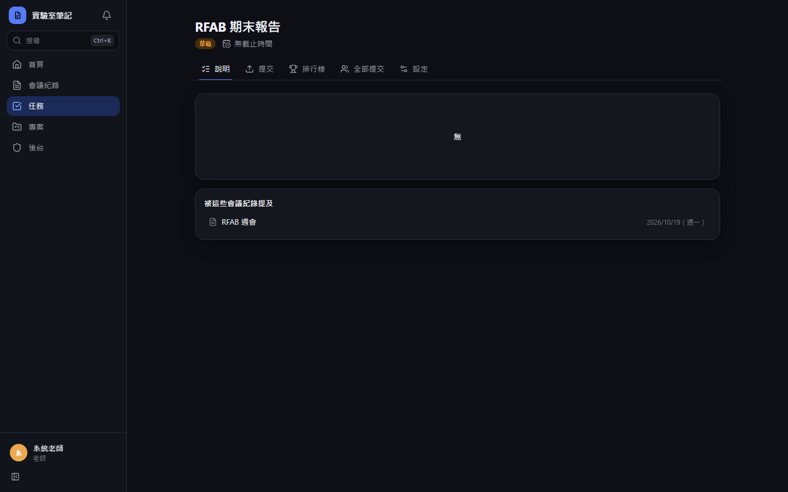
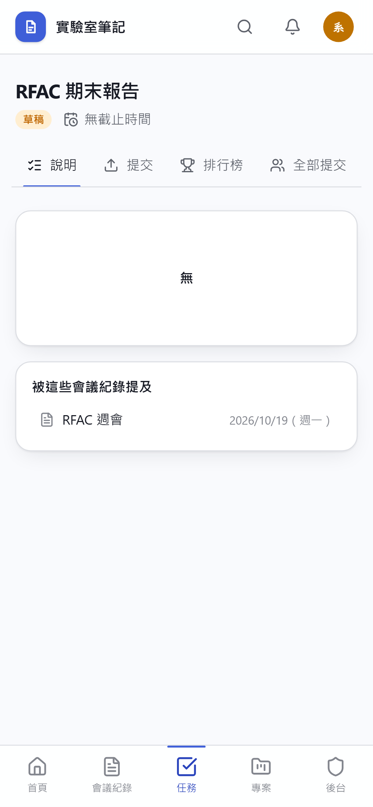
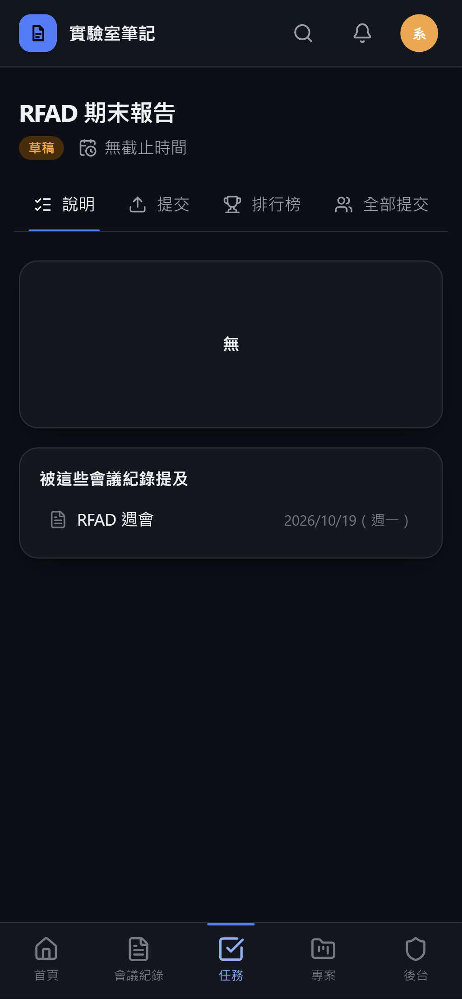

# [MS-19] 連結會議紀錄與任務、議題

> 狀態：完成

## 內文

### 需求
每週會議要能連到待辦（議題）與任務，讓討論、待辦與學生提交的成果互相追得到。

### 來源
使用者 2026-10-19 對話（初始需求）；設計：`design/03-meeting-notes.md` §3、`design/04-tasks.md` §5

### 驗收條件
- [x] 內文輸入 # 可搜尋並引用議題 `#[issue:KEY-N]` 與任務 `#[task:id]`，顯示成可點的 pill（含目前狀態）
- [x] 被引用的議題與任務頁面顯示「被哪些會議紀錄提及」
- [x] 「五、待辦事項」每列有「轉成議題」：選專案後建立議題，負責人與期限帶過去，該列自動補上議題引用；已轉過的列顯示議題狀態
- [x] 看不到的議題或任務引用，對沒權限的人顯示為「無法存取的項目」，不洩漏標題
- [x] 會議紀錄頁側邊列出本份引用到的所有議題與任務及其狀態

### 測試流程
1. 在討論事項輸入 # 搜尋並引用一張議題與一個任務
2. 打開該議題，看到「被會議紀錄提及」並可點回
3. 在待辦事項第一列按轉成議題，議題建立且負責人、期限正確
4. 用不是該專案成員的帳號開啟紀錄，引用顯示為無法存取

---

# 跟其他票的關係

- Blocks：無
- Blocked by：MS-11、MS-21、MS-27
- Related：無

---

# Commit-1

## 內文

原本會議紀錄的待辦事項只是表格文字，要另外到專案手動開票；任務也看不到被哪些會議提過。
現在內文輸入 # 可搜尋並引用議題與任務，顯示成帶狀態的 pill；沒有權限的人看到「無法存取的項目」，不會看到標題。會議紀錄「連結」面板上方列出「五、待辦事項」的每一列，按「轉成議題」選專案即建立議題，負責人（表格寫的名稱或 @ 成員）與期限（如 10/30）自動帶入，該列自動補上議題引用並改顯示議題狀態；負責人不在該專案時改建未指派議題並提示。面板下方列出本份紀錄引用到的全部議題與任務。議題與任務頁都會列出「被這些會議紀錄提及」。
驗收：範本中有一列「準備口試投影片 | 姓名 | 10/30」，按轉成議題後建立 KEY-1，負責人與截止日正確、表格該列多出 KEY-1 的 pill、按鈕消失；任務頁列出引用它的週會；學生看不到草稿任務，引用顯示為無法存取。

### 測試結果

| 項目 | 結果 |
|---|---|
| 型別檢查（tsc -b） | 0 錯誤 |
| Lint 與色碼檢查 | 0 錯誤（76 個檔案） |
| 單元／整合測試（vitest） | 通過 35 / 35 |
| 驗收測試（Playwright 全套，電腦／手機 × 深／淺） | 第一輪 32 / 36；失敗的 4 項為開發伺服器在大檔上傳時斷線與成員列表分頁（測試本身問題），修正測試後該 3 個規格重跑 16 / 16 通過 |

### 截圖

**待辦事項轉成議題**

**任務頁的被提及列表**

