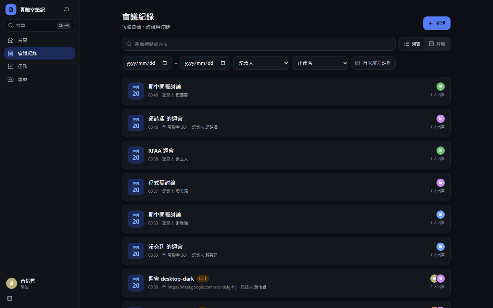
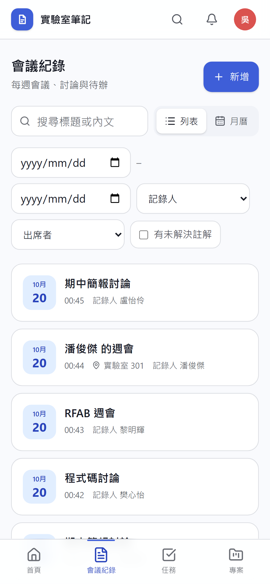
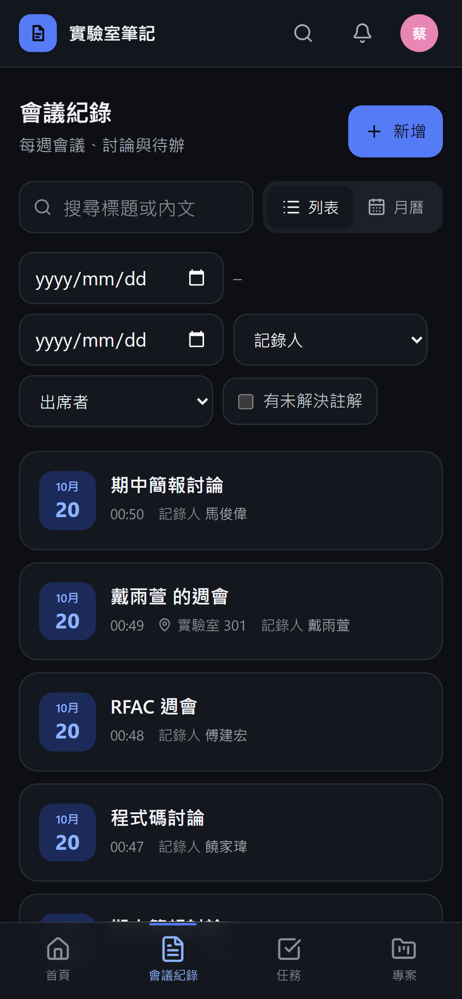
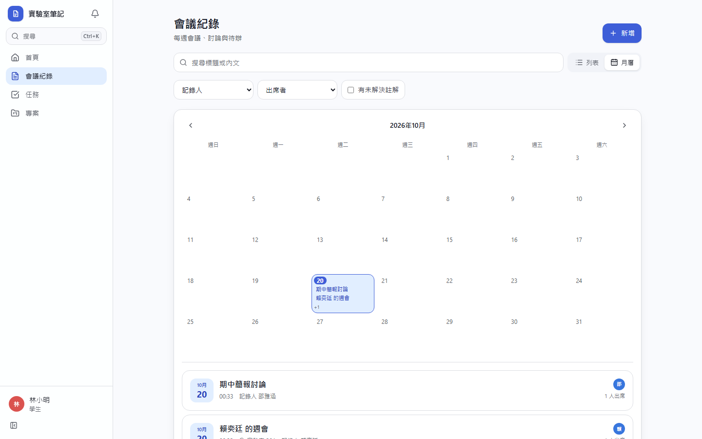
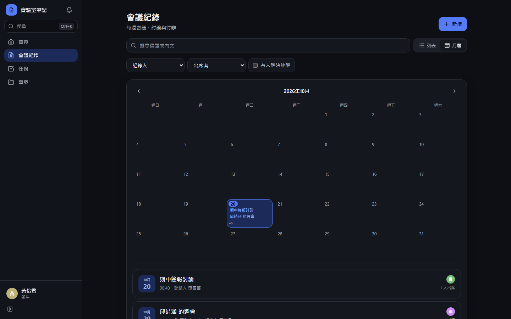
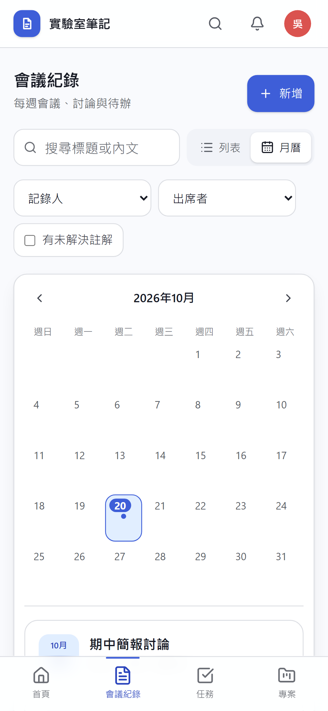
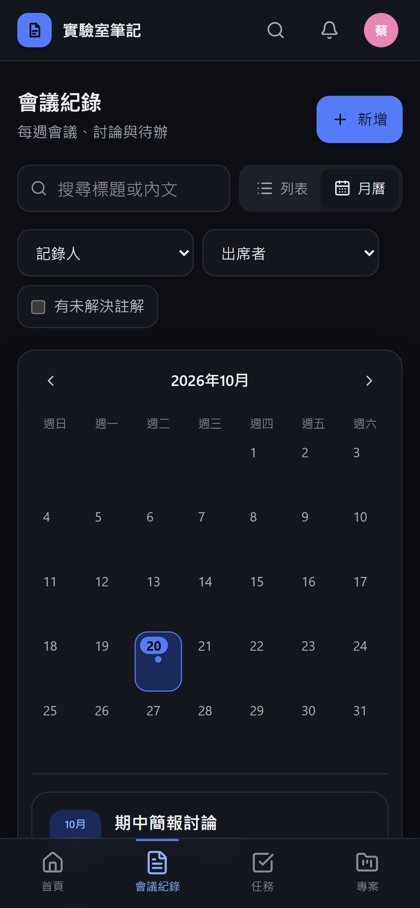

# [MS-20] 瀏覽與搜尋會議紀錄

> 狀態：完成

## 內文

### 需求
會議紀錄多了以後，要能快速找到某一份或某一段內容。

### 來源
使用者 2026-10-19 對話（初始需求）

### 驗收條件
- [x] 列表依日期排序，顯示名稱、日期、記錄人、出席人數、未解決註解數
- [x] 可篩選：日期範圍、專案、記錄人、出席者、有未解決註解；篩選狀態寫在網址，重新整理與分享可還原
- [x] 全文搜尋標題與內文，結果標示命中的片段
- [x] 提供月曆檢視，點日期看當天的會議
- [x] 列表分頁載入，1000 份紀錄仍順暢
- [x] 只列出使用者有權限讀取的紀錄，分頁數量正確

### 測試流程
1. 建立 3 份不同日期與專案的紀錄
2. 篩選某專案，網址更新；複製網址到另一分頁，顯示相同結果
3. 搜尋內文中的一個詞，結果標示命中片段
4. 切換月曆檢視，點日期看到該日會議

---

# 跟其他票的關係

- Blocks：MS-42
- Blocked by：MS-11
- Related：無

---

# Commit-1

## 內文

原本沒有會議紀錄列表。
現在列表依日期排序，顯示名稱、日期、時間、地點、記錄人、出席人數與未解決註解數。可依日期範圍、記錄人、出席者、有未解決註解篩選，篩選與頁碼都寫在網址；搜尋標題與內文並顯示命中片段；月曆檢視點日期看當天的會議。只列出使用者讀得到的紀錄，總數也只算這些。
尚未完成：依專案篩選（隨專案票交付）、1000 份紀錄的效能量測。

### 測試結果

| 項目 | 結果 |
|---|---|
| E2E 列表與月曆（四種組合） | 通過 |

### 截圖

**列表**

**月曆**

# Commit-2

## 內文

補驗收：會議紀錄列表每頁 20 份並顯示總數，45 份紀錄時第 3 頁只剩 5 份、總數正確；大量紀錄只載入目前頁面。

### 測試結果

| 項目 | 結果 |
|---|---|
| 型別檢查（tsc -b） | 0 錯誤 |
| Lint 與色碼檢查 | 0 錯誤（81 個檔案） |
| 單元／整合測試（vitest） | 通過 42 / 42 |
| 驗收測試（Playwright 全套，電腦／手機 × 深／淺） | 通過 56 / 56 |

### 截圖

無畫面變更
