# [MS-21] 讓老師建立任務與評測設定

> 狀態：完成

## 內文

### 需求
老師、學長要能出任務：寫說明、設期限、上傳評測程式與資料，並先試跑確認評測正確再發布給學生。

### 來源
使用者 2026-10-19 對話（初始需求）；設計：`design/04-tasks.md` §1、§2、§4；待確認 #7

### 驗收條件
- [x] 管理員可建立任務：標題、說明（Markdown 可放圖）、開始與截止時間、可見對象（全站或指定專案）、提交格式、檔案上限、每日提交上限、是否開放排行榜、分數方向
- [x] 評測設定：上傳評測程式與隱藏資料、選執行環境與需求套件、時間與記憶體上限；評測程式合約說明在頁面上可展開查看
- [x] 必須用範例提交試跑成功才能發布；試跑結果顯示分數、訊息與執行紀錄
- [x] 發布後可修改說明與截止時間；改評測程式時可選擇「重新評測全部提交」並顯示預估耗用分鐘數
- [x] 建立／發布／修改都記活動
- [x] 設定頁切成 Tab：說明、評測、提交規則、預覽，單頁不擁擠
- [x] 學生看不到評測程式與隱藏資料

### 測試流程
1. 管理員建立任務、上傳評測程式，用範例提交試跑，看到分數
2. 試跑失敗時「發布」按鈕不可按，hover 顯示原因
3. 發布後學生帳號看到任務與說明，但看不到評測程式
4. 修改評測程式並選擇重新評測全部，所有提交重新跑過

---

# 跟其他票的關係

- Blocks：MS-19、MS-22
- Blocked by：MS-8、MS-18
- Related：無

---

# Commit-1

## 內文

原本沒有任務功能。
現在老師與學長可以在任務列表按「新增任務」，設定頁分成「說明／評測／提交規則／試跑與發布」四個 Tab：說明支援 Markdown 與貼上截圖，並即時預覽；評測可上傳評測程式（.py 或 .zip）與隱藏資料，設定 Docker 映像檔、需要的套件、時間與記憶體上限，並附評測程式合約說明；提交規則可設檔案或程式碼、允許的副檔名、檔案上限、每日上限、排行榜與分數方向。發布前必須用範例提交試跑並通過，否則「發布」按鈕不能按；改了評測設定會清除試跑結果，並可選擇重新評測所有提交。學生拿不到評測程式、隱藏資料與套件清單。
尚未驗證：已發布任務改評測程式後「重新評測全部」的完整流程與預估耗時顯示。

### 測試結果

| 項目 | 結果 |
|---|---|
| 整合測試：未試跑不能發布、試跑通過後可發布 | 通過 |
| 整合測試：學生看不到評測程式 id、讀評測程式檔回 404 | 通過 |
| E2E 出題 → 上傳評測程式 → 試跑 → 發布 | 通過（四種組合） |

### 截圖

**任務說明設定**

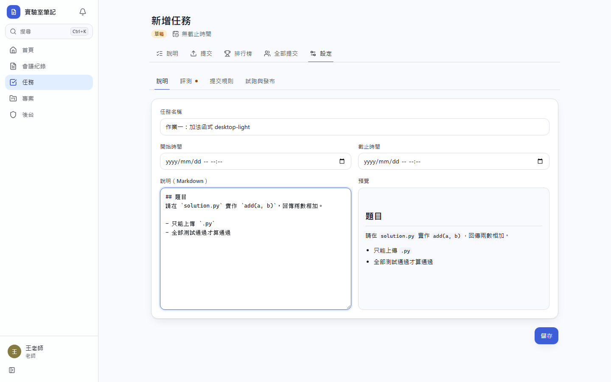
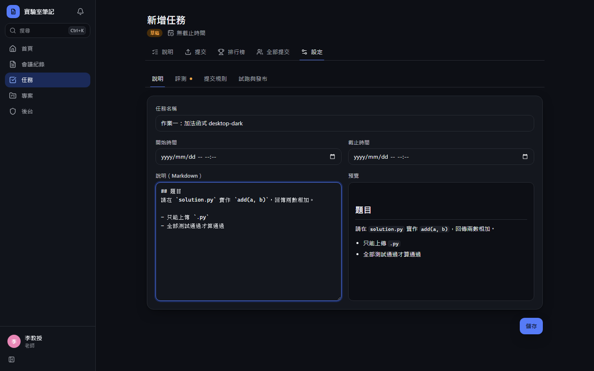
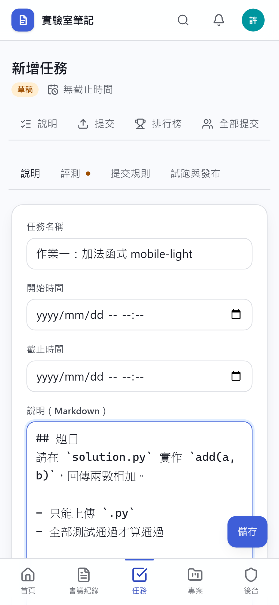
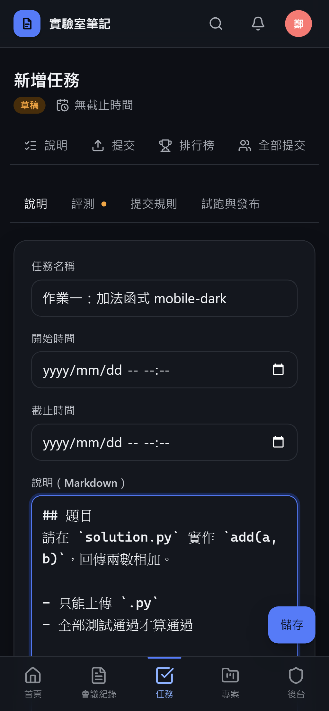

**評測設定**

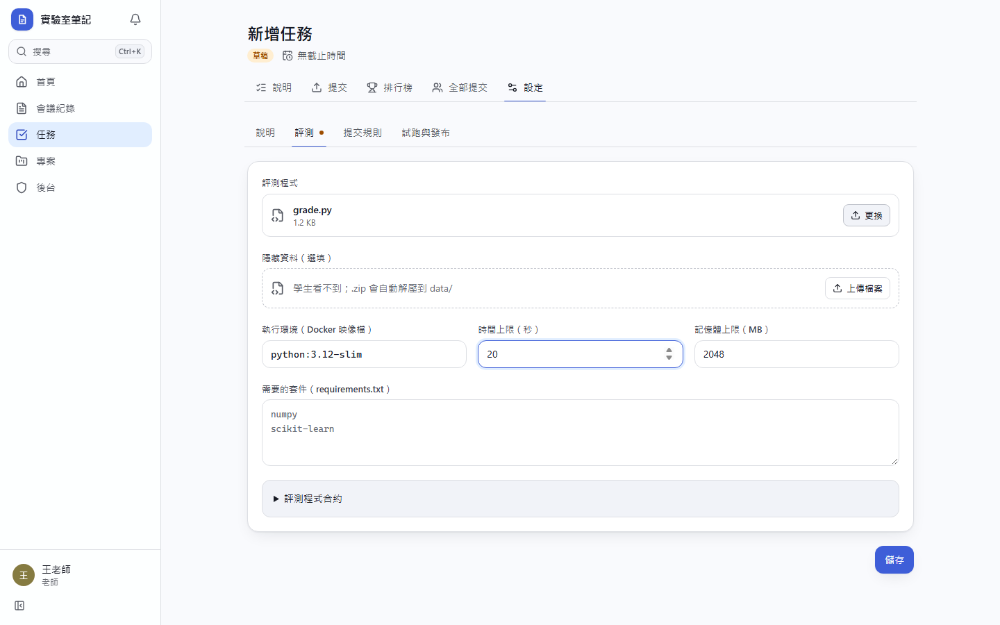
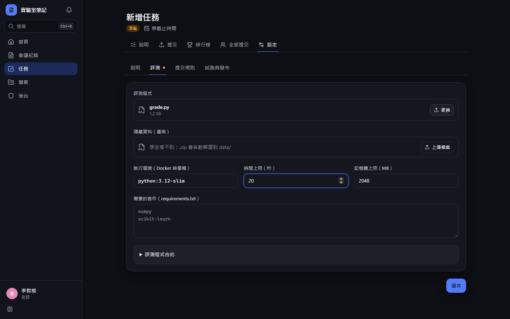
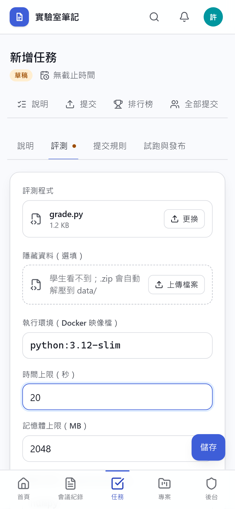
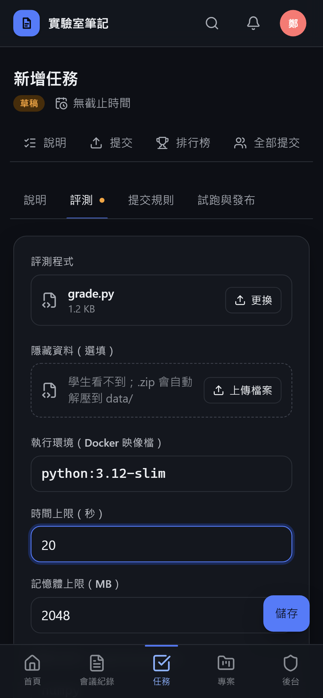

**試跑通過後可發布**

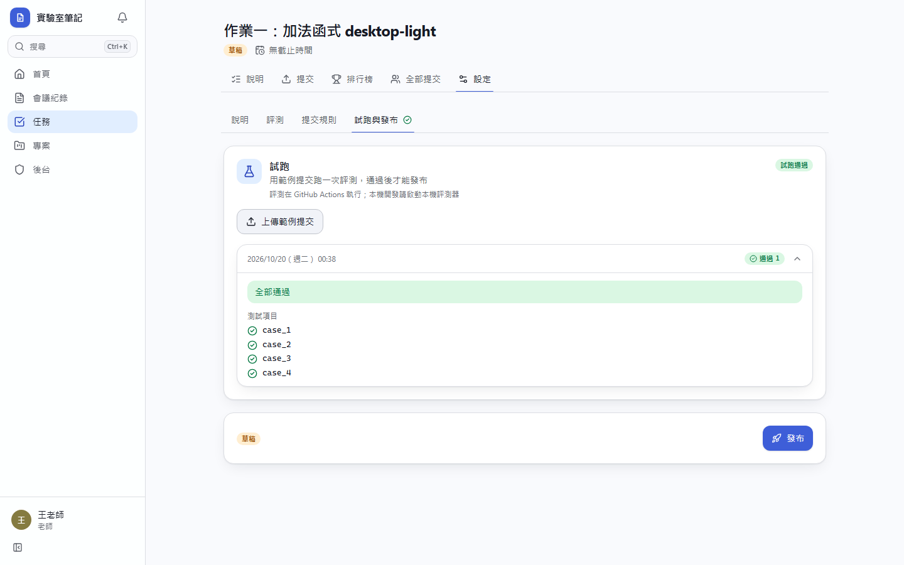
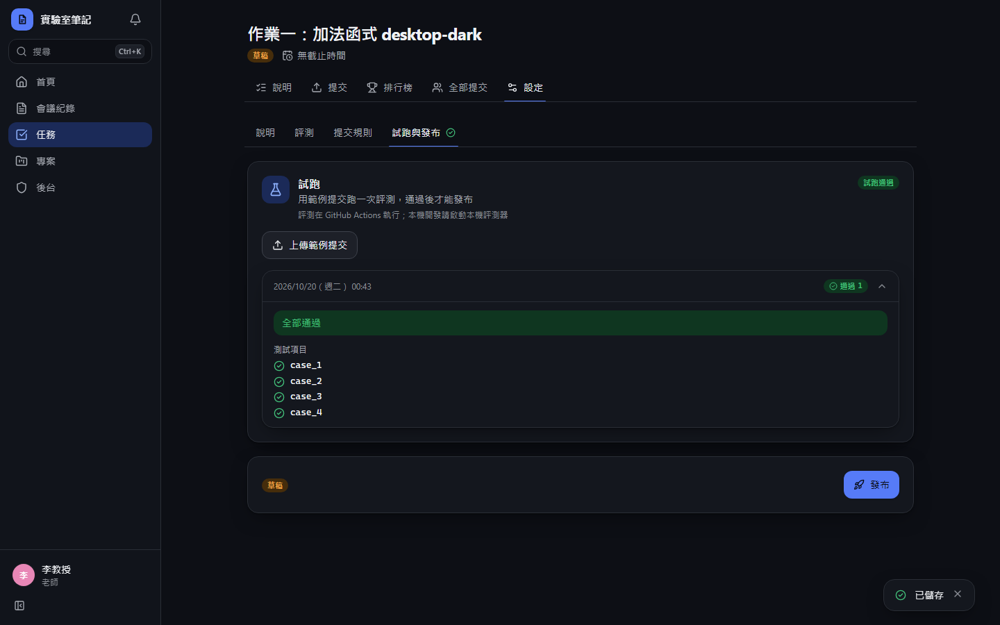
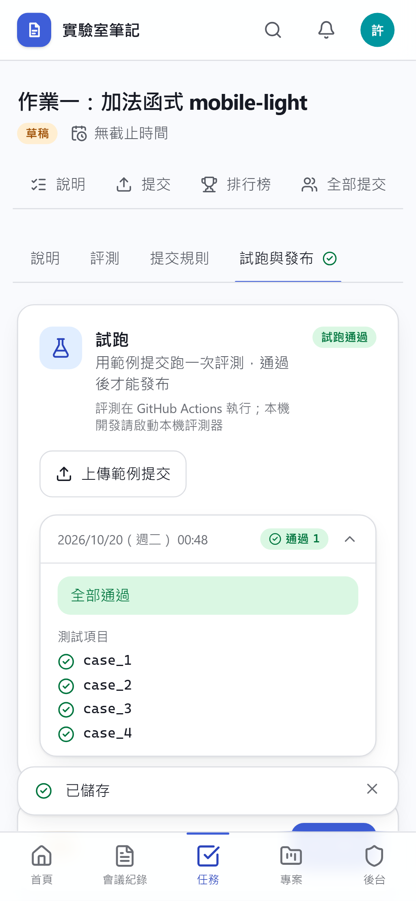
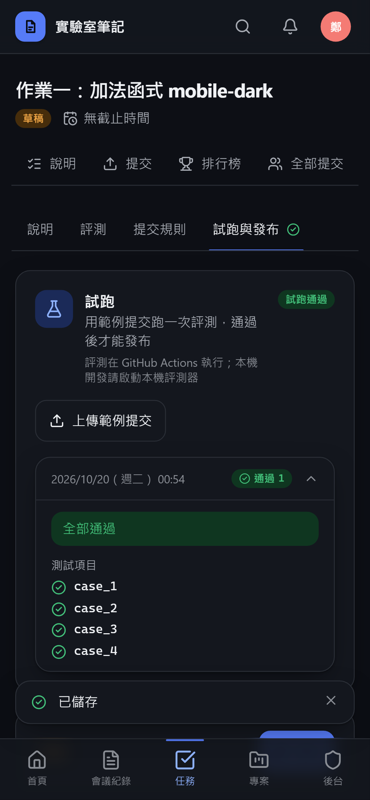

# Commit-2

## 內文

原本改了評測程式按「重新評測全部提交」時，只顯示份數。
現在確認視窗會依過去評測的平均時間估算這次會用掉多少分鐘 GitHub Actions；任務發布後仍可修改說明與截止時間。

### 測試結果

| 項目 | 結果 |
|---|---|
| 型別檢查（tsc -b） | 0 錯誤 |
| Lint 與色碼檢查 | 0 錯誤（81 個檔案） |
| 單元／整合測試（vitest） | 通過 42 / 42 |
| 驗收測試（Playwright 全套，電腦／手機 × 深／淺） | 通過 56 / 56 |

### 截圖

無畫面變更
