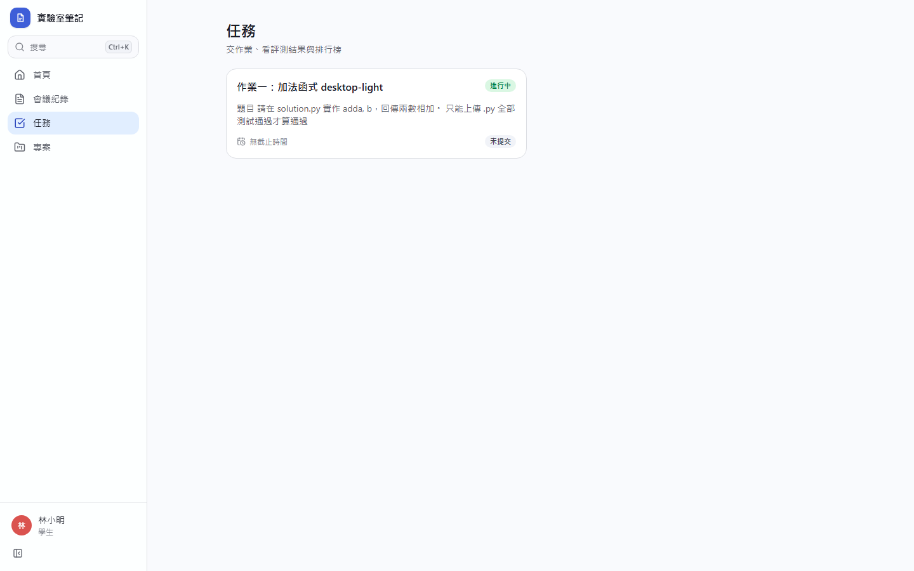
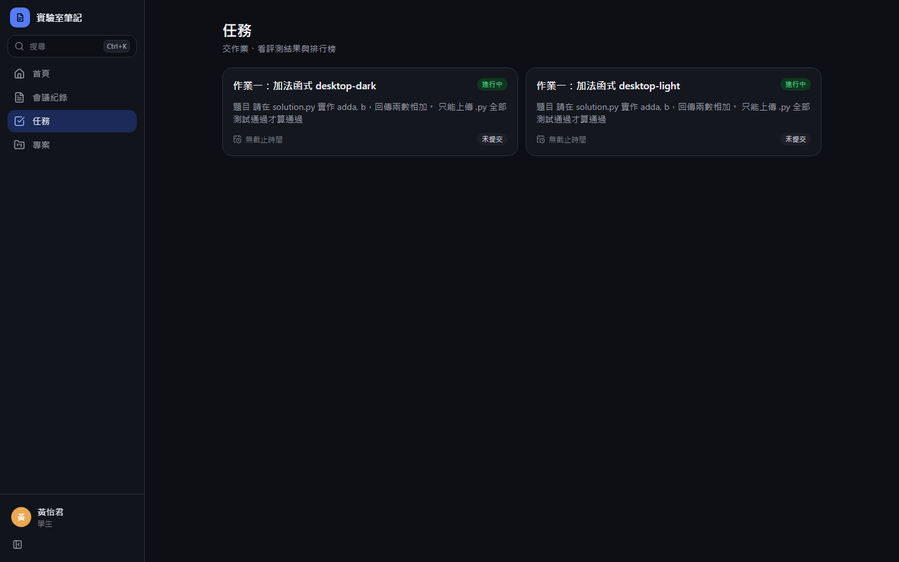
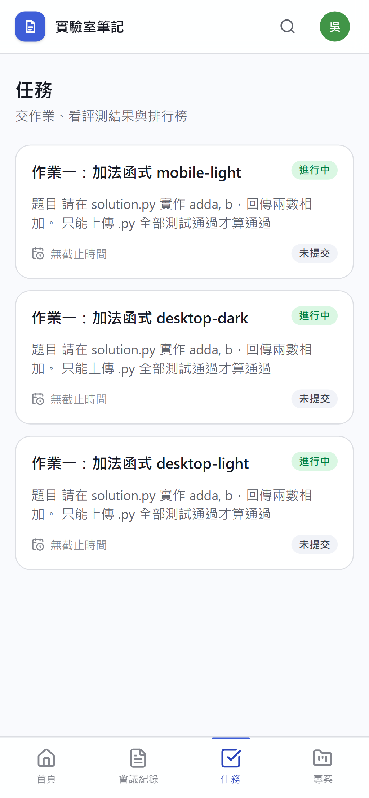
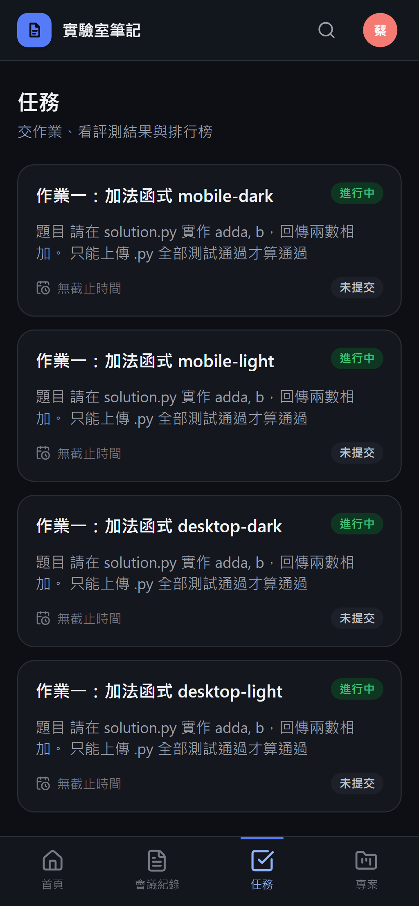
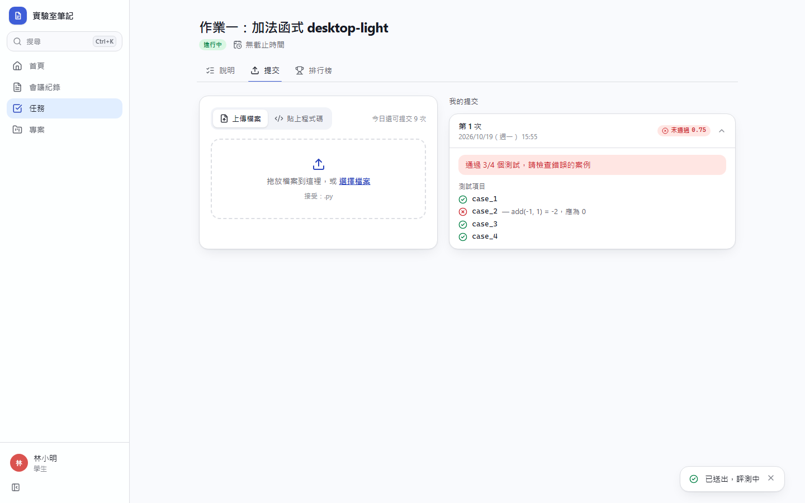
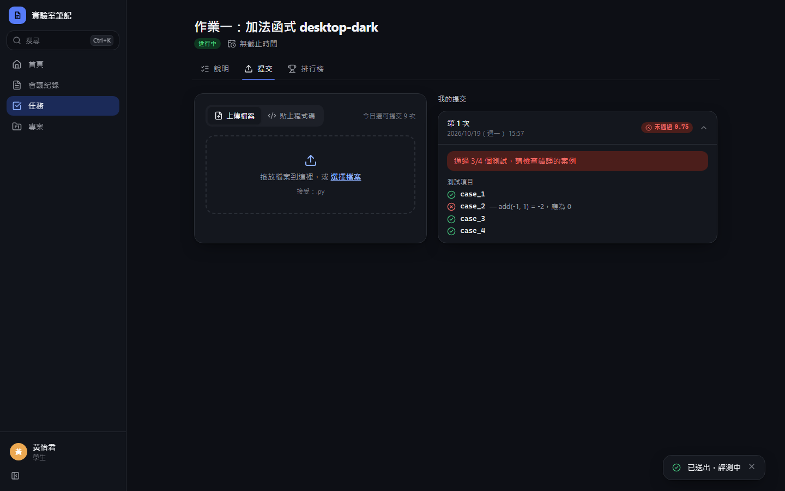
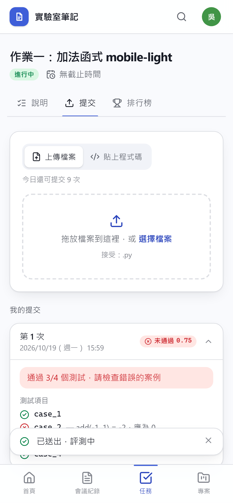
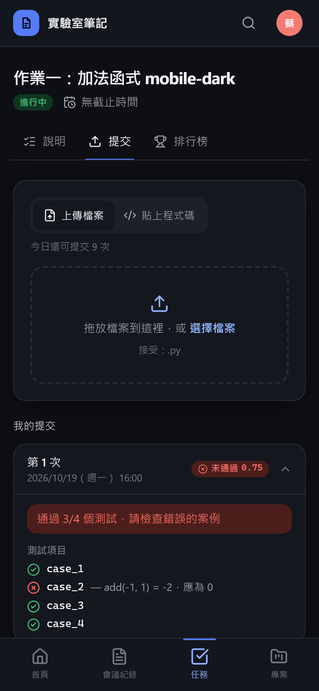

# [MS-22] 讓學生提交任務

> 狀態：完成

## 內文

### 需求
學生要能上傳檔案或貼上程式碼來提交任務，並即時看到評測進度與結果。

### 來源
使用者 2026-10-19 對話（初始需求）；設計：`design/04-tasks.md` §3

### 驗收條件
- [x] 任務頁可上傳檔案（依任務允許的格式）或貼上程式碼提交
- [x] 提交後狀態即時更新：排隊中 → 執行中 → 通過／未通過／錯誤／逾時，不需重新整理
- [x] 未通過時清楚顯示原因（評測程式的訊息、各測試項目結果）與截斷後的執行紀錄
- [x] 超過截止時間、超過每日上限、格式不符時無法提交，並說明原因與下次可提交時間
- [x] 學生只看得到自己的提交
- [x] 任務列表顯示每個任務的狀態：未提交／已通過／未通過、最佳分數、截止倒數

### 測試流程
1. 學生上傳一份正確的提交，看到狀態依序變化，最後顯示通過與分數
2. 上傳一份錯誤的提交，看到未通過與具體原因
3. 當日提交達上限後再提交，被拒絕並顯示可再提交的時間
4. 另一位學生看不到第一位學生的提交

---

# 跟其他票的關係

- Blocks：MS-23、MS-42、MS-44
- Blocked by：MS-21
- Related：無

---

# Commit-1

## 內文

原本學生沒有地方交作業。
現在任務頁「提交」Tab 可拖放或選擇檔案（依任務允許的副檔名），也可直接貼上程式碼。送出後狀態每 2 秒自動更新：排隊中 → 執行中 → 通過／未通過／錯誤／逾時，完成時最新一筆自動展開，顯示評測程式給的原因、每個測試項目的結果與執行紀錄。超過截止時間、每日上限或格式不符時會被擋下並說明原因與可再提交的時間。學生只看得到自己的提交。任務列表顯示每個任務的開放狀態、截止倒數與自己的最佳成績。

### 測試結果

| 項目 | 結果 |
|---|---|
| 整合測試：每日上限、只看得到自己的提交 | 通過 |
| E2E 提交錯誤解答 → 顯示 3/4 與錯誤案例；提交正確解答 → 通過 | 通過（四種組合） |

### 截圖

**任務列表**

**未通過的原因與測試項目**

