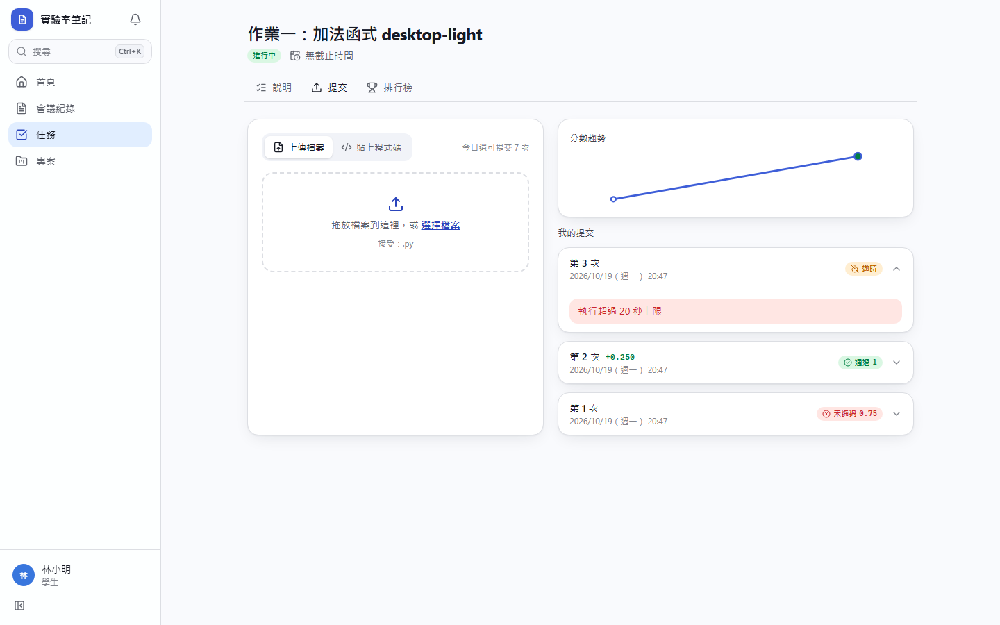
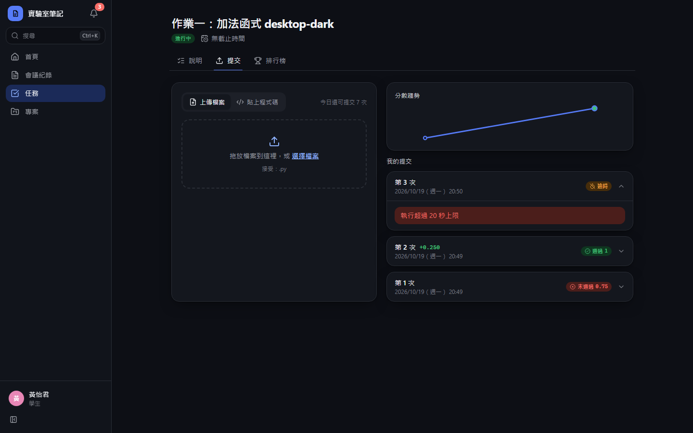
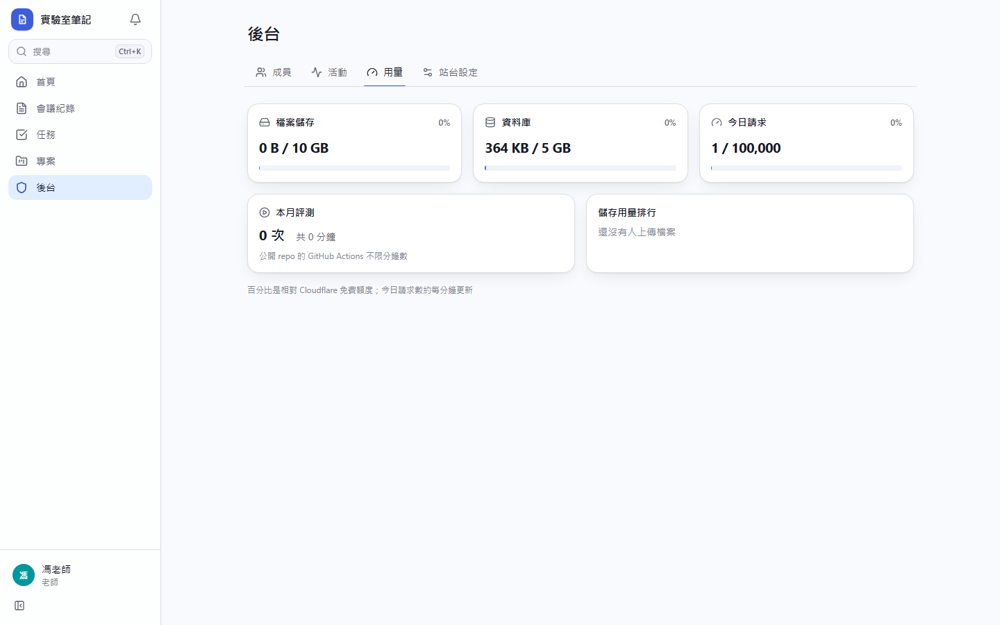
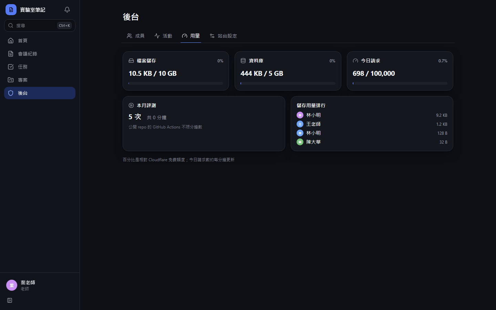
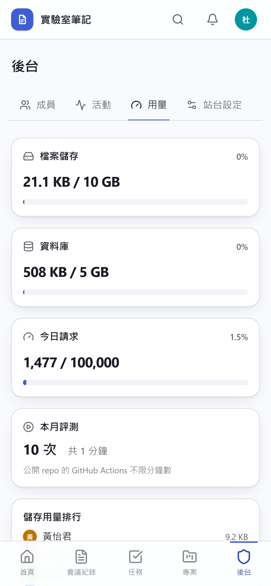
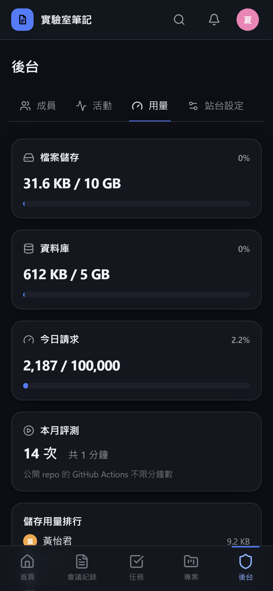

# [MS-23] 用 GitHub Actions 評測提交

> 狀態：進行中

## 內文

### 需求
提交的程式碼要在隔離環境中執行並自動評分，結果可信、不可被學生偽造，成本維持在免費額度內。

### 來源
使用者 2026-10-19 對話（初始需求）；設計：`design/02-architecture.md` §6；決策：GitHub Actions

### 驗收條件
- [x] 每次提交自動觸發一次評測，結果自動回寫到平台
- [x] 學生程式在無網路、無任何秘密的環境中執行，有時間與記憶體上限
- [x] 評測結果只接受經 GitHub 簽章驗證、來自指定 repo 與 workflow 的回報；偽造的回報被拒絕並記 log
- [x] 評測程式沒產出結果、格式錯誤、逾時、記憶體超限時，平台判為錯誤或逾時並寫明具體原因
- [x] 超過時限沒回報的工作由排程標記為逾時，不會永遠卡在執行中
- [x] 公開的 Actions log、workflow 輸入、artifact 中沒有任何學生程式、輸出、分數或秘密（只有工作 id 與耗時）
- [x] 後台看得到本月評測次數與總耗時
- [x] 有一份文件說明如何設定觸發評測用的 GitHub 權杖與 workflow 權限
- [x] 本機開發不需 GitHub 也能跑完整評測流程

### 測試流程
1. 提交一份正確程式，在 GitHub Actions 看到工作執行，平台顯示通過
2. 提交一份會嘗試連網的程式，執行時無法連網
3. 提交無窮迴圈程式，超過時間上限被判逾時並顯示原因
4. 用 curl 偽造一筆評測回報，平台拒絕

---

# 跟其他票的關係

- Blocks：MS-24、MS-25、MS-41、MS-45
- Blocked by：MS-22
- Related：無

---

# Commit-1

## 內文

原本沒有自動評測。
現在每次提交都會自動排入評測：正式環境呼叫本 repo 的 GitHub Actions workflow（公開 repo 分鐘數不限），workflow 輸入只有工作 id 與站台網址；runner 用 GitHub OIDC 憑證向平台領取評測程式與提交、回報結果，平台只接受發行者、repo、workflow 都正確的憑證，偽造的回報一律拒絕。學生程式在沒有網路、沒有秘密、限制 CPU／記憶體／時間的 Docker 容器中執行，log 不會印出任何學生程式、輸出或分數。評測程式沒產生結果、格式錯誤、逾時、記憶體超限都會判為錯誤或逾時並寫明原因；30 分鐘沒開始或超時沒回報的工作由排程標記逾時。本機開發用同一支 runner 的本機模式，不需要 GitHub（README 說明 GitHub 權杖設定）。
本次在本機以「無 Docker」開發模式驗證（這台機器的 Docker Desktop 未能啟動）；GitHub Actions 上的實際執行與 Docker 隔離尚未實測。尚未完成：後台本月評測次數與耗時。

### 測試結果

| 項目 | 結果 |
|---|---|
| 整合測試：沒有憑證或偽造的 OIDC 憑證回報被拒（401） | 通過 |
| E2E 無窮迴圈 → 「執行超過 20 秒上限」 | 通過（電腦版兩種主題） |
| E2E 本機 runner 完整評測流程 | 通過（四種組合） |

### 截圖

**逾時的提交**

# Commit-2

## 內文

原本後台看不到評測用了多少。
「後台 → 用量」現在顯示本月評測次數與總耗時（分鐘），並註明公開 repo 的 GitHub Actions 不限分鐘數。

### 測試結果

| 項目 | 結果 |
|---|---|
| 型別檢查（tsc -b） | 0 錯誤 |
| Lint 與色碼檢查 | 0 錯誤（73 個檔案） |
| 單元／整合測試（vitest） | 通過 34 / 34 |
| 驗收測試（Playwright，電腦／手機 × 深／淺） | 通過 32 / 32 |

### 截圖

**用量**

