# [MS-24] 顯示提交歷史與排行榜

> 狀態：完成

## 內文

### 需求
學生要能看自己的歷次提交與進步；開放排行榜的任務要能看到大家的最佳成績，老師要能看全部提交的整體狀況。

### 來源
使用者 2026-10-19 對話（初始需求）；設計：`design/04-tasks.md` §2、§3

### 驗收條件
- [x] 學生：提交歷史列表（時間、狀態、分數），可比較兩次提交的分數與各測項差異；分數趨勢圖
- [x] 排行榜（任務有開放時）：每人只顯示最佳成績，依分數方向排序，同分以較早提交者優先，標示自己的名次
- [x] 管理員：所有提交列表、每人最佳成績、未通過原因統計、未提交名單；可下載提交檔與匯出 CSV
- [x] 排行榜與列表分頁載入
- [x] 名稱跟隨改名即時更新

### 測試流程
1. 三位學生各提交數次不同分數
2. 排行榜每人只出現一次且排序正確
3. 學生打開提交歷史看到分數趨勢圖
4. 管理員看到未提交名單並匯出 CSV

---

# 跟其他票的關係

- Blocks：無
- Blocked by：MS-23
- Related：無

---

# Commit-1

## 內文

原本看不到提交紀錄與成績比較。
現在學生的提交 Tab 有分數趨勢圖（最佳分數以綠點標示）與歷次提交，每筆顯示與上一次的分數差。開放排行榜的任務每人只列最佳成績，依分數方向排序、同分以較早提交者優先，自己的那列會標示。老師的「全部提交」Tab 有每人最佳成績、未通過原因統計、未提交名單、所有提交（可下載提交檔），以及 CSV 匯出。名稱跟著改名即時更新。
尚未完成：排行榜與提交列表的分頁（目前一次最多 500 筆）。

### 測試結果

| 項目 | 結果 |
|---|---|
| 整合測試：排行榜每人只取最佳、排序正確 | 通過 |
| E2E 提交歷史、排行榜、老師總覽 | 通過（四種組合） |

### 截圖

**提交歷史與分數趨勢**

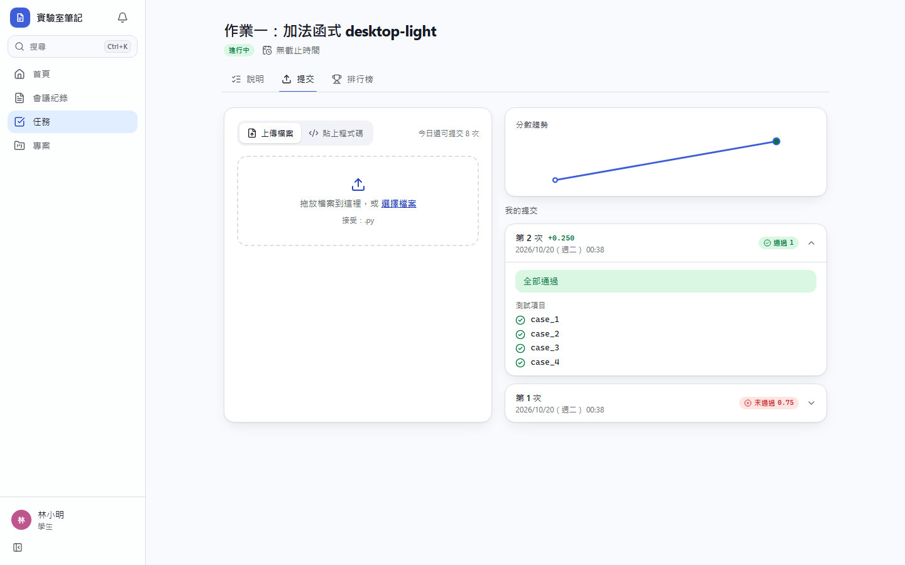
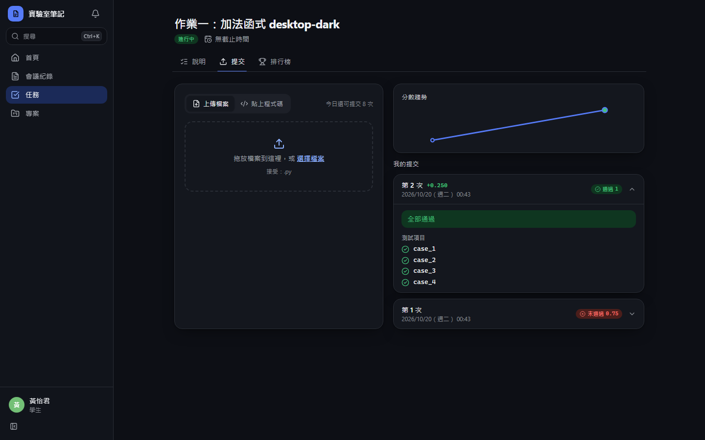

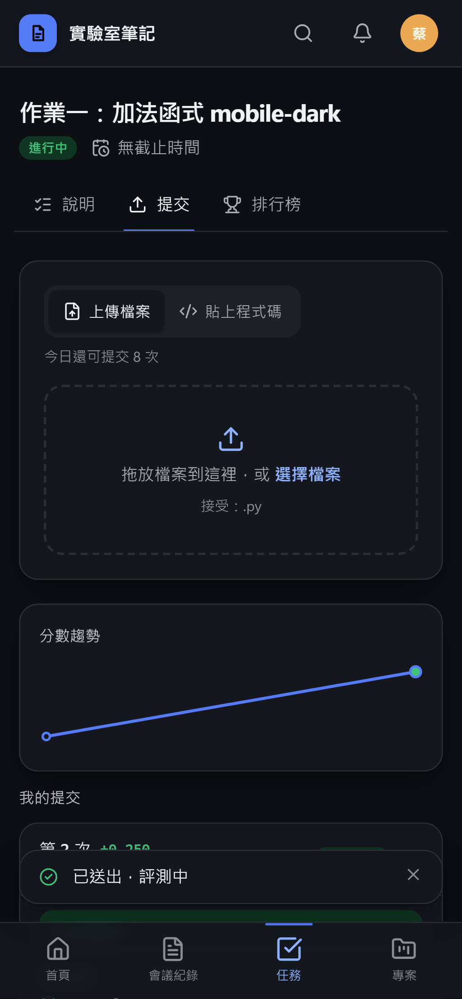

**排行榜**

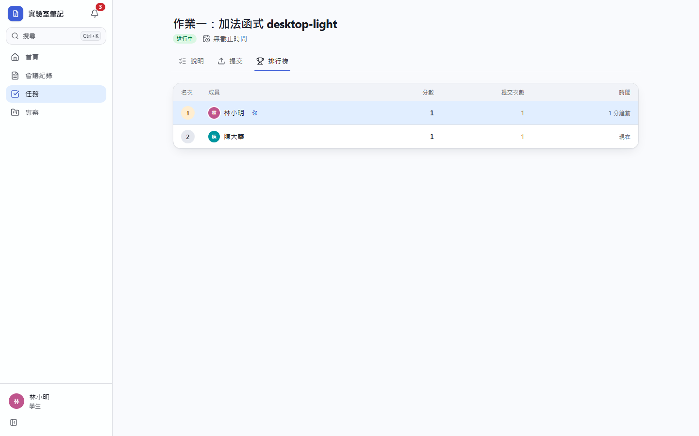
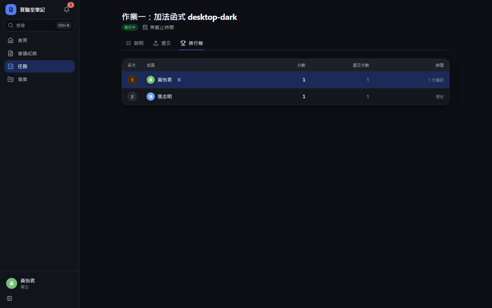
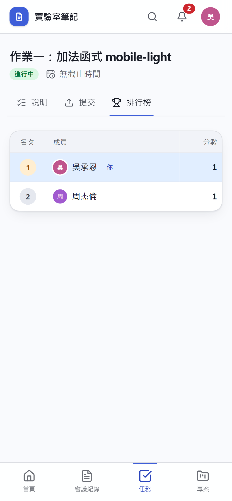
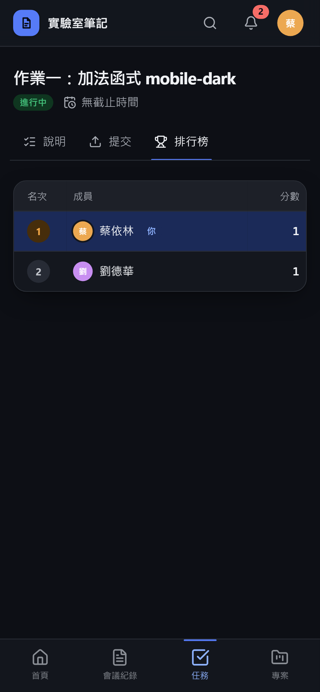

**老師總覽**

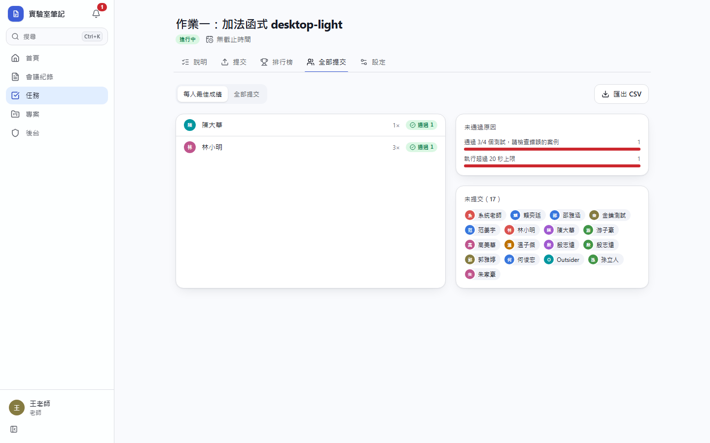
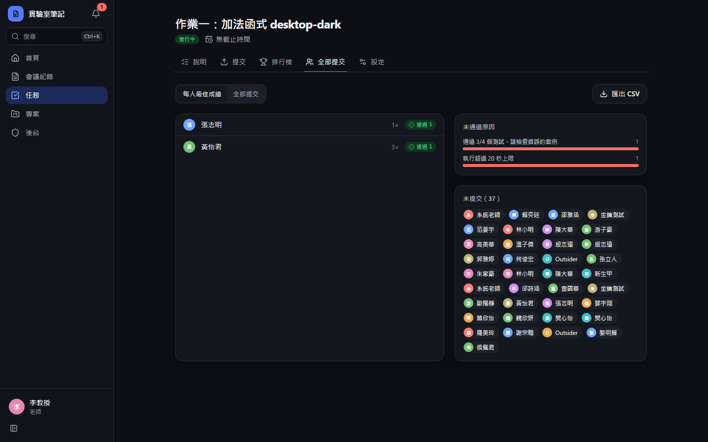
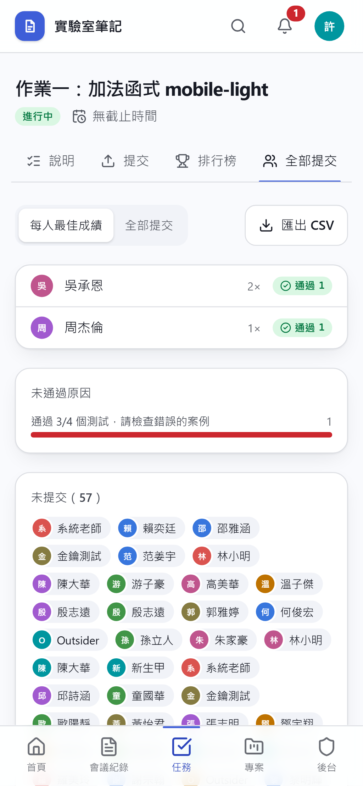
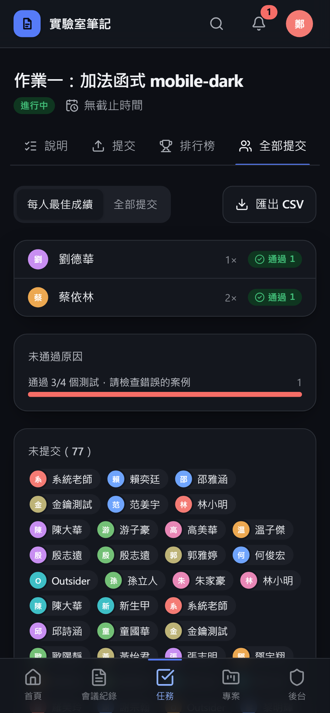

# Commit-2

## 內文

原本排行榜與提交紀錄一次載入全部。
現在排行榜與提交紀錄每次載入 50 筆，下方「載入更多」顯示目前／總數；自己的名次不在本頁時仍固定顯示在最後一列。
驗收：每頁 1 筆時拿到第 2 名與總數 2，並附上自己的名次；提交紀錄限制 1 筆時回傳 1 筆與總數 2。

### 測試結果

| 項目 | 結果 |
|---|---|
| 型別檢查（tsc -b） | 0 錯誤 |
| Lint 與色碼檢查 | 0 錯誤（81 個檔案） |
| 單元／整合測試（vitest） | 通過 42 / 42 |
| 驗收測試（Playwright 全套，電腦／手機 × 深／淺） | 通過 56 / 56 |

### 截圖

無畫面變更
