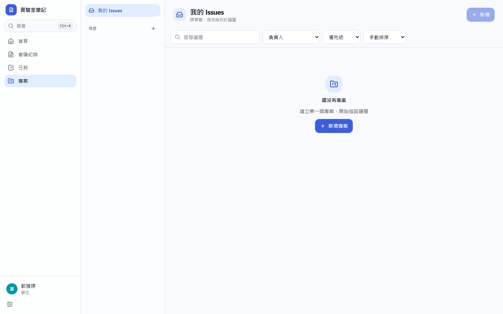
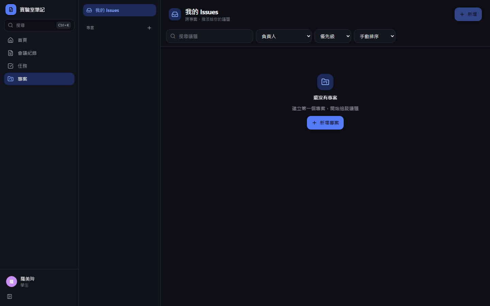
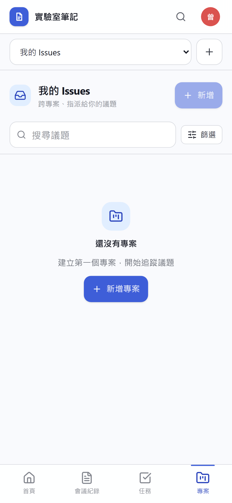
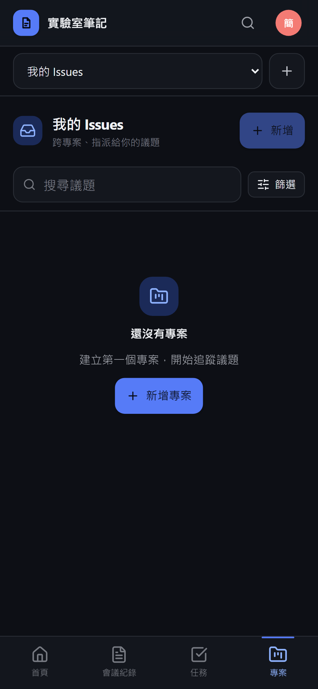
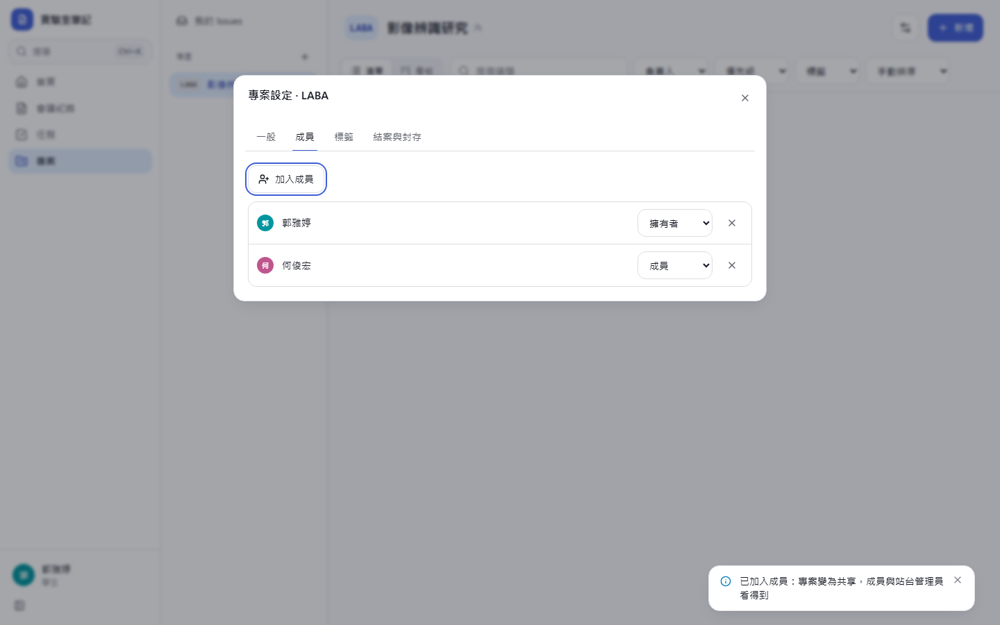
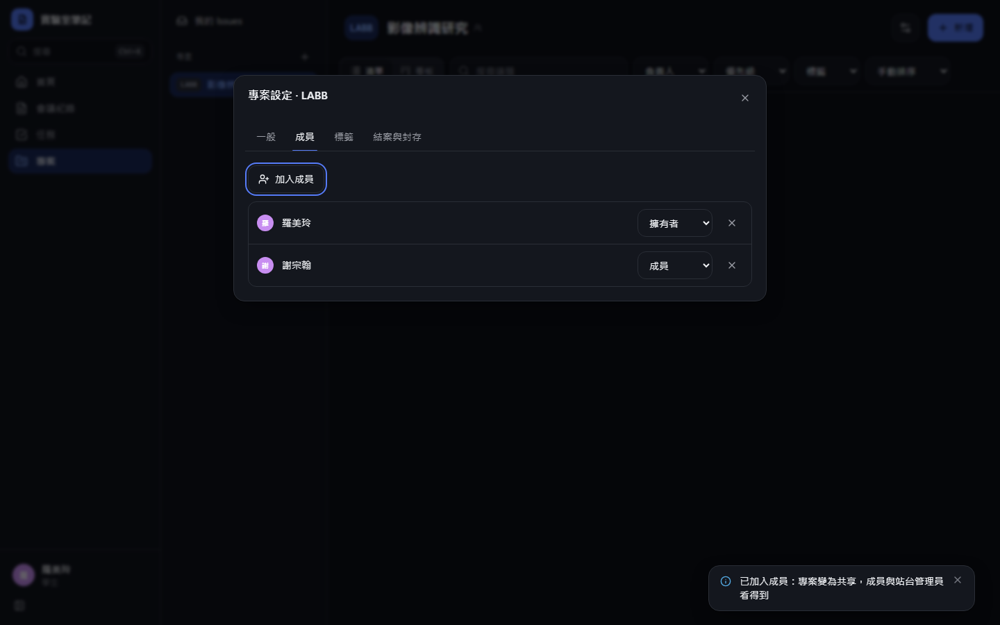
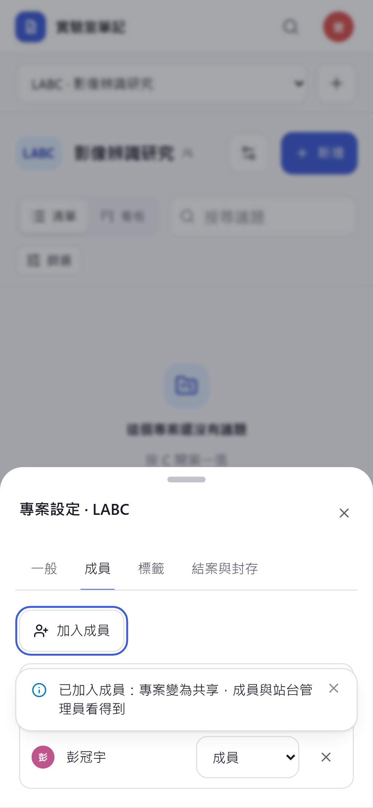
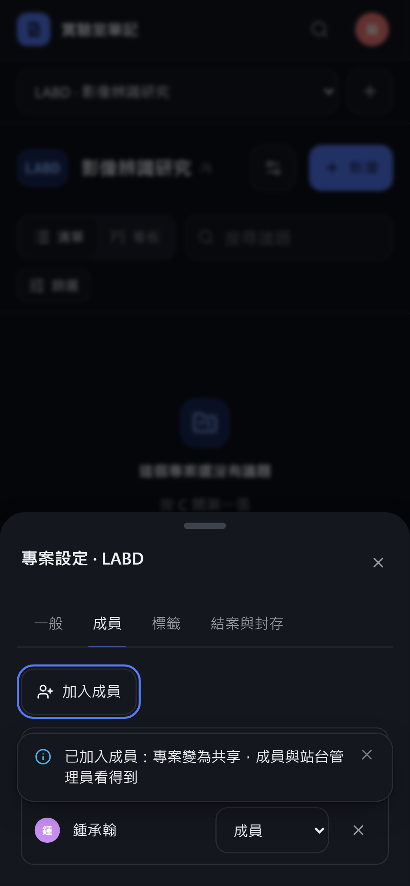

# [MS-26] 建立專案與成員權限

> 狀態：進行中

## 內文

### 需求
專案管理要有專案層級的權限：不是成員就完全看不到；私人、共享、對管理員隱藏都要正確。

### 來源
使用者 2026-10-19 對話（初始需求）；設計：`design/05-project-management.md` §3（專案）、§4

### 驗收條件
- [x] 建立專案：名稱、key（2–6 大寫英文字母、全域唯一、不可改）、說明、驗收人、目標日期、父專案（子專案權限不繼承）
- [x] 專案角色：檢視者、成員、擁有者；擁有者可加入、移除成員與改角色
- [x] 非成員存取專案或其議題一律回找不到，不洩漏存在與否
- [x] 成員數 ≤ 1 即為私人專案，對管理員隱形；擁有者可開啟「對管理員隱藏」
- [x] 站台管理員與老師看得到所有共享專案，側欄「其他專案」只對他們顯示
- [x] 側欄顯示可見度徽章（私人／僅成員／共享），hover 說明誰看得到；切換私人與共享時 toast 說明現在誰看得到
- [x] 最後一位擁有者不能被降級或移除；移除成員時一併清除其訂閱、驗收人身分與負責人指派
- [x] 權限檢查在狀態檢查之前，不同錯誤碼不會洩漏專案狀態
- [x] 所有變更記活動

### 測試流程
1. A 建立專案 CATS，此時為私人；管理員看不到
2. A 加入 B 為成員，專案變共享，toast 說明；管理員在其他專案看得到
3. 非成員 C 打 CATS 的網址，看到找不到
4. A 嘗試把自己（唯一擁有者）降級，被拒絕
5. 移除 B 後，B 被指派的議題負責人清空

---

# 跟其他票的關係

- Blocks：MS-27、MS-38
- Blocked by：MS-8
- Related：無

---

# Commit-1

## 內文

原本沒有專案管理。
現在可以建立專案（名稱、2–6 個大寫字母的代號、說明；代號全站唯一且不能改），專案有檢視者、成員、擁有者三種角色，擁有者在設定的「成員」Tab 加入、移除成員或改角色。不是成員的人打專案或其中議題的網址一律看到「找不到」。只有一位成員時是私人專案，管理員也看不到；加入成員後自動變成共享並跳出提示說明誰看得到；擁有者可再開啟「對管理員隱藏」。側欄依「我的專案／其他專案（管理員）／已結案／已封存」分組並顯示可見度圖示，滑過說明誰看得到。最後一位擁有者不能被降級或移除；移除成員時一併清掉他在專案內的負責人指派。所有變更都記活動。
尚未完成：父子專案的設定介面（伺服器已支援父專案欄位）、目標日期。

### 測試結果

| 項目 | 結果 |
|---|---|
| 整合測試：非成員 404、私人對管理員隱形、加入成員後共享、對管理員隱藏 | 通過 |
| 整合測試：最後一位擁有者、移除成員清除指派 | 通過 |
| E2E 建立專案、加入成員 | 通過（四種組合） |

### 截圖

**沒有專案時的引導**

**成員設定**

