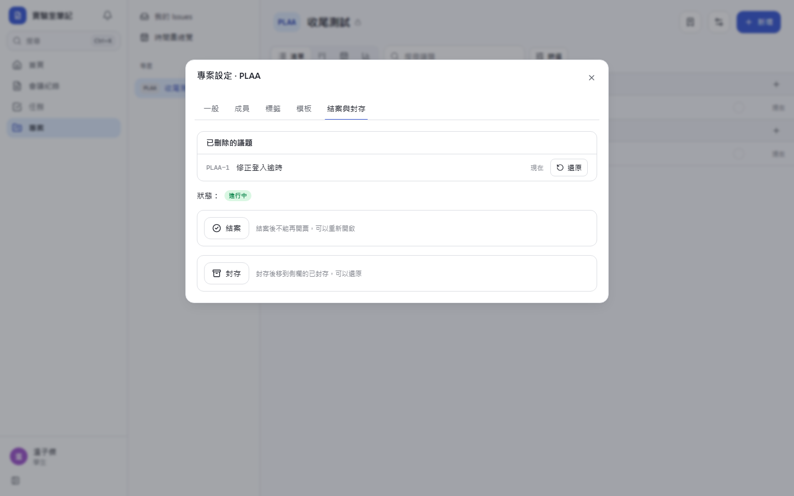
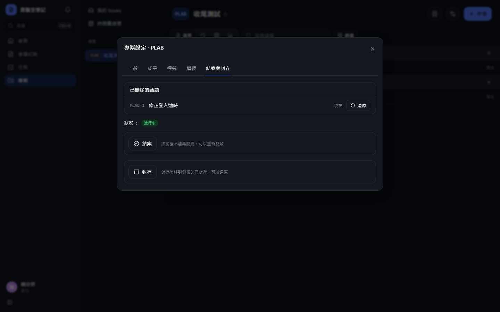
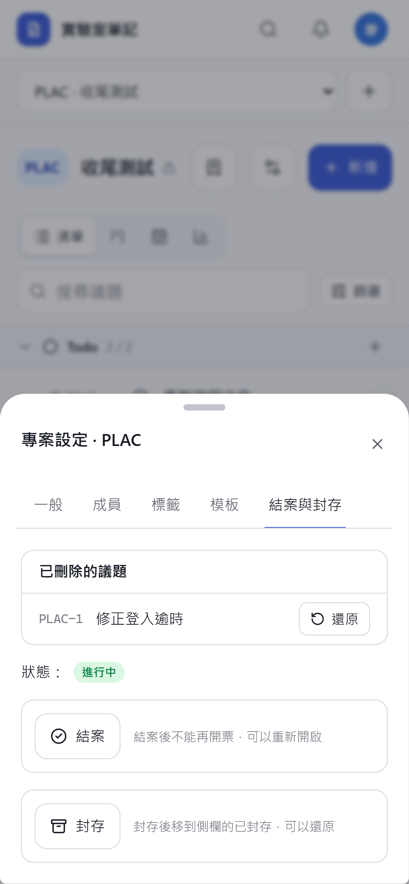
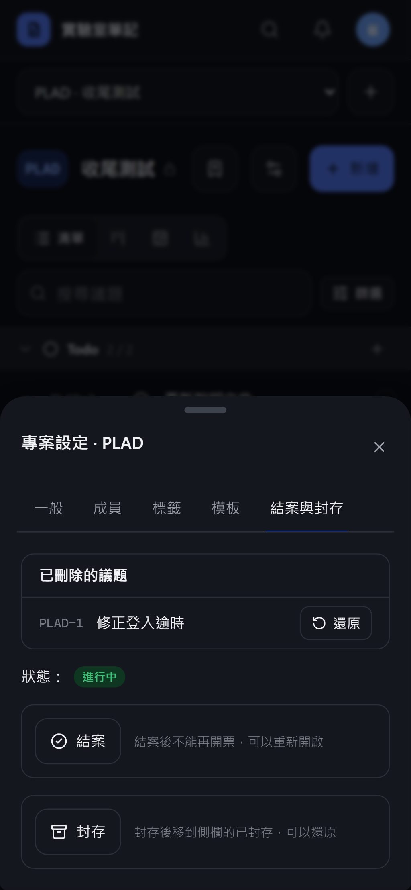

# [MS-27] 建立議題與編號、狀態、屬性

> 狀態：完成

## 內文

### 需求
專案底下的議題要有 Linear 風格的編號、狀態、優先級、負責人、標籤，且所有變更都有完整的活動紀錄。

### 來源
使用者 2026-10-19 對話（初始需求）；設計：`design/05-project-management.md` §3、§8

### 驗收條件
- [x] 議題編號 `KEY-N`，同時大量建立也不重號、不跳號重用
- [x] 6 種狀態（Backlog、Todo、進行中、審查中、完成、已取消）與 5 級優先級，圖示與顏色依 §8
- [x] 負責人可多位，第一位為主要負責人；只能指派看得到該專案的人
- [x] 標籤屬於單一專案，顏色從 8 色 token 選；擁有者可管理標籤
- [x] 截止日；描述為 Markdown
- [x] 每次變更寫結構化活動（欄位、從、到、誰、何時、來源 web／mcp／system），存 id 不存名稱，只增不刪
- [x] 議題、留言軟刪除，可由擁有者還原
- [x] 已結案、已封存專案在伺服器端拒絕新增議題

### 測試流程
1. 在 CATS 連續快速建立 20 張議題（含並行），編號 CATS-1 到 CATS-20 不重複
2. 改狀態、優先級、負責人、標籤，活動依序記錄從→到
3. 負責人改名後，活動紀錄顯示新名稱
4. 嘗試指派非成員，被拒絕並說明原因
5. 把專案結案後透過 API 開票，被拒絕

---

# 跟其他票的關係

- Blocks：MS-19、MS-28、MS-29、MS-30、MS-33、MS-42
- Blocked by：MS-26
- Related：無

---

# Commit-1

## 內文

原本沒有議題。
現在議題編號為「代號-流水號」，編號與建立在同一個原子操作內遞增，同時大量建立也不會重號或重用。議題有 6 種狀態與 5 級優先級（圖示依設計），可指派多位負責人（第一位為主要），只能指派看得到這個專案的人；標籤屬於專案、從 8 種顏色 token 選。每次修改都寫一筆「欄位、從、到、誰、何時、來源」的活動，只存帳號 id，改名後歷史顯示新名稱。已結案或已封存的專案，伺服器直接拒絕新增議題。
尚未完成：已刪除議題與留言的還原介面（目前為軟刪除，資料保留）。

### 測試結果

| 項目 | 結果 |
|---|---|
| 整合測試：並行建立 12 張編號連續無重複 | 通過 |
| 整合測試：指派看不到專案的人被拒、結案專案拒絕開票 | 通過 |

### 截圖

**清單中的議題與優先級**

# Commit-2

## 內文

原本刪除的議題與留言無法還原。
現在專案擁有者可在專案設定「結案與封存」看到已刪除的議題並一鍵還原，編號、歷史與留言都保留；刪除的留言顯示「已刪除」，作者或專案擁有者可以還原。還原會寫入活動紀錄。
驗收：刪除一張票後在專案設定看到它，按還原後票回到清單；刪除的留言還原後內容恢復。

### 測試結果

| 項目 | 結果 |
|---|---|
| 型別檢查（tsc -b） | 0 錯誤 |
| Lint 與色碼檢查 | 0 錯誤（81 個檔案） |
| 單元／整合測試（vitest） | 通過 38 / 38 |
| 驗收測試（Playwright 全套，電腦／手機 × 深／淺） | 通過 48 / 48 |

### 截圖

**已刪除的議題**

