# [MS-29] 提供開票視窗與模板、草稿保護

> 狀態：完成

## 內文

### 需求
開票要快：快捷鍵開視窗、鍵盤完成所有欄位、可連續建立；用模板帶入格式；打到一半關掉也不會遺失。

### 來源
使用者 2026-10-19 對話（初始需求）；設計：`design/05-project-management.md` §5.1

### 驗收條件
- [x] 按 C、工具列「新增」、看板欄頭「＋」（預帶該欄狀態，hover 說明會建立在哪個狀態）開啟
- [x] 標題自動聚焦；底部 pill 依序：專案、模板、狀態 S、優先級 P、負責人 A、標籤 L，可用鍵盤操作
- [x] ⌘／Ctrl+Enter 送出；勾「連續建立」送出後不關閉並清空
- [x] 專案選單只列進行中且自己不是檢視者的專案
- [x] 模板分個人、專案、全域，預設優先序個人 > 專案 > 全域；描述為空時自動帶入預設模板；換模板直接覆蓋且 ⌘Z 可還原
- [x] 草稿自動存本機，重新開啟提示「已還原上次未送出的草稿」
- [x] 打過字後 Esc、X、點外面都出現三選一：取消／刪除／保留草稿，焦點預設在保留
- [x] 手機上開票視窗為全螢幕，pill 可橫向捲動

### 測試流程
1. 按 C 開視窗，只用鍵盤填完標題、狀態、優先級、負責人並送出
2. 勾連續建立，送出三張後視窗仍開著
3. 換模板覆蓋描述，按 ⌘Z 還原原本內容
4. 打字後按 Esc，選保留草稿；重新開啟看到還原提示與內容

---

# 跟其他票的關係

- Blocks：無
- Blocked by：MS-9、MS-27
- Related：無

---

# Commit-1

## 內文

原本沒有開票介面。
現在在專案內按 C、工具列「新增」或看板欄頭「＋」（滑過說明會建立在哪個狀態）開啟視窗，標題自動聚焦，底部依序是專案、狀態 S、優先級 P、負責人 A、標籤 L，鍵盤即可完成；Ctrl/⌘+Enter 送出，勾「連續建立」送出後清空保留視窗。專案選單只列進行中且自己能開票的專案。草稿自動存在本機，重開時提示已還原；打過字後按 Esc、X 或點外面會出現「取消／刪除／保留草稿」，焦點預設在保留。手機上是全螢幕視窗。
尚未完成：開票模板（個人／專案／全域）。

### 測試結果

| 項目 | 結果 |
|---|---|
| E2E 開票、草稿三選一、還原草稿 | 通過（四種組合） |

### 截圖

**開票視窗**

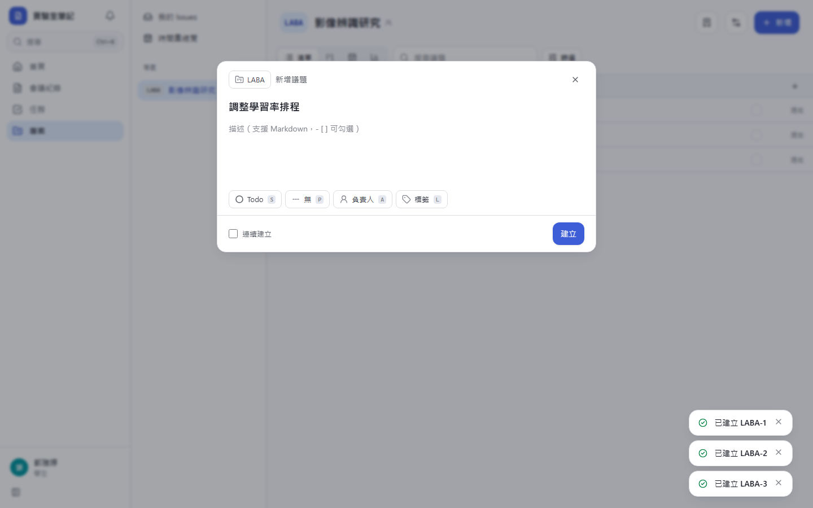
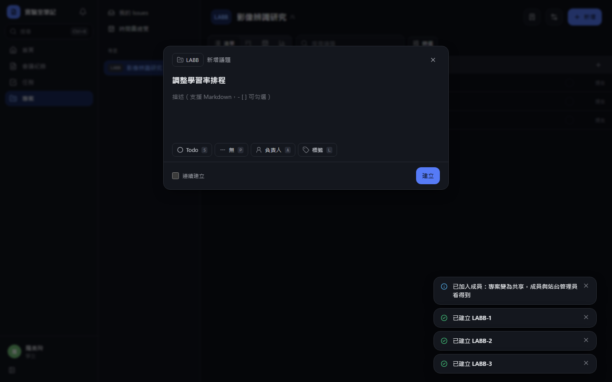
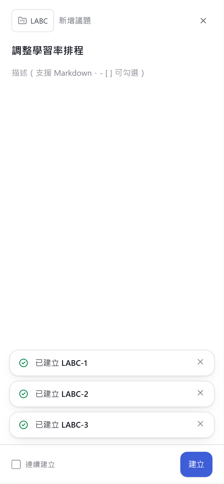
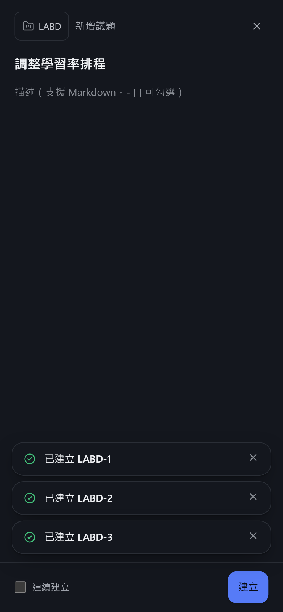

**關閉草稿的三選一**

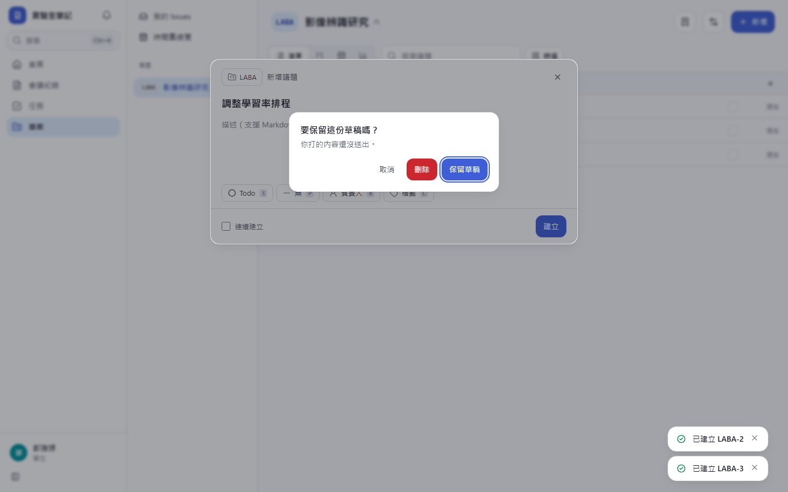
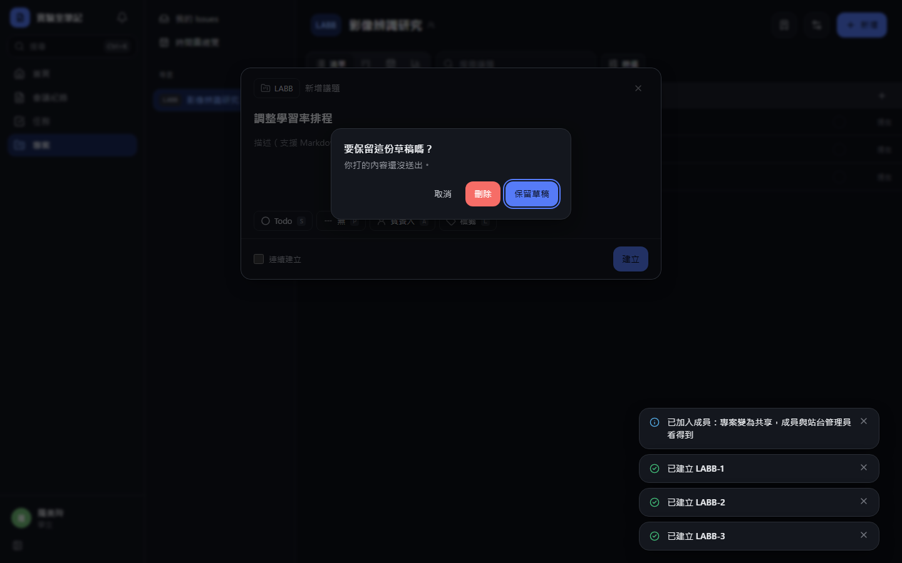
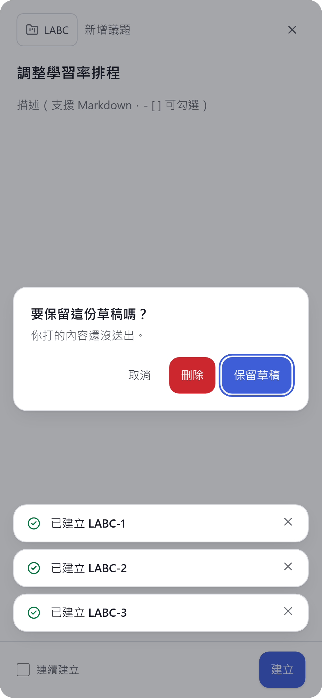
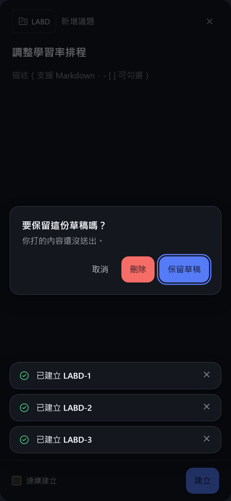

# Commit-2

## 內文

原本開票只能從空白描述開始。
現在可以建立個人、專案、全站三種模板（專案設定的「模板」Tab；全站模板限管理員、專案模板限擁有者）。開票時描述是空的會自動帶入預設模板，優先序為個人 > 專案 > 全站；在開票視窗的「模板」選單換模板會直接覆蓋描述，按 Ctrl/⌘+Z 一步還原原本的內容。
驗收：專案預設「Bug 回報」時開票視窗自動帶入重現步驟；改選個人的「實驗紀錄」後描述換成假設／結果，按 Ctrl/⌘+Z 回到 Bug 回報；他人看不到也刪不掉我的個人模板。

### 測試結果

| 項目 | 結果 |
|---|---|
| 型別檢查（tsc -b） | 0 錯誤 |
| Lint 與色碼檢查 | 0 錯誤（81 個檔案） |
| 單元／整合測試（vitest） | 通過 38 / 38 |
| 驗收測試（Playwright 全套，電腦／手機 × 深／淺） | 通過 48 / 48 |

### 截圖

**開票時換模板**

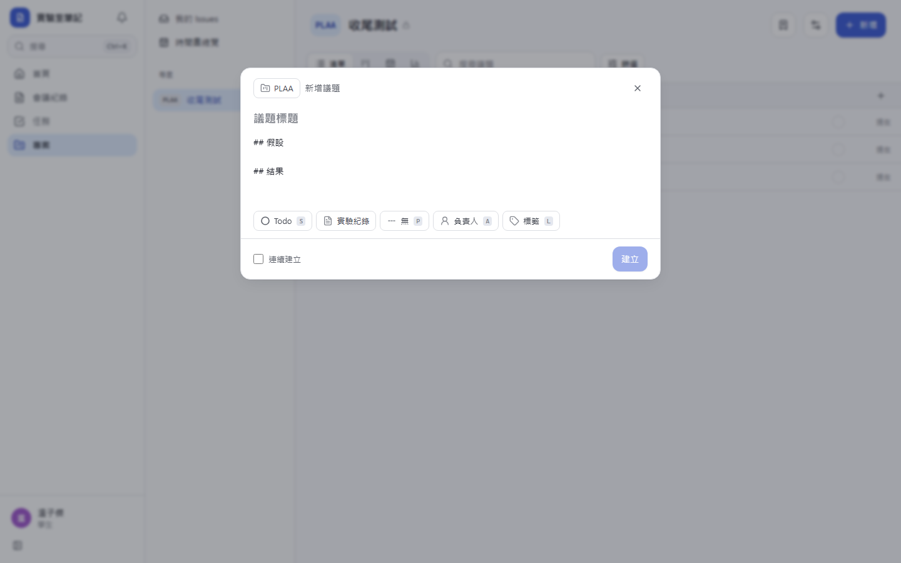
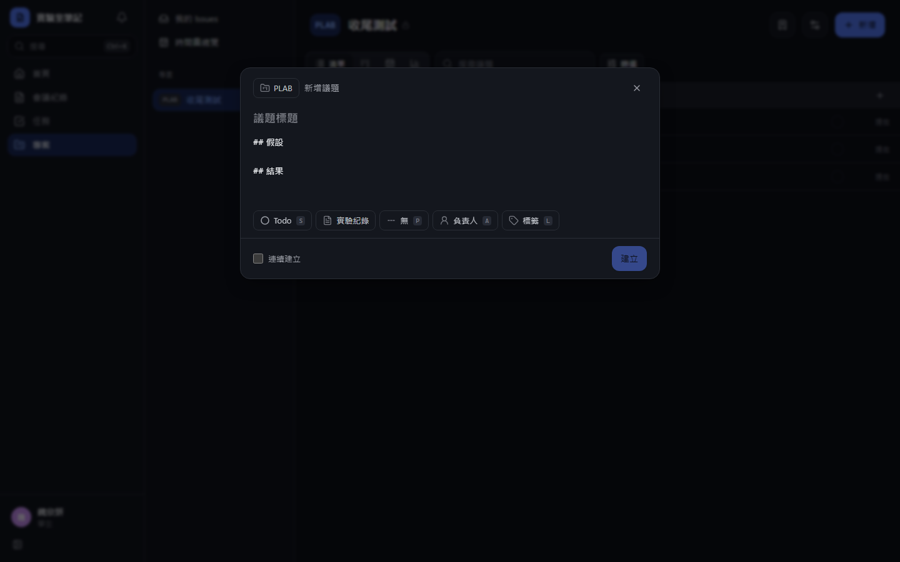
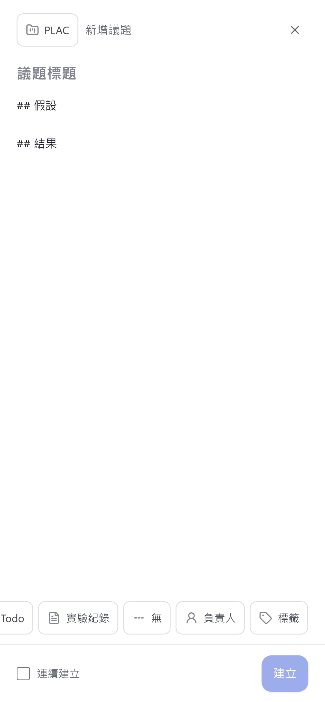
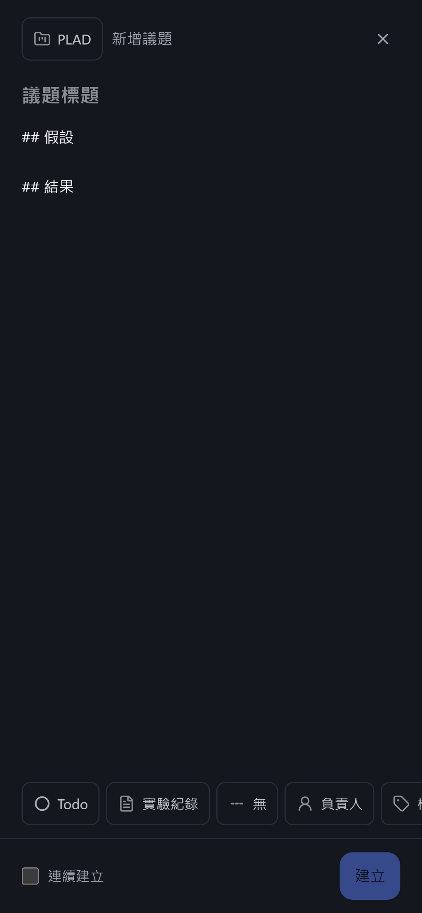
