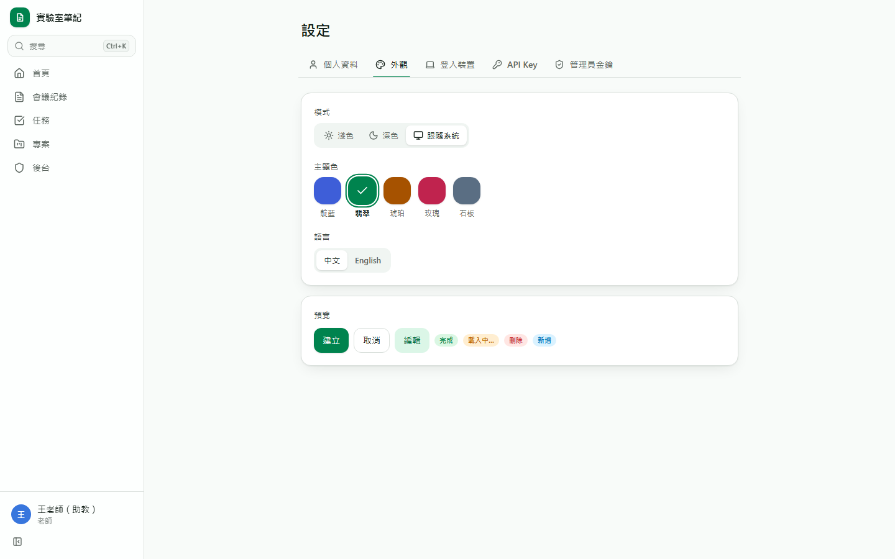
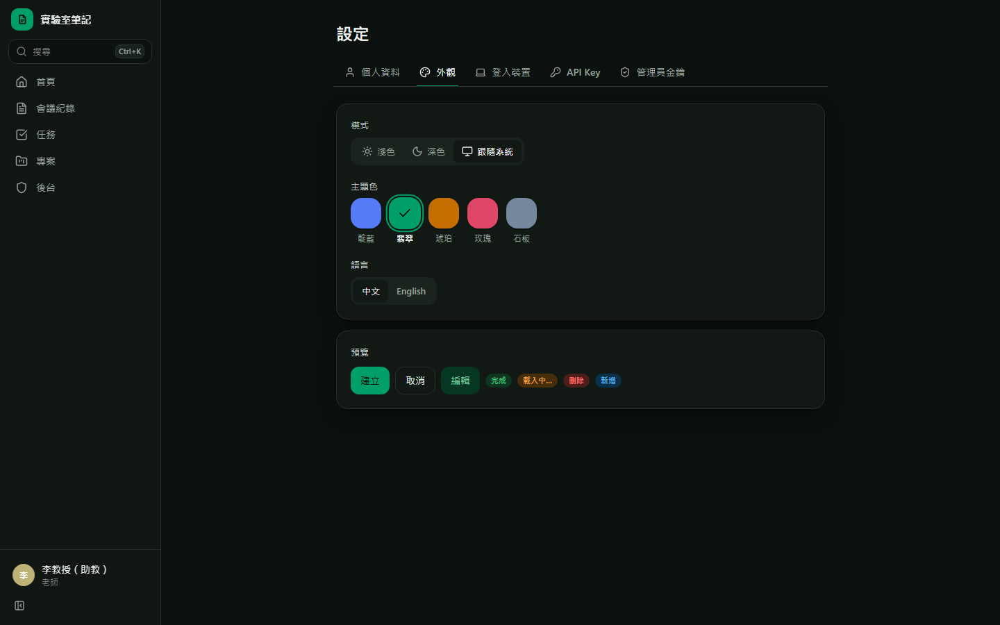
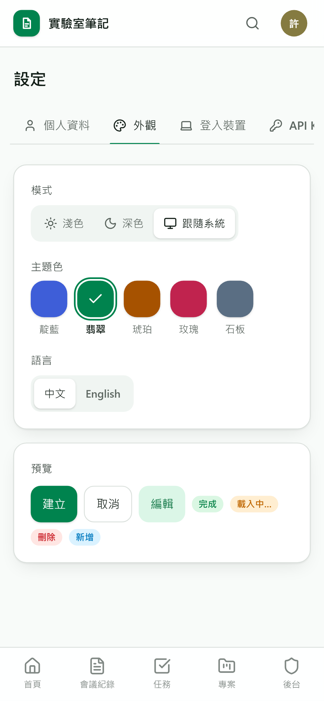
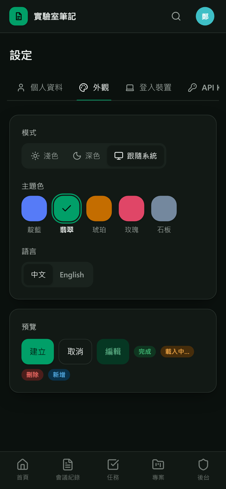

# [MS-2] 建立設計系統與主題色切換

> 狀態：進行中

## 內文

### 需求
整站要好看、有豐富動畫但不複雜，並能切換主題色與深淺模式；顏色一律來自語意 token，切換主題時所有元件同步變色。

### 來源
使用者 2026-10-19 對話（初始需求）；設計：`design/01-product.md` §3；`design/05-project-management.md` §8；待確認 #4

### 驗收條件
- [x] 提供 5 組主色（靛藍、翡翠、琥珀、玫瑰、石板）× 淺色／深色／跟隨系統，設定頁即時預覽並記住選擇（登入後跨裝置同步）
- [x] 程式碼中沒有寫死的色碼（自動檢查會擋）
- [x] 提供共用元件：按鈕、輸入框、選單、對話框、確認框（寫出後果）、底部抽屜、Tab、Tooltip、Toast、骨架載入、空狀態
- [x] Tooltip 延遲 400ms，可附快捷鍵角標；只有圖示的按鈕缺 tooltip 時開發環境會警告
- [x] 頁面轉場、對話框、列表項目進出都有動畫，單次 ≤ 250ms；系統開啟「減少動態效果」時動畫改為淡入或關閉
- [ ] 所有元件在深淺兩種主題、5 組主色下對比度達 WCAG AA（文字 4.5:1）
- [ ] 有一頁元件總覽（開發用），可一次檢視所有元件在各主題的樣子
- [x] 首次載入不閃白：深色使用者重新整理時不會先看到淺色畫面

### 測試流程
1. 開啟設定 → 外觀，逐一切換 5 組主色與淺色／深色／跟隨系統，畫面即時變色
2. 重新整理頁面，主題維持，且沒有閃一下淺色
3. 在另一台裝置登入同帳號，主題相同
4. 開啟作業系統「減少動態效果」，開關對話框沒有縮放動畫
5. 在元件總覽頁用對比檢查工具量測，全部達 AA

---

# 跟其他票的關係

- Blocks：MS-4、MS-9、MS-11
- Blocked by：MS-1
- Related：無

---

# Commit-1

## 內文

原本沒有任何視覺規範。
現在有一套只用語意 token 的設計系統：5 組主色 × 淺色／深色／跟隨系統，設定頁即時預覽並同步到帳號；按鈕、輸入框、選單、對話框（手機自動變底部抽屜）、主題化確認框、Tab、Tooltip（400ms、附快捷鍵角標、觸控裝置不顯示）、Toast（可帶「重試」）、骨架載入、空狀態都已提供。轉場與進出動畫皆在 250ms 內，系統開啟減少動態效果時關閉。程式中寫死色碼會被 lint 擋下。深色使用者重新整理不會閃白。
尚未完成：逐色量測 WCAG AA 對比度、開發用元件總覽頁。

### 測試結果

| 項目 | 結果 |
|---|---|
| 色碼檢查 | 50 個檔案無寫死色碼 |
| E2E 外觀設定（四種組合） | 通過 |

### 截圖

**外觀設定：切換到翡翠，五個色塊各自顯示自己的顏色**

