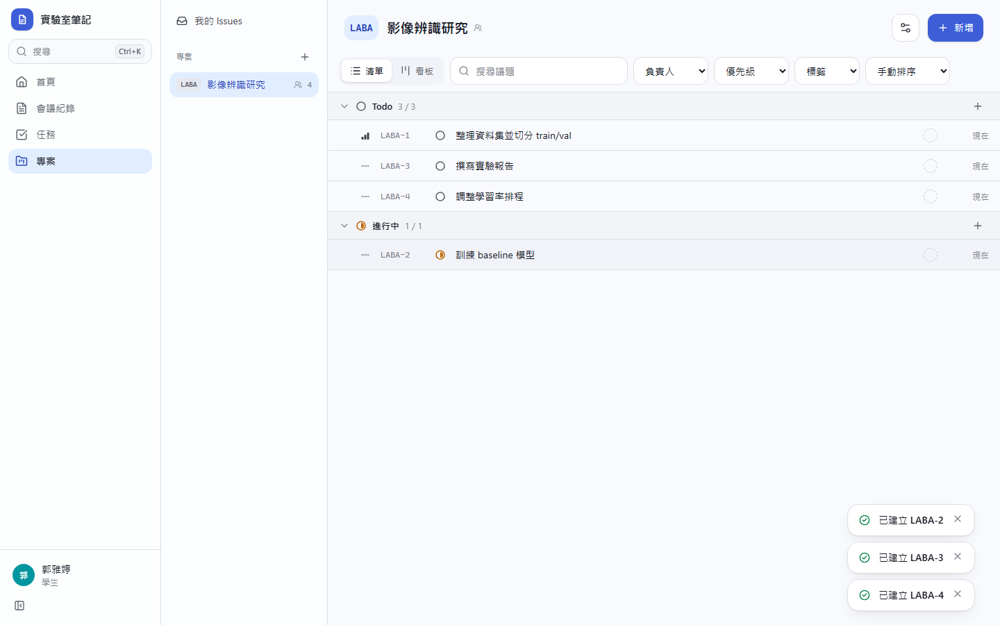
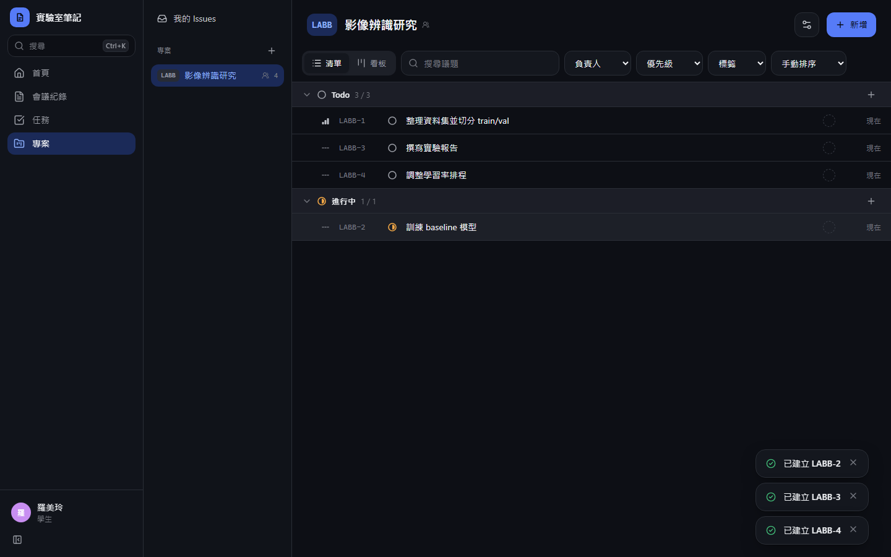
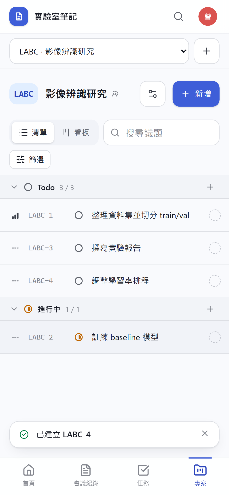
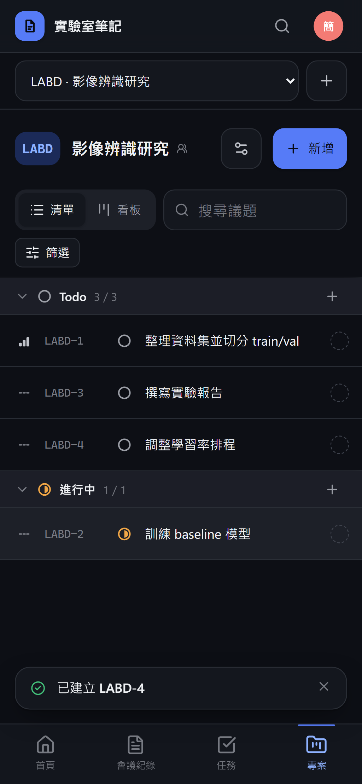
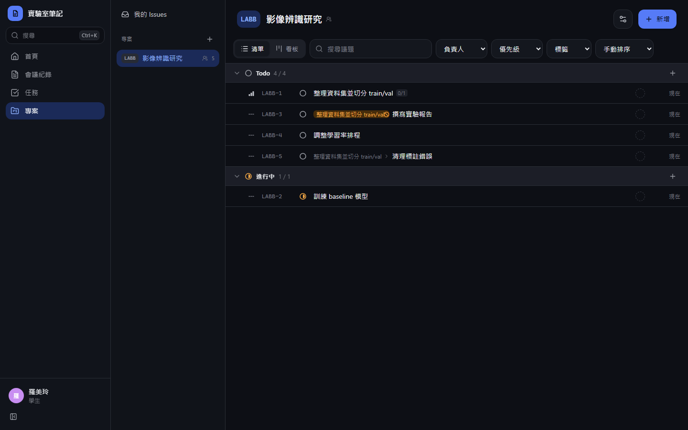
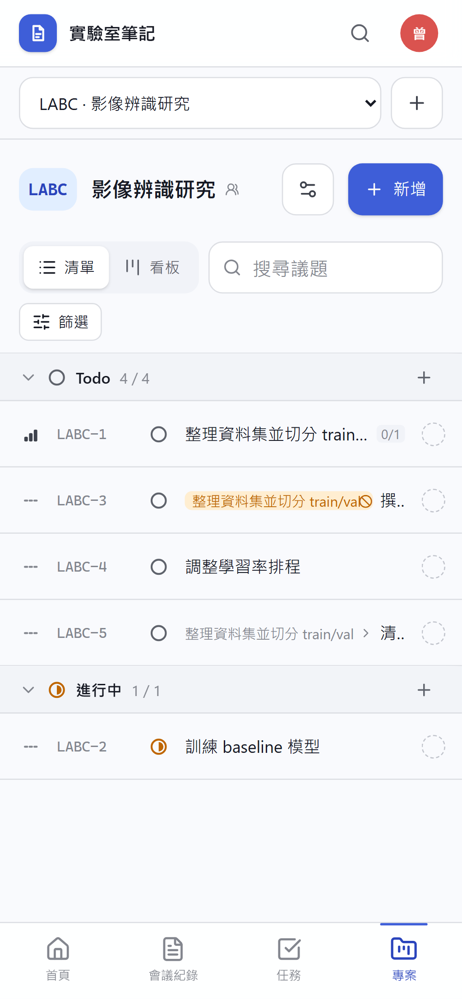
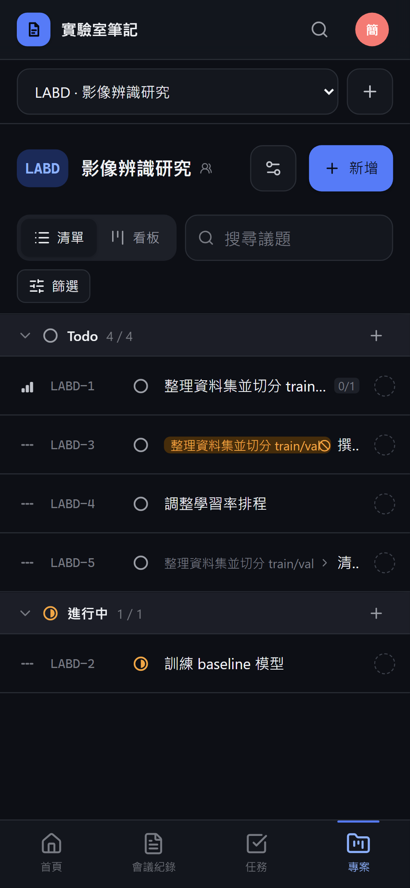

# [MS-30] 提供議題清單檢視

> 狀態：進行中

## 內文

### 需求
清單檢視要能快速掃過大量議題、就地修改，篩選排序都放在網址可以分享。

### 來源
使用者 2026-10-19 對話（初始需求）；設計：`design/05-project-management.md` §5.2、§5.3

### 驗收條件
- [x] 依狀態分組，組頭可收合並顯示「已載入／總數」；每個狀態各自查詢、各自分頁（每次 50 張），收合的組不載入但顯示總數
- [x] 欄位：優先級、編號、狀態、標題、標籤（最多 3 個，多的 +N）、負責人、建立時間（hover 顯示絕對時間）
- [x] 列上的狀態、優先級、負責人、標籤圖示可直接點開選單修改
- [ ] 超過 200 列改用虛擬化渲染，捲動順暢
- [x] J／K、↑／↓ 移動選取，Enter 開啟，X 多選，S／A／P／L 修改，I 把自己加入負責人，⌘C 複製 ID，⌘⇧C 複製連結
- [x] 右鍵選單依單選／多選顯示對應內容（多選標題顯示「N 張 issues」）
- [x] 被擋住的票標題前顯示「擋住它的第一張票 +N ⃠」暖色前綴，擋住它的票全部完成後消失；子票標示父票
- [ ] 篩選（狀態、優先級、負責人、標籤、截止日）、排序、檢視都寫在網址
- [x] 篩選無結果時顯示一鍵清除篩選

### 測試流程
1. 建立 300 張票，其中 Todo 的票全部排在最後，清單中 Todo 組仍存在且總數正確
2. 篩選負責人為自己並排序，複製網址到新分頁顯示相同畫面
3. 用鍵盤選 3 張並按 S 改狀態
4. 一張票被另一張擋住，前綴出現；把擋住它的票改完成，前綴消失

---

# 跟其他票的關係

- Blocks：MS-31、MS-32、MS-39
- Blocked by：MS-9、MS-27
- Related：無

---

# Commit-1

## 內文

原本沒有議題清單。
現在清單依狀態分組，每個狀態各自查詢、各自分頁（每次 50 張），組頭顯示「已載入／總數」，收合的組不載入但仍顯示總數，所以某個狀態不會因為排序而整組消失。每列顯示優先級、編號、狀態、標題、最多 3 個標籤（多的顯示 +N）、負責人與建立時間（滑過顯示完整時間），狀態、優先級、負責人圖示可以直接點開修改。J／K／方向鍵移動、Enter 開啟、X 多選、S／A／P／L 修改、I 把自己加入負責人、⌘C／⌘⇧C 複製編號或連結；右鍵選單依單選或多選顯示（多選標題為「N 張 issues」）。被擋住的票標題前有暖色前綴，擋住它的票全部完成後自動消失；子票前標示父票。篩選與排序都寫在網址，篩選沒有結果時可一鍵清除。手機上篩選收在「篩選」按鈕裡。
尚未完成：超過 200 列的虛擬化渲染、依狀態與截止日篩選。

### 測試結果

| 項目 | 結果 |
|---|---|
| E2E 清單、就地改狀態、被擋住前綴 | 通過（四種組合） |
| 整合測試：被擋住只計未完成的票 | 通過 |

### 截圖

**議題清單**

**被擋住的前綴**

