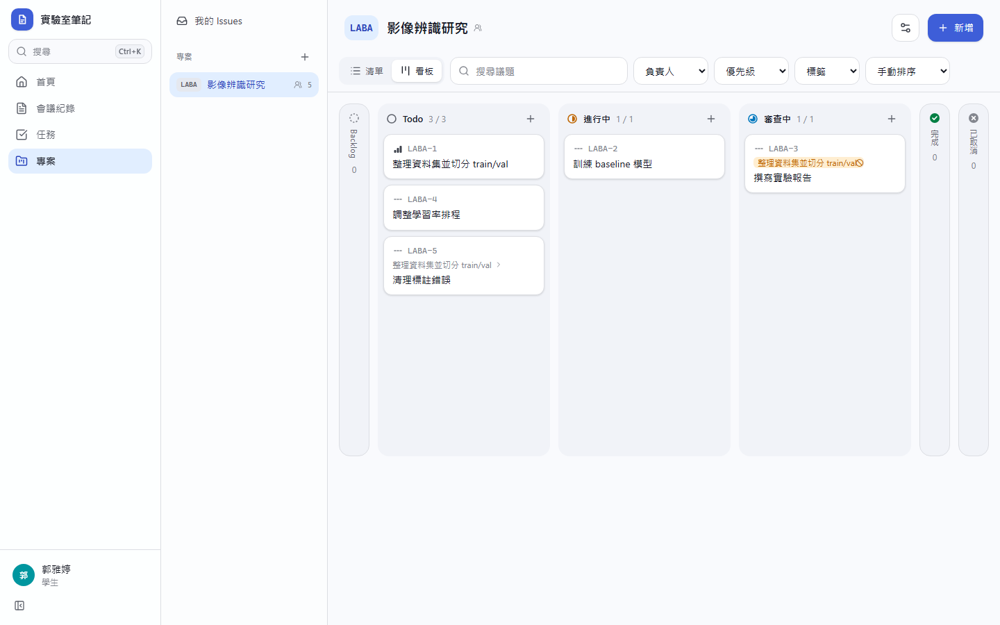
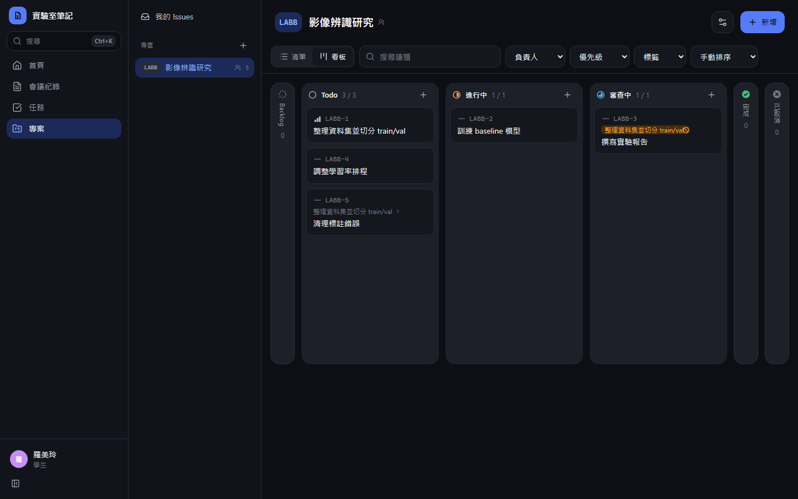
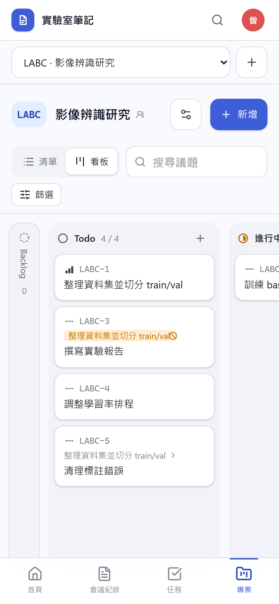
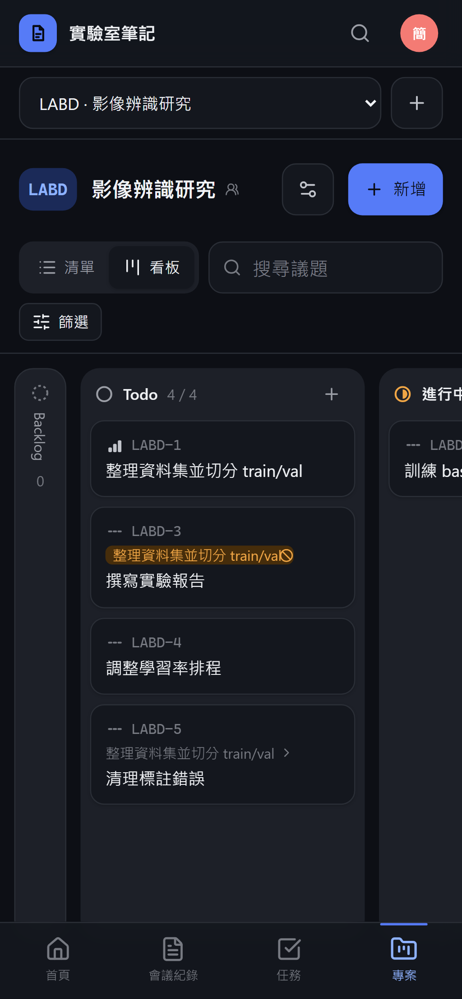

# [MS-31] 提供議題看板檢視

> 狀態：進行中

## 內文

### 需求
看板檢視讓進度一目了然，拖曳就能改狀態與排序。

### 來源
使用者 2026-10-19 對話（初始需求）；設計：`design/05-project-management.md` §5.2

### 驗收條件
- [x] 6 欄，完成與已取消預設摺疊成窄欄，可展開
- [x] 跨欄拖曳改狀態、欄內拖曳排序，放下即生效且有動畫；排序只改動被拖的那張
- [x] 每欄各自分頁，欄頭顯示已載入／總數
- [x] 卡片顯示編號、標題、優先級、負責人頭像、標籤、被擋住前綴
- [ ] 手機上看板可左右滑動切換欄，長按卡片拖曳
- [ ] 鍵盤可操作：方向鍵移動、S 改狀態

### 測試流程
1. 把一張卡從 Todo 拖到進行中，活動記錄狀態變更
2. 在進行中欄內把第 5 張拖到第 1 張，重新整理後順序保持
3. 在手機上長按拖曳卡片到另一欄

---

# 跟其他票的關係

- Blocks：無
- Blocked by：MS-30
- Related：無

---

# Commit-1

## 內文

原本沒有看板。
現在看板有 6 欄，完成、已取消與沒有議題的欄位預設摺成窄欄（可展開，也可以直接把卡片拖進摺起來的欄位）。跨欄拖曳改狀態、欄內拖曳改順序，放下立即更新畫面，排序只改被拖的那一張；衝突時自動還原。每欄各自分頁並顯示已載入／總數，卡片顯示編號、標題、優先級、負責人、標籤與被擋住前綴。手機上可左右滑動切換欄。
尚未完成：手機長按拖曳、看板的鍵盤方向鍵操作。

### 測試結果

| 項目 | 結果 |
|---|---|
| E2E 拖曳到「審查中」並重新整理後仍在該欄 | 通過（電腦版兩種主題） |

### 截圖

**看板**

