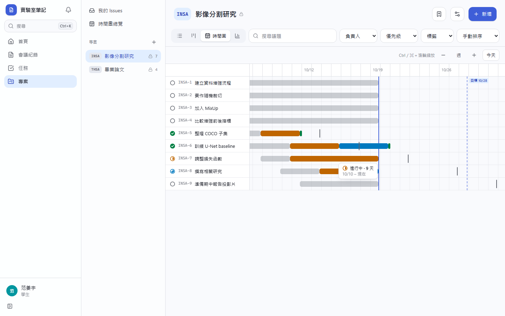
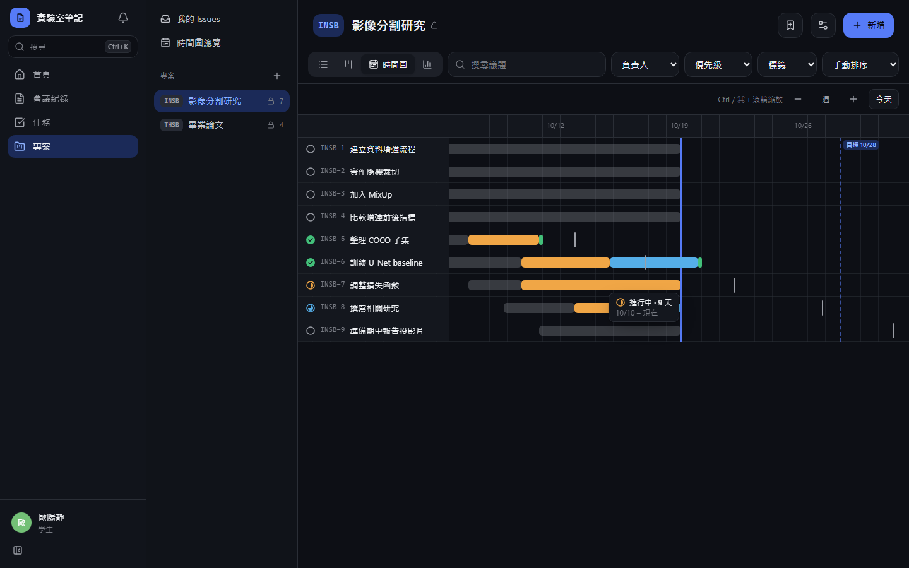
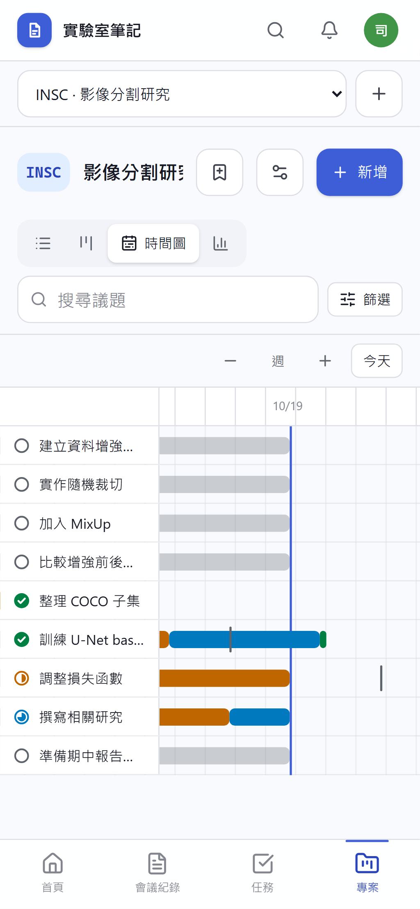
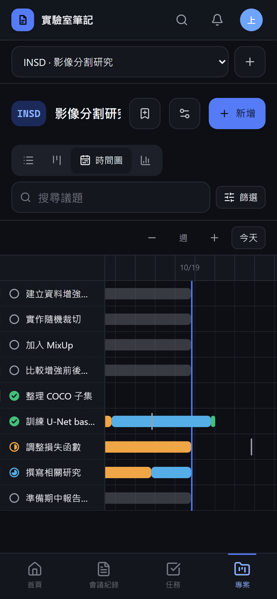
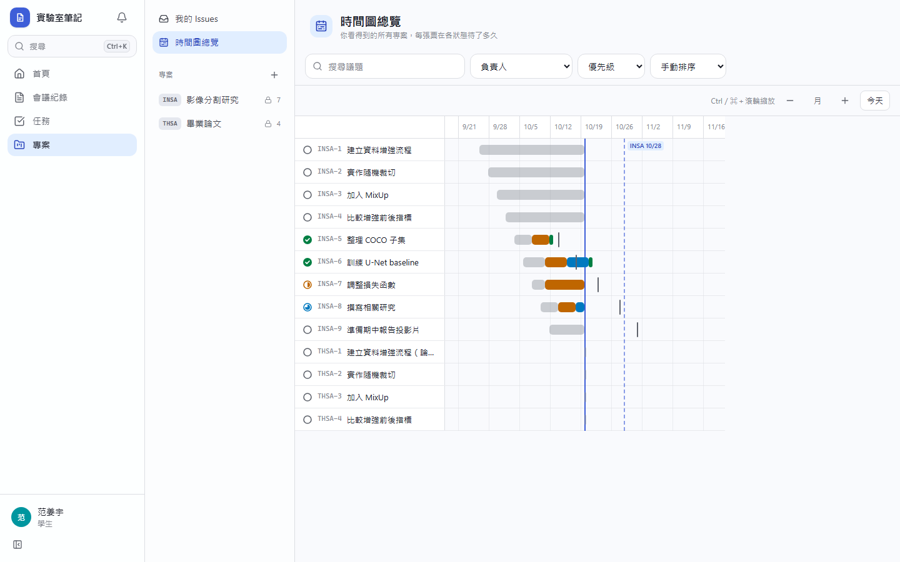
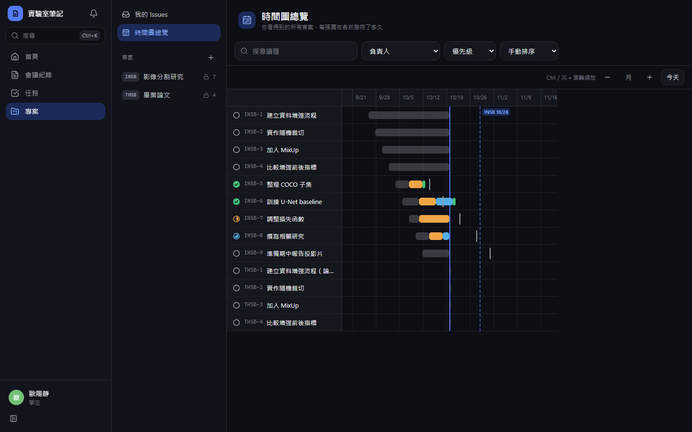
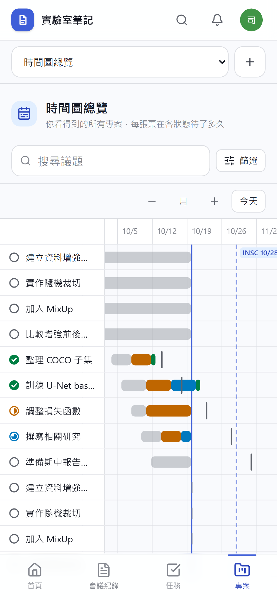
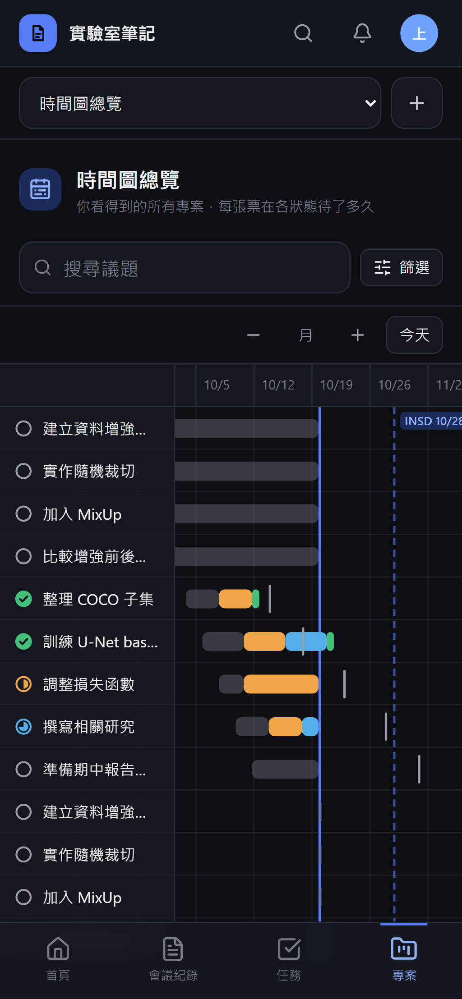

# [MS-32] 提供議題時間圖檢視

> 狀態：完成

## 內文

### 需求
時間圖讓人看到每張票在各狀態待了多久、有沒有逾期。

### 來源
使用者 2026-10-19 對話（初始需求）；設計：`design/05-project-management.md` §9

### 驗收條件
- [x] 每張票畫成各狀態的時間段，資料從狀態變更活動推導，不另存
- [x] Ctrl／⌘＋滾輪以游標為中心縮放，級距季、月、週、日；= 放大、- 縮小、T 跳到今天
- [x] 今天線、專案目標日期（逾期變紅）、議題截止日刻線
- [x] hover 時間段顯示狀態與停留時間
- [x] 單一專案最多 500 張，超過時提示用篩選縮小範圍
- [x] 有全站時間圖總覽（G O），只含自己可見的專案
- [x] 單張票資料異常時補預設值，不影響整張圖
- [x] 手機上可雙指縮放與左右拖動

### 測試流程
1. 打開有 50 張票的專案時間圖，用滾輪縮放到週級距
2. 按 T 回到今天
3. hover 一段進行中，顯示停留天數
4. 設定一個已過的目標日期，標記變紅

---

# 跟其他票的關係

- Blocks：MS-40
- Blocked by：MS-30
- Related：無

---

# Commit-1

## 內文

原本只能用清單和看板看票，看不出每張票在各狀態待了多久、有沒有逾期。
專案頁多了「時間圖」檢視，每張票畫成各狀態的時間段，資料全從狀態變更紀錄推導。Ctrl／⌘＋滾輪以游標位置為中心在季、月、週、日之間縮放，= 放大、- 縮小、T 回到今天；畫面上有今天線、專案目標日期（過期且還有未完成的票時變紅）與每張票的截止日刻線，滑過（手機點一下）時間段顯示狀態、停留時間與起訖日。單一專案最多畫 500 張，超過時提示用篩選縮小範圍；某張票紀錄缺漏時以目前狀態補一段，不影響整張圖。側欄與 G O 開啟「時間圖總覽」，只含自己看得到的專案。手機上可左右拖動，雙指捏合縮放。專案設定也新增目標日期欄位。
驗收：以 9 張跨三週的票檢查，時間段與狀態變更時間一致、週級距縮放時游標下的日期不跳動、T 置中今天、hover 顯示「進行中 · 9 天」與起訖日、過期目標日期變紅。

### 測試結果

| 項目 | 結果 |
|---|---|
| 型別檢查（tsc -b） | 0 錯誤 |
| Lint 與色碼檢查 | 0 錯誤（69 個檔案） |
| 單元／整合測試（vitest） | 通過 29 / 29 |
| 驗收測試（Playwright，電腦／手機 × 深／淺） | 通過 24 / 24 |

### 截圖

**專案時間圖（週級距，hover 時間段）**

**時間圖總覽**

