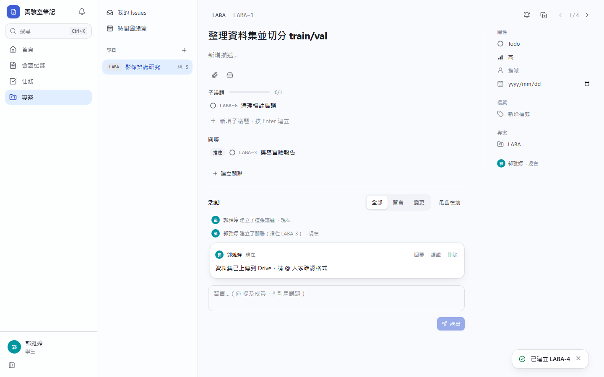
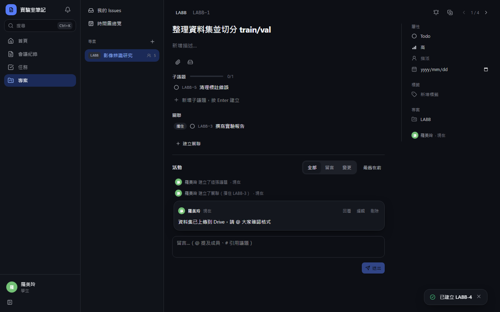
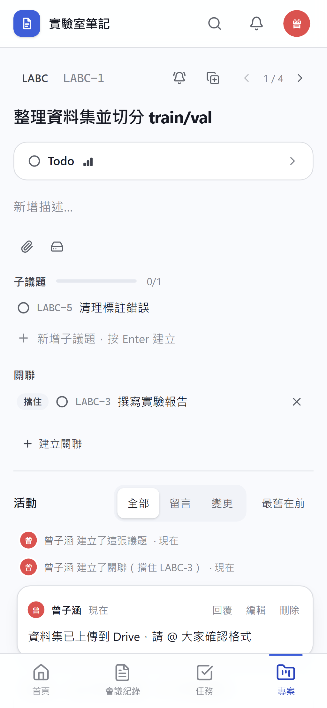
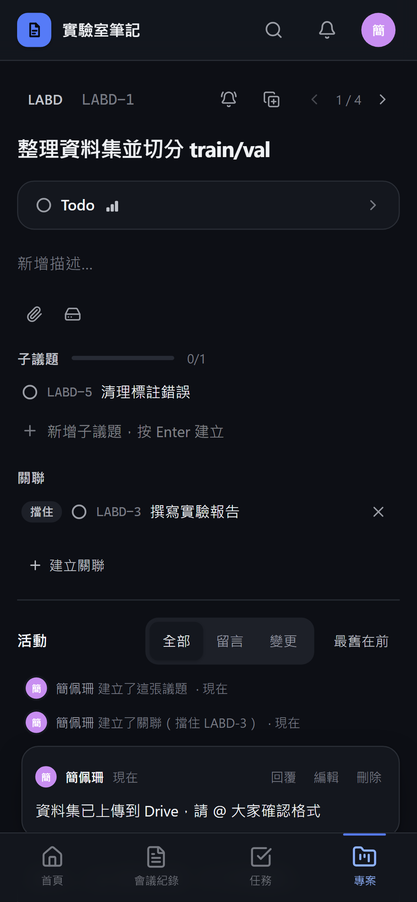

# [MS-33] 提供議題詳情全頁

> 狀態：完成

## 內文

### 需求
打開一張票要看到完整內容與屬性，並能不回清單就連續看下一張。

### 來源
使用者 2026-10-19 對話（初始需求）；設計：`design/05-project-management.md` §2（PROJ-44）、§5.4

### 驗收條件
- [x] 左欄由上到下：衝突橫幅、父票 chip 與「被 N 張票擋住」、標題（就地編輯）、描述（Markdown，`- [ ]` 可直接勾選）、子議題、關聯、附件、時間軸
- [x] 右欄：狀態、優先級、負責人、標籤、截止日、建立資訊、停滯徽章；手機上右欄移到標題下方並可收合
- [x] 有上一張／下一張（[ ／ ]），順序沿用進來時的清單與篩選排序；直接用網址開啟時不顯示
- [x] 返回清單時回到原捲動位置並選中剛看的票
- [x] 別人更新這張票時出現衝突橫幅與重新載入按鈕
- [x] 勾選描述中的待辦時，若原文與畫面不一致則拒絕並提示重新載入

### 測試流程
1. 從篩選後的清單打開第 3 張，按 ] 到第 4 張，順序與清單一致
2. 按返回，清單捲動位置不變且第 4 張被選中
3. 在描述中勾一個待辦，重新整理後仍勾選
4. B 修改同一張票，A 的畫面出現衝突橫幅

---

# 跟其他票的關係

- Blocks：MS-34、MS-35、MS-36
- Blocked by：MS-27
- Related：無

---

# Commit-1

## 內文

原本沒有議題詳情頁。
現在議題以全頁開啟，版面參考 Linear：左欄由上到下是衝突橫幅、父票與「被 N 張票擋住」、標題（點擊就地編輯）、描述（Markdown，`- [ ]` 可直接勾選；沒有描述時只顯示「新增描述…」）、一排小圖示（上傳附件、連結 Drive），有內容才出現的附件、子議題、關聯清單，以及活動與留言；右欄是無框的屬性清單（狀態、優先級、負責人、截止日、標籤、專案）與建立資訊、停滯提示。手機上屬性收在標題下方可展開。有上一張／下一張（[ ／ ]），順序沿用進來時的清單；別人更新時出現衝突橫幅；勾選待辦時若原文已變會拒絕並重新載入。
尚未完成：返回清單時回到原捲動位置並選中剛看的票（目前回到同一個篩選網址）。

### 測試結果

| 項目 | 結果 |
|---|---|
| 整合測試：勾選待辦時原文不符被拒（409） | 通過 |
| E2E 詳情頁、子議題、關聯、留言 | 通過（四種組合） |

### 截圖

**議題詳情**

# Commit-2

## 內文

原本從議題返回清單時不會標出剛才看的票。
現在返回時清單回到原本的捲動位置，並選取剛才打開的那張票（即使它還沒載入完就返回）。
驗收：從清單點開第 2 張票後按返回，第 2 張呈選取狀態。

### 測試結果

| 項目 | 結果 |
|---|---|
| 型別檢查（tsc -b） | 0 錯誤 |
| Lint 與色碼檢查 | 0 錯誤（81 個檔案） |
| 單元／整合測試（vitest） | 通過 38 / 38 |
| 驗收測試（Playwright 全套，電腦／手機 × 深／淺） | 通過 48 / 48 |

### 截圖

無畫面變更
