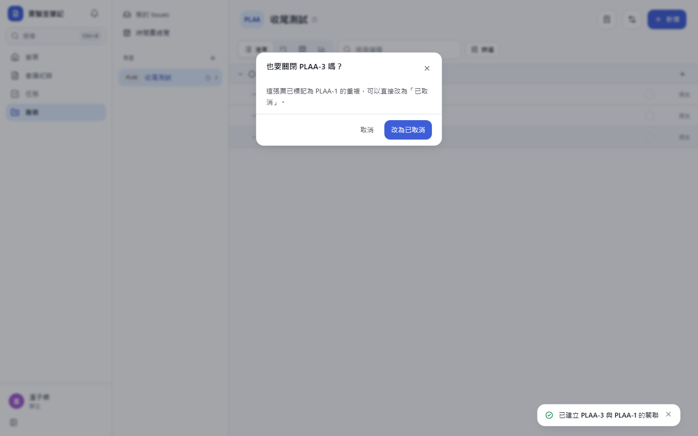
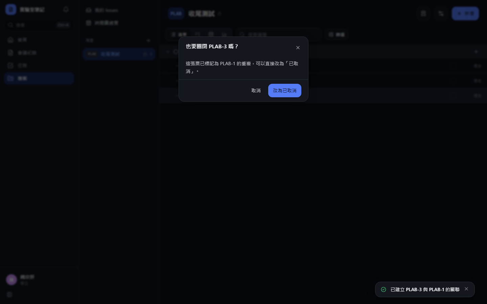

# [MS-34] 支援父子票與議題關聯

> 狀態：完成

## 內文

### 需求
大議題要能拆成子議題，議題之間要能標示擋住、相關、重複，被擋住的票一眼看得出來。

### 來源
使用者 2026-10-19 對話（初始需求）；設計：`design/05-project-management.md` §3（父子票、關聯）、§5.3、§5.4

### 驗收條件
- [x] 子議題區顯示 x／y 進度條，行內按 Enter 即新增子議題
- [x] 一張票只有一個父票，最多 10 層，形成循環時拒絕並說明
- [x] 關聯：blocks、relates、duplicate_of；「被擋住」由 blocks 反推，兩邊顯示永遠一致
- [x] 詳情頁顯示「⛔ 被 N 張票擋住」，只計未完成的票
- [x] 從右鍵選單建立關聯（子票、父票、Blocks、Blocked by）
- [x] 標記為重複時提示是否關閉此票

### 測試流程
1. 在 CATS-1 下行內新增 3 張子議題，完成 1 張後進度為 1／3
2. 嘗試把 CATS-1 設為自己子票的子票，被拒絕
3. CATS-2 blocks CATS-3，CATS-3 頁面顯示被 1 張擋住；CATS-2 完成後提示消失

---

# 跟其他票的關係

- Blocks：MS-37
- Blocked by：MS-33
- Related：無

---

# Commit-1

## 內文

原本議題之間沒有關係。
現在詳情頁可行內新增子議題（顯示 x／y 進度），一張票只有一個父票、最多 10 層，形成循環時拒絕並說明。關聯有擋住、被擋住、相關、重複於四種，「被擋住」由「擋住」反推，兩邊永遠一致；「被 N 張票擋住」只計未完成的票。右鍵選單可直接建立子議題。
尚未完成：右鍵選單建立父票／擋住／被擋住、標為重複時詢問是否取消此票。

### 測試結果

| 項目 | 結果 |
|---|---|
| 整合測試：擋住完成後提示消失、循環父票被拒 | 通過 |
| E2E 子議題與擋住關聯 | 通過（四種組合） |

### 截圖

**被擋住的前綴**

# Commit-2

## 內文

原本只能在議題頁建立關聯。
現在清單與看板的右鍵選單（手機長按）有「建立關聯」子選單：設定父議題、擋住、被擋住、相關、重複於，選了以後搜尋另一張票即可建立。標記為重複時會詢問是否同時把這張改為已取消；議題頁的關聯區也是一樣。
驗收：右鍵「重複於」選擇另一張票後出現「也要關閉嗎？」，按改為已取消後狀態變為已取消。

### 測試結果

| 項目 | 結果 |
|---|---|
| 型別檢查（tsc -b） | 0 錯誤 |
| Lint 與色碼檢查 | 0 錯誤（81 個檔案） |
| 單元／整合測試（vitest） | 通過 38 / 38 |
| 驗收測試（Playwright 全套，電腦／手機 × 深／淺） | 通過 48 / 48 |

### 截圖

**標記重複後詢問是否關閉**

