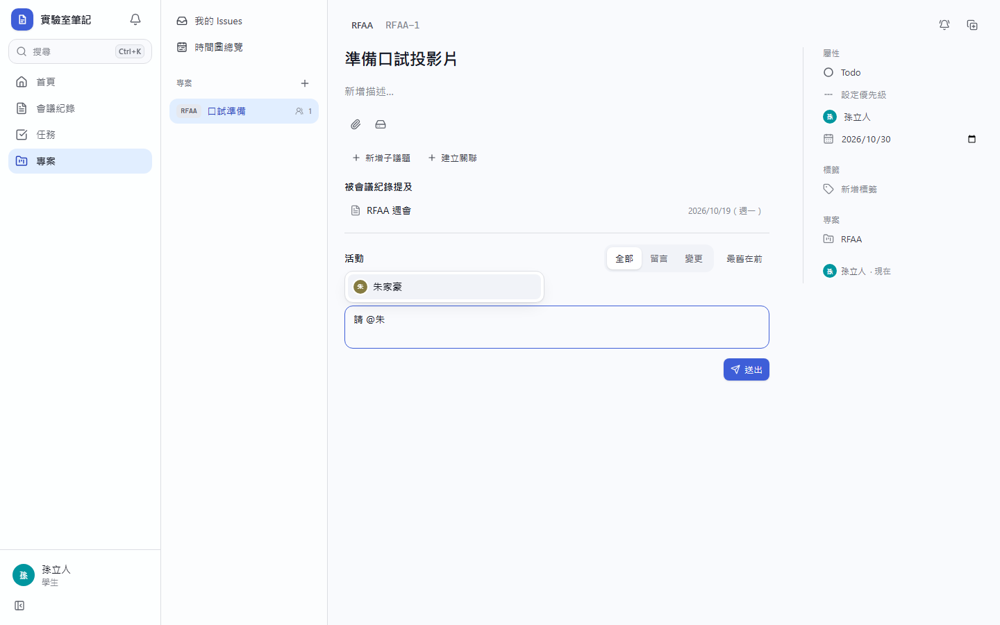
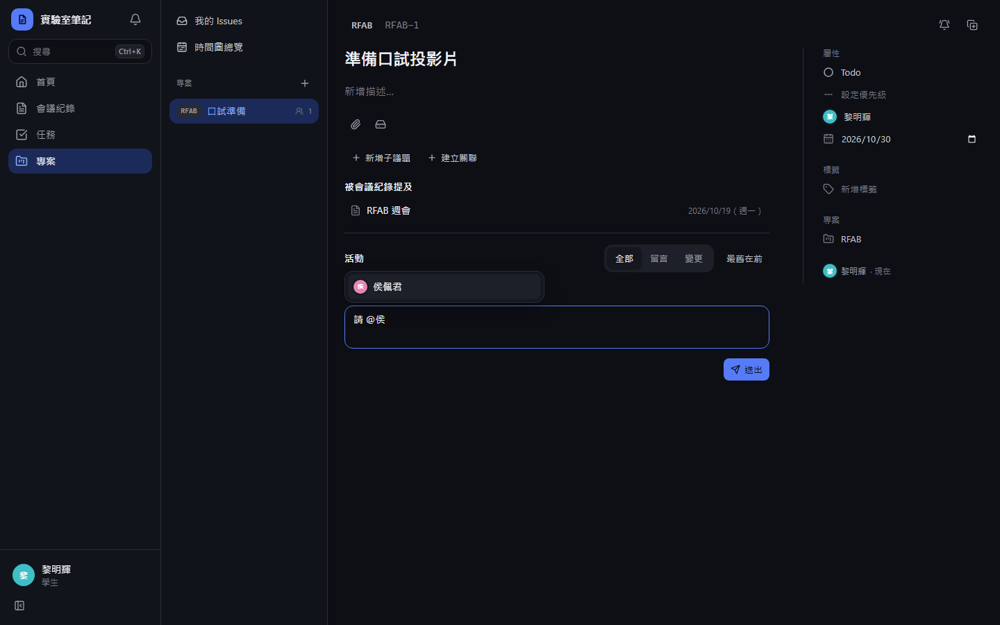
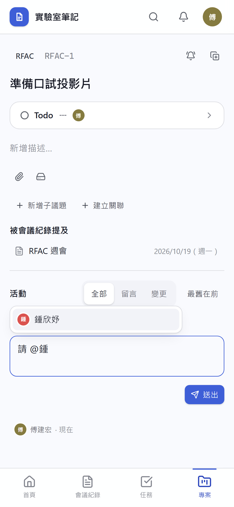
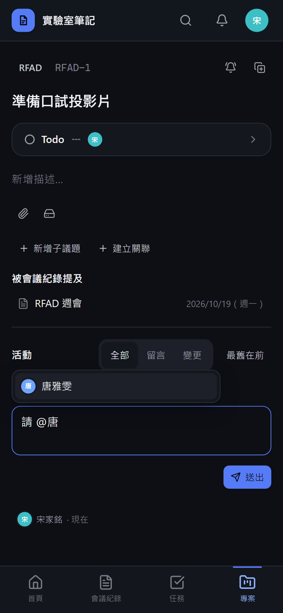
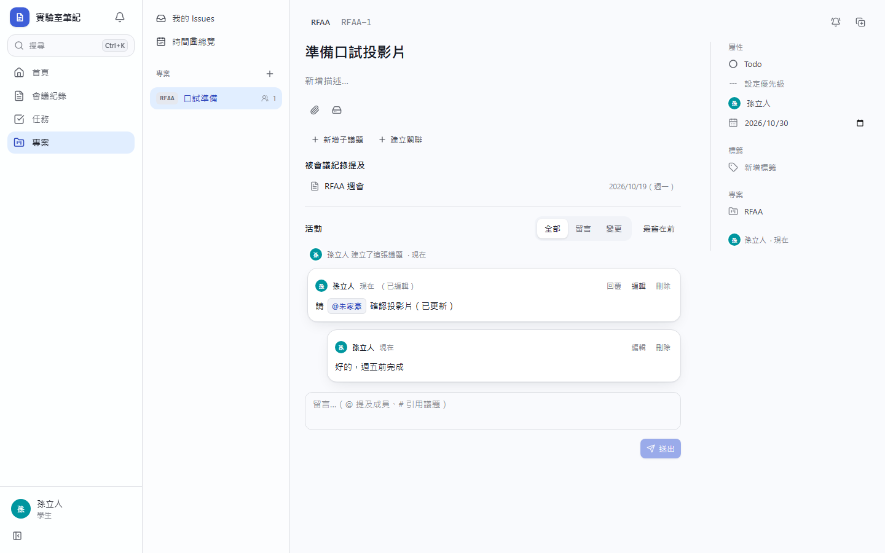
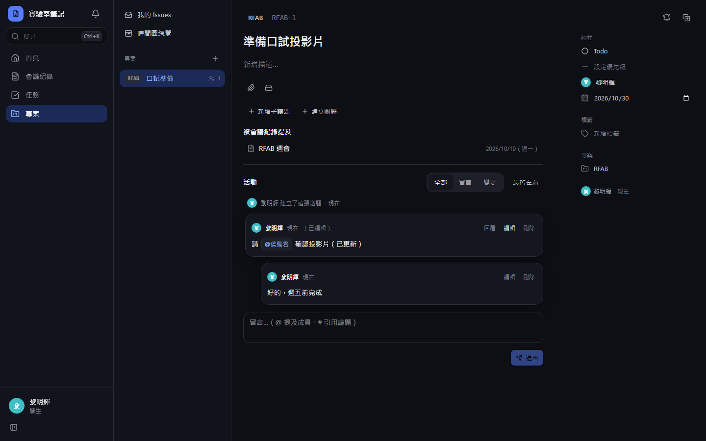
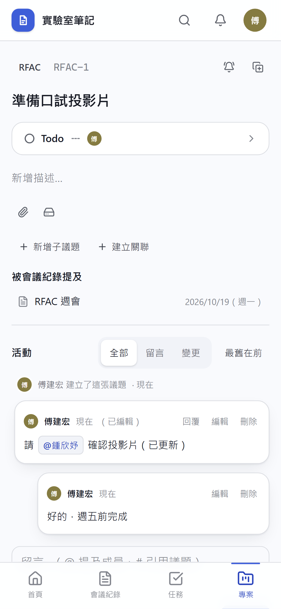
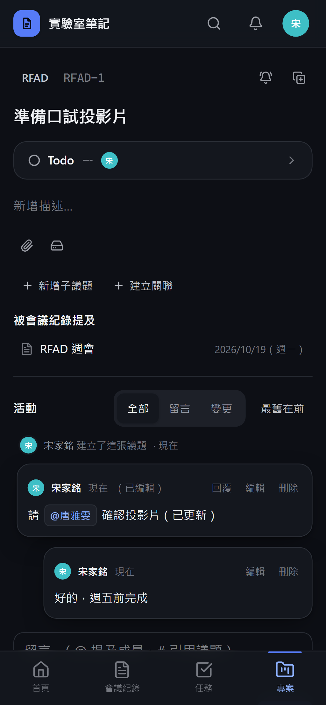

# [MS-35] 支援留言、提及與活動時間軸

> 狀態：完成

## 內文

### 需求
團隊要能在票上討論，提到人或其他票時對方收得到、能點過去。

### 來源
使用者 2026-10-19 對話（初始需求）；設計：`design/05-project-management.md` §5.5

### 驗收條件
- [x] 留言支援 Markdown、@ 叫出成員（只列看得到此專案的人）、# 搜尋議題，顯示成 pill；被 # 引用的票反向記一筆「被引用」
- [x] 回覆只有一層；只能編輯、刪除自己的留言，編輯過顯示「已編輯」
- [x] 時間軸合併留言與變更，可篩選全部／留言／變更、切換排序、「載入更早」分頁
- [x] 輸入框自動長高到 40% 視窗高度為止，不能手動拖曳；插入 mention 或自動接續清單時捲動位置不跳
- [x] 留言可貼上圖片

### 測試流程
1. 在留言 @B 並 # 引用 CATS-5，送出後顯示 pill
2. CATS-5 時間軸出現「被引用」
3. 編輯自己的留言，顯示已編輯；無法編輯別人的留言
4. 連續輸入 30 行，輸入框長到 40% 後改為內部捲動

---

# 跟其他票的關係

- Blocks：MS-41
- Blocked by：MS-33
- Related：無

---

# Commit-1

## 內文

原本議題不能討論。
現在詳情頁下方是留言與變更合併的時間軸，可篩選全部／留言／變更、切換排序、分頁載入更早的內容；留言支援 Markdown，只能刪除自己的留言，輸入框自動長高到視窗 40% 為止，Ctrl/⌘+Enter 送出。伺服器已處理 @提及（只能提及看得到專案的人）與 # 引用並寫入通知與反向引用。
尚未完成：留言輸入框的 @／# 自動完成、一層回覆的介面、編輯留言、貼上圖片。

### 測試結果

| 項目 | 結果 |
|---|---|
| E2E 留言出現在時間軸 | 通過（四種組合） |

### 截圖

**活動與留言**

# Commit-2

## 內文

原本留言框是純文字，打 @ 或 # 沒有提示，不能回覆或編輯，也不能貼圖。
現在議題與會議紀錄的留言框輸入 @ 會列出成員（議題只列看得到該專案的人），輸入 # 會搜尋議題與任務，方向鍵與 Enter 選取後插入成 pill；被 # 引用的議題在自己的活動時間軸多一筆「在另一張票引用了這張」並可點回。議題留言可回覆一層；只有作者能編輯與刪除自己的留言，編輯過顯示「（已編輯）」。留言框可直接貼上圖片，上傳後以 Markdown 圖片插入。
驗收：在議題留言打「@」加姓氏首字，看到專案成員並選取；送出後被提及的人收到提及通知；回覆一則、編輯原留言後顯示已編輯；在另一張票的留言引用此票，被引用的票時間軸出現一筆可點回的紀錄。

### 測試結果

| 項目 | 結果 |
|---|---|
| 型別檢查（tsc -b） | 0 錯誤 |
| Lint 與色碼檢查 | 0 錯誤（76 個檔案） |
| 單元／整合測試（vitest） | 通過 35 / 35 |
| 驗收測試（Playwright 全套，電腦／手機 × 深／淺） | 第一輪 32 / 36；失敗的 4 項為開發伺服器在大檔上傳時斷線與成員列表分頁（測試本身問題），修正測試後該 3 個規格重跑 16 / 16 通過 |

### 截圖

**@ 提及建議**

**回覆與已編輯**

