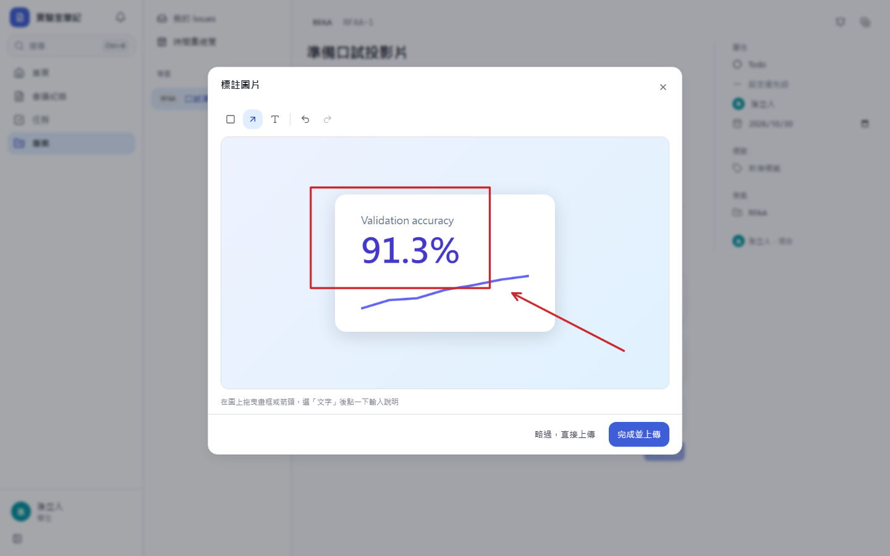
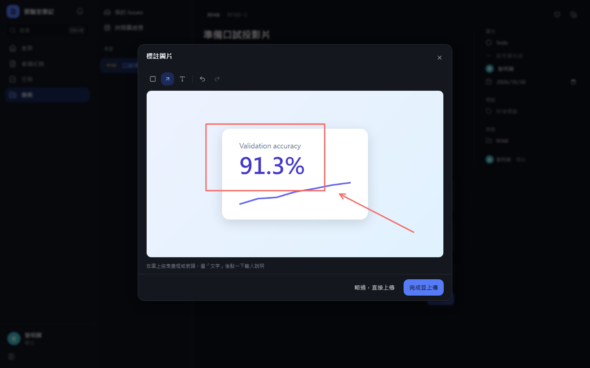
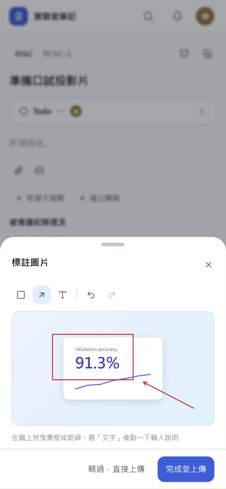
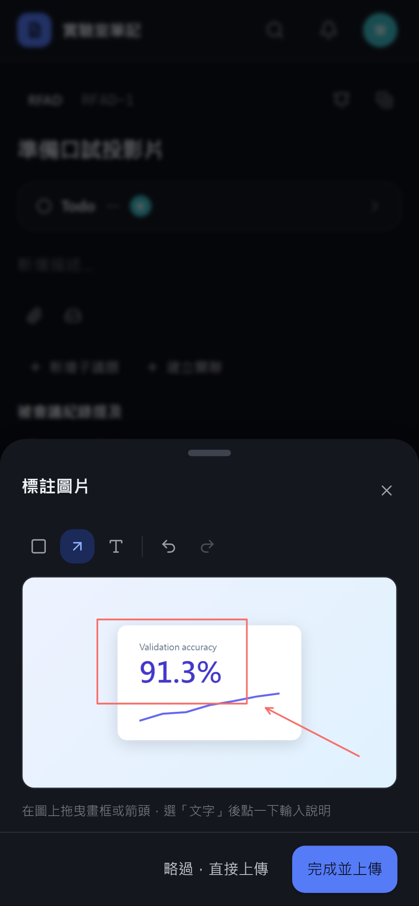
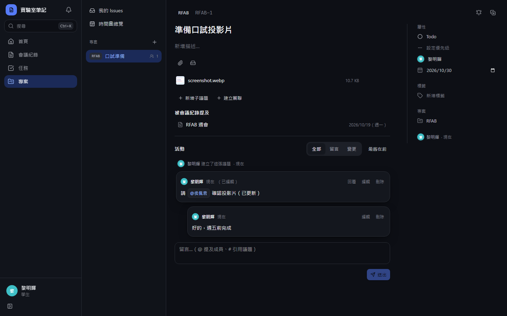
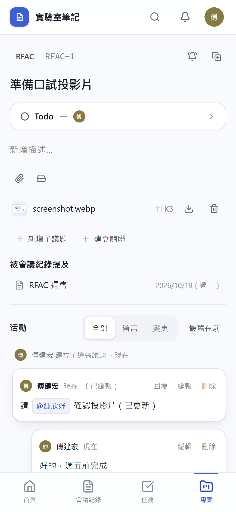
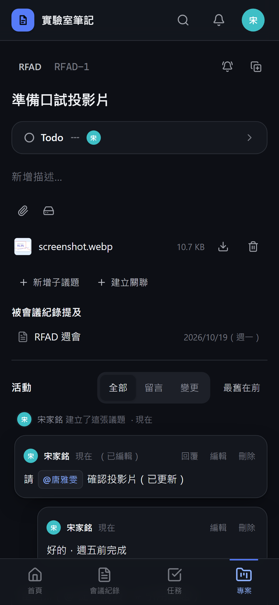

# [MS-36] 支援議題附件與圖片標註

> 狀態：完成

## 內文

### 需求
議題要能附檔案、圖片、Drive 檔案；貼截圖時能先畫紅框標註問題位置。

### 來源
使用者 2026-10-19 對話（初始需求）；設計：`design/05-project-management.md` §5.6 與「本平台的調整」

### 驗收條件
- [x] 上傳方式：按鈕、貼上、拖放；檔案存平台儲存，規則與會議紀錄附件一致
- [x] 貼上或拖放圖片時先開標註器：紅框、箭頭、文字、復原與重做，可略過
- [x] 先上傳完成才登記附件，中斷不留下孤兒附件
- [x] 可掛載既有 Drive 檔案：不套大小上限、不改 Drive 權限、移除時不刪來源檔
- [x] 附件權限與專案一致

### 測試流程
1. 在議題貼上截圖，標註器開啟，畫紅框與文字後確認，附件顯示標註後的圖
2. 標註時按復原與重做，結果正確
3. 上傳途中斷網，附件區沒有殘留項目
4. 掛載一個 Drive 檔案後移除，Drive 檔案仍在

---

# 跟其他票的關係

- Blocks：MS-37
- Blocked by：MS-17、MS-18、MS-33
- Related：無

---

# Commit-1

## 內文

原本議題附件只能按按鈕或拖放上傳，截圖貼上沒有反應，也不能先標註重點。
現在在議題頁任何非輸入框的位置貼上檔案即上傳為附件；貼上或拖放圖片時先開啟標註器，可畫紅框、箭頭、加文字，支援復原與重做（Ctrl/⌘+Z、Shift+Ctrl/⌘+Z），可略過直接上傳；手機上以底部抽屜操作，畫圖不會誤觸關閉。檔案先上傳完成才登記附件，被拒絕的上傳（超過大小或配額）會立即回報錯誤；Drive 檔案以連結掛載，不套大小上限、不改 Drive 權限、移除時不刪來源；附件權限與專案相同。
驗收：在議題頁貼上一張截圖，標註器出現，畫一個框與一個箭頭後按完成，附件區出現標註後的圖片；按略過則上傳原圖。

### 測試結果

| 項目 | 結果 |
|---|---|
| 型別檢查（tsc -b） | 0 錯誤 |
| Lint 與色碼檢查 | 0 錯誤（76 個檔案） |
| 單元／整合測試（vitest） | 通過 35 / 35 |
| 驗收測試（Playwright 全套，電腦／手機 × 深／淺） | 第一輪 32 / 36；失敗的 4 項為開發伺服器在大檔上傳時斷線與成員列表分頁（測試本身問題），修正測試後該 3 個規格重跑 16 / 16 通過 |

### 截圖

**貼上截圖後的標註器**

**標註後的附件**

