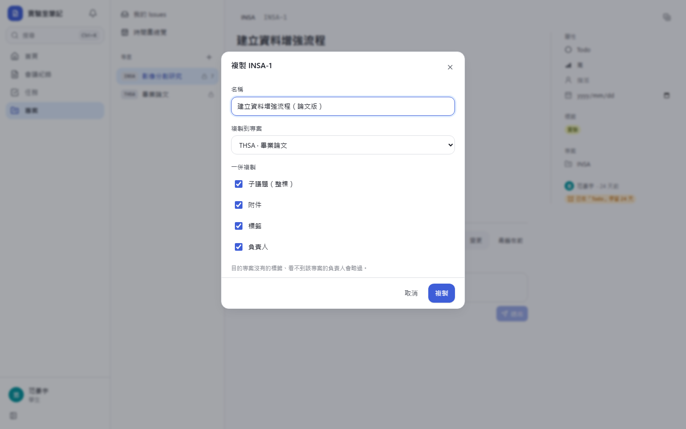
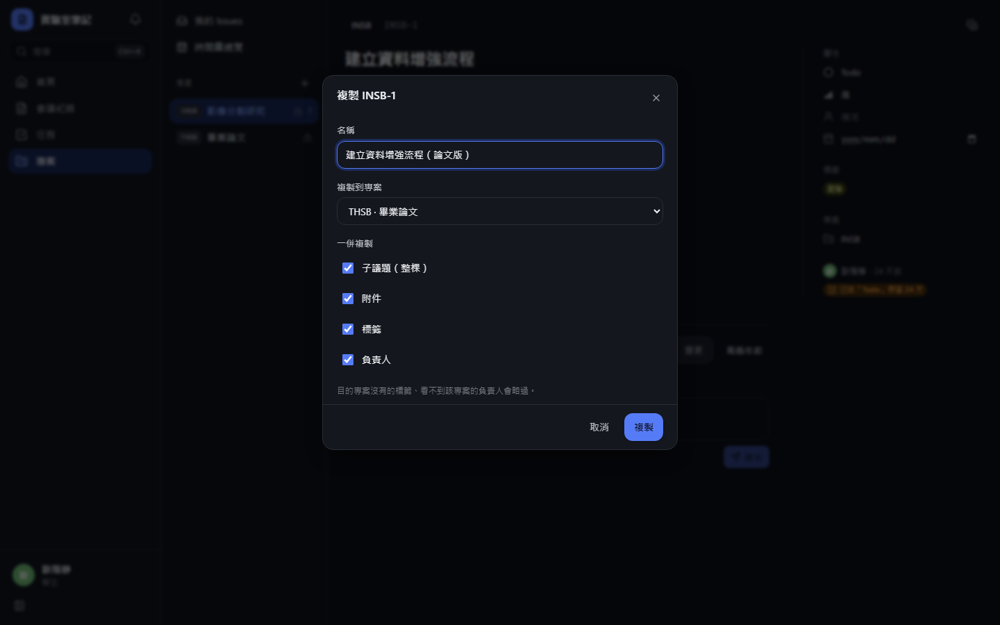
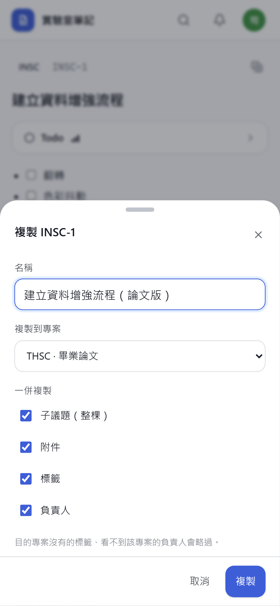
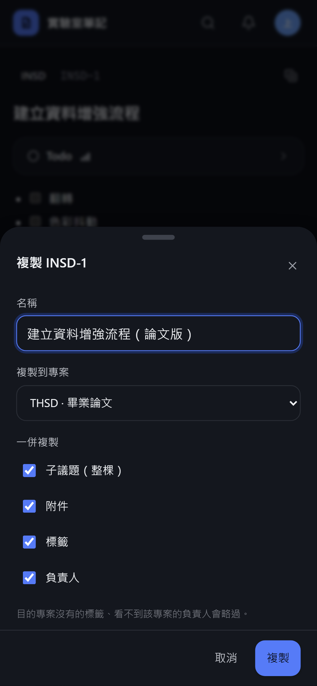
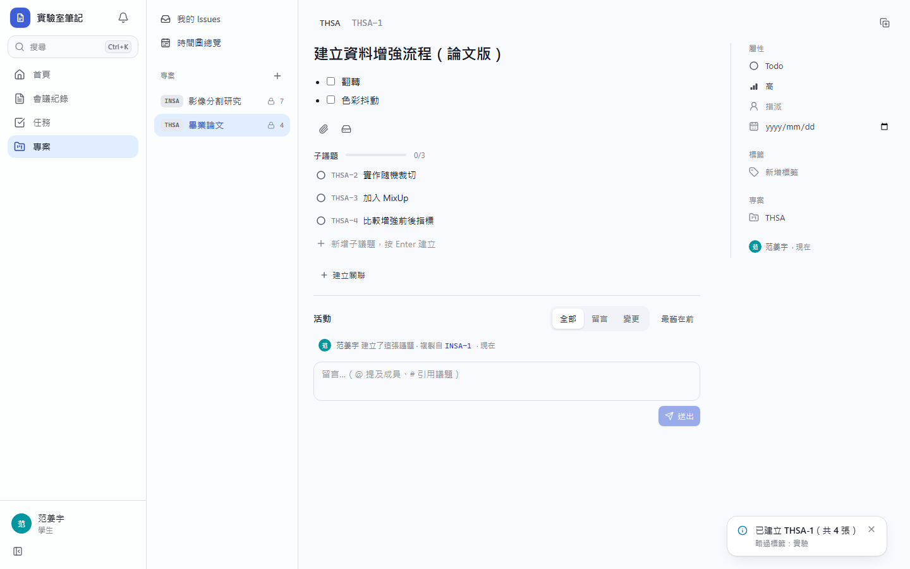
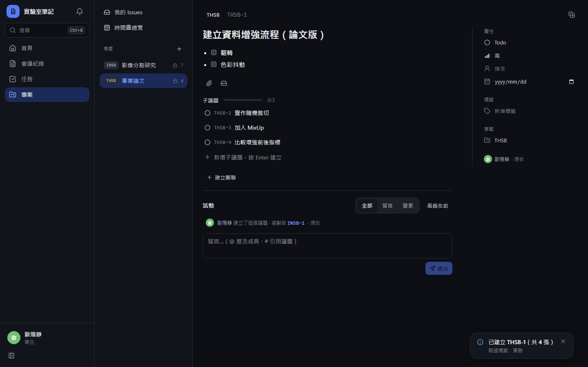
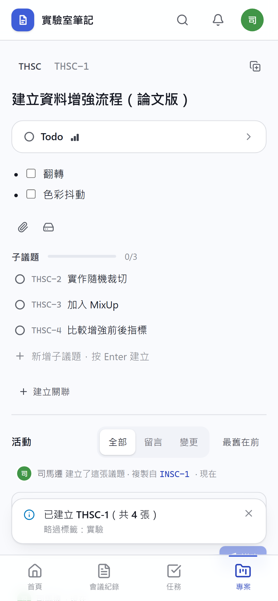
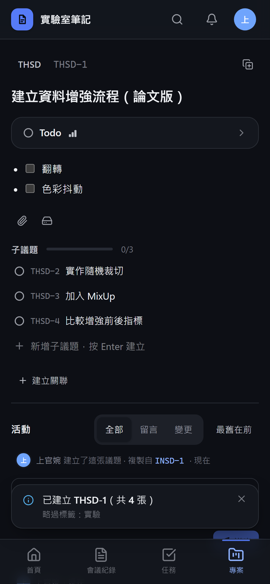

# [MS-37] 支援複製議題

> 狀態：完成

## 內文

### 需求
常有類似的票，要能一鍵複製並選擇要帶哪些內容。

### 來源
使用者 2026-10-19 對話（初始需求）；設計：`design/05-project-management.md` §5.7

### 驗收條件
- [x] 從右鍵選單或詳情頁觸發，可改名稱、選目的專案
- [x] 可選是否一併複製子議題（整棵）、附件、標籤、負責人
- [x] 整棵子樹的編號連續，不與其他同時建立的票交錯
- [x] 跨專案複製時，目的專案沒有的標籤與看不到專案的負責人自動略過並提示
- [x] 新票活動記「複製自 KEY-N」

### 測試流程
1. 複製一張有 3 張子議題與 2 個附件的票，勾選全部，新票與子議題、附件都在
2. 複製到另一個專案，原標籤在目的專案不存在，看到略過提示
3. 新票活動顯示複製來源並可點回

---

# 跟其他票的關係

- Blocks：無
- Blocked by：MS-34、MS-36
- Related：無

---

# Commit-1

## 內文

原本類似的票只能重新開一張、一欄一欄填。
現在議題頁右上角的複製圖示、清單與看板的右鍵選單都能「複製議題」：可改名稱、選目的專案，勾選是否一併複製整棵子議題、附件、標籤與負責人。整棵樹的編號一次保留，連續不會和別人同時開的票交錯；跨專案時標籤依名稱對應，目的專案沒有的標籤與看不到該專案的負責人會略過並在完成提示中列出。附件連同檔案本體一起複製，描述內的圖片改指向新附件；新票活動顯示「複製自 KEY-N」並可點回原票。AI 工具也能透過 MCP 的 issue_duplicate 複製。
驗收：把有 3 張子議題、1 個附件與 2 個標籤的票複製到另一專案，新票加子議題共 4 張、編號連續（同時有人在目的專案開票也不交錯），附件內容一致，只保留名稱對得上的標籤並提示略過的那個，活動可點回來源。

### 測試結果

| 項目 | 結果 |
|---|---|
| 型別檢查（tsc -b） | 0 錯誤 |
| Lint 與色碼檢查 | 0 錯誤（69 個檔案） |
| 單元／整合測試（vitest） | 通過 29 / 29 |
| 驗收測試（Playwright，電腦／手機 × 深／淺） | 通過 24 / 24 |

### 截圖

**複製視窗**

**複製完成：子議題、略過提示與來源連結**

