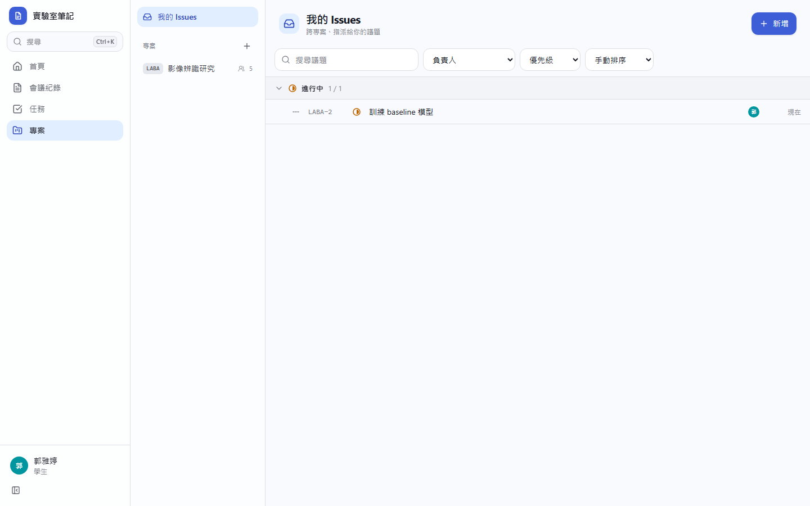
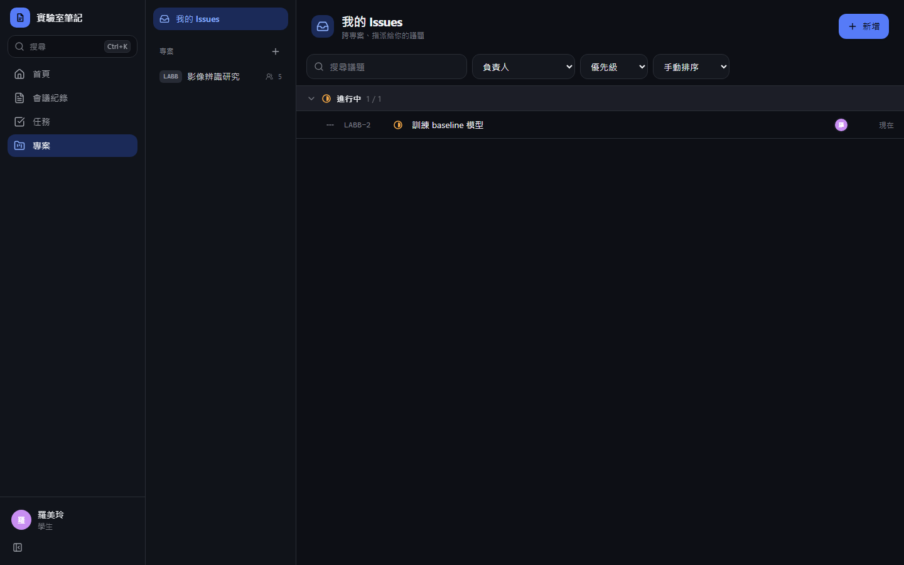
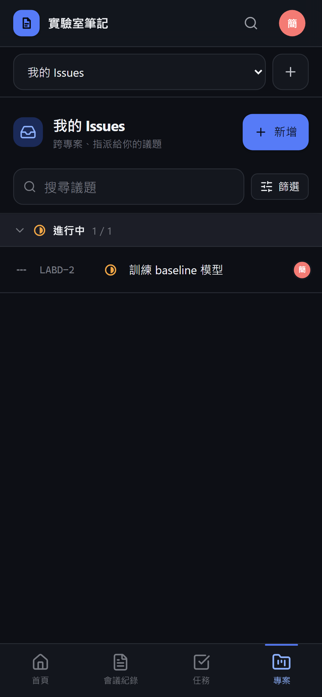

# [MS-39] 提供我的 Issues 與跨專案搜尋

> 狀態：進行中

## 內文

### 需求
每個人要一眼看到所有指派給自己的票，並能跨專案搜尋。

### 來源
使用者 2026-10-19 對話（初始需求）；設計：`design/05-project-management.md` §2（/projects）、§4（跨專案查詢）、§5.2

### 驗收條件
- [x] `/projects` 列出跨專案指派給我的票，依狀態分組、各自分頁
- [x] 完成的票預設只列最近 14 天，組底「顯示全部」可切換
- [ ] 跨專案搜尋（/ 聚焦）可搜編號與關鍵字，只搜自己可見的專案，分頁數量正確
- [ ] 可依專案、狀態、優先級篩選並寫在網址

### 測試流程
1. 在兩個專案各被指派數張票，我的 Issues 都看得到
2. 一張 20 天前完成的票預設不顯示，按顯示全部後出現
3. 搜尋另一個我不是成員的專案的票標題，搜不到

---

# 跟其他票的關係

- Blocks：無
- Blocked by：MS-30
- Related：無

---

# Commit-1

## 內文

原本看不到跨專案指派給自己的票。
現在「我的 Issues」列出所有專案中指派給我的票，依狀態分組、各自分頁；完成與已取消預設只列最近 14 天，組底可「顯示全部」。指令面板（⌘K）可用編號或標題跨專案搜尋議題，只搜自己看得到的專案。
尚未完成：我的 Issues 依專案篩選。

### 測試結果

| 項目 | 結果 |
|---|---|
| E2E 我的 Issues | 通過（四種組合） |

### 截圖

**我的 Issues**

