# [MS-3] 支援中英文切換

> 狀態：完成

## 內文

### 需求
介面要有中文與英文兩種語系，使用者可以隨時切換，日期、時間、相對時間也依語系顯示。

### 來源
使用者 2026-10-19 對話（初始需求）

### 驗收條件
- [x] 設定頁與頂端選單都能切換中文／英文，切換後不重新整理頁面即全站更新
- [x] 第一次造訪依瀏覽器語言決定預設語系；登入後記住選擇並跨裝置同步
- [x] 日期時間依語系格式化（例如 `2026/10/19（一）14:00` 與 `Mon, Oct 19, 2026 2:00 PM`），相對時間（3 分鐘前／3 min ago）也一樣
- [x] 兩種語系的字串鍵完全一致，缺字串時建置失敗
- [x] 伺服器回傳的錯誤訊息、Email 以外的通知文字也依使用者語系顯示
- [x] 英文介面下所有頁面沒有文字溢出或截斷（電腦與手機）

### 測試流程
1. 用英文瀏覽器第一次開站，看到英文介面
2. 切到中文，頁面內所有文字、日期立刻變中文
3. 觸發一個錯誤（例如名稱留空送出），錯誤訊息為目前語系
4. 在手機寬度下逐頁瀏覽英文介面，檢查沒有文字被截斷

---

# 跟其他票的關係

- Blocks：MS-11
- Blocked by：MS-1
- Related：無

---

# Commit-1

## 內文

原本介面只有中文字串。
現在全站字串都經過 i18n，中文、英文可在設定頁即時切換不需重新整理；首次造訪依瀏覽器語言決定，登入後記在帳號上跨裝置同步。日期、時間、相對時間依語系格式化。英文字典的型別必須與中文完全對應，缺字串或多字串都會讓型別檢查失敗。伺服器只回錯誤代碼，訊息由前端依語系翻譯。
尚未完成：逐頁檢查英文在手機上的文字截斷。

### 測試結果

| 項目 | 結果 |
|---|---|
| 型別檢查（兩語系鍵值一致） | 0 錯誤 |
| E2E 切換英文 | 通過 |

### 截圖

**切換為英文後的設定頁**

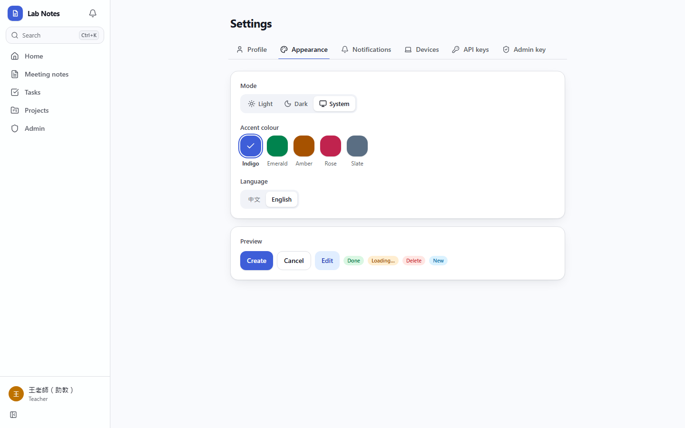
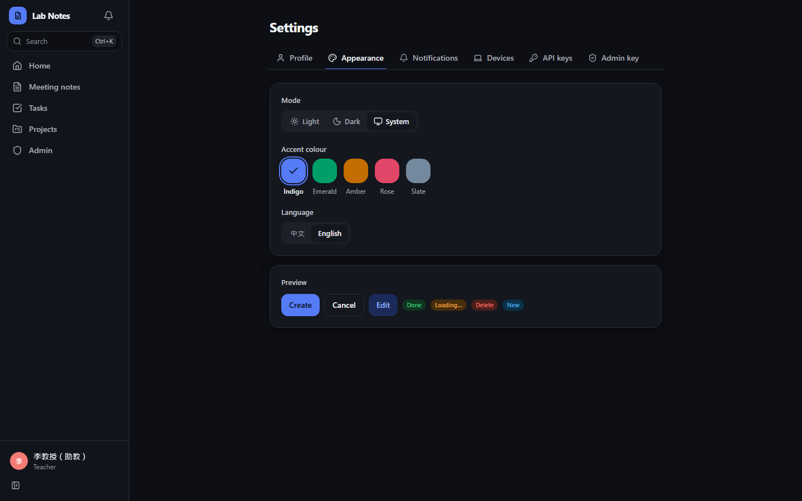
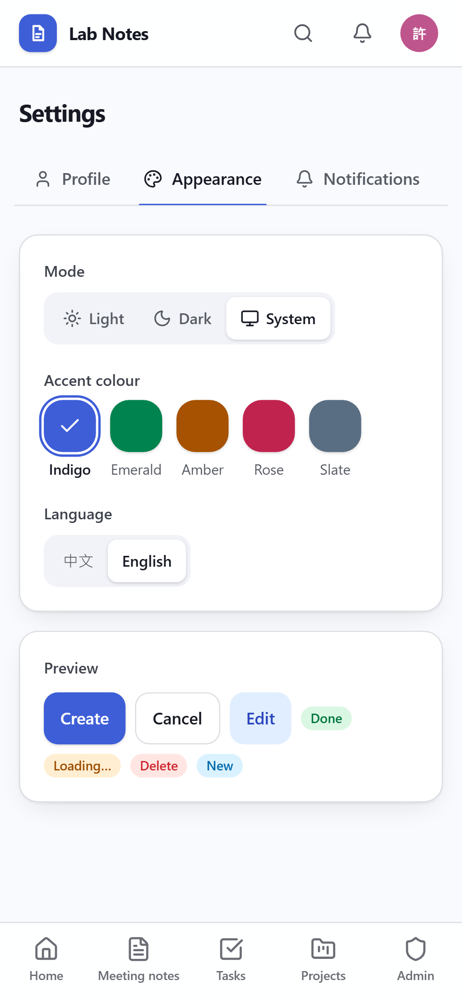
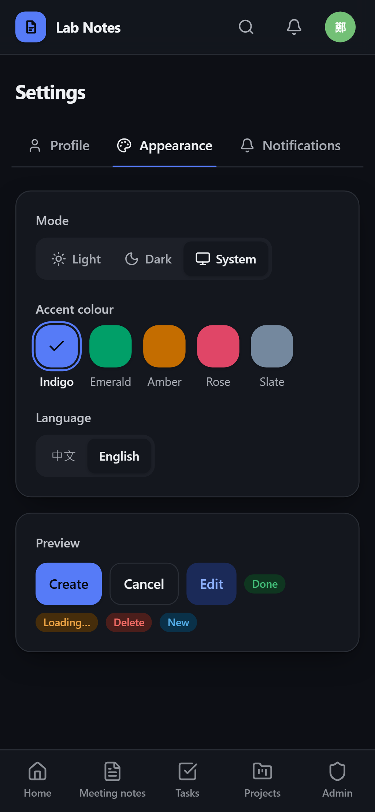

# Commit-2

## 內文

原本沒有檢查英文介面的版面。
現在以英文介面逐頁檢查首頁、會議紀錄列表與內頁、任務、專案（清單、看板、時間圖、統計、議題頁、時間圖總覽）與設定各 Tab，電腦與手機都沒有任何頁面出現橫向捲動；手機上過長的專案名稱改為換行而不是被切掉。議題標題等使用者內容過長時以「…」截斷屬預期。
驗收：14 個頁面在 1440 與 390 寬度下 scrollWidth 都不超過視窗寬度。

### 測試結果

| 項目 | 結果 |
|---|---|
| 完整測試套件（vitest） | 通過 46 / 46 |
| E2E（Playwright，4 種裝置×主題） | 通過 92 / 92（4 項僅桌機，手機略過） |
| 型別檢查 | 0 錯誤 |
| lint（含色碼與對比度檢查） | 0 錯誤 |

### 截圖

**英文介面：專案**

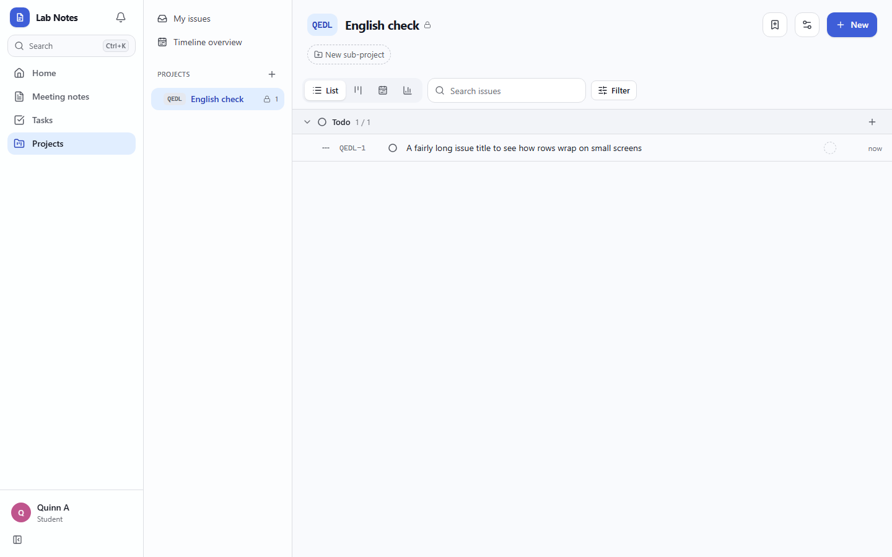
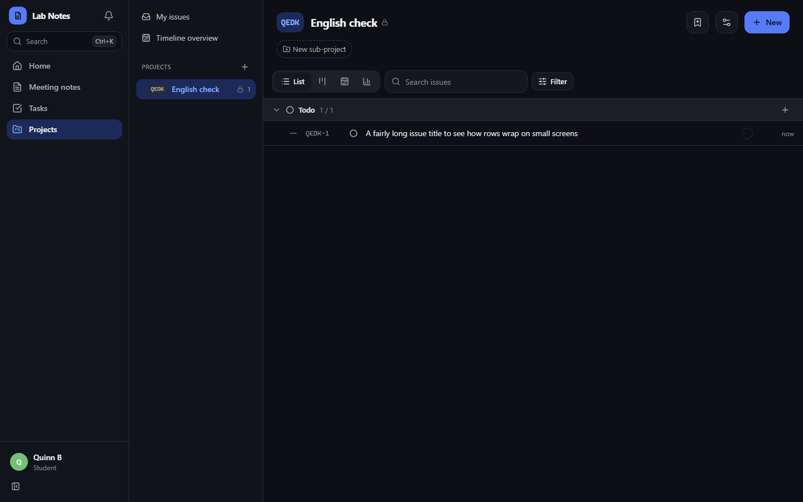
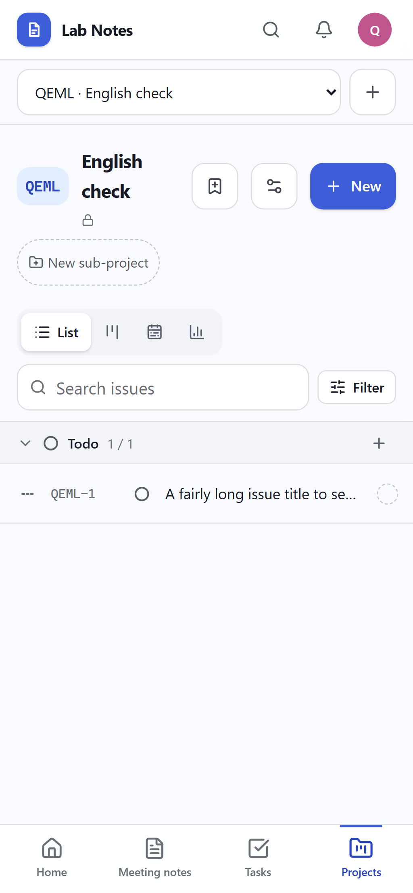
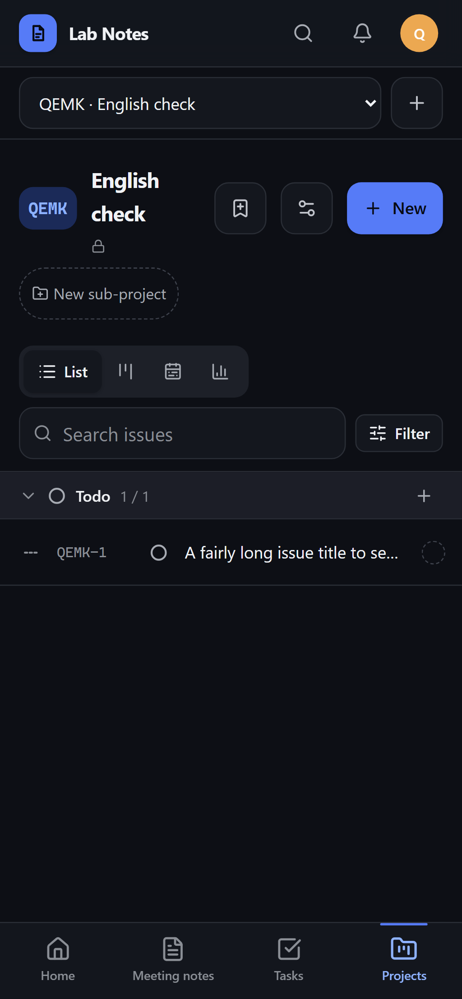

**英文介面：通知設定**

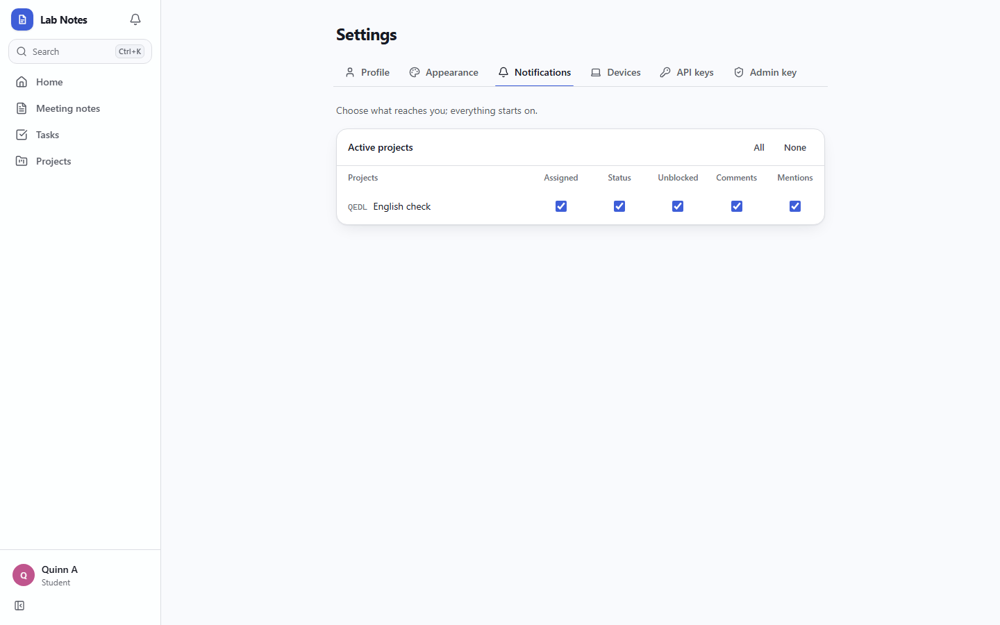
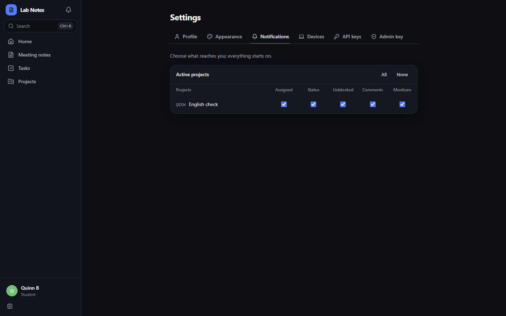
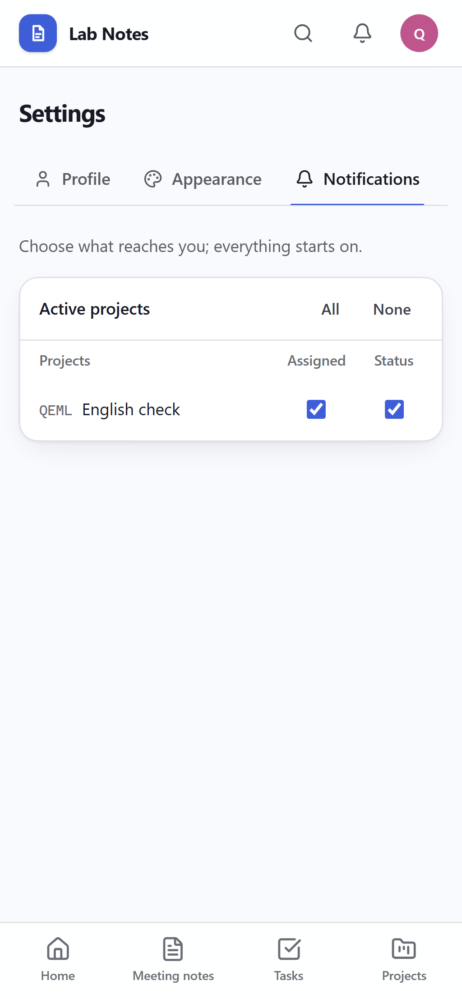
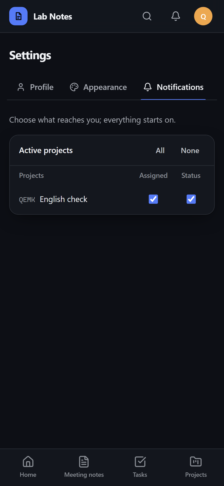
