# [MS-40] 提供統計、停滯偵測與已存檢視

> 狀態：完成

## 內文

### 需求
要能看出專案效率、卡住的票，並保存常用的篩選畫面。

### 來源
使用者 2026-10-19 對話（初始需求）；設計：`design/05-project-management.md` §9

### 驗收條件
- [x] 統計：Lead time、Cycle time 的平均與中位數、各狀態平均停留時間、近 12 週每週完成數，全部從活動推導
- [x] 停滯偵測：在同一未完成狀態超過門檻（3／7／14／30 天，預設 7）顯示 ⏰，依狀態變更時間判斷，完成的票不顯示
- [x] 已存檢視：把目前網址命名保存，上限 30 筆，可重新命名與刪除
- [x] 統計圖在手機上可閱讀

### 測試流程
1. 打開專案統計，數字與手動計算一致
2. 一張票停在進行中 8 天，顯示 ⏰；改為完成後消失
3. 設好篩選後存成檢視，從側欄點開還原相同畫面

---

# 跟其他票的關係

- Blocks：無
- Blocked by：MS-32
- Related：無

---

# Commit-1

## 內文

原本看不到團隊的交付速度，停太久的票也沒有提醒，常用的篩選每次都要重設。
專案頁多了「統計」檢視：Lead time（建立到完成）與 Cycle time（第一次進行中到完成）的平均與中位數、各狀態平均停留時間、近 12 週每週完成數，全部從狀態變更紀錄推導，手機上卡片改為單欄。專案設定可選停滯門檻 3／7／14／30 天（預設 7），未完成的票在同一狀態超過門檻就在清單、看板與詳情頁顯示 ⏰ 與停留天數，完成或取消的票不顯示。任何專案頁都能按「儲存檢視」把目前網址（篩選、排序、檢視）命名保存，每人最多 30 筆，從側欄（手機在專案選單）點開還原，可重新命名與刪除，別人看不到也改不了。
驗收：2 張已完成、5 張未完成的專案，統計的樣本數與天數和手動計算一致；十天後所有未完成的票出現 ⏰、已完成的沒有；存下「高優先看板」後從側欄點開，網址與畫面回到看板＋高優先篩選。

### 測試結果

| 項目 | 結果 |
|---|---|
| 型別檢查（tsc -b） | 0 錯誤 |
| Lint 與色碼檢查 | 0 錯誤（69 個檔案） |
| 單元／整合測試（vitest） | 通過 29 / 29 |
| 驗收測試（Playwright，電腦／手機 × 深／淺） | 通過 24 / 24 |

### 截圖

**統計**

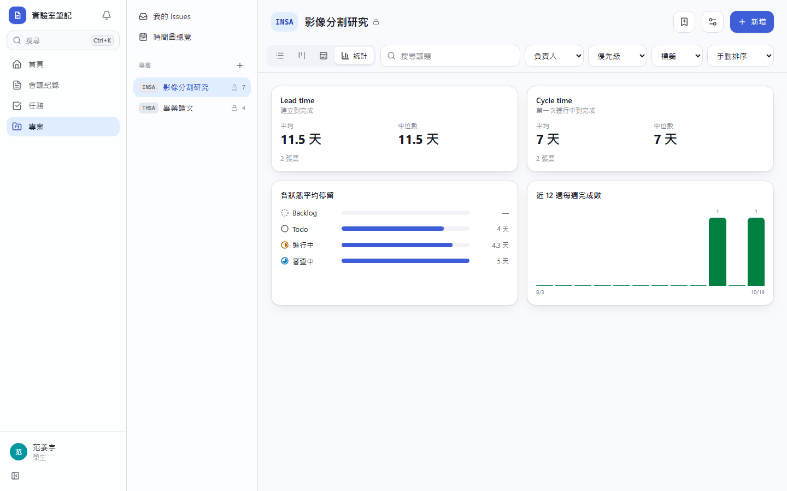
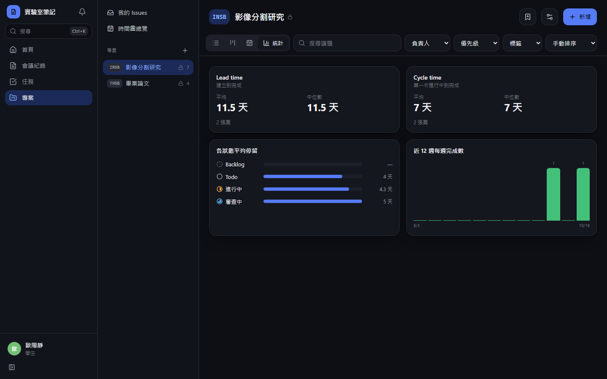
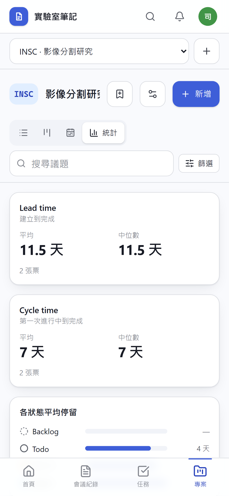
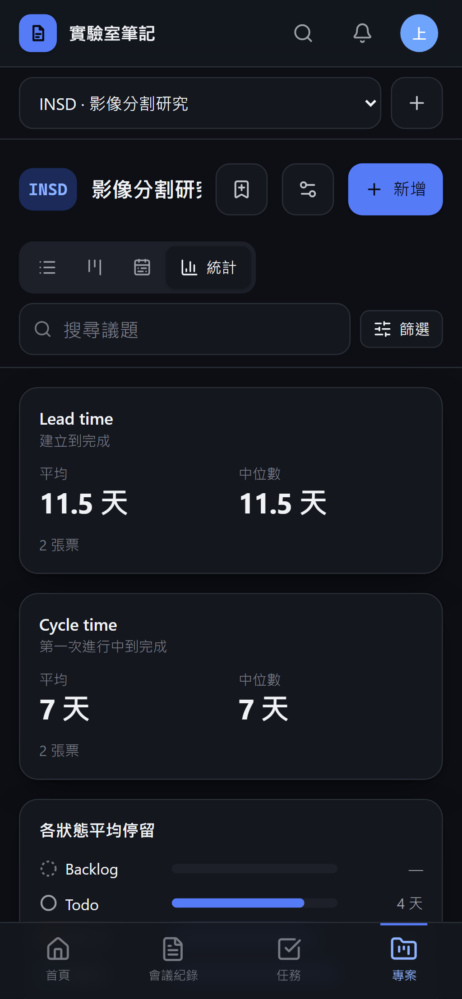

**停滯提醒**

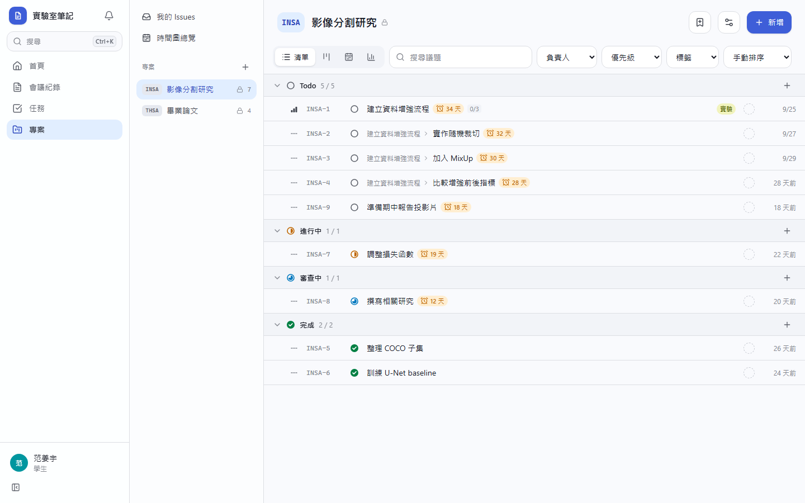
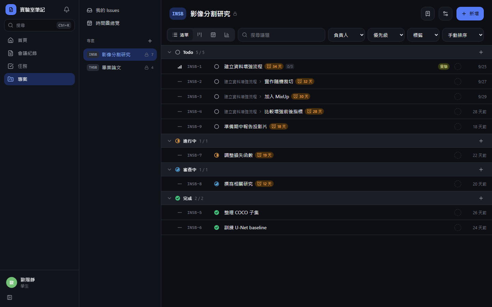
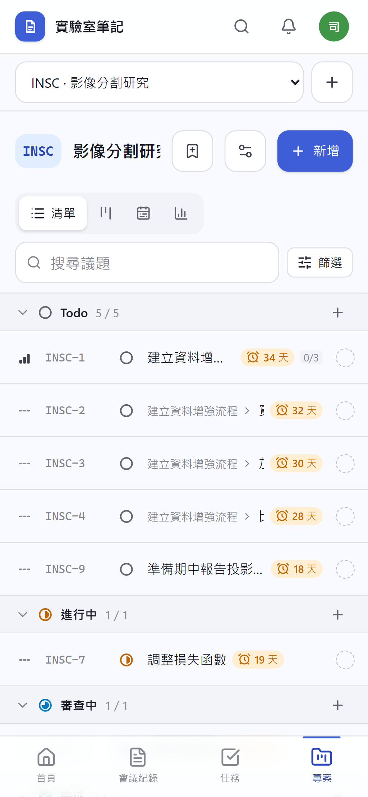
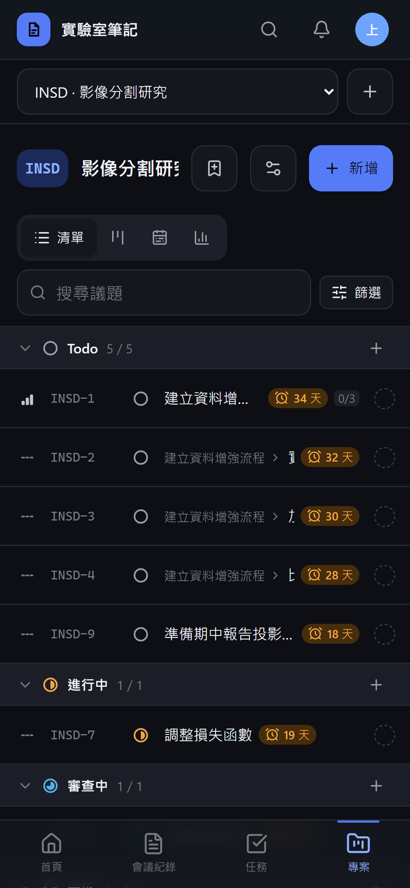

**已存檢視還原**

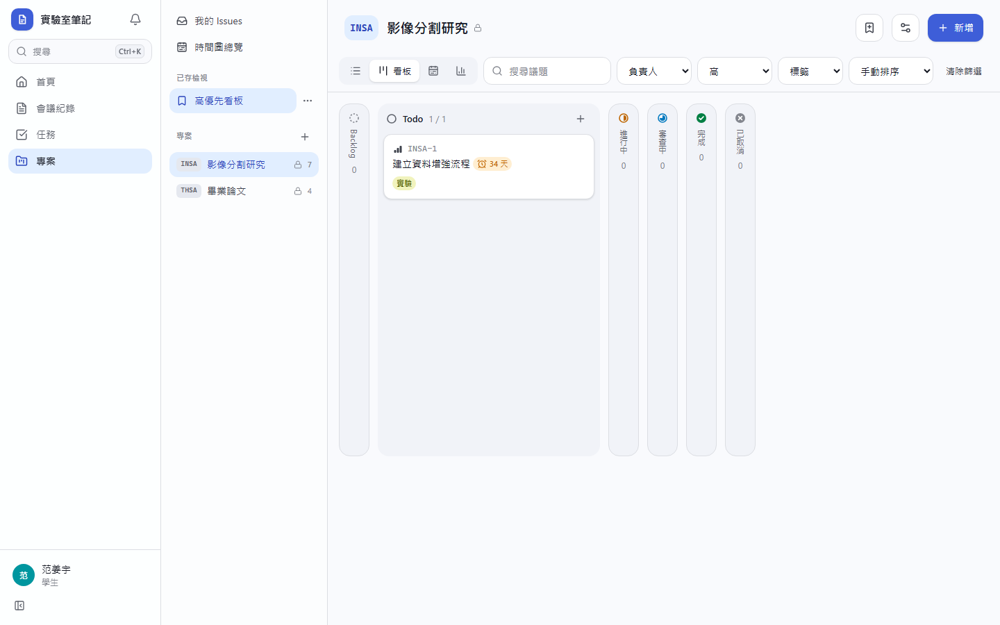
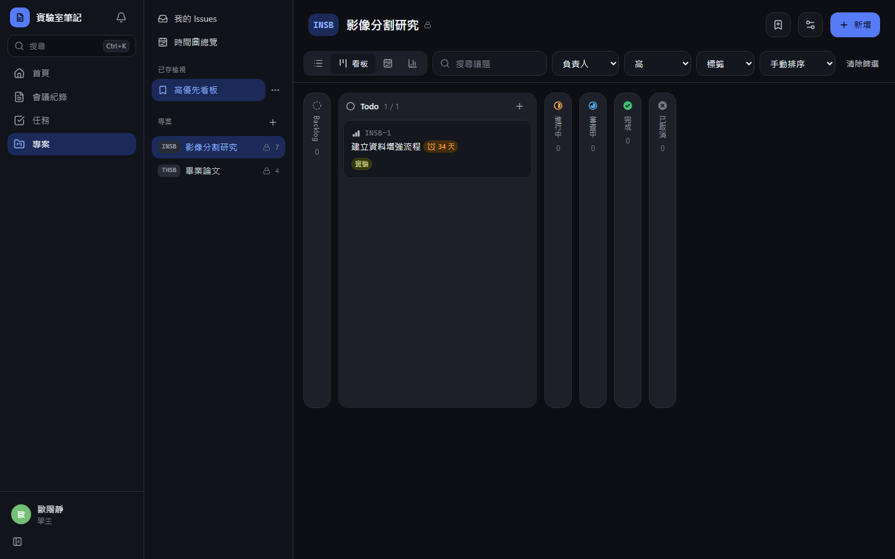
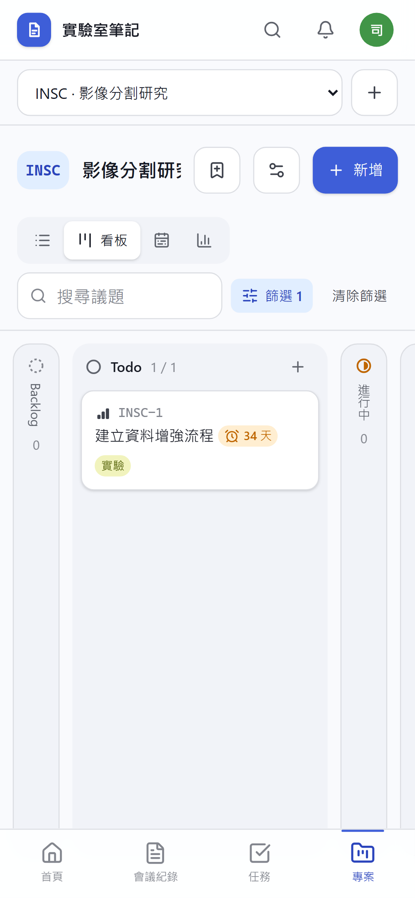
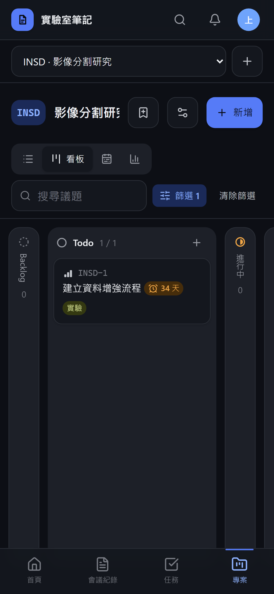
