# [MS-41] 提供站內通知與通知偏好

> 狀態：完成

## 內文

### 需求
被指派、被提及、收到註解、評測結果出來時要收到通知，並能自己決定要收哪些。

### 來源
使用者 2026-10-19 對話（初始需求）；設計：`design/05-project-management.md` §10、§13；待確認 #3

### 驗收條件
- [x] 事件：議題被指派、狀態變更、新留言、被提及；會議紀錄被註解與回覆；任務評測結果
- [x] 訂閱者收通知；議題建立者與負責人自動訂閱；60 秒內同一張票的通知合併；自己做的動作不通知自己
- [x] 通知鈴鐺顯示未讀數，列表可標已讀、全部已讀，點擊前往對應位置
- [x] 清單上有未讀通知的票顯示紅點
- [x] 偏好設定為「專案 × 事件」矩陣，分進行中、已結案、已封存三區，有全選與全不選；沒有設定即為開啟
- [x] 通知在資料寫入成功後才送出；單一收件人失敗不影響其他人與主流程
- [x] 通知即時出現（不需重新整理）

### 測試流程
1. B 把 CATS-1 指派給 A，A 的鈴鐺即時出現未讀
2. B 在 60 秒內連改 CATS-1 三次，A 只收到一則合併通知
3. A 在偏好關閉 CATS 的狀態變更，B 改狀態後 A 沒收到
4. A 提交任務，評測完成後收到結果通知

---

# 跟其他票的關係

- Blocks：MS-57
- Blocked by：MS-15、MS-23、MS-35
- Related：無

---

# Commit-1

## 內文

原本平台不會通知任何人。
現在議題被指派、狀態變更、新留言、被 @ 提及、會議紀錄被註解或回覆、任務評測結果出來時，相關的人都會收到站內通知（自己做的動作不通知自己）。左側導覽與手機頂端有鈴鐺與未讀數，點開列出最近的通知，可以全部標為已讀，點一則會標為已讀並直接打開對應的議題、會議紀錄或任務。通知在資料寫入成功後才送出，每位收件人各自寫入，某一人失敗不影響其他人與原本的操作。
尚未完成：訂閱機制與 60 秒合併、清單上的未讀紅點、「專案 × 事件」偏好設定、即時推送（目前每 30 秒更新一次）。

### 測試結果

| 項目 | 結果 |
|---|---|
| E2E 指派後對方鈴鐺出現未讀並可點開議題 | 通過（四種組合） |

### 截圖

**通知鈴鐺**

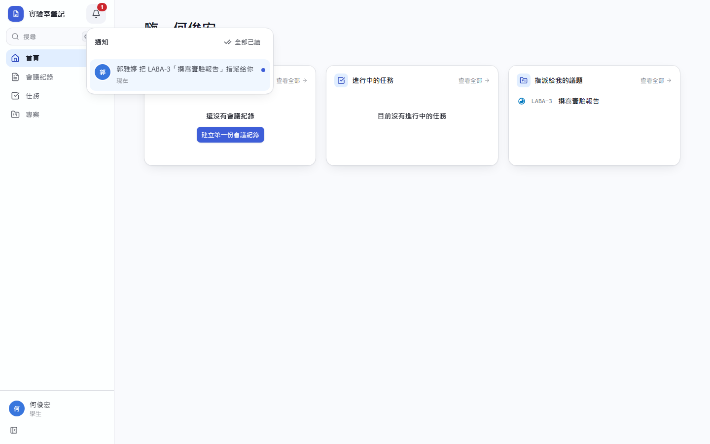
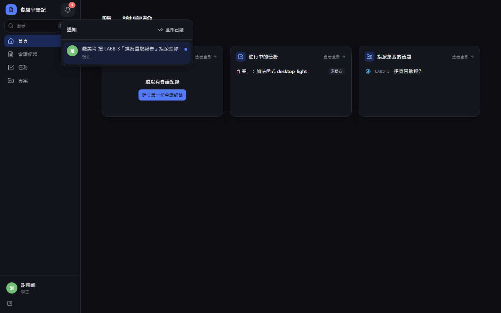
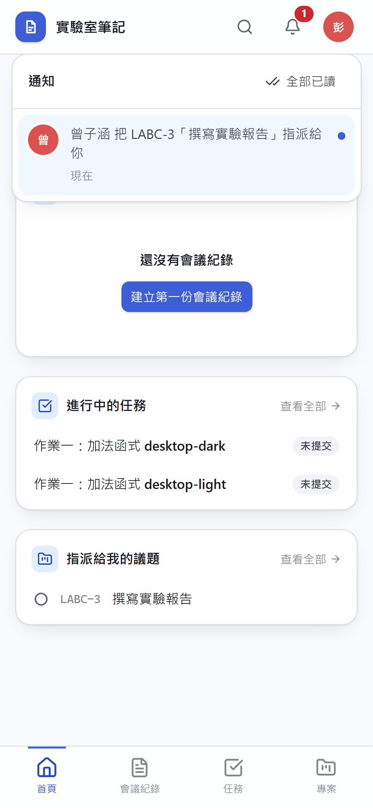
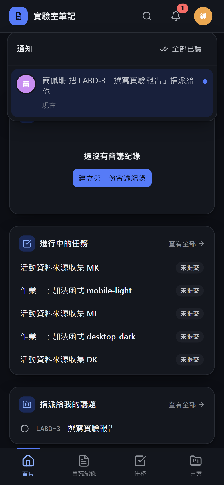

# Commit-2

## 內文

通知原本是側欄裡的一列導覽，和頁面導覽混在一起不好辨認。
現在通知只留鈴鐺圖示，放在側欄頂端站名旁邊（側欄收合時移到帳號上方，手機在頂列），未讀數以紅色角標顯示，點開仍是同一個通知面板。
驗收：電腦版展開與收合、手機版都只剩鈴鐺圖示，未讀角標與點開後跳轉正常。

### 測試結果

| 項目 | 結果 |
|---|---|
| 型別檢查（tsc -b） | 0 錯誤 |
| Lint 與色碼檢查 | 0 錯誤（69 個檔案） |
| 單元／整合測試（vitest） | 通過 29 / 29 |
| 驗收測試（Playwright，電腦／手機 × 深／淺） | 通過 24 / 24 |

### 截圖

**通知鈴鐺**

# Commit-3

## 內文

原本通知只發給建立者與負責人、每次變更各一則，也不能關掉不想收的通知，清單上看不出哪張票有新動態。
現在每張票有訂閱者：建立者、負責人與留言的人自動訂閱，議題頁右上角的鈴鐺可訂閱或取消；狀態變更與新留言只發給訂閱者，被 @ 的人另外收到提及通知，自己的動作不會通知自己。同一張票 60 秒內的多次更新合併成一則「有 N 項更新」，提及不合併。「設定 → 通知」是專案 × 事件（被指派、狀態變更、新留言、被提及）的勾選表，依進行中、已結案、已封存分區並有全選／全不選，沒改過的都是開啟。有未讀通知的票在清單與看板顯示紅點，打開該票即標為已讀；鈴鐺每 30 秒更新一次（分頁在背景時暫停以節省請求額度），不需重新整理。既有的票已把建立者與負責人補為訂閱者。
驗收：A 指派 B 並連續改兩次狀態，B 只看到一則「有 3 項更新」、清單上只有那張票有紅點、打開後紅點消失；B 關掉該專案的「狀態變更」後，A 再改狀態 B 沒有收到；取消訂閱後的新留言也不再通知。

### 測試結果

| 項目 | 結果 |
|---|---|
| 型別檢查（tsc -b） | 0 錯誤 |
| Lint 與色碼檢查 | 0 錯誤（73 個檔案） |
| 單元／整合測試（vitest） | 通過 34 / 34 |
| 驗收測試（Playwright，電腦／手機 × 深／淺） | 通過 32 / 32 |

### 截圖

**合併通知**

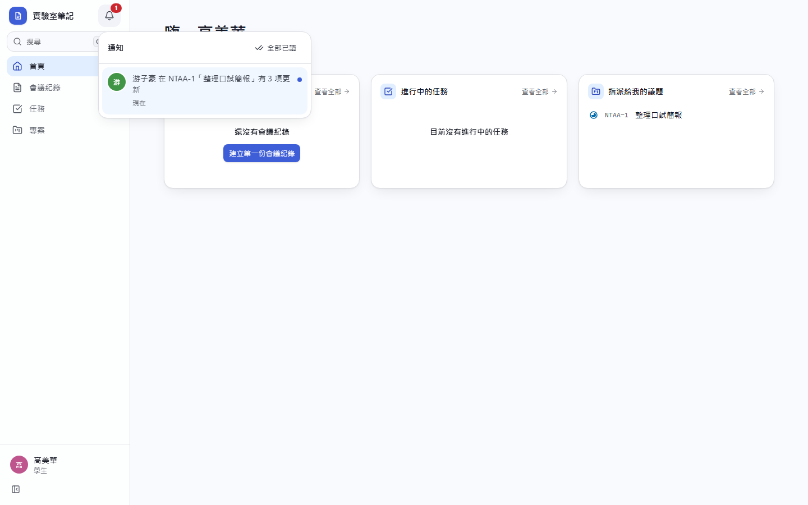

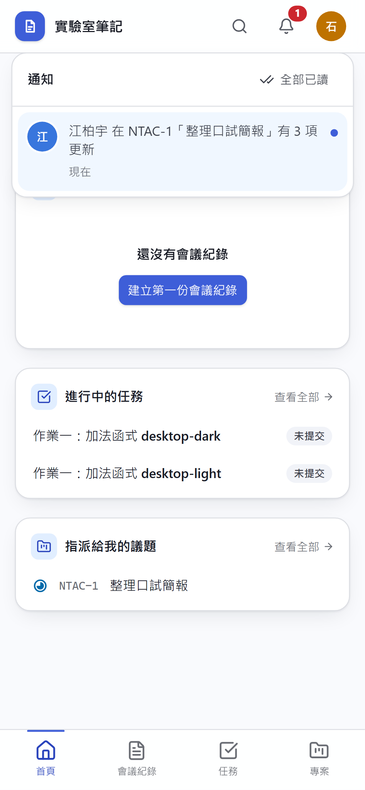
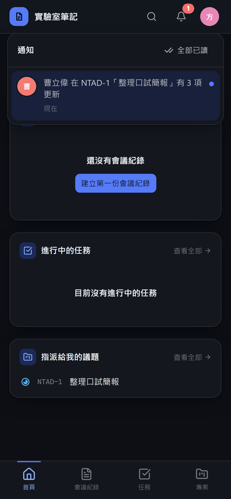

**未讀紅點**

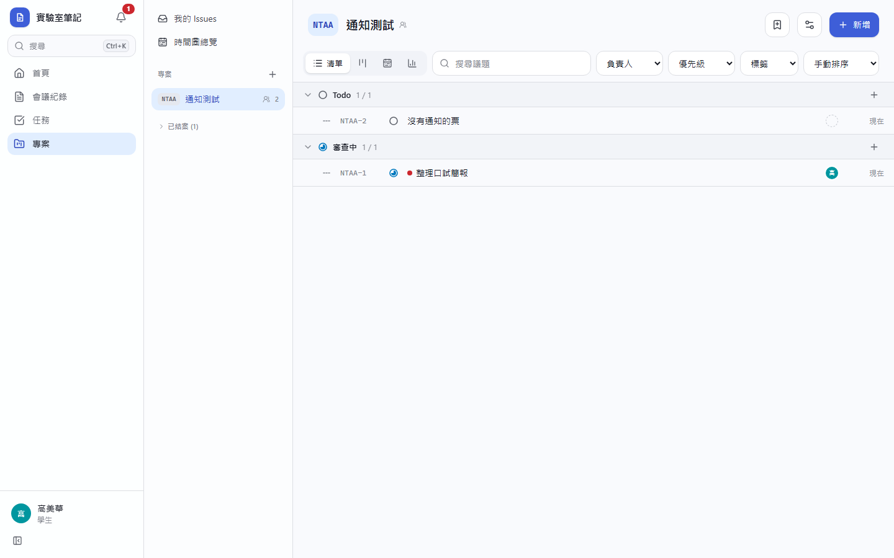
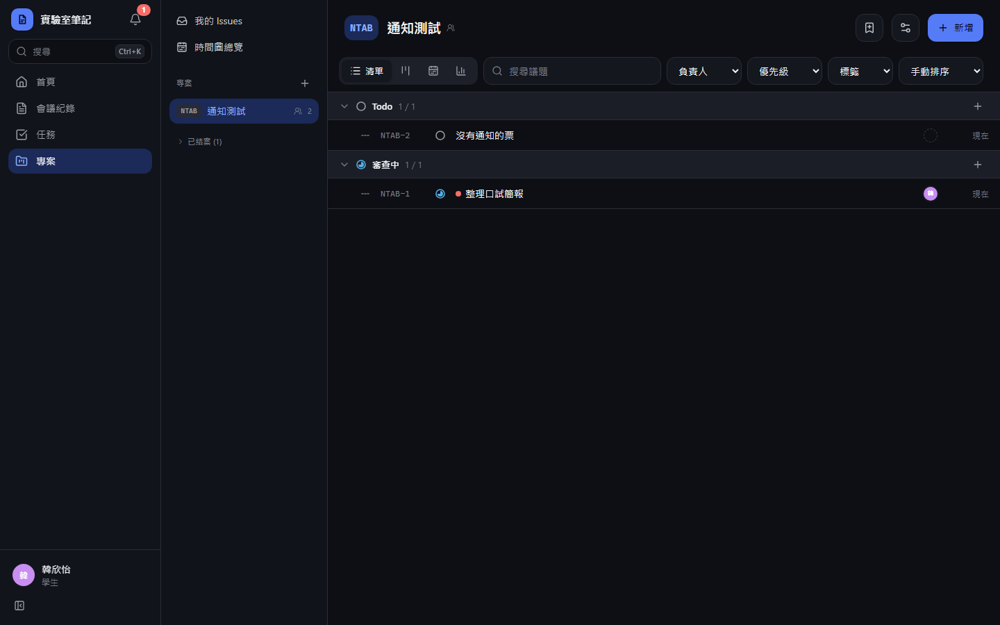
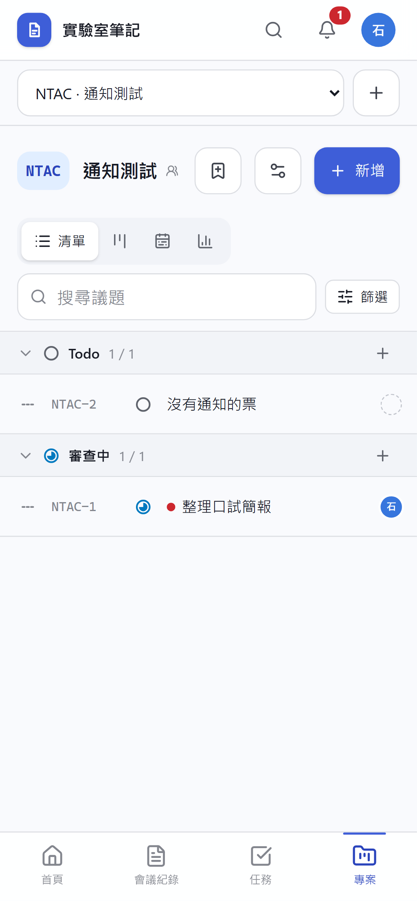
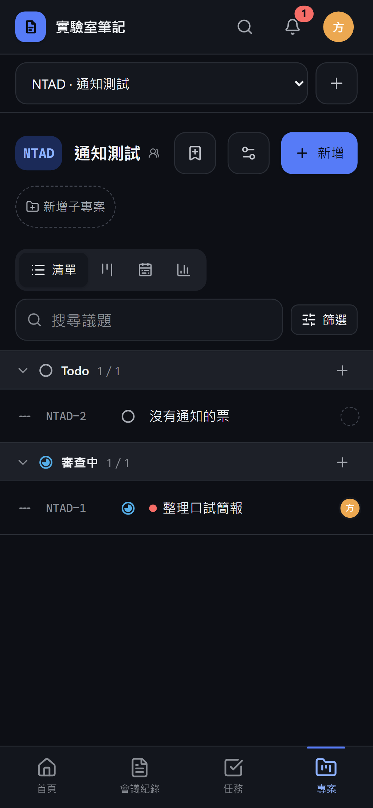

**通知偏好**

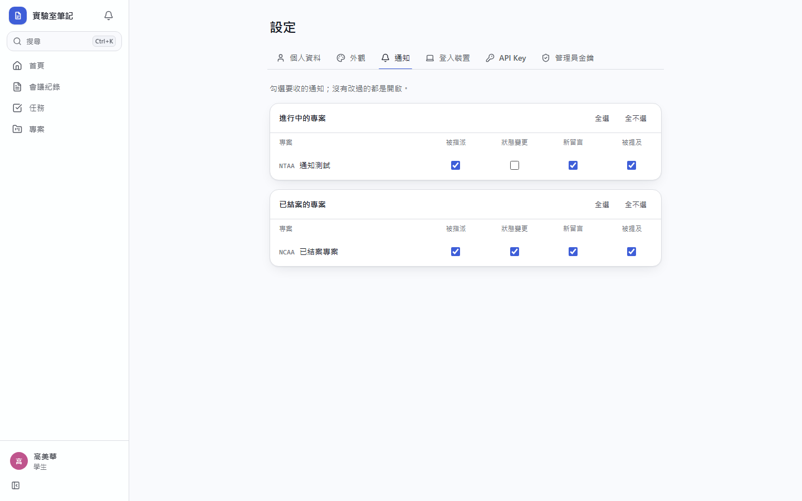
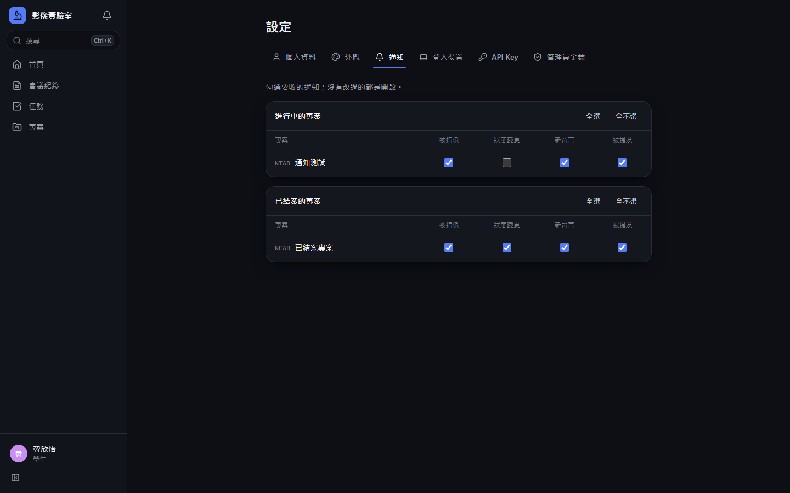
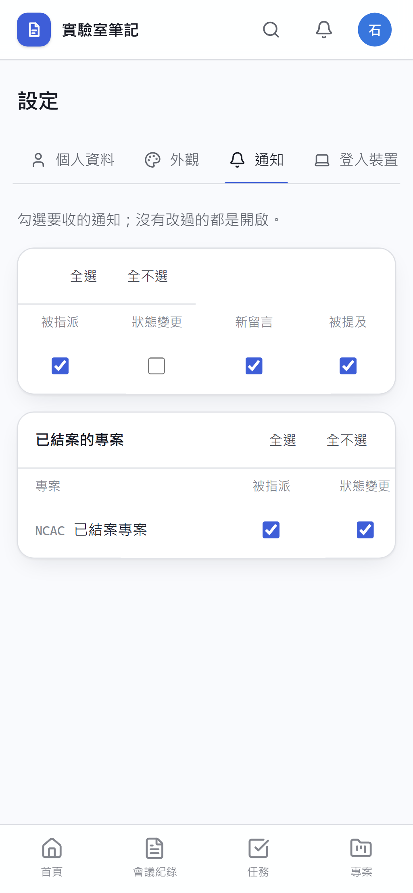
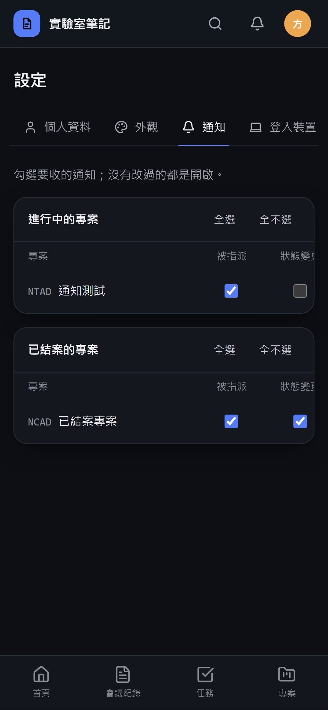
