# [MS-42] 讓使用者產生 API Key 接 MCP

> 狀態：完成

## 內文

### 需求
大家要能用 Claude Code、Claude Desktop 等外部 AI 透過 MCP 新增、修改票與專案，設定越簡單越好：自己產生金鑰，一行就加好。

### 來源
使用者 2026-10-19 對話（初始需求）；設計：`design/02-architecture.md` §7、`design/05-project-management.md` §12

### 驗收條件
- [x] 設定頁可產生 API Key：命名、scope（read／write／manage）、可限定專案、到期日；建立時只顯示一次，可撤銷；列出最後使用時間
- [x] 產生後直接顯示可複製的一行加入指令（Claude Code）與網址形式（只能填網址的客戶端），網址形式旁標示「網址含金鑰，勿分享」
- [x] MCP 工具涵蓋：專案（列出、詳情、建立、成員、結案）、議題（查詢、建立、修改、批次修改、留言、附件）、會議紀錄（查詢、讀取、建立）、任務（列出、查看自己的提交結果）
- [x] 權限與網頁完全一致：看不到的專案回找不到；scope 不足時回明確錯誤
- [x] REST 用 API Key 呼叫時同樣受 scope 限制
- [x] 每次呼叫重新檢查金鑰與帳號狀態，撤銷或帳號停用後立即失效
- [x] MCP 的寫入在活動紀錄標示來源 mcp；支援 operation_id 冪等
- [x] 每把金鑰有呼叫頻率上限，超過時回明確錯誤

### 測試流程
1. 產生一把 write 金鑰，複製一行指令貼到 Claude Code，成功加入
2. 在 Claude Code 請它在 CATS 開一張票並留言，網頁上看到該票且活動來源為 mcp
3. 用限定專案的金鑰查詢另一個專案，得到找不到
4. 撤銷金鑰後再呼叫，立即失敗

---

# 跟其他票的關係

- Blocks：無
- Blocked by：MS-20、MS-22、MS-27
- Related：無

---

# Commit-1

## 內文

原本外部 AI 工具無法操作平台。
現在設定頁「API Key」可以自己產生金鑰：命名、選唯讀／讀寫／讀寫＋管理專案、可限定專案、可設到期日；金鑰只顯示一次，資料庫只存雜湊，列表顯示最後使用時間，可隨時撤銷。產生後直接給可複製的一行 Claude Code 指令，以及給只能填網址的客戶端用的網址形式（旁邊標示網址含金鑰勿分享）。MCP 端點 `/mcp` 提供成員、專案（列出、詳情、建立、加成員、結案）、議題（查詢、詳情、建立、修改、批次修改、留言）、會議紀錄（列出、讀取 Markdown、建立）、任務（列出、自己的提交）等工具，全部走和網頁相同的服務與權限：看不到的專案回找不到、權限不足回明確錯誤，REST 用金鑰呼叫也一樣受限。每次呼叫都重新檢查金鑰與帳號狀態，撤銷或停用立即失效；寫入在活動紀錄標示來源 mcp，可帶 operation_id 避免重送重複執行；每把金鑰每分鐘最多 120 次呼叫。

### 測試結果

| 項目 | 結果 |
|---|---|
| 整合測試：initialize／tools/list／建立議題與留言、活動來源為 mcp、網址形式可用 | 通過 |
| 整合測試：唯讀金鑰寫入被拒（MCP 與 REST）、限定專案外 404、撤銷後 401 | 通過 |
| E2E 產生金鑰 → 複製一行指令 → 用金鑰呼叫 MCP → 撤銷後失效 | 通過（四種組合） |

### 截圖

**產生 API Key**

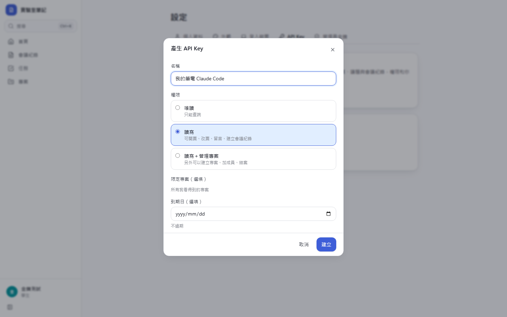
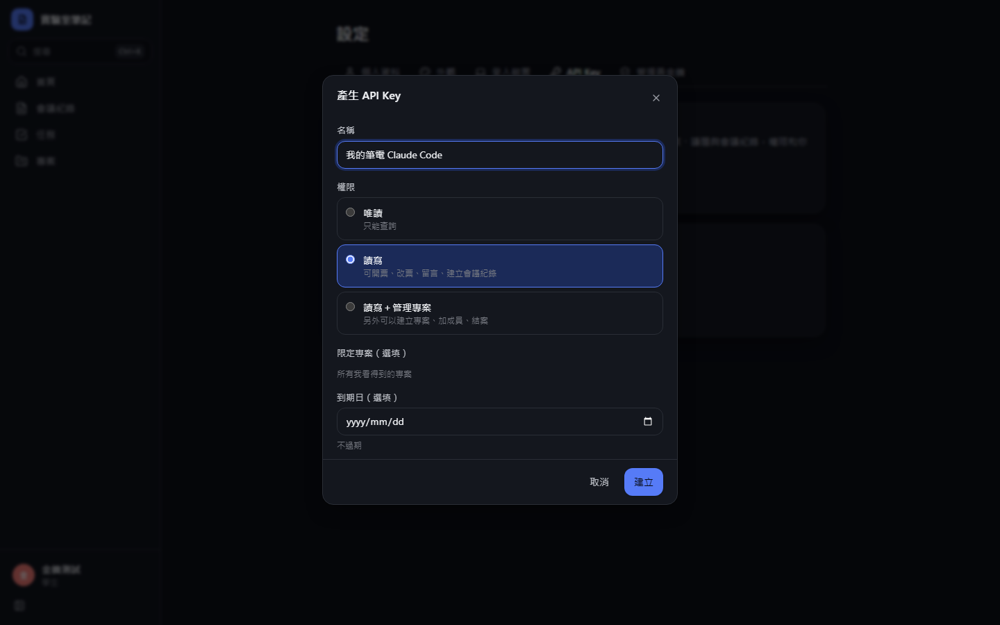
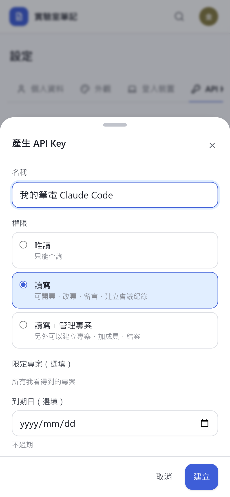
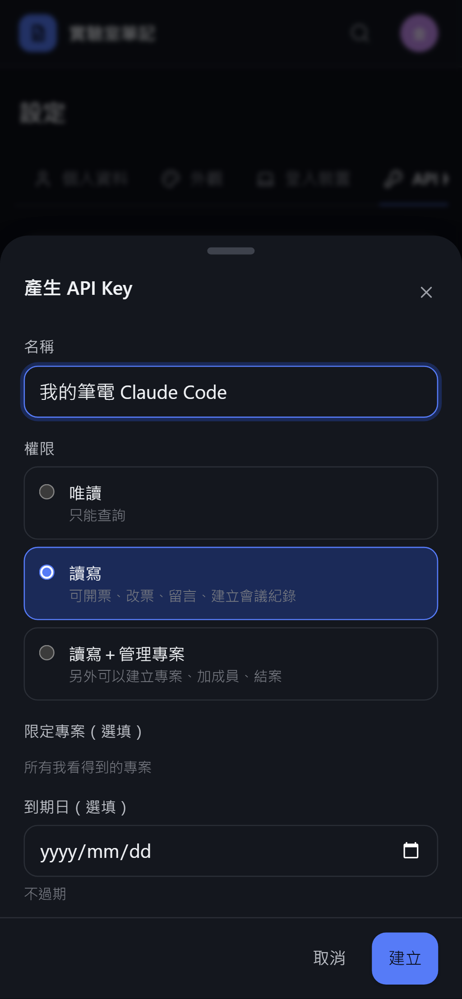

**建立後顯示一行指令與網址形式**

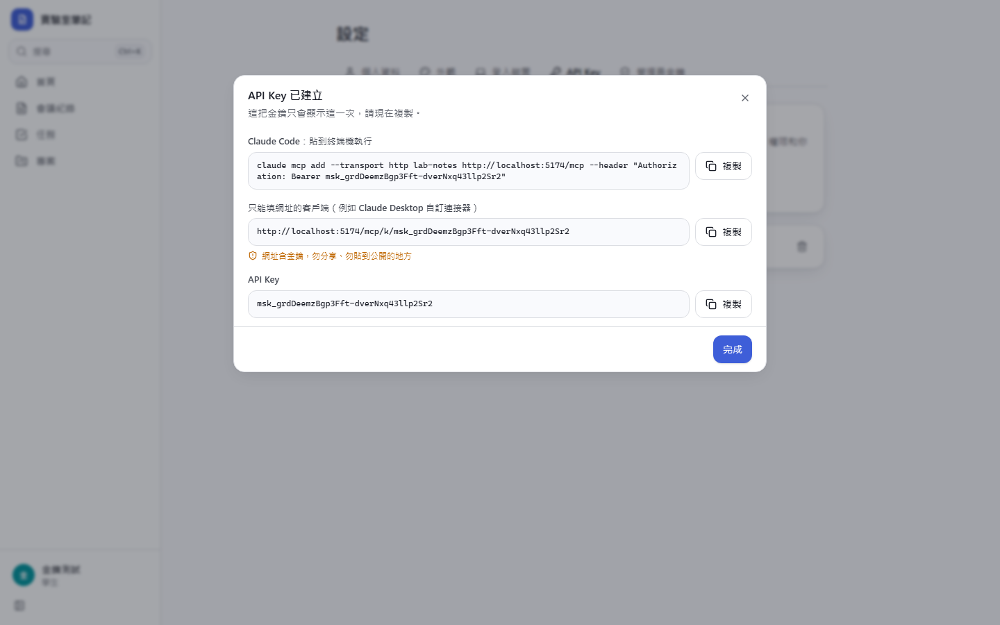
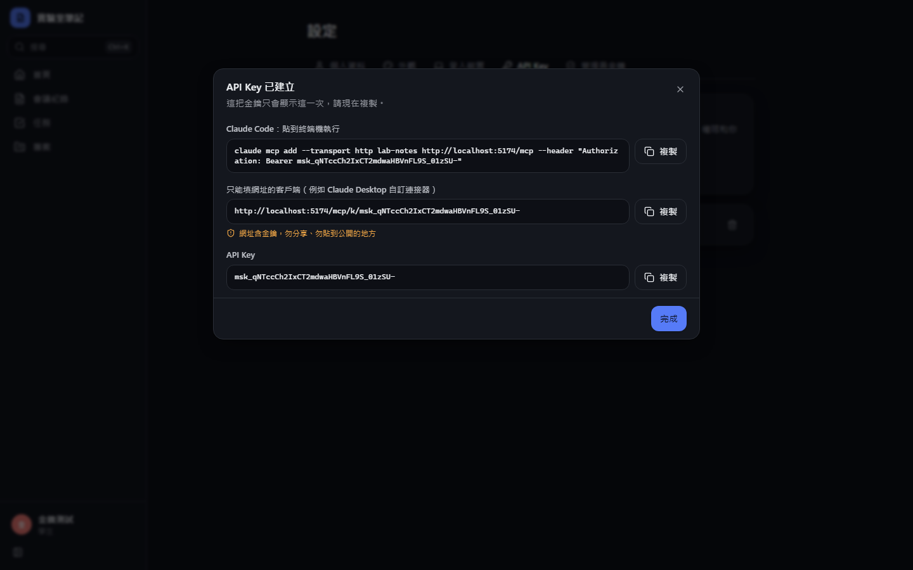
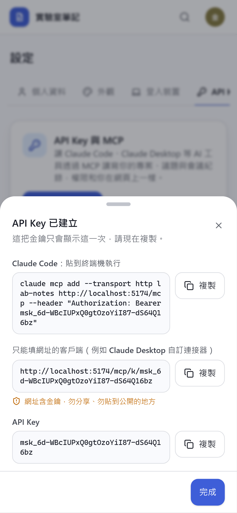
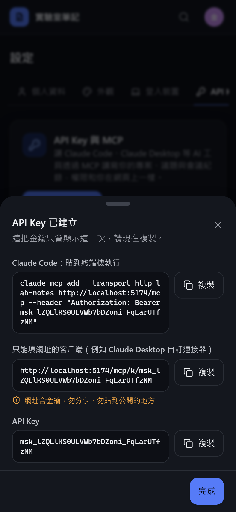

**金鑰列表**

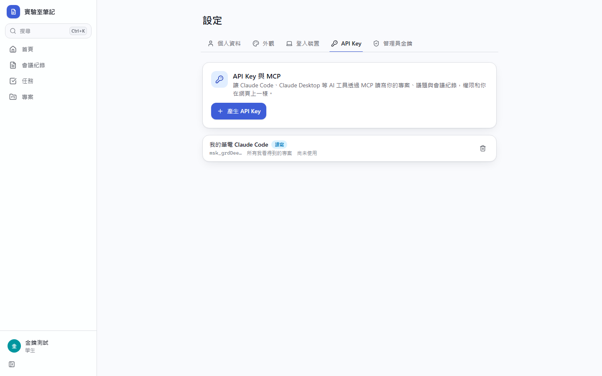
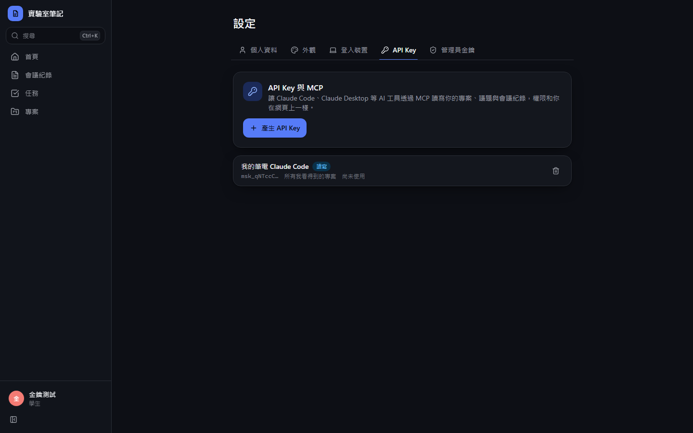

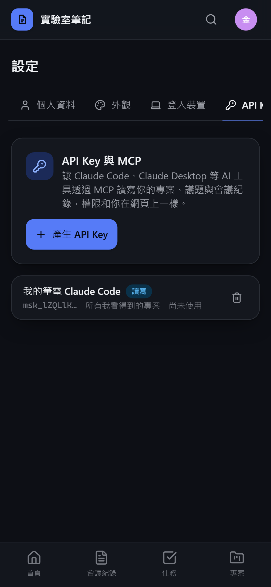
