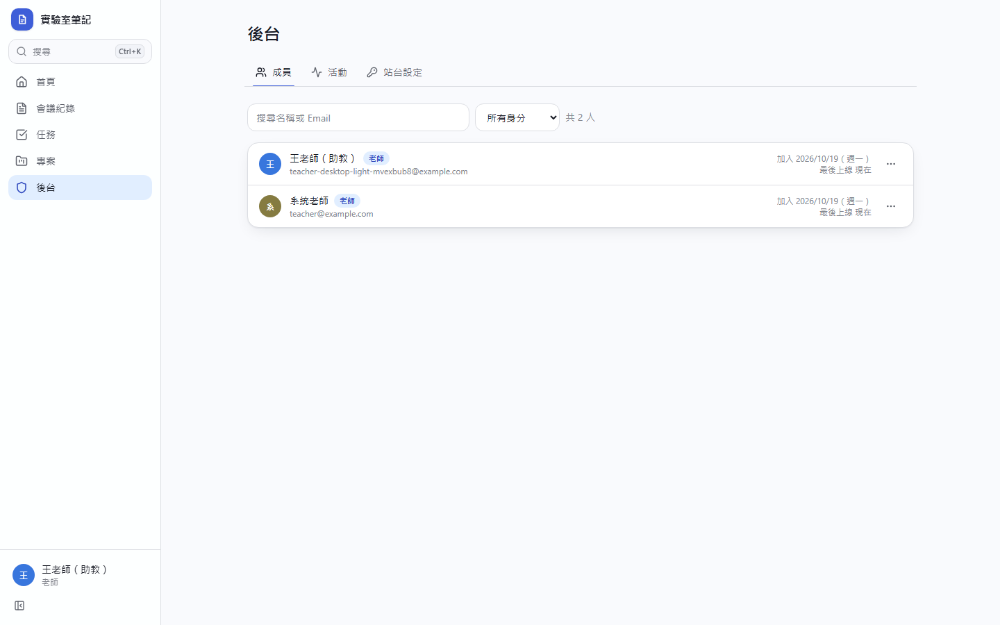
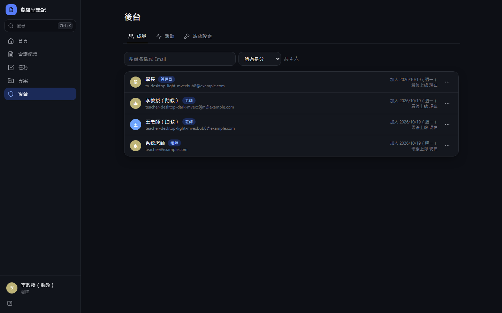
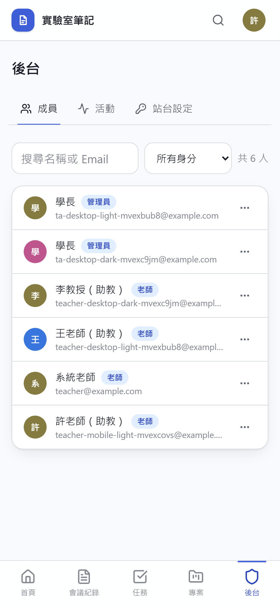
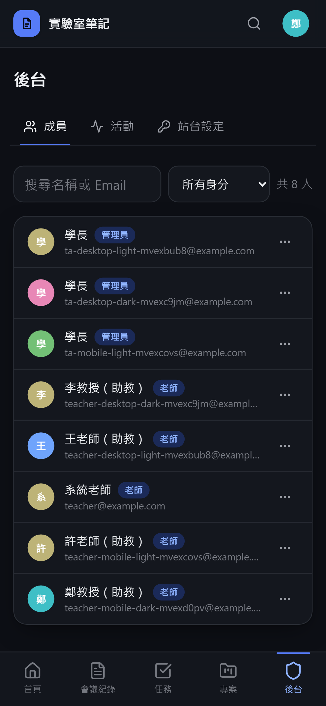

# [MS-43] 建立後台成員管理

> 狀態：進行中

## 內文

### 需求
老師與學長要在後台管理所有成員：查看、升降角色、停用、移除。

### 來源
使用者 2026-10-19 對話（初始需求）；設計：`design/01-product.md` §2.1

### 驗收條件
- [x] 成員列表：頭像、名稱、Email、角色、加入時間、最後上線時間，可搜尋與依角色篩選，分頁
- [x] 可把學生設為管理員、管理員降為學生；老師可指定其他老師
- [x] 可停用（保留資料、無法登入）與移除成員；確認框寫出後果（例如「停用後對方立即被登出」）
- [x] 停用與移除立即生效，對方下一次請求即失效
- [x] 所有角色與狀態變更記活動並可在後台查詢
- [ ] 手機上列表改卡片呈現

### 測試流程
1. 老師把學生 A 設為管理員，A 不需重新登入即看到後台
2. 停用學生 B，B 在另一台裝置的下一個操作被導到停用提示
3. 在活動紀錄查到以上兩筆變更

---

# 跟其他票的關係

- Blocks：無
- Blocked by：MS-8
- Related：無

---

# Commit-1

## 內文

原本沒有後台。
現在後台「成員」分頁列出頭像、名稱、Email、角色、加入與最後上線時間，可搜尋、依角色篩選、分頁。可把學生設為管理員或降回學生，老師可指定其他老師；停用與移除都有寫出後果的確認框，立即讓對方的 session 失效。所有變更都記活動。
尚未完成：手機版改為卡片版型（目前為精簡列表）。

### 測試結果

| 項目 | 結果 |
|---|---|
| 整合測試：停用後對方立即登出 | 通過 |
| E2E 成員列表（四種組合） | 通過 |

### 截圖

**成員管理**

