# [MS-44] 建立後台學生活動總覽

> 狀態：完成

## 內文

### 需求
老師要能看到學生什麼時候編輯了什麼：會議紀錄的編輯、提交、議題變更，一個地方看完。

### 來源
使用者 2026-10-19 對話（初始需求）；設計：`design/03-meeting-notes.md` §5、`design/04-tasks.md` §2

### 驗收條件
- [x] 全站活動流：時間、誰、做了什麼（編輯會議紀錄 +N／−M 字、提交任務與結果、議題變更、留言、註解），點擊前往並定位到該處
- [x] 可依成員、模組、日期範圍篩選，篩選寫在網址
- [x] 成員個人頁：該成員的會議紀錄參與、任務提交與成績、議題，以及近 12 週活動熱度圖
- [x] 可匯出 CSV
- [x] 活動以分頁載入，1 萬筆以上仍順暢
- [x] 管理員看不到私人專案與對管理員隱藏的專案中的活動

### 測試流程
1. 學生 A 編輯會議紀錄、提交任務、改一張議題
2. 老師在活動流篩選 A，看到三筆並可點進去，會議紀錄打開時對應版本差異
3. 打開 A 的個人頁看到熱度圖與成績
4. 匯出 CSV 內容與畫面一致

---

# 跟其他票的關係

- Blocks：無
- Blocked by：MS-14、MS-22
- Related：MS-13

---

# Commit-1

## 內文

原本後台看不到學生做了什麼。
現在後台「活動」分頁是全站活動流：時間、誰、做了什麼（加入、改名、角色變更、建立／編輯會議紀錄 +N／−M 字、註解、還原），可依成員與類型篩選，分頁載入；點會議紀錄的編輯活動會直接打開那個版本的差異。只會列出管理員看得到的專案內的活動。
尚未完成：任務提交與議題活動（隨各模組交付）、日期範圍篩選寫進網址、成員個人頁、CSV 匯出。

### 測試結果

| 項目 | 結果 |
|---|---|
| E2E 活動流（四種組合） | 通過 |

### 截圖

**活動流**

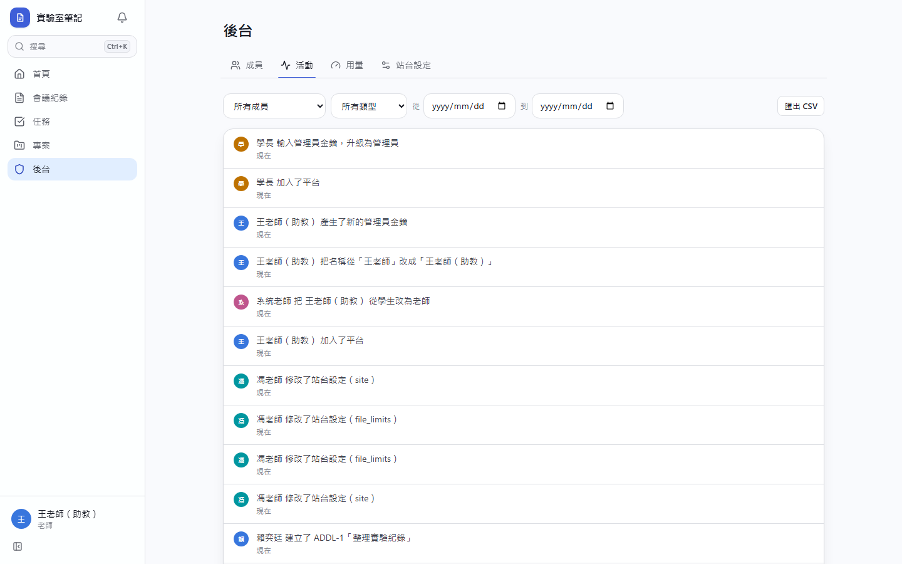
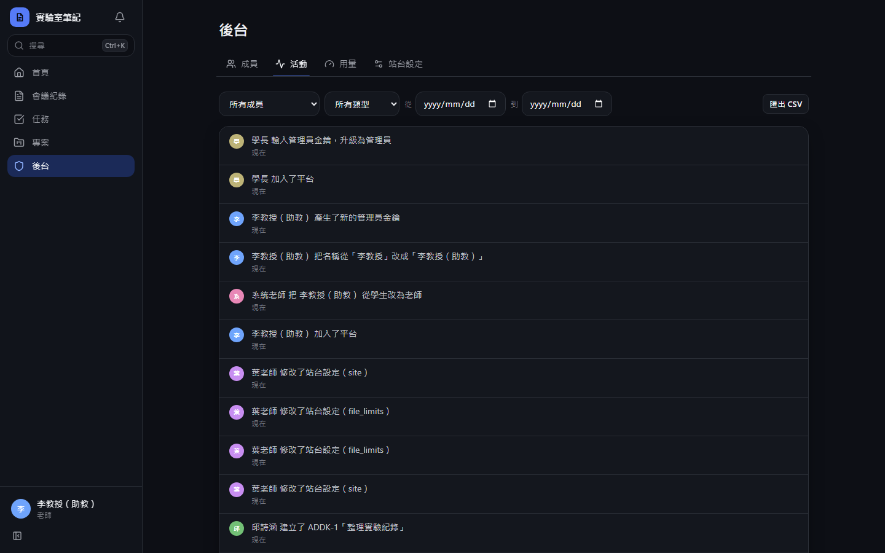
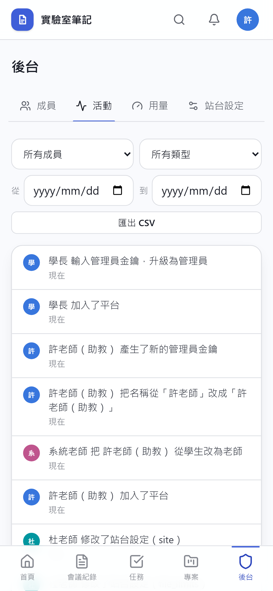
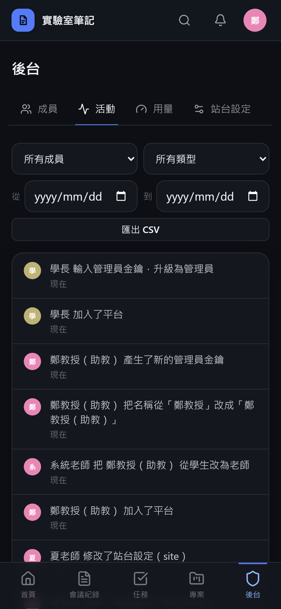

# Commit-2

## 內文

原本後台活動流只能選成員和類型、不能選日期，篩選也不會留在網址，沒辦法匯出，也看不到單一學生的整體狀況。
現在活動流可依成員、模組（含站台設定）與起訖日期篩選，篩選全寫在網址，可直接分享或重新整理；「匯出 CSV」依目前篩選以串流逐頁輸出（含時間、成員、Email、模組、動作、對象、來源與細節，Excel 直接開啟不亂碼），上萬筆也不會一次載入記憶體。成員列表點任一人進入個人頁：近 12 週活動熱度圖（依瀏覽者時區分日）、參與編輯的會議紀錄與次數、正式提交與成績、負責的議題，以及只屬於他的活動流；私人專案中的活動與議題仍不顯示。
驗收：學生建立會議紀錄、修改地點並在共享專案開票後，老師以成員＋「議題」篩選只看到開票那筆、網址帶有篩選；CSV 與畫面一致且逗號與引號正確跳脫；個人頁熱度圖今天有色塊、議題列出 KEY-1。

### 測試結果

| 項目 | 結果 |
|---|---|
| 型別檢查（tsc -b） | 0 錯誤 |
| Lint 與色碼檢查 | 0 錯誤（73 個檔案） |
| 單元／整合測試（vitest） | 通過 34 / 34 |
| 驗收測試（Playwright，電腦／手機 × 深／淺） | 通過 32 / 32 |

### 截圖

**活動流依成員與模組篩選**

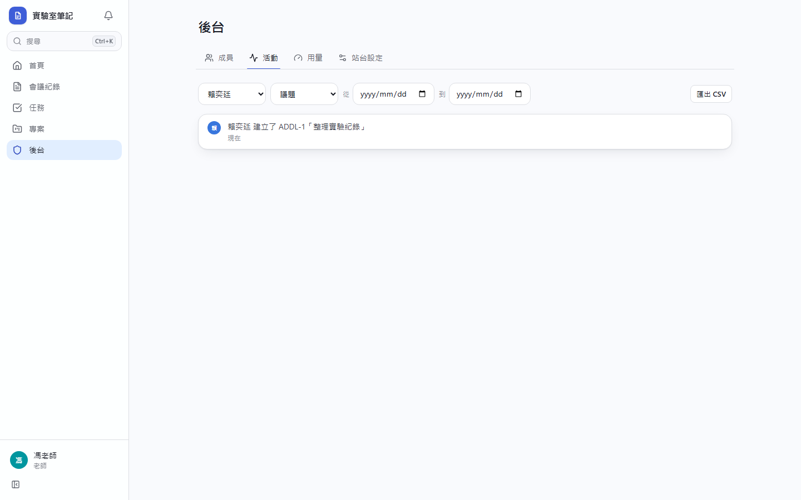
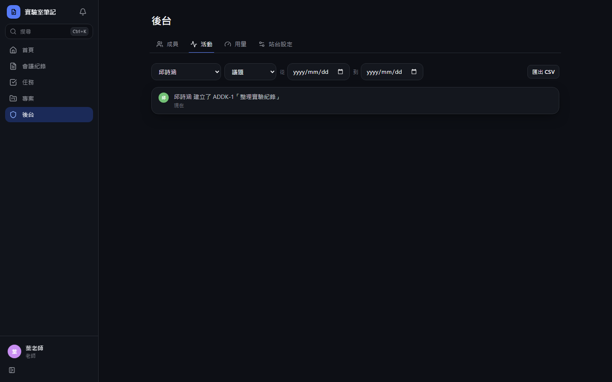
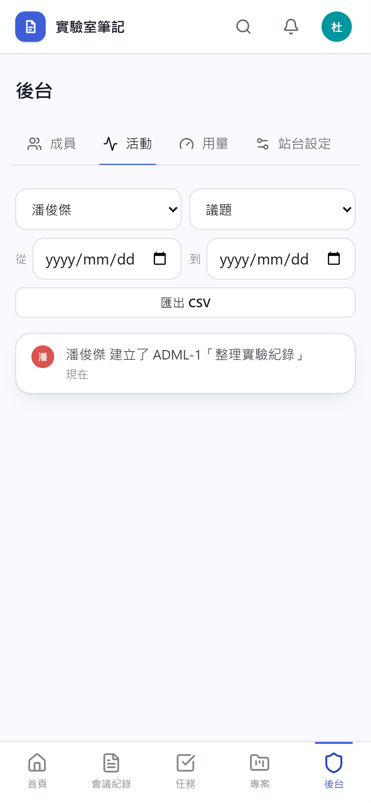
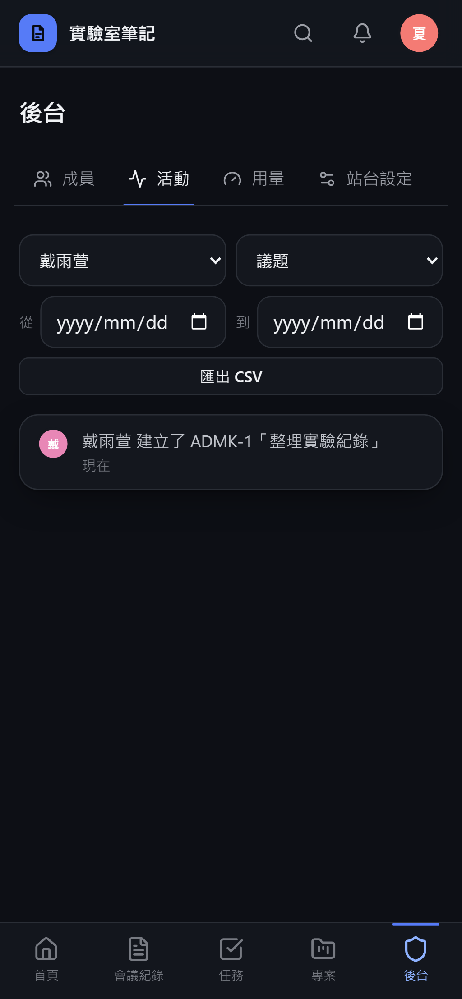

**成員個人頁**

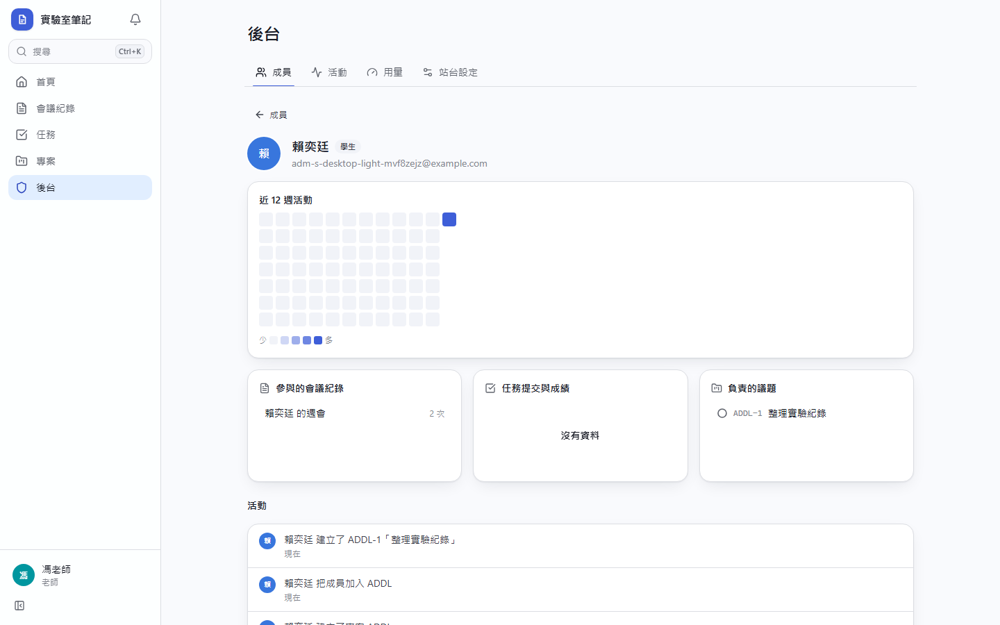
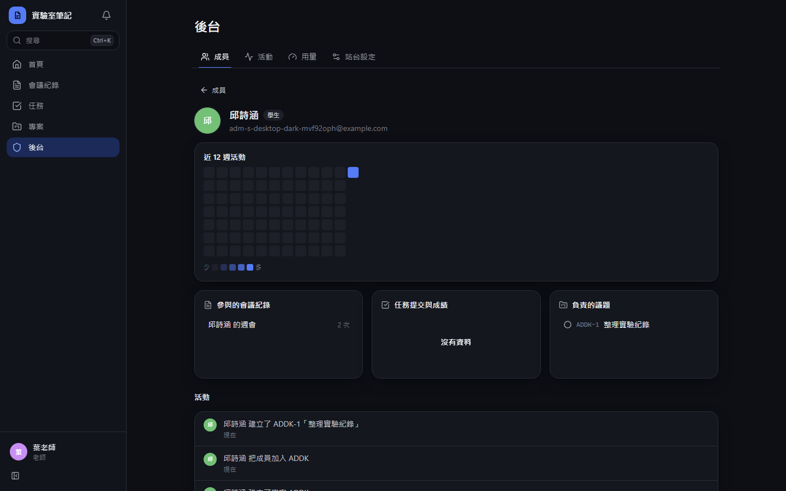
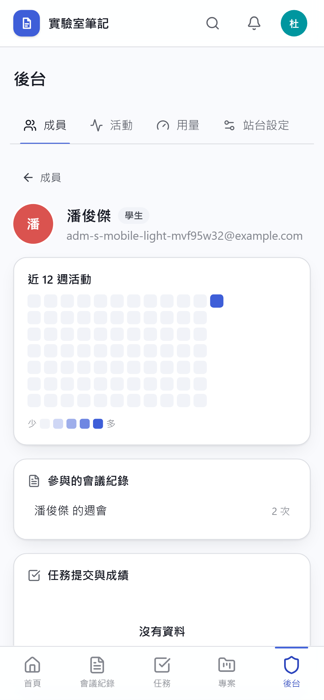
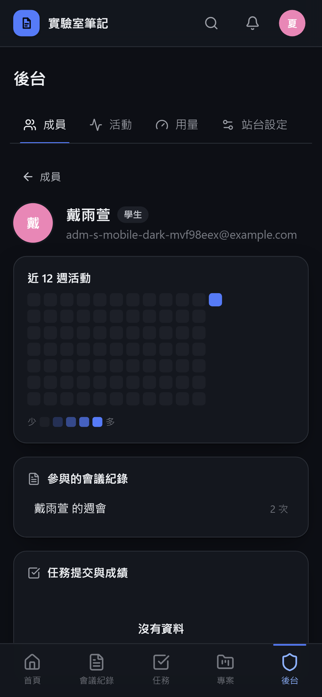
