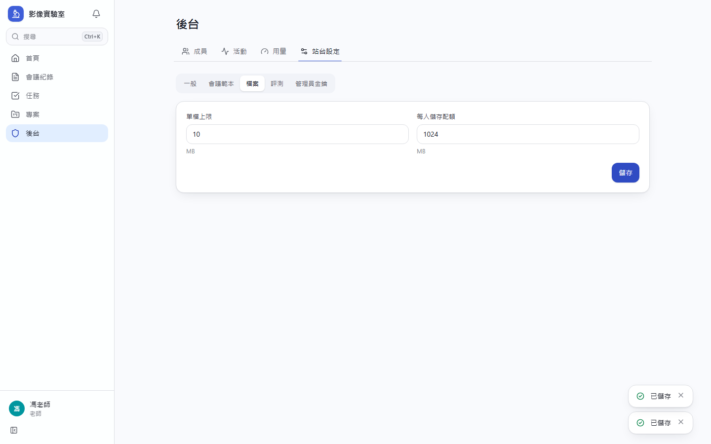
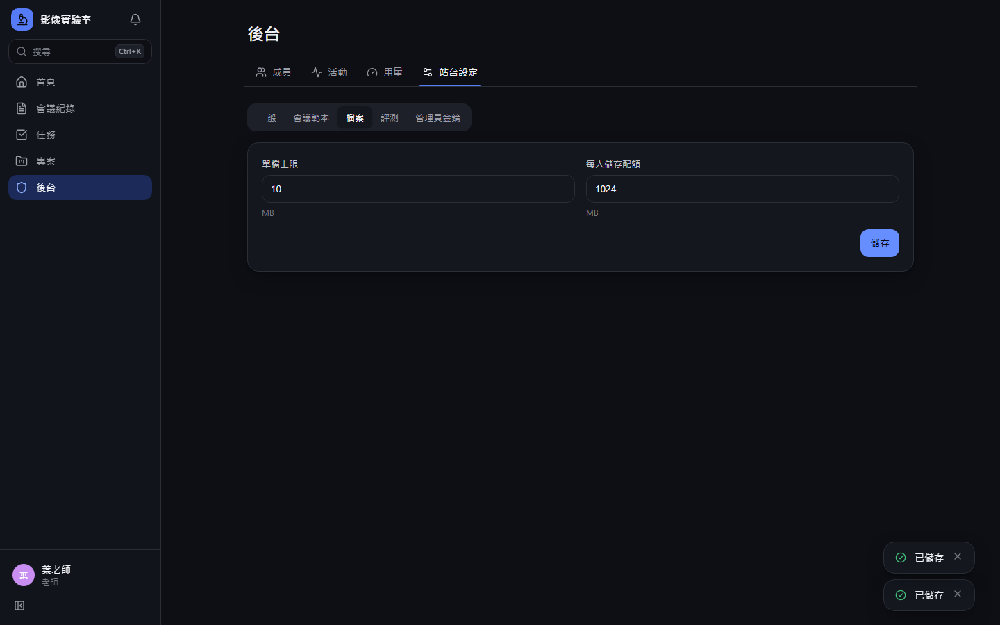
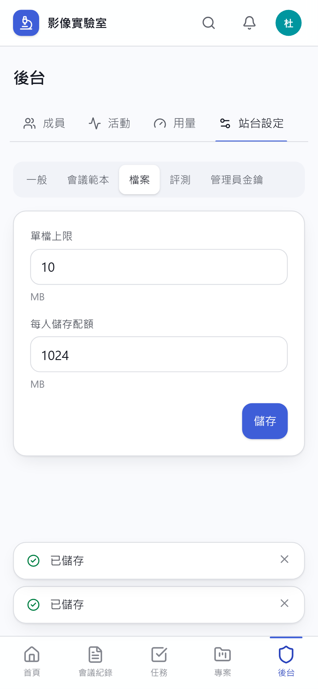
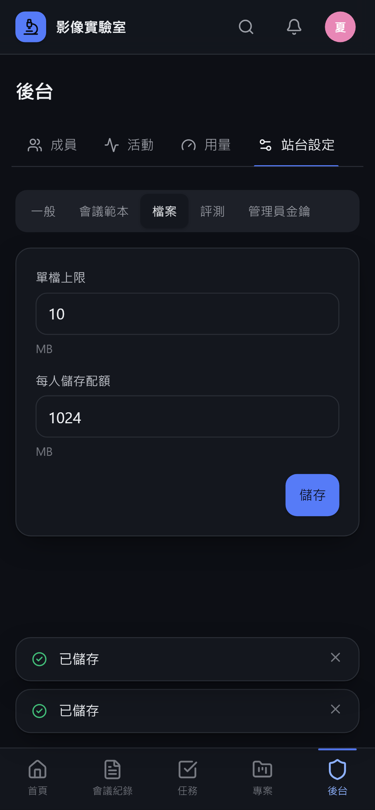

# [MS-45] 建立後台站台設定與用量監控

> 狀態：完成

## 內文

### 需求
老師要能調整站台設定，並隨時知道是否快超出免費額度，避免產生費用或服務中斷。

### 來源
使用者 2026-10-19 對話（初始需求）；設計：`design/02-architecture.md` §9；待確認 #5

### 驗收條件
- [x] 站台設定：管理員金鑰輪替、預設會議範本、單檔上限、每人儲存配額、評測預設上限、站台名稱與圖示
- [x] 用量頁：儲存空間（總量與每人排行）、本月評測次數與耗時、資料庫大小、今日請求數，各項顯示占免費額度的百分比
- [x] 任一項超過 80% 時後台顯示警示，並通知老師
- [x] 設定變更記活動
- [x] 設定頁切 Tab，不擠在同一頁

### 測試流程
1. 修改單檔上限為 10 MB，學生上傳 20 MB 檔案被拒絕
2. 用量頁數字與 Cloudflare、GitHub 後台一致（誤差 5% 內）
3. 模擬儲存用量達 85%，後台出現警示且老師收到通知

---

# 跟其他票的關係

- Blocks：無
- Blocked by：MS-8、MS-23
- Related：無

---

# Commit-1

## 內文

原本站台設定只有管理員金鑰，也看不到用量，可能不知不覺超出免費額度。
後台新增「用量」與「站台設定」兩個 Tab。用量顯示檔案儲存（含前 10 名排行）、資料庫大小、今日請求數各占 Cloudflare 免費額度的百分比，以及本月評測次數與總分鐘數（公開 repo 的 Actions 不限分鐘）；任一項達 80% 時後台各頁頂端顯示紅色警示，並每天最多通知老師一次。站台設定再分為一般（站名與 8 種圖示，側欄與手機頂列立即更新）、會議範本（中英文各一份，可改回內建）、檔案（單檔上限、每人配額）、評測（新任務預設的時間、記憶體、每日次數、檔案上限）、管理員金鑰；每次修改都寫入活動流，數值超出合理範圍會被拒絕。
驗收：把單檔上限改成 10 MB 後學生上傳 20 MB 檔案被拒絕（413）；改站名與圖示後側欄即時換成新名稱；改評測預設後新建立的任務帶入新值；活動流「站台設定」篩選看得到每次修改。

### 測試結果

| 項目 | 結果 |
|---|---|
| 型別檢查（tsc -b） | 0 錯誤 |
| Lint 與色碼檢查 | 0 錯誤（73 個檔案） |
| 單元／整合測試（vitest） | 通過 34 / 34 |
| 驗收測試（Playwright，電腦／手機 × 深／淺） | 通過 32 / 32 |

### 截圖

**用量**

**站台設定：一般**

**站台設定：檔案**

