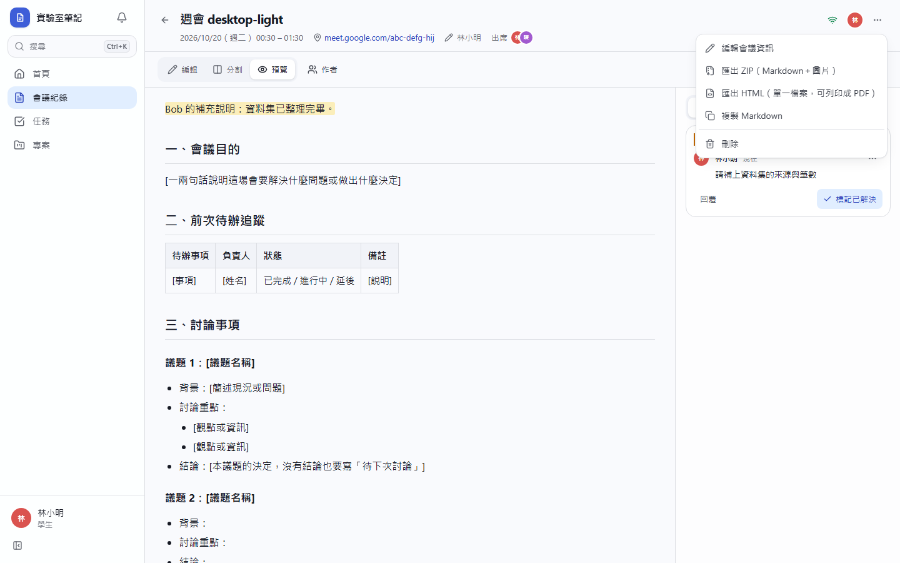
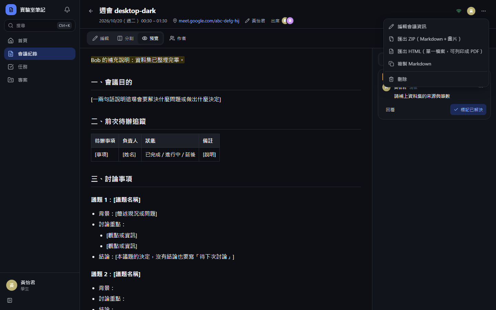
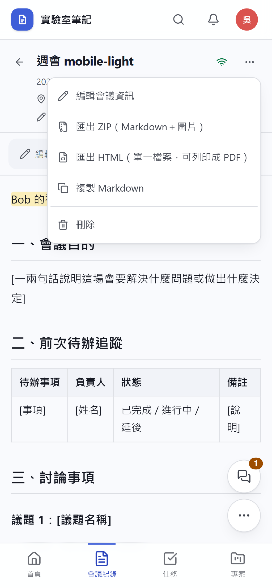
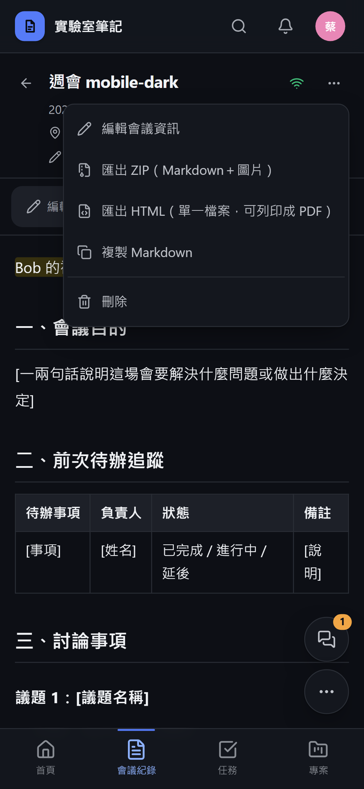
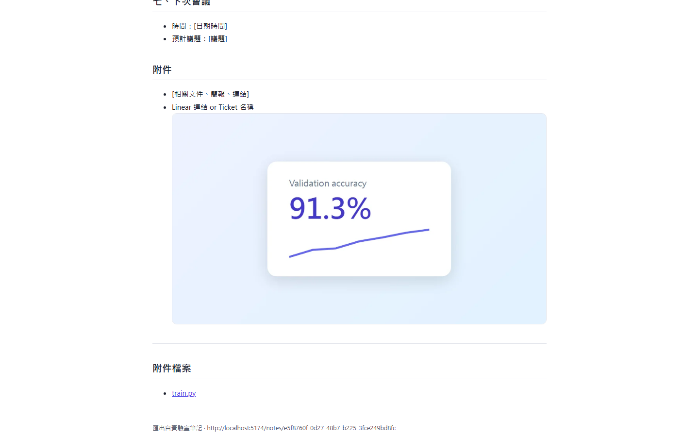
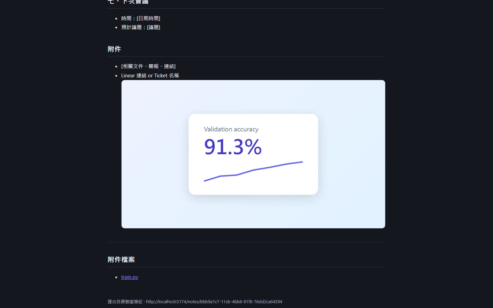
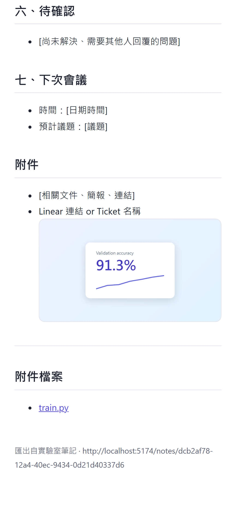
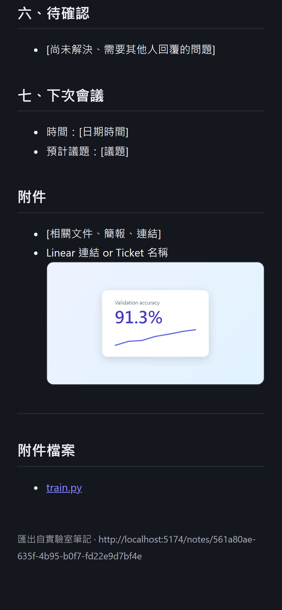

# [MS-46] 一鍵匯出完整會議紀錄

> 狀態：完成

## 內文

### 需求
會議紀錄要能一鍵完整匯出帶走或交給別人：內容包含會議資訊表頭與全部內文，上傳的圖片要出現在內文原本的位置，附件也一起帶出，離開平台也能完整閱讀。

### 來源
使用者 2026-10-19 對話：「還要可以一鍵完整匯出會議紀錄（包含上傳的圖片等等要插入在正確位置）」

### 驗收條件
- [x] 會議紀錄頁的選單有「匯出」，可選兩種格式：ZIP（Markdown＋圖片與附件資料夾）、單一 HTML 檔（圖片內嵌）
- [x] ZIP 解壓後用任何 Markdown 編輯器打開，圖片顯示在與平台上相同的位置（連結改成 ZIP 內的相對路徑）
- [x] ZIP 內附上這份紀錄的所有附件；Google Drive 連結列在附件清單中（不下載 Drive 檔案）
- [x] HTML 檔離線用瀏覽器打開，表頭、表格、待辦、程式碼、圖片都正確顯示，深淺色皆可閱讀，可直接列印成 PDF
- [x] 匯出內容是按下當下的最新版本（包含尚未同步到列表的即時編輯）
- [x] 匯出時顯示進度；某張圖片讀取失敗時仍完成匯出，並在該位置保留原連結與提示
- [x] 檔名為「日期_會議名稱」，中文檔名不亂碼
- [x] 只有能讀這份紀錄的人能匯出；匯出不消耗伺服器運算額度（在瀏覽器端組裝）

### 測試流程
1. 在一份有 2 張圖片與 1 個 PDF 附件的會議紀錄，按「匯出 → ZIP」
2. 解壓後用 VS Code 預覽 Markdown，圖片位置與平台相同，附件資料夾有 PDF
3. 按「匯出 → HTML」，關閉網路後打開檔案，內容與圖片完整，按列印預覽為正常版面
4. 另一人正在編輯時匯出，匯出內容包含對方剛打的字

---

# 跟其他票的關係

- Blocks：無
- Blocked by：MS-16、MS-18
- Related：MS-11

---

# Commit-1

## 內文

原本只能複製純文字 Markdown，圖片和附件帶不走。
現在會議紀錄選單有「匯出 ZIP」與「匯出 HTML」。ZIP 內有含表頭的 Markdown、images/ 與 attachments/ 資料夾，內文的圖片連結改成 ZIP 內的相對路徑，所以用任何 Markdown 編輯器打開圖片都在原位置；附件與 Google Drive 連結列在最後的「附件檔案」。HTML 是單一檔案，圖片直接內嵌，離線也能完整閱讀，自動跟隨深淺色，列印時改為白底黑字。匯出的是按下當下的即時內容，檔名為「日期_會議名稱」，整個組裝在瀏覽器端完成、不耗伺服器額度，能讀這份紀錄的人才能匯出。
尚未驗證：圖片讀取失敗時保留原連結的情境（程式已處理，未寫自動化測試）。

### 測試結果

| 項目 | 結果 |
|---|---|
| E2E 匯出 ZIP：含 images/chart.webp 與 attachments/train.py，Markdown 以相對路徑引用圖片 | 通過（四種組合） |
| E2E 匯出 HTML：圖片為內嵌 data URI，離線開啟正確顯示 | 通過（四種組合） |

### 截圖

**匯出選單**

**匯出的 HTML 離線開啟**

# Commit-2

## 內文

補驗收：匯出時右上角顯示「匯出中 N/M」進度；內文有一張讀不到的圖片時仍完成匯出，該位置保留原連結並標示「此檔案無法匯出」。

### 測試結果

| 項目 | 結果 |
|---|---|
| 型別檢查（tsc -b） | 0 錯誤 |
| Lint 與色碼檢查 | 0 錯誤（81 個檔案） |
| 單元／整合測試（vitest） | 通過 42 / 42 |
| 驗收測試（Playwright 全套，電腦／手機 × 深／淺） | 通過 56 / 56 |

### 截圖

無畫面變更
