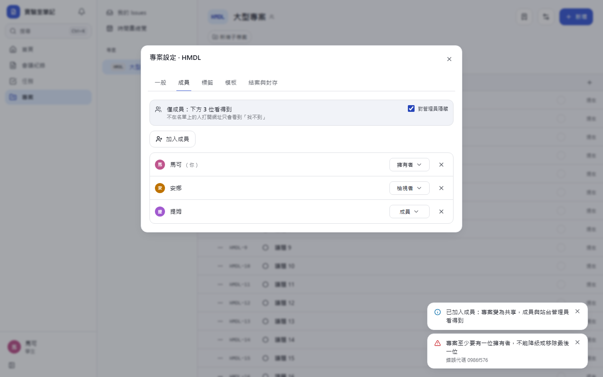
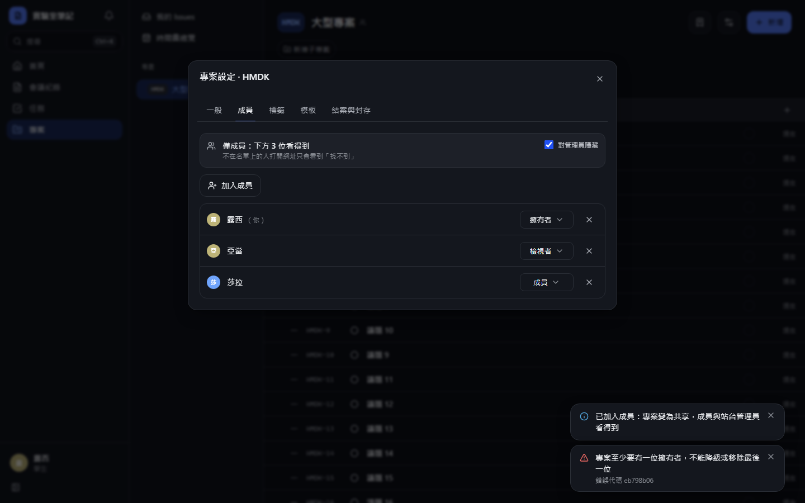

# [MS-47] 修正專案設定視窗操作卡頓

> 狀態：完成

## 內文

### 需求
專案設定視窗（一般、成員、標籤、範本、結案與封存）在議題多的專案裡切換分頁、改成員角色、加成員都明顯卡頓；改角色時下拉選單會先跳回舊值，等伺服器回應才變。設定視窗的每個操作都要即時回應，不拖慢背後的議題清單。

### 來源
使用者 2026-10-20 對話：「這個介面按了很卡。然後專案管理整體操作起來並不方便」（附成員分頁截圖）

### 驗收條件
- [x] 在有 300 張議題的專案，切換設定分頁時背後的議題清單不重新渲染（React Profiler 量測：切換分頁的 commit 只包含設定視窗）
- [x] 切換分頁、改角色、加成員從點擊到畫面更新 < 100 ms（Playwright 量測，桌機）
- [x] 改角色立即顯示新值；伺服器拒絕時（例如降級最後一位擁有者）退回舊值並顯示原因
- [x] 加成員後立即出現在清單，不需等待重新整理
- [x] 重新整理頁面後設定視窗仍停在原本的分頁（網址保留分頁）

### 測試流程
1. 開一個有 300 張議題的專案，打開設定，連續切換五個分頁
2. 在成員分頁把一位成員從「成員」改成「檢視者」，再加入一位新成員
3. 把唯一的擁有者改成「成員」

預期：分頁切換與修改立即反映；第 3 步顯示「最後一位擁有者不能降級」並退回「擁有者」。

---

# 跟其他票的關係

- Blocks：無
- Blocked by：無
- Related：MS-48、MS-29

---

# Commit-1

## 內文

專案設定視窗在議題多的專案裡切換分頁、改角色都會卡一下，改角色時選單還會先跳回舊值，等伺服器回應才變。原因是每次開關或切換設定，背後的整份議題清單都跟著重畫。
現在設定視窗的操作不再牽動背後的清單：300 張議題的專案裡切換五個分頁（兩輪），每次從點擊到畫面更新都在 100 ms 內。改角色、加成員、移除成員、切換「對管理員隱藏」都立即反映在畫面上；伺服器拒絕時（例如把唯一的擁有者降級）退回原值並說明原因。重新整理後仍停在原本的分頁。
驗收：Playwright 在 300 張議題的專案逐一點擊設定分頁兩輪，最長一次 < 100 ms；改角色在 500 ms 內顯示新值（不等伺服器）；降級唯一擁有者時顯示「專案至少要有一位擁有者」並退回「擁有者」。

### 測試結果

| 項目 | 結果 |
|---|---|
| 完整測試套件（vitest） | 通過 46 / 46 |
| E2E（Playwright，4 種裝置×主題） | 通過 92 / 92（4 項僅桌機，手機略過） |
| 型別檢查 | 0 錯誤 |
| lint（含色碼與對比度檢查） | 0 錯誤 |

### 截圖

**成員分頁（改角色、加成員後）**

