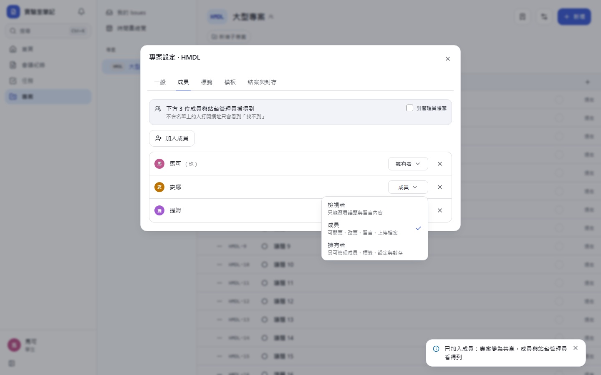
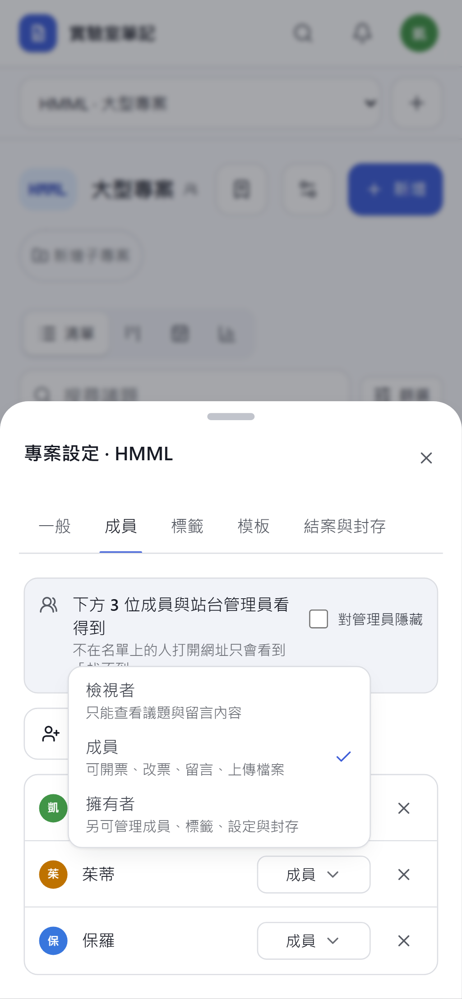
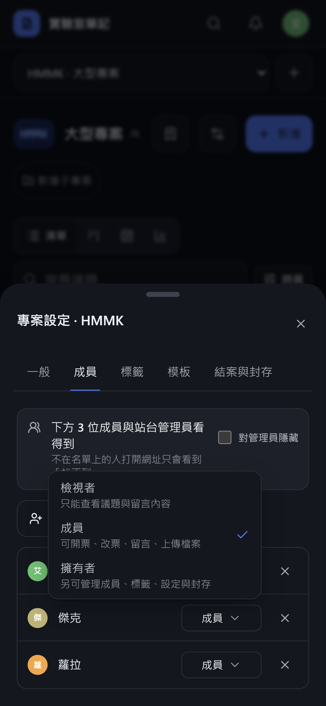
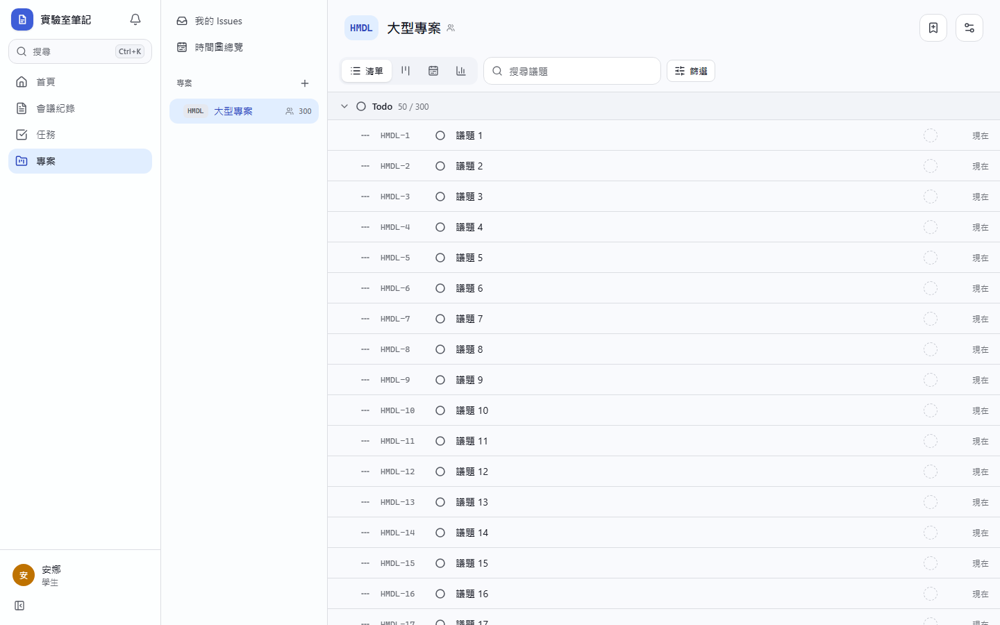
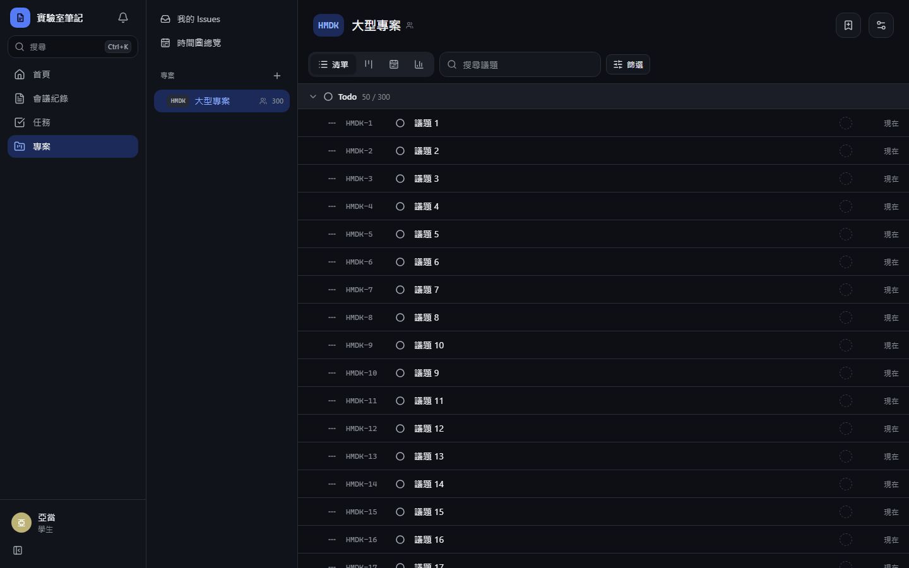
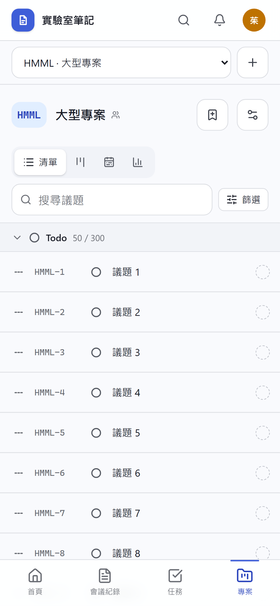
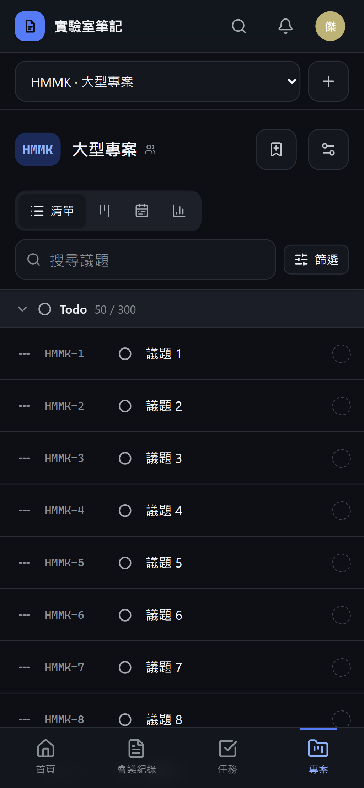

# [MS-48] 讓擁有者清楚設定誰能看到專案

> 狀態：完成

## 內文

### 需求
專案的可見範圍由成員決定（非成員看不到，管理員看得到共享專案，擁有者可對管理員隱藏），但介面上看不出來，使用者以為無法控制誰能看到哪些專案。擁有者要能一眼看出「現在誰看得到這個專案」，並能在建立專案時就選好成員、一次加入多人、逐人設定角色，且清楚知道每個角色能做什麼。

### 來源
使用者 2026-10-20 對話：「專案管理是不是沒辦法設置誰能看到哪一些專案? 我希望可以個別設定專案成員」

### 驗收條件
- [x] 成員分頁頂端有「誰看得到」摘要：私人（只有你）／僅成員 N 人／成員 N 人與站方管理員，並可直接切換「對管理員隱藏」（僅擁有者）
- [x] 角色選單每個選項附一句說明（檢視者：只能看；成員：可開票、改票、留言；擁有者：管理成員與設定）
- [x] 加成員可一次勾選多人，加入時可選角色；已是成員的人在選單中標示且不能重複加入
- [x] 建立專案時可選初始成員與角色；不選就是私人專案，對話框說明這點
- [x] 移除成員的確認框寫出後果（對方將看不到此專案與其中的議題，並移除其指派）
- [x] 非成員打開專案網址看到「找不到」，不透露專案存在；被移除的人重新整理後專案從側欄消失
- [x] 檢視者看不到任何編輯按鈕，也不能透過 API 修改（回 404）

### 測試流程
1. A 建立專案時加入 B（成員）與 C（檢視者）
2. B、C 登入後側欄都看得到；D 看不到，直接開網址看到找不到
3. A 在成員分頁看到「成員 3 人與站方管理員」，開啟「對管理員隱藏」後摘要變為「僅成員 3 人」，管理員 E 看不到此專案
4. C 嘗試修改議題，畫面沒有編輯入口

---

# 跟其他票的關係

- Blocks：無
- Blocked by：無
- Related：MS-29、MS-47、MS-49

---

# Commit-1

## 內文

專案的可見範圍本來就由成員決定，但介面看不出來，使用者以為無法控制誰看得到哪些專案；加成員一次只能加一人，也看不出各角色能做什麼。
現在成員分頁最上方寫明「現在誰看得到」：私人（只有你）、僅成員 N 位、或成員 N 位與站台管理員，擁有者可直接在這裡切換「對管理員隱藏」。加成員可一次勾選多人並選角色，已是成員的人不會出現在選單裡。角色選單每個選項都附一句說明（檢視者只能看；成員可開票、改票、留言；擁有者另可管理成員與設定）。建立專案時就能選初始成員與角色，不選就是私人專案，對話框會說明。移除成員或自己離開時，確認框寫出後果。
驗收：一次加入兩人後摘要變成「下方 3 位成員與站台管理員看得到」，開啟隱藏後變成「僅成員」；被設為檢視者的人看得到專案但沒有任何編輯按鈕，直接呼叫 API 開票回 404；非成員打開網址看到「找不到」。

### 測試結果

| 項目 | 結果 |
|---|---|
| 完整測試套件（vitest） | 通過 46 / 46 |
| E2E（Playwright，4 種裝置×主題） | 通過 92 / 92（4 項僅桌機，手機略過） |
| 型別檢查 | 0 錯誤 |
| lint（含色碼與對比度檢查） | 0 錯誤 |

### 截圖

**角色選單（每個角色附說明）**

**成員與誰看得到**

**檢視者看到的畫面（沒有編輯入口）**

