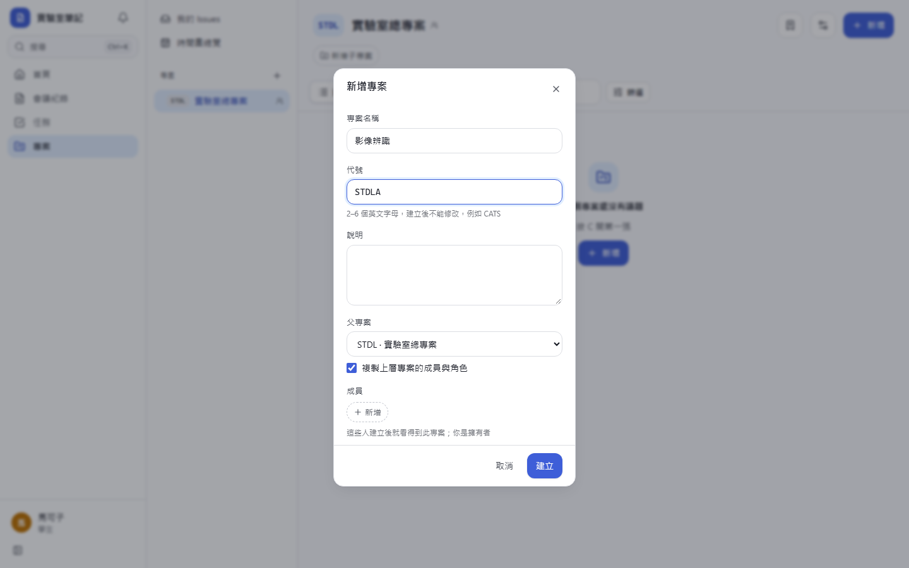
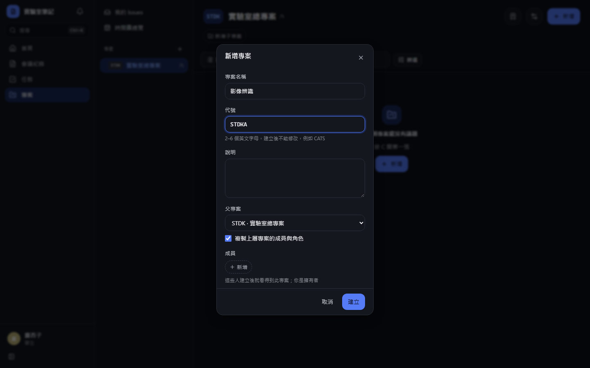
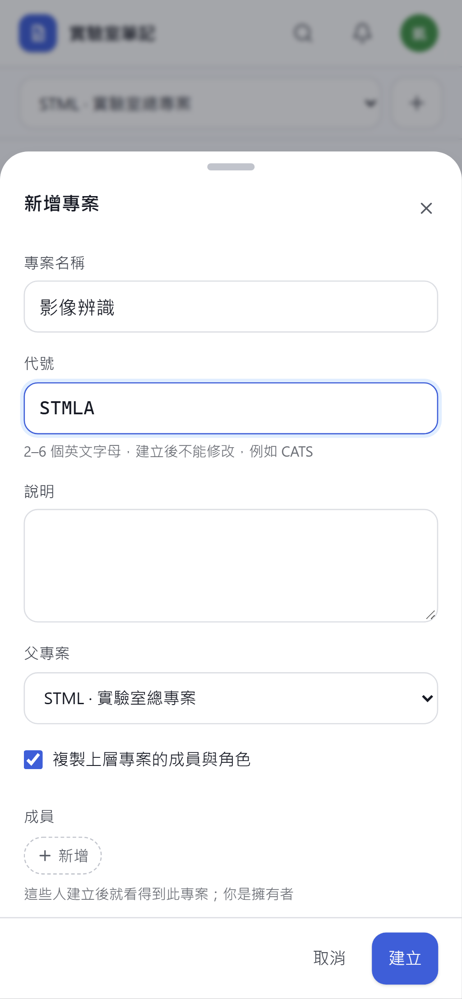
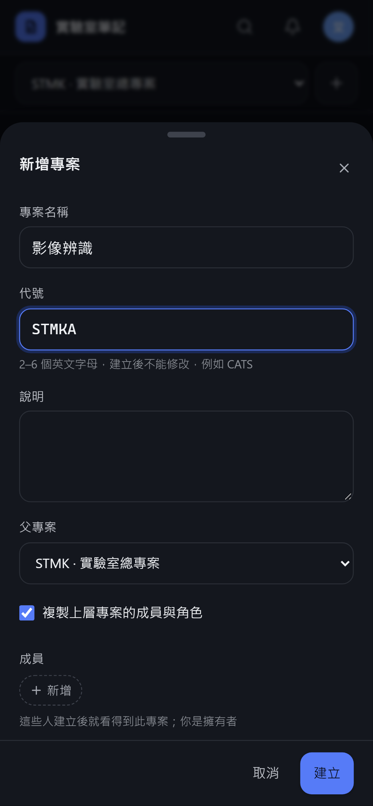
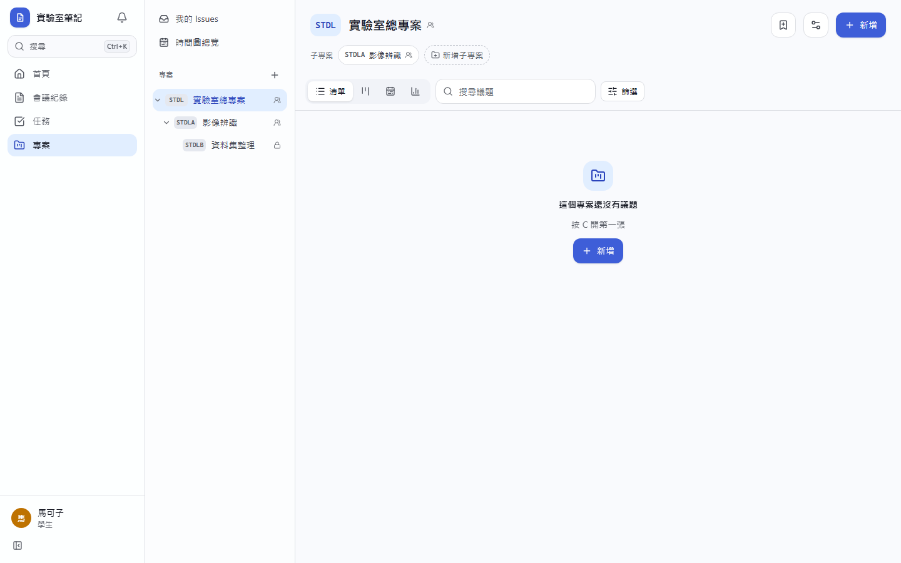
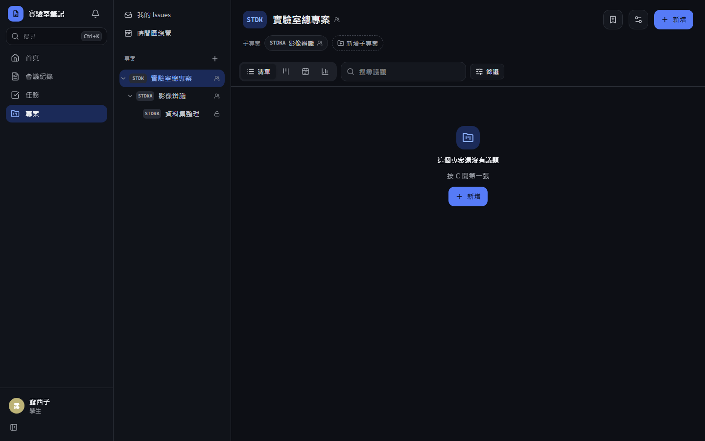
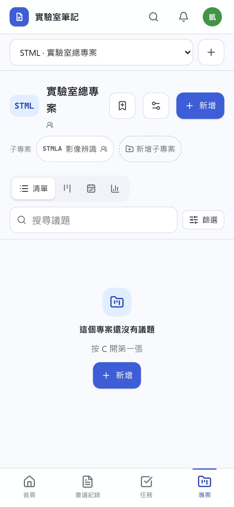
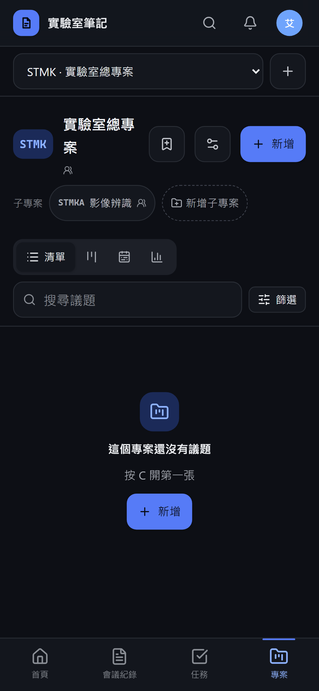

# [MS-49] 建立子專案階層

> 狀態：完成

## 內文

### 需求
專案可以有子專案（樹狀，權限不繼承），但介面上沒有地方建立子專案或指定上層專案，側欄也只縮排一層、順序不跟著上層。要能建立與調整子專案、在側欄看到正確的樹狀結構、在上層專案頁看到子專案，並防止循環。

### 來源
使用者 2026-10-20 對話：「然後正確設定子專案等等的東西」；設計文件 05-project-management §3（子專案樹狀、權限不繼承）

### 驗收條件
- [x] 可從上層專案（設定、右鍵選單、專案頁）建立子專案；可選「複製上層專案的成員」（預設勾選）
- [x] 一般設定可改上層專案或改回頂層；只列出自己是擁有者或成員的專案，並排除自己與自己的子孫（不能形成循環，API 也擋）
- [x] 最多 5 層；超過時說明原因
- [x] 側欄依樹狀排列：子專案緊接在上層之下、依層縮排、可收合；看不到上層時，子專案顯示在頂層
- [x] 專案頁標題上方顯示上層專案路徑（可點），並有「子專案」區塊列出看得到的子專案（名稱、未完成議題數、可見度）
- [x] 權限不繼承：上層的成員不會自動看到子專案；子專案的成員不會自動看到上層
- [x] 上層專案結案或封存時不影響子專案，確認框說明這點；永久刪除上層時，子專案改為頂層

### 測試流程
1. 在 LAB 專案建立子專案 LABA（複製成員），再在 LABA 下建立 LABB
2. 側欄顯示 LAB › LABA › LABB 三層縮排，收合 LAB 時兩個子專案一起收起
3. 在 LAB 的設定把上層改成 LABB，畫面不提供此選項；直接呼叫 API 回「不能形成循環」
4. 只在 LABA 的成員 F 登入，側欄只看到 LABA（頂層顯示）

---

# 跟其他票的關係

- Blocks：無
- Blocked by：無
- Related：MS-29、MS-48

---

# Commit-1

## 內文

專案資料上可以有上層專案，但介面沒有地方建立子專案或改上層，側欄只縮排一層而且順序不跟著上層，也沒有防循環。
現在可以從專案頁的「新增子專案」、側欄右鍵選單或一般設定建立與調整子專案，建立時可勾選「複製上層專案的成員與角色」（預設勾選）。上層專案的選單只列出自己參與的專案，並排除自己與自己的子孫；最多 5 層，超過或形成循環時伺服器也會拒絕並說明。側欄依樹狀排列、逐層縮排、可收合（記住收合狀態），手機的專案下拉選單同樣依樹狀排列。專案頁標題上方顯示上層路徑，標題下方列出看得到的子專案（未完成議題數、可見度）。權限不繼承：看不到上層時子專案顯示在頂層，也不會露出上層名稱。結案或封存上層時確認框說明子專案維持原狀；永久刪除上層時子專案改為頂層。
驗收：從專案頁建立子專案並複製成員後，子專案有 2 位成員、標題上方出現上層連結；第三層出現在側欄並可收合；把上層改到自己的孫專案回「會形成循環」；第 6 層回「超過 5 層上限」；設定的上層選單不含自己的子孫。

### 測試結果

| 項目 | 結果 |
|---|---|
| 完整測試套件（vitest） | 通過 46 / 46 |
| E2E（Playwright，4 種裝置×主題） | 通過 92 / 92（4 項僅桌機，手機略過） |
| 型別檢查 | 0 錯誤 |
| lint（含色碼與對比度檢查） | 0 錯誤 |

### 截圖

**建立子專案（複製上層成員）**

**側欄樹狀與子專案列**

