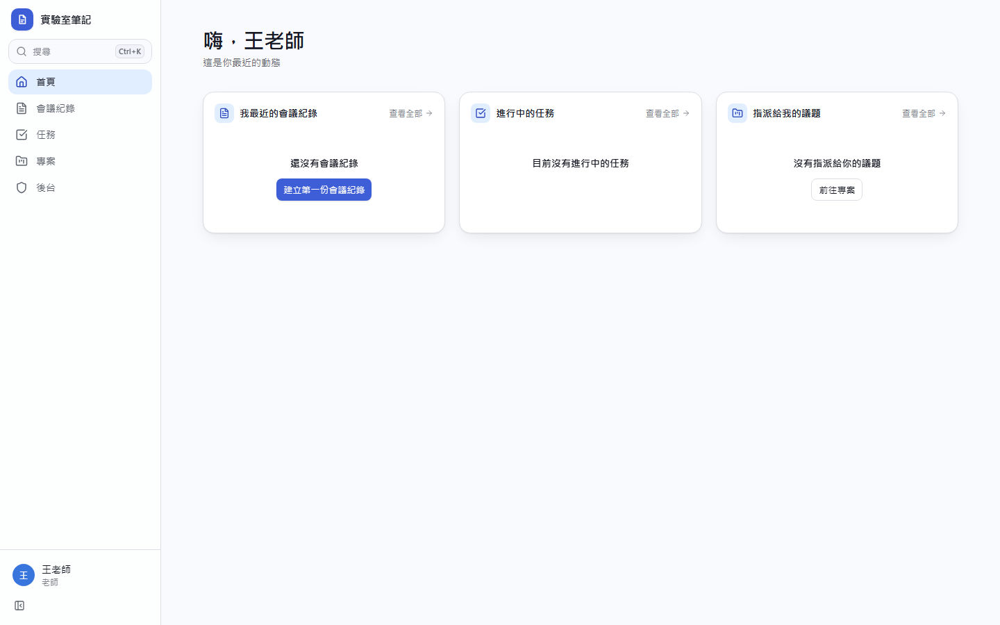
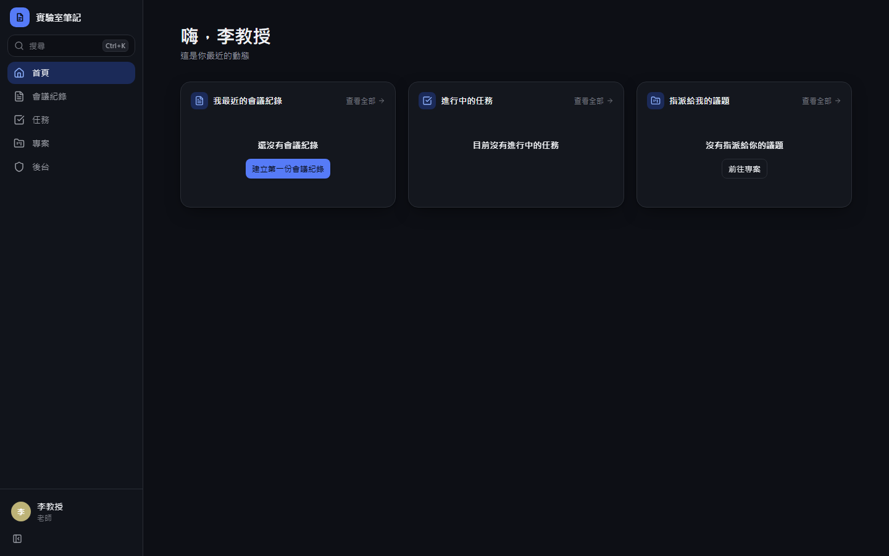
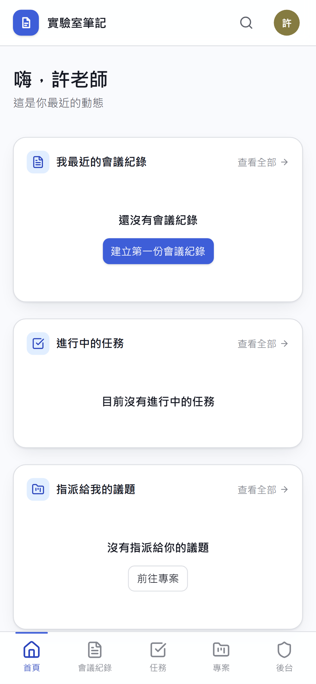
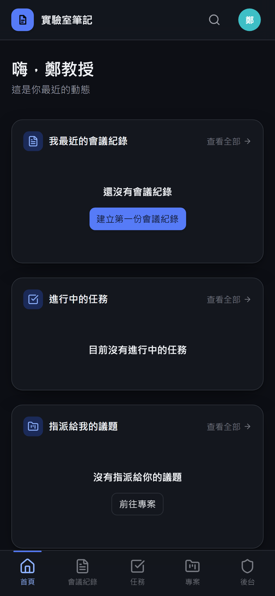

# [MS-4] 做成可安裝的 PWA

> 狀態：進行中

## 內文

### 需求
學生常用手機看會議紀錄和評測結果；網站要能安裝到主畫面、像 App 一樣開啟，網路不穩時也不會整頁空白。

### 來源
使用者 2026-10-19 對話（初始需求）

### 驗收條件
- [ ] Android Chrome 與 iOS Safari 都能「加入主畫面」，以全螢幕獨立視窗開啟，有正確圖示與啟動畫面（深淺主題各一）
- [ ] 離線時開啟仍顯示 App 外殼與「目前離線」提示，已看過的頁面可以閱讀
- [x] 有新版本時顯示「有新版本，重新整理」提示，不會在使用者編輯中自動重整
- [x] 手機版底部有主要導覽，觸控目標 ≥ 44px，沒有水平捲動，鍵盤彈出時輸入框不被遮住
- [ ] Lighthouse PWA 檢查全部通過，手機版 Performance ≥ 90

### 測試流程
1. 用 Android 手機開站，從瀏覽器選單安裝，從主畫面開啟
2. 開飛航模式重新開啟 App，看到外殼與離線提示，打開先前看過的會議紀錄可閱讀
3. 部署新版本後回到 App，看到更新提示，按下後載入新版
4. 用 Lighthouse 跑手機版檢查並附報告截圖

---

# 跟其他票的關係

- Blocks：無
- Blocked by：MS-2
- Related：無

---

# Commit-1

## 內文

原本網站不能安裝。
現在有 Web App Manifest、各尺寸圖示（含 maskable）與 Service Worker：App 外殼離線可開、看過的 API 資料有快取、離線時頂部顯示「目前離線」。有新版本時只顯示提示，由使用者按下才重新整理，編輯中不會被打斷。手機版有底部導覽，觸控目標 44px 以上。
尚未驗證：實機加入主畫面、iOS 啟動畫面、Lighthouse 分數（需要部署到 HTTPS 網域後量測）。

### 測試結果

| 項目 | 結果 |
|---|---|
| 建置產生 Service Worker | 成功（precache 5 項） |
| E2E 手機版（390×844） | 通過，無水平捲動 |

### 截圖

**手機版首頁與底部導覽**

