# [MS-50] 正確顯示與處理議題阻擋關係

> 狀態：完成

## 內文

### 需求
議題可以設定 Blocks／Blocked by，但目前只看得到「被幾張阻擋」，看不出這張阻擋了誰；跨專案的阻擋者顯示成「?-3」，還會露出自己看不到的專案的議題標題；可以設定互相阻擋的循環；阻擋者完成後被阻擋的人不會知道；也無法篩出被阻擋的議題。阻擋關係的顯示、篩選、通知與防呆都要正確。

### 來源
使用者 2026-10-20 對話：「專案有沒有被 Block、被誰 Block 整體的 UIUX 跟操作邏輯都要正確」

### 驗收條件
- [x] 清單、看板卡片顯示「被阻擋」（列出未完成的阻擋者）與「阻擋 N 張」兩種標示，hover 列出編號與標題，點擊可前往
- [x] 詳情頁上方顯示「被 X、Y 阻擋」與「阻擋 Z」，已完成或取消的阻擋者以刪除線列在關聯區，不計入「被阻擋」
- [x] 跨專案阻擋者顯示正確編號；看不到的專案的議題只顯示「1 張無權檢視的議題」，不露出標題與編號
- [x] 不能設定互相阻擋或形成阻擋循環（A→B→C→A），畫面與 API 都擋並說明原因
- [x] 把仍被阻擋的議題改成進行中／審查中／完成時，跳出確認並列出阻擋者；可選擇仍要變更
- [x] 最後一個阻擋者完成或取消時，被阻擋議題的負責人與訂閱者收到「已解除阻擋」通知（通知偏好可關閉）
- [x] 篩選器可篩「被阻擋」與「阻擋他人」，網址保留篩選
- [x] 移除阻擋關係記入活動紀錄，兩張議題的歷史都看得到

### 測試流程
1. 建立 A、B、C，設定 A blocks B、B blocks C；再設定 C blocks A，顯示「會形成循環」
2. 清單中 B 顯示「被 A 阻擋」與「阻擋 1 張」；篩「被阻擋」只出現 B、C
3. 把 B 拖到「進行中」，跳出確認列出 A
4. 把 A 改完成，B 的負責人收到「已解除阻擋」通知，B 不再顯示被阻擋

---

# 跟其他票的關係

- Blocks：無
- Blocked by：無
- Related：MS-33、MS-41

---

# Commit-1

## 內文

原本只看得到「被幾張阻擋」，看不出這張阻擋了誰；跨專案的阻擋者顯示成「?-3」，還會露出自己看不到的專案的議題標題；可以設定互相阻擋；阻擋者完成後沒人知道；也不能篩出被阻擋的議題。
現在清單與看板卡片同時顯示「被阻擋 N」與「阻擋 N」，滑過列出編號與標題，點擊前往（手機只顯示圖示與數字，讓標題保有空間）。議題頁上方寫出「被這些議題阻擋」與「正在阻擋這些議題」並可點；關聯區已完成或取消的阻擋者以刪除線呈現、不算阻擋。跨專案的阻擋者顯示正確編號，看不到的專案只顯示「另有 N 張你無權檢視的議題」。設定會形成循環的阻擋（A→B→C→A）時拒絕並說明。把仍被阻擋的議題改成進行中、審查中或完成（下拉、看板拖曳、右鍵、批次都一樣）會先確認並列出阻擋者，可選「仍要變更」。最後一個阻擋者完成或取消時，被阻擋議題的負責人與訂閱者收到「已解除阻擋」通知，通知偏好可關閉。篩選多了「被阻擋／阻擋他人」，網址會保留。建立或移除關聯時兩張議題的活動紀錄都有記錄。
驗收：A 阻擋 B、B 阻擋 C 後，B 同時顯示「被阻擋 1」「阻擋 1」；設定 C 阻擋 A 回「會形成循環」；篩「被阻擋」只剩 B、C；把 B 改成進行中跳出確認並列出 A，取消後狀態仍是 Todo；看不到秘密專案的人看到「另有 1 張」而沒有標題；A 完成後 B 的負責人收到「已解除阻擋」。

### 測試結果

| 項目 | 結果 |
|---|---|
| 完整測試套件（vitest） | 通過 46 / 46 |
| E2E（Playwright，4 種裝置×主題） | 通過 92 / 92（4 項僅桌機，手機略過） |
| 型別檢查 | 0 錯誤 |
| lint（含色碼與對比度檢查） | 0 錯誤 |

### 截圖

**清單上的阻擋標示**

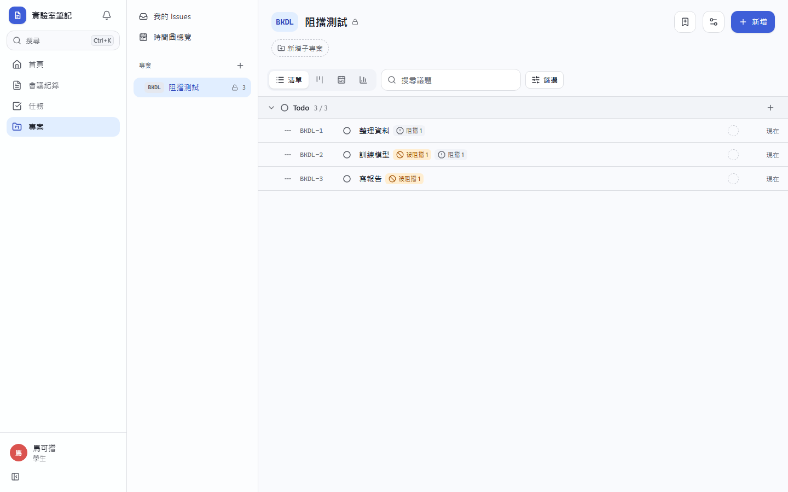
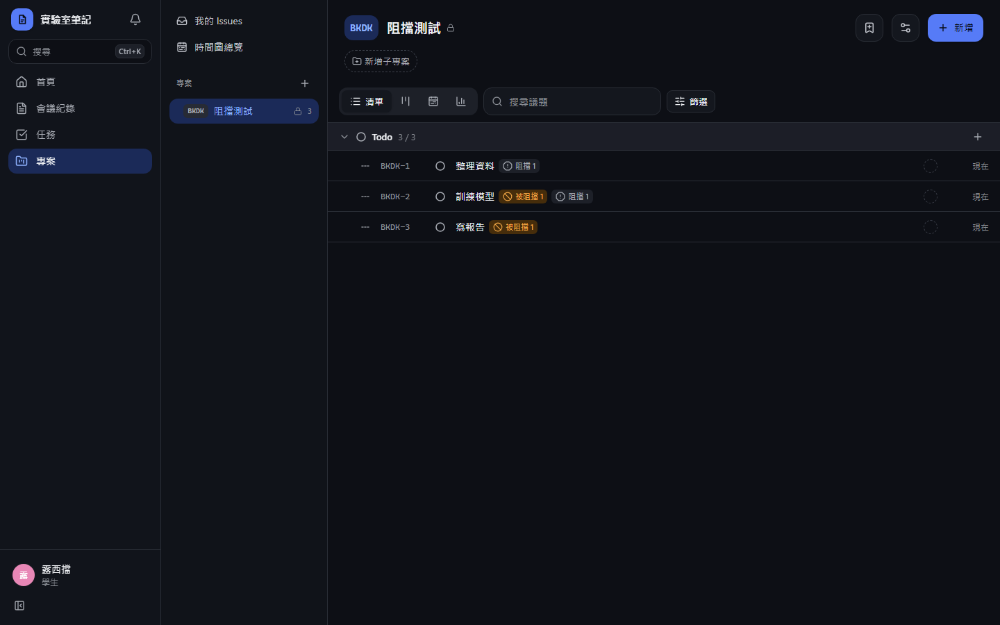
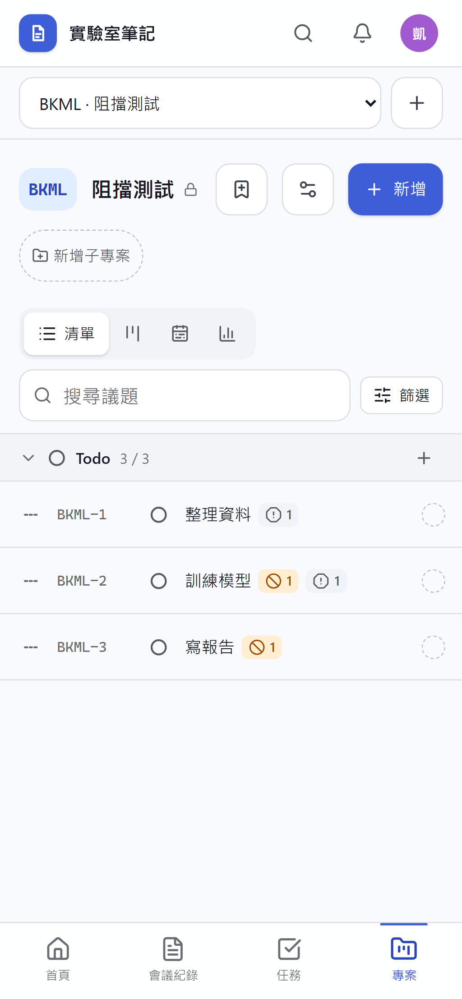
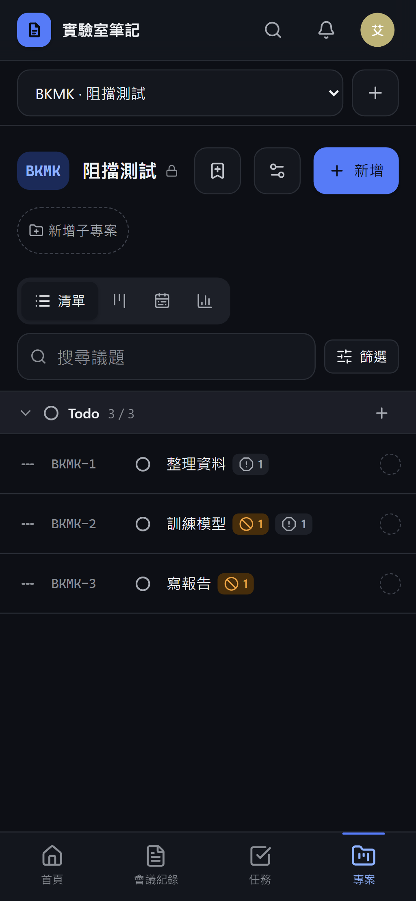

**議題頁的阻擋與被阻擋**

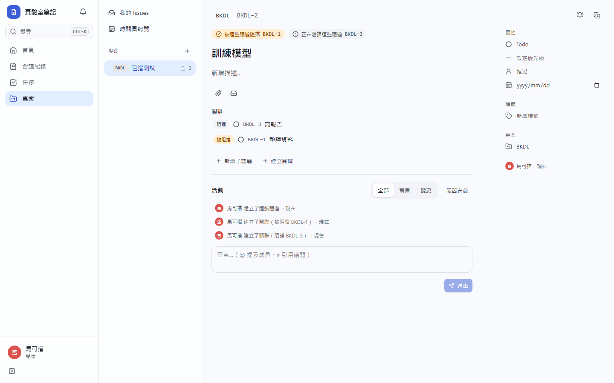
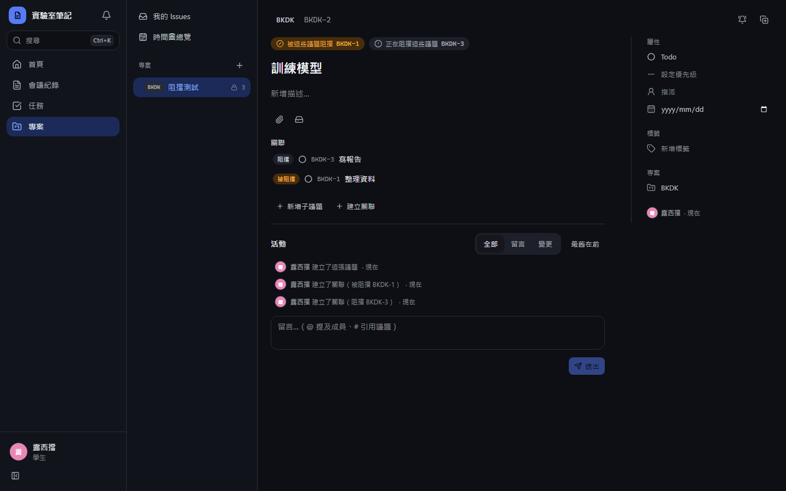
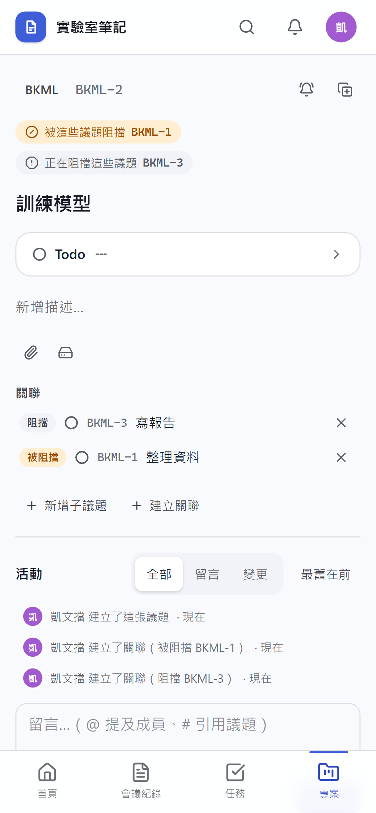
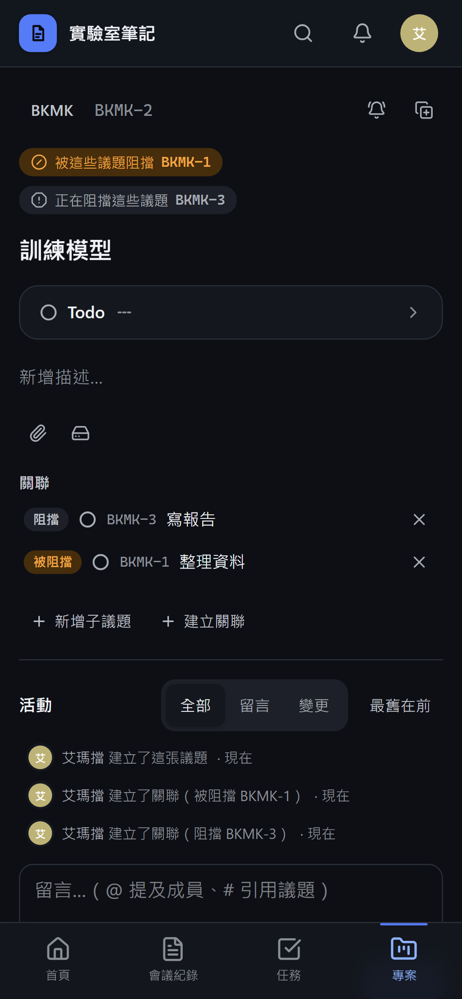

**改成進行中前的確認**

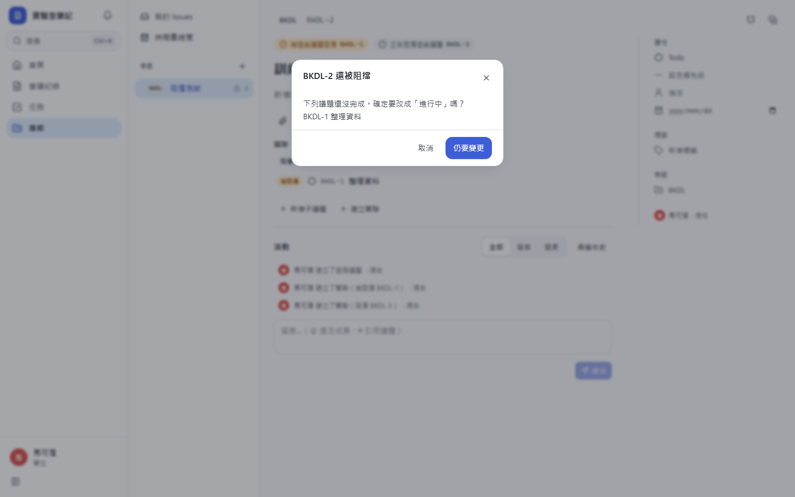
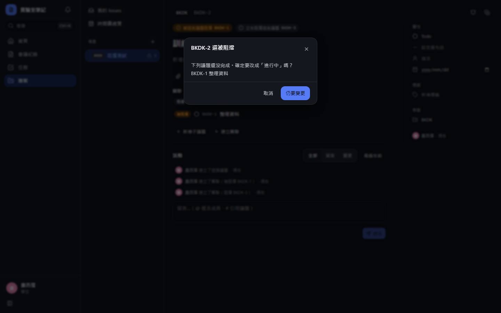
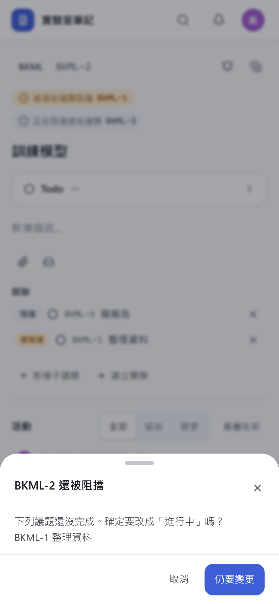
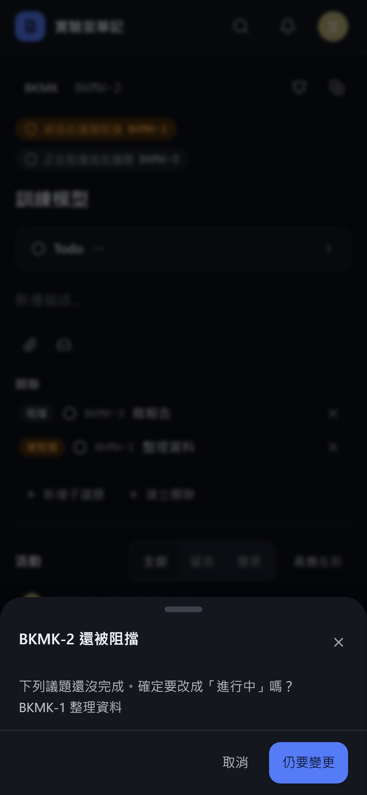
