# [MS-51] 補齊各處的右鍵選單

> 狀態：完成

## 內文

### 需求
只有議題清單與看板卡片有右鍵選單，其他常用物件（側欄專案、會議紀錄、任務、留言、附件、看板欄）按右鍵只出現瀏覽器預設選單。參考 Linear、Notion、GitHub 的慣例，在這些地方提供合適的右鍵選單，選單內容只出現使用者有權限做的動作，手機長按同樣可用。

### 來源
使用者 2026-10-20 對話：「我發現好像沒有設計點擊右鍵的功能。幫我補上合適的功能們，如果不確定就參考其他專案的」

### 驗收條件
- [x] 側欄專案：開啟、在新分頁開啟、新增議題、新增子專案、專案設定、管理成員、複製連結、結案／封存（依權限）
- [x] 看板欄標題：在此欄新增議題、收合／展開
- [x] 會議紀錄列表：開啟、在新分頁開啟、複製連結、匯出 ZIP／HTML、刪除（依權限）
- [x] 任務列表：開啟、在新分頁開啟、複製連結、編輯任務（管理者）
- [x] 留言（議題與會議紀錄）：回覆、複製內容、複製連結、編輯、刪除（只對自己的留言或有權限者）
- [x] 附件：開啟、下載、複製連結、刪除（依權限）
- [x] 所有右鍵選單外觀一致、深淺色正確、鍵盤可操作（上下鍵、Enter、Esc），有快捷鍵的項目附角標
- [x] 手機長按開啟，以底部抽屜呈現，觸控目標 ≥ 44 px，不超出螢幕
- [x] 文字輸入框、編輯器內按右鍵仍是瀏覽器原生選單（保留拼字檢查與貼上）

### 測試流程
1. 依序在側欄專案、看板欄、紀錄列表、任務列表、留言、附件按右鍵，確認選單項目與權限相符
2. 用檢視者帳號重複一次，看不到編輯、刪除類項目
3. 手機寬度長按同樣的物件，底部抽屜開啟且可操作
4. 在留言輸入框按右鍵，出現瀏覽器原生選單

---

# 跟其他票的關係

- Blocks：無
- Blocked by：無
- Related：MS-9、MS-49

---

# Commit-1

## 內文

原本只有議題清單與看板卡片有右鍵選單，其他地方按右鍵只出現瀏覽器預設選單。
現在參考 Linear、Notion、GitHub 的慣例補上：側欄專案（開啟、新分頁開啟、新增議題、新增子專案、專案設定、管理或查看成員、複製連結、結案、封存）、看板欄標題（在此欄新增議題、收合／展開、選取此欄）、會議紀錄卡片（開啟、新分頁、複製連結、匯出 ZIP／HTML、刪除）、任務卡片（開啟、新分頁、複製連結、排行榜、編輯任務設定）、議題與會議紀錄的留言（回覆、複製內容、複製連結、編輯、刪除）、附件（開啟、下載、複製連結、刪除）。每個選單只出現自己有權限的項目，外觀與議題選單一致，可用鍵盤操作，有快捷鍵的附角標。手機長按開啟，以底部抽屜呈現；文字輸入框與編輯器內仍是瀏覽器原生選單。
驗收：在側欄專案、看板欄、紀錄卡片、任務卡片、留言、附件按右鍵（手機長按），選單項目與上列一致；手機選單右緣不超出 390px；在留言輸入框觸發右鍵不會被攔下。

### 測試結果

| 項目 | 結果 |
|---|---|
| 完整測試套件（vitest） | 通過 46 / 46 |
| E2E（Playwright，4 種裝置×主題） | 通過 92 / 92（4 項僅桌機，手機略過） |
| 型別檢查 | 0 錯誤 |
| lint（含色碼與對比度檢查） | 0 錯誤 |

### 截圖

**側欄專案的右鍵選單**

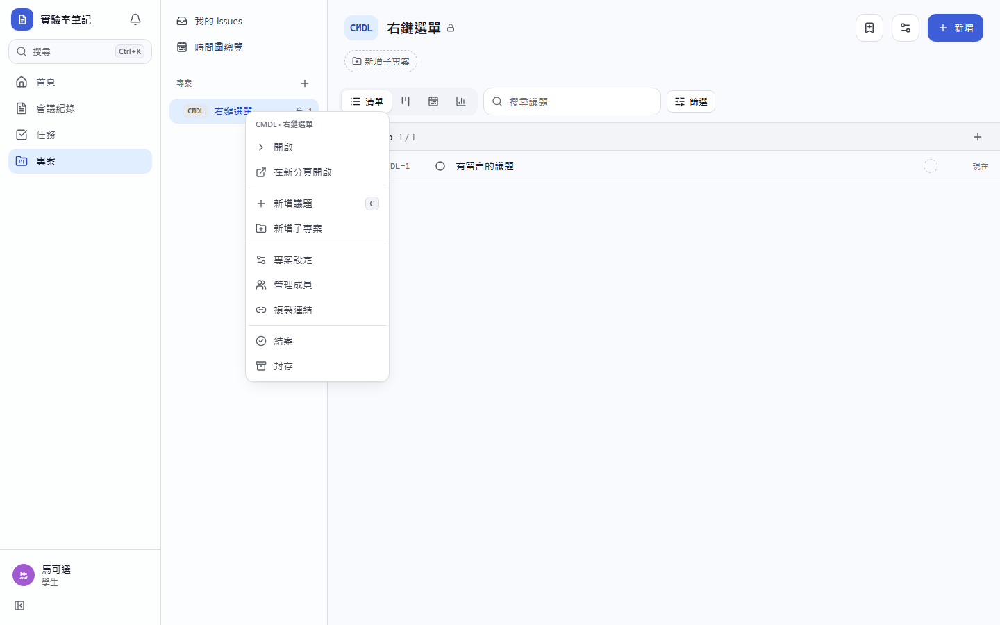
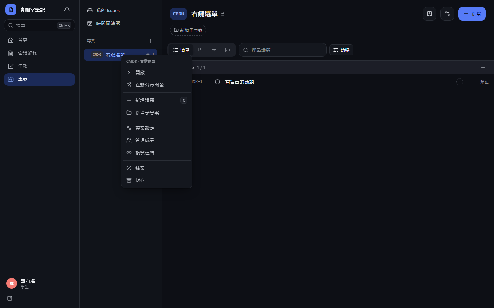

**會議紀錄卡片**

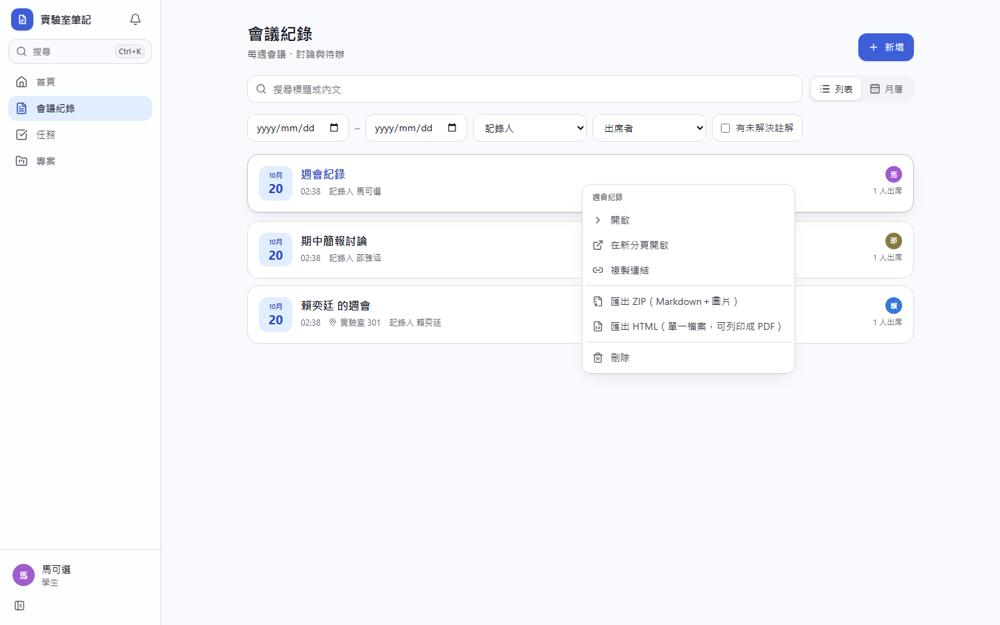
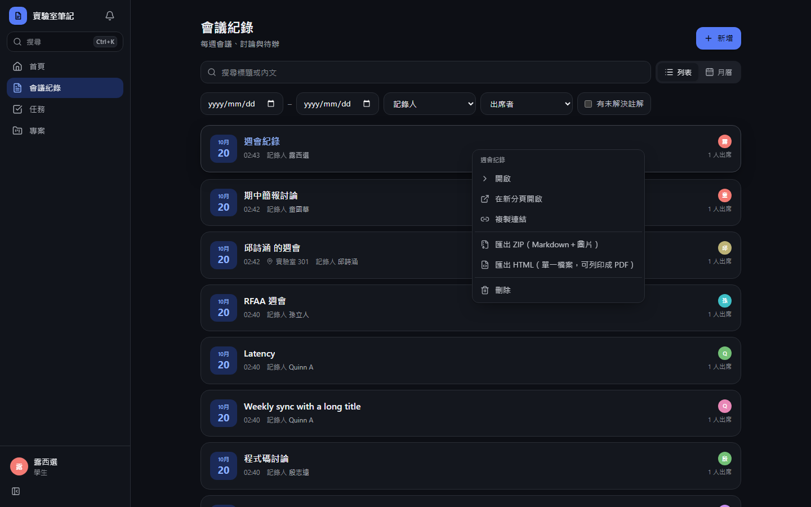
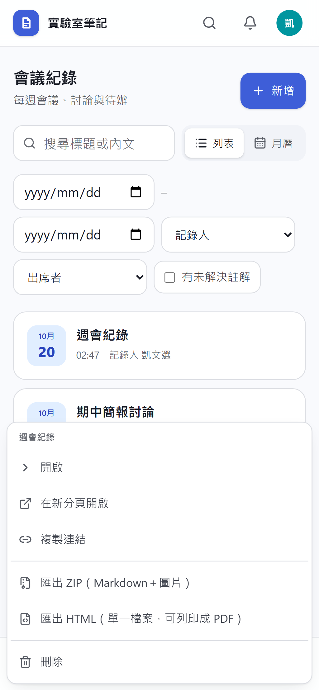
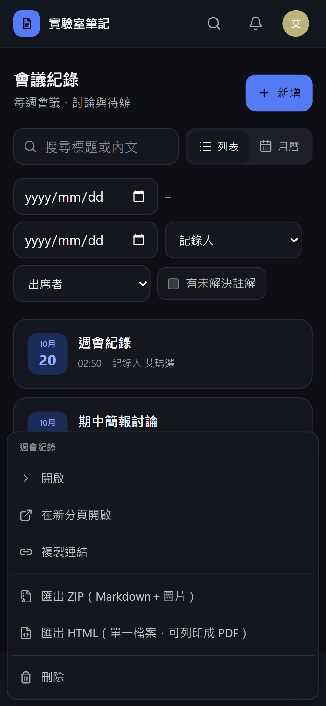

**留言**

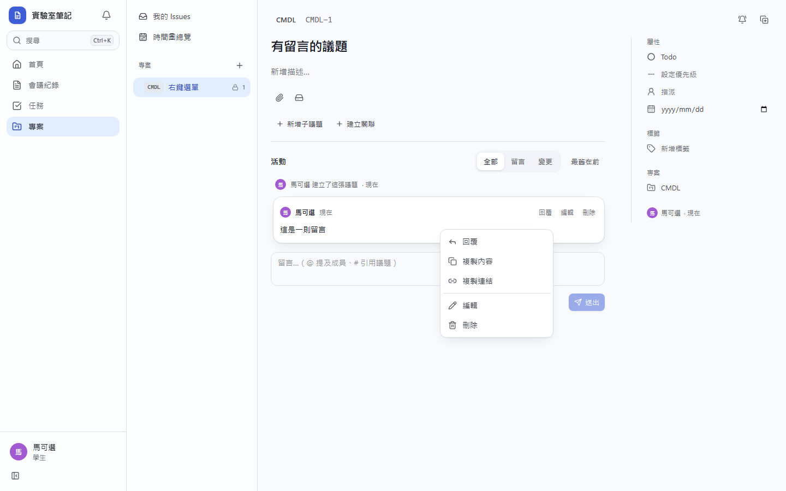
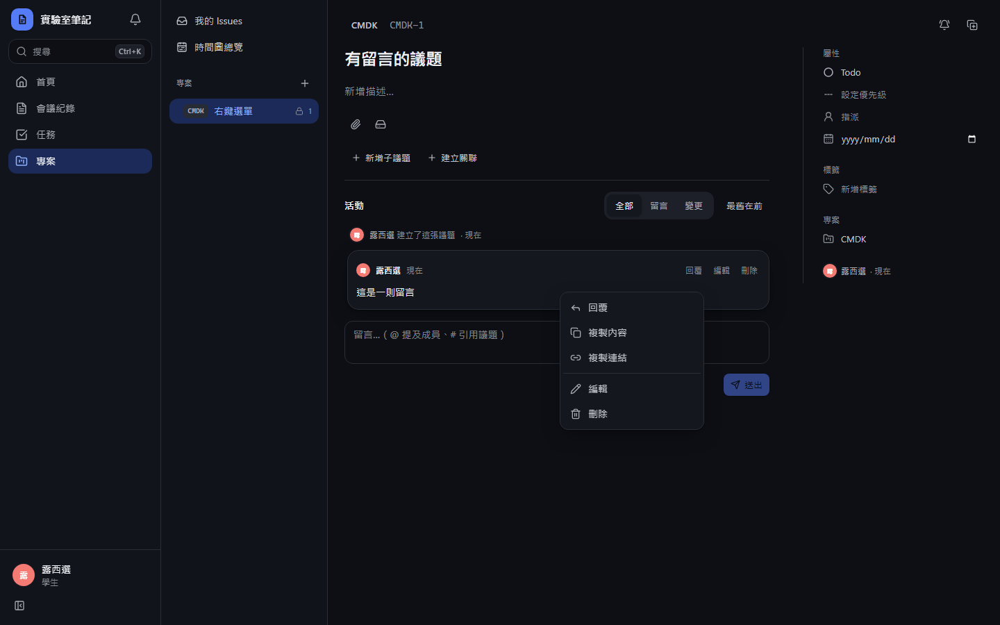
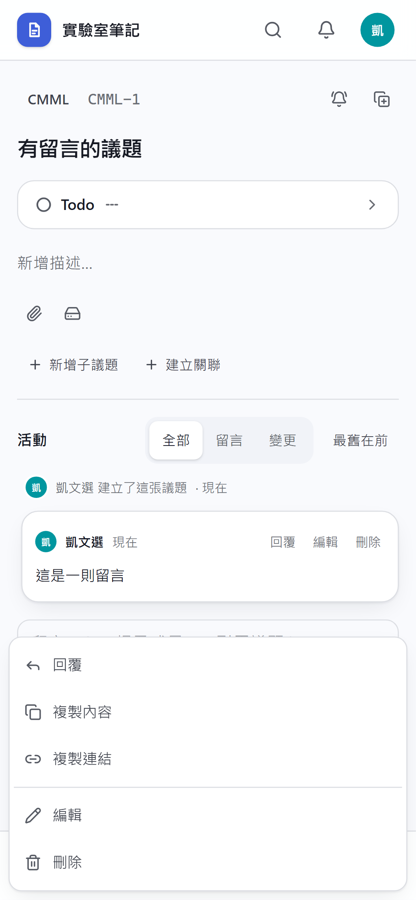
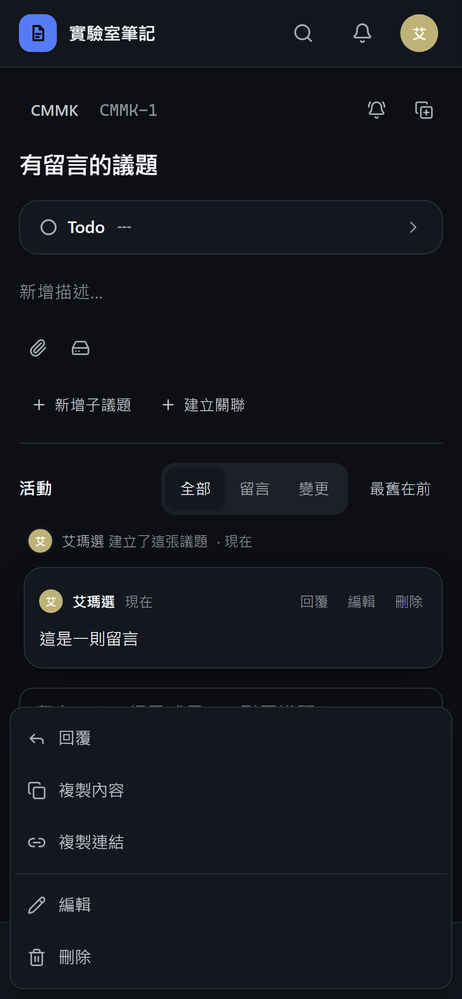

**附件**

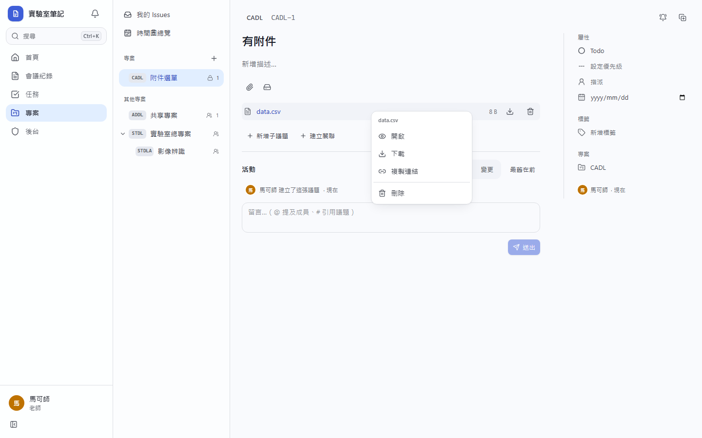
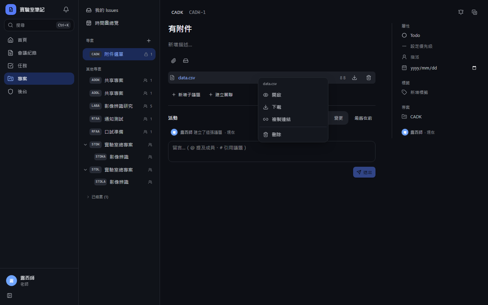
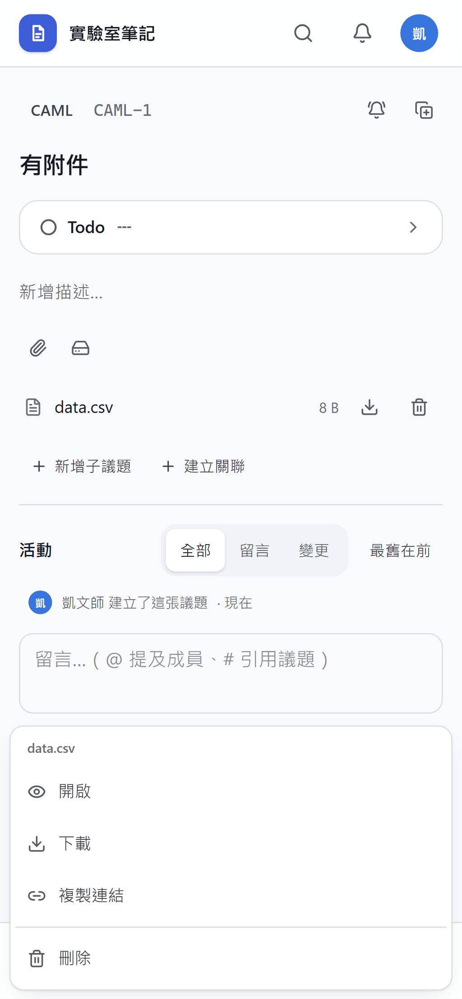
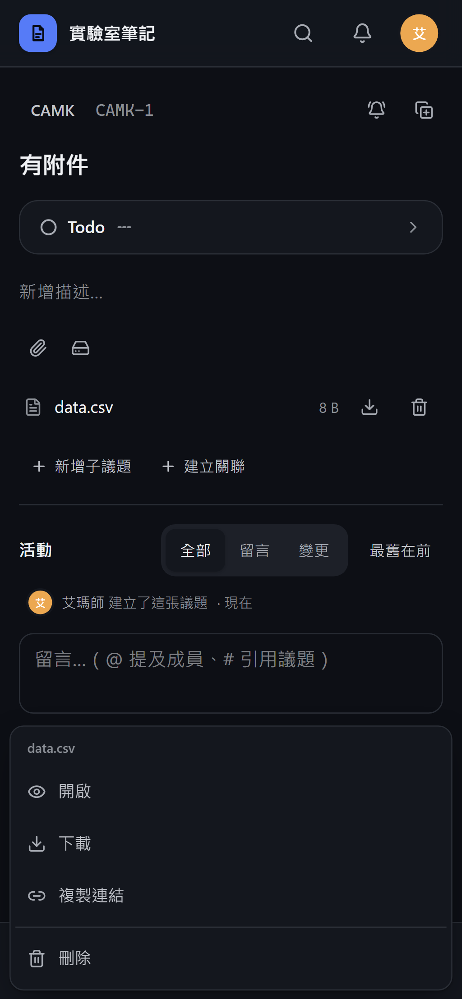
