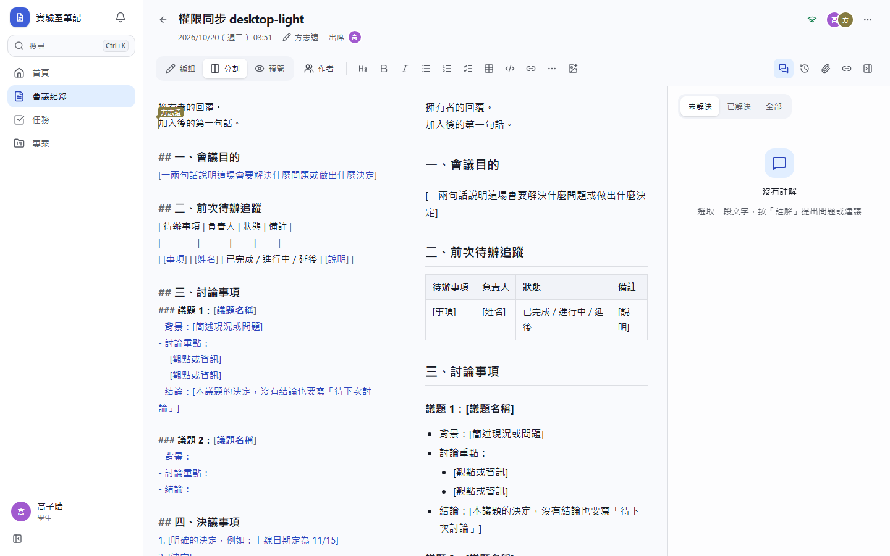
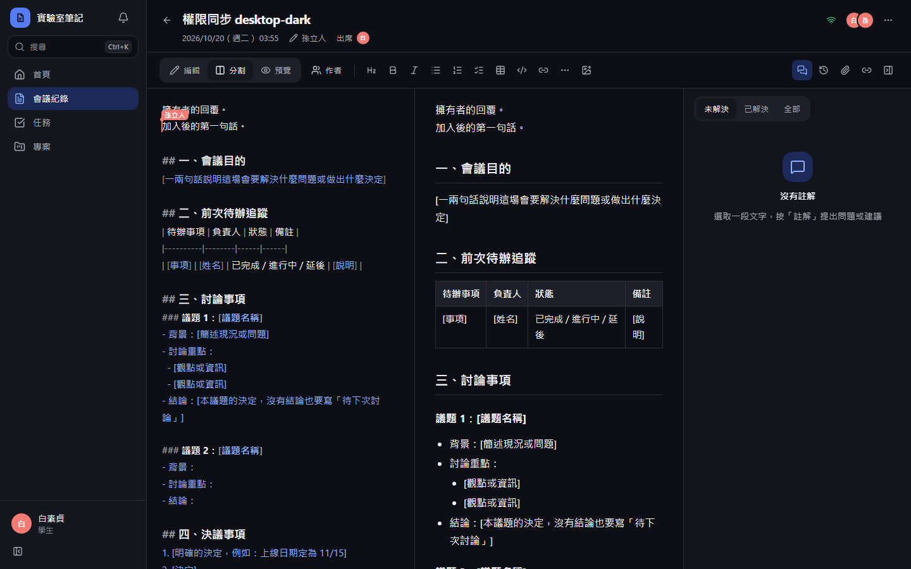
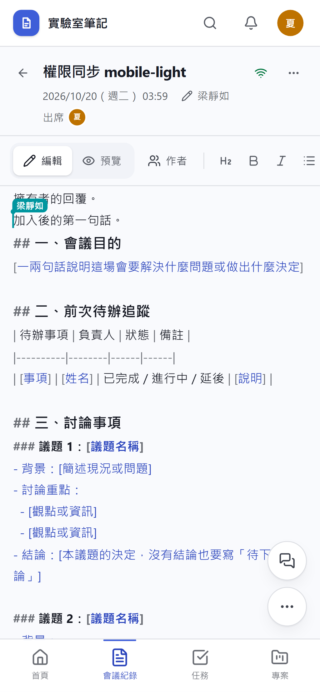
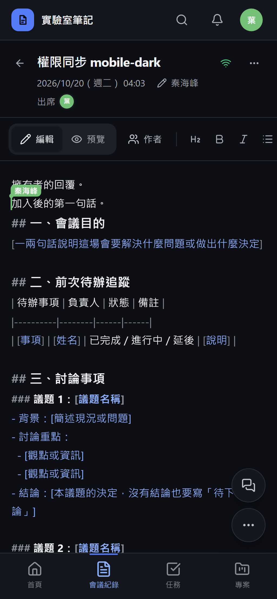

# [MS-52] 修正協作時一方修改沒有同步

> 狀態：完成

## 內文

### 需求
兩人同時編輯會議紀錄時，有時一方打的字只出現在自己畫面上，另一方永遠看不到（例如表格同一列兩人看到的內容不同），重新整理前都不會自己修正。任何情況下，所有正在編輯的人看到的內容都要一致；伺服器不接受某人的修改時要讓對方知道，不能默默丟掉。

### 來源
使用者 2026-10-20 對話：「他有時候會正確同步，但有時有一邊有改一邊卻沒有一起改，實際的問題出在哪裡?」（附兩人畫面截圖，表格第二、三列內容不同）

### 驗收條件
- [x] 開著紀錄時才被加為出席者或記錄人的人，畫面不用重新整理就變成可編輯，打的字其他人看得到（自動測試重現原本的問題）
- [x] 權限在連線期間改變而伺服器尚未得知時，第一次送出的修改會重新檢查權限，不會被默默丟掉
- [x] 沒有編輯權限的人送出修改時，伺服器告知對方，畫面改為唯讀並回到伺服器的版本，不會停在與別人不同的內容
- [x] 權限改變時只有權限有變的人重新連線，原本就能編輯的人不受影響
- [x] 伺服器漏收的修改（例如伺服器重啟前還沒寫入的內容）在 30 秒內由雙方自動補齊
- [x] 兩人交替輸入後，雙方畫面上的全文完全相同

### 測試流程
1. A 建立紀錄並開啟編輯；B 不在出席名單，開啟後顯示唯讀
2. A 把 B 加進出席者；B 的畫面自動變成可編輯
3. B 在開頭輸入一句話，A 立刻看到；A 在結尾回覆，B 立刻看到
4. 比對兩人畫面的全文，完全相同

---

# 跟其他票的關係

- Blocks：無
- Blocked by：無
- Related：MS-12、MS-13

---

# Commit-1

## 內文

兩人同時編輯時，有時一方打的字只出現在自己畫面上，另一方永遠看不到。原因是伺服器只在連線那一刻判斷「這個人能不能編輯」，之後一直沿用；開著紀錄時才被加為出席者或記錄人的人，畫面變成可編輯，但伺服器仍把他的修改當成唯讀而默默丟掉，兩邊從此對不上。
現在改出席者或記錄人時，只有權限有變的人會自動重新連線並取得新權限，畫面不用重新整理就變成可編輯，原本就能編輯的人不受影響。伺服器收到「唯讀」連線送來的修改時會重新檢查權限：仍然沒有權限就告知對方，對方畫面改為唯讀並回到伺服器的版本，不再停在與別人不同的內容。另外每 30 秒雙方會互相比對一次，伺服器漏收的修改（例如伺服器重啟前還沒寫入的內容）會自動補齊。
驗收：自動測試重現原本的問題——換回舊版伺服器程式時三項新測試全部失敗，新版全部通過；e2e 中訪客開著唯讀頁面被加為出席者後，畫面自動變成可編輯，雙方互相輸入後開頭內容完全相同。

### 測試結果

| 項目 | 結果 |
|---|---|
| 完整測試套件（vitest） | 通過 48 / 48（含 3 項重現測試，舊版 3 項失敗） |
| E2E（Playwright，4 種裝置×主題） | 通過 102 / 102（6 項限定裝置，其餘裝置略過） |
| 型別檢查 | 0 錯誤 |
| lint（含色碼與對比度檢查） | 0 錯誤 |

### 截圖

**被加為出席者後的訪客畫面（雙方內容一致）**

