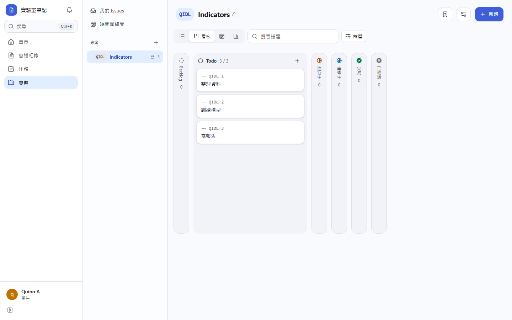
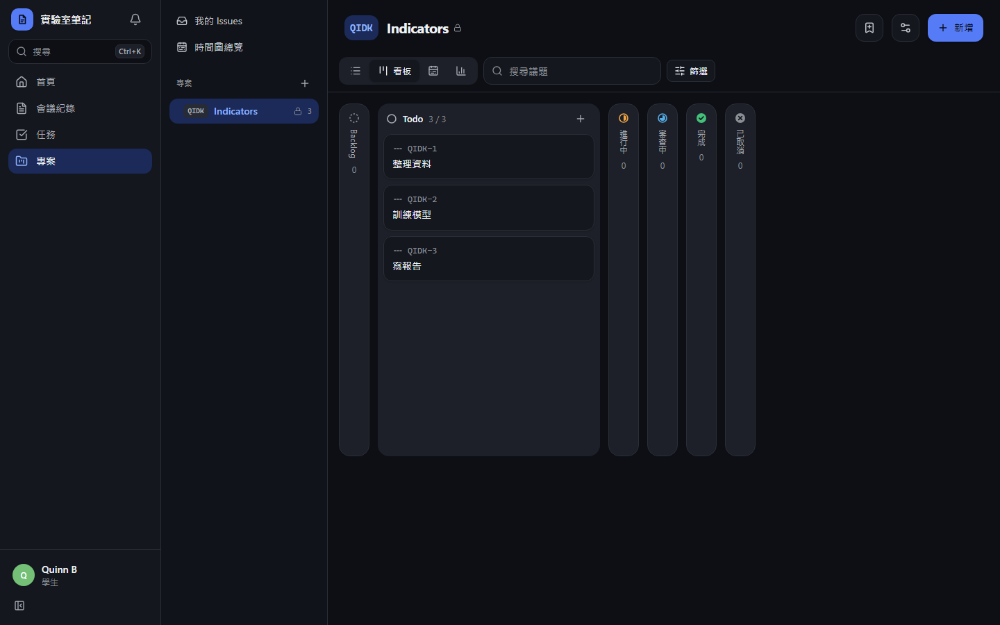
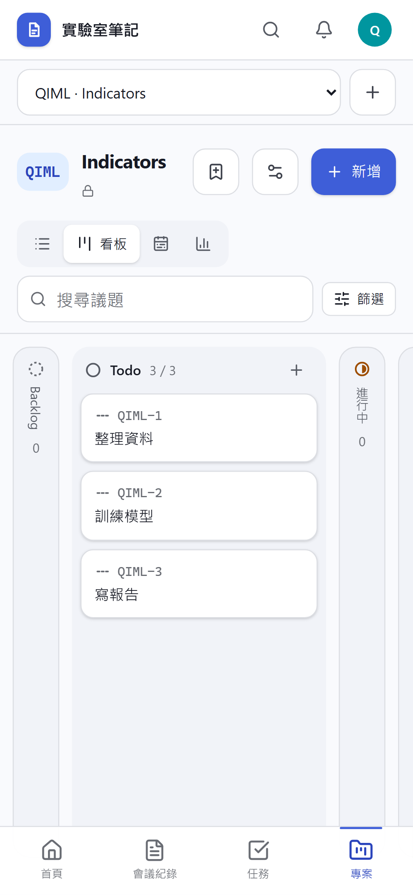
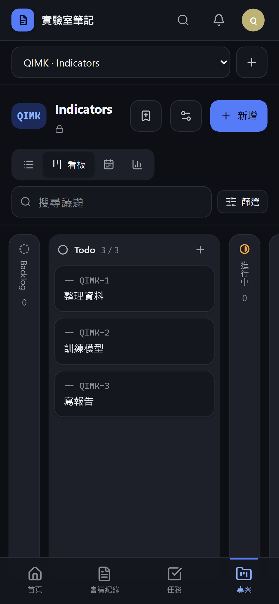
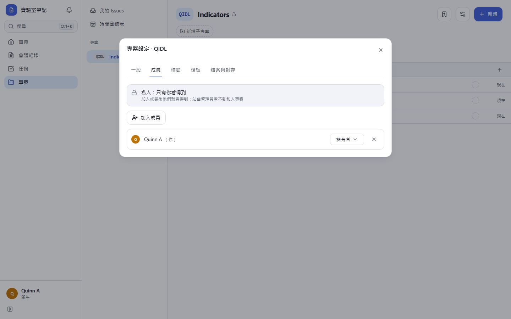
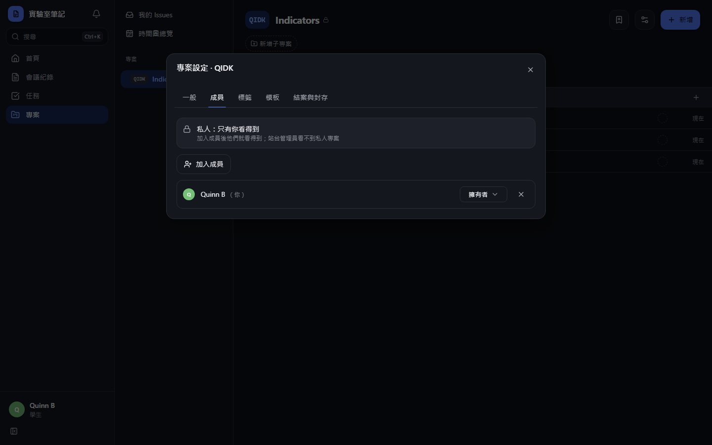
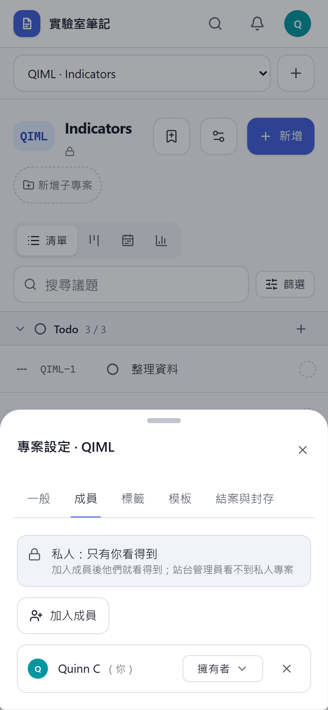
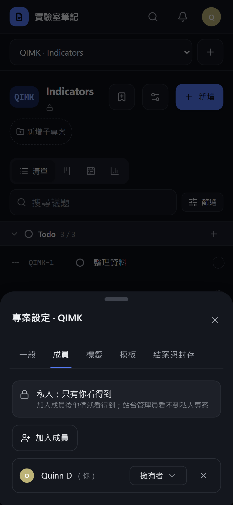
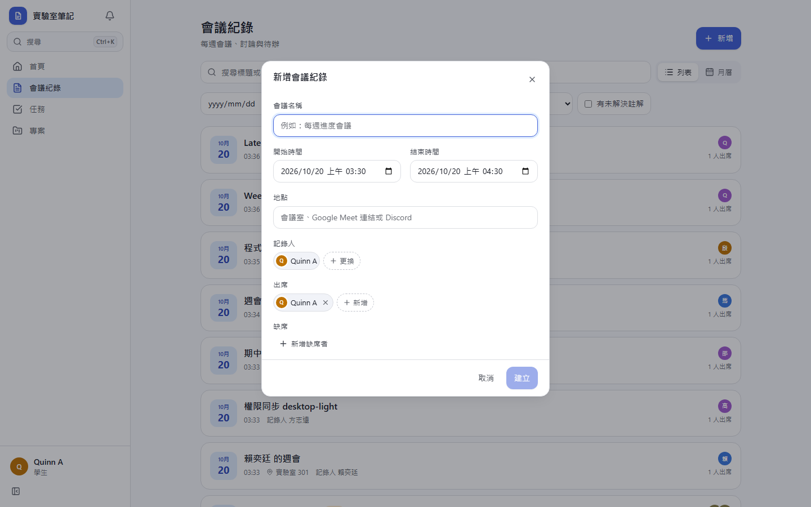
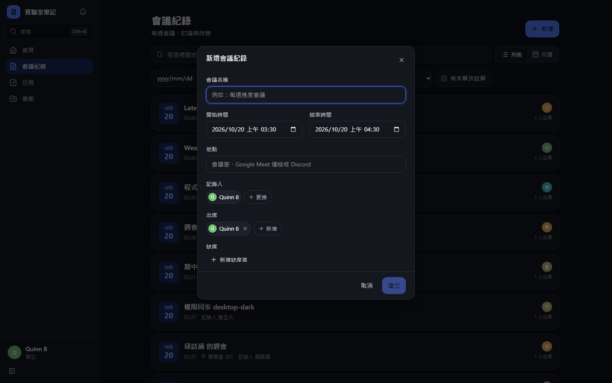

# [MS-53] 修正動畫卡頓

> 狀態：完成

## 內文

### 需求
新增會議紀錄的對話框、專案管理各畫面的動畫看起來卡卡的：對話框打開時、在對話框裡切分頁時掉格，切到看板或換頁時第一下會頓一下。所有常用動作的動畫都要順，在一般筆電上不掉格，在較慢的裝置上也不能每一格都卡。

### 來源
使用者 2026-10-20 對話：「為甚麼整體的動畫都卡卡的?這個畫面或是專案管理的畫面，可以幫我正確修正嗎?」（附新增會議紀錄對話框截圖）

### 驗收條件
- [x] 正式版、一般 CPU：開關新增會議紀錄、新增議題、專案設定對話框，切設定分頁，切到看板，在首頁／會議紀錄／任務／專案之間換頁，捲動清單與看板，每一格都 ≤ 33 ms（瀏覽器逐格量測）
- [x] 正式版、CPU 降速 4 倍（模擬較慢裝置）：上述動作只有第一格（畫面掛載）可以較長，之後的動畫格 ≤ 34 ms；切看板與換頁的第一格比修正前少一半以上
- [x] 畫面上沒有任何元素對背後內容做模糊（自動測試檢查）
- [x] 對話框開啟、切分頁、關閉時，掛載完成後的每一格 ≤ 34 ms（自動測試檢查，會擋下回歸）
- [x] 側欄目前頁面、分頁底線、看板、清單的動畫仍在，深淺色正確

### 測試流程
1. 在有 300 張議題的專案依序開專案設定、切成員分頁、關閉，按 C 開新增議題再關閉
2. 切到看板、捲動；切到會議紀錄、開新增會議紀錄再關閉；在首頁、任務、專案之間切換
3. 每一步逐格記錄畫面更新間隔，正式版一般 CPU 與降速 4 倍各量一次

---

# 跟其他票的關係

- Blocks：無
- Blocked by：無
- Related：MS-2、MS-47

---

# Commit-1

## 內文

新增會議紀錄、新增議題、專案設定等對話框打開後，每一格要 33～50 ms，畫面只剩 20～30 fps，在對話框裡切分頁也一樣卡。原因是對話框後面的整頁做了模糊，每一格都要重算整頁模糊。另外換頁與切看板的第一下會頓：側欄目前頁面、分頁底線、看板卡片用的是會量測整頁版面的位移動畫，加上每張卡片各自訂閱未讀通知、各開一個計時器。
現在對話框遮罩、側欄、手機頂端列與底部導覽、清單分組標題都不再模糊背後內容（改成近乎不透明的底色，看起來幾乎一樣）；側欄目前頁面、分頁底線、檢視切換、手機底部導覽改用純 CSS 過渡，看板卡片與清單不再做整頁量測；整個清單共用一份未讀與停滯資料。卡片 hover 只過渡位移、邊框與陰影，不再過渡所有屬性。
量測（正式版、300 張議題的專案、逐格記錄畫面更新間隔）：一般 CPU 下開關三種對話框、切設定分頁、切看板、捲動、在首頁／會議紀錄／任務／專案之間換頁，每一格都 ≤ 33 ms（修正前對話框開著時每格 33～50 ms）。CPU 降速 4 倍時只剩掛載的第一格較長，切看板 167 → 95 ms、從看板換到會議紀錄 345 → 96 ms，之後的動畫格 ≤ 34 ms。新增的自動測試會檢查畫面上沒有任何背景模糊，並量測對話框開啟、切分頁、關閉時掛載後每一格 ≤ 34 ms；把模糊加回去時這個測試會失敗。

### 測試結果

| 項目 | 結果 |
|---|---|
| 完整測試套件（vitest） | 通過 48 / 48 |
| E2E（Playwright，4 種裝置×主題） | 通過 102 / 102（6 項僅桌機，手機略過） |
| 型別檢查 | 0 錯誤 |
| lint（含色碼與對比度檢查） | 0 錯誤 |
| 逐格量測（正式版，一般 CPU） | 所有動作每格 ≤ 33 ms |
| 逐格量測（正式版，CPU ×4） | 首格之後 ≤ 34 ms；切看板首格 95 ms、換頁首格 96 ms |

### 截圖

**看板（檢視切換、側欄與底部導覽的目前位置）**

**專案設定分頁底線**

**新增會議紀錄對話框（背景不再模糊）**

