# [MS-54] 在任務中檢視與篩選上傳的表格資料

> 狀態：完成

## 內文

### 需求
學生上傳 CSV／XLSX 等資料檔時，老師目前只看得到通過與否和分數，要下載後另外用 Excel 打開才知道內容。要能在平台內直接看到檔案的基本資訊與內容，並用常見的工具快速檢查：排序、搜尋、只看某些欄位、只看或排除某些值、篩出符合條件的資料並匯出。開啟與操作都要即時，不增加伺服器成本。

### 來源
使用者 2026-10-20 對話：「最好是在我的平台裡面，任務也認順便顯示資料的 meta data，例如欄位、幾筆資料、然後能針對結果做一些簡單的 sort，或是針對欄位做一些簡單的搜尋、資料擷取。只看某些欄位的資料、選擇欄位的某些值，只看這些值或是只不看這些值……最好要可以預覽或是直接看到裡面的資料，看怎麼設計成本最低，然後使用體驗最好，最不會有延遲。」（附作業 BAB-6 與 sample_events.csv／xlsx）

### 驗收條件
- [x] 提交卡片（學生自己的與老師的管理頁）對 .csv／.tsv／.xlsx 顯示「檢視資料」，開啟後即看到內容；議題與會議紀錄附件的同類檔案預覽也用同一個檢視器
- [x] 資訊列顯示：檔名、大小、編碼（UTF-8／Big5，非 UTF-8 時提示）、分隔符號、工作表（XLSX 可切換）、資料筆數、欄位數
- [x] 欄位總覽：每欄的推測型別（數字／日期／文字）、有值與空白筆數、不重複值數量、最常見的值；數字與日期顯示最小／最大
- [x] 表格：表頭固定、列號、點表頭排序（升冪／降冪／取消）；1 萬筆資料捲動維持順暢（每格 ≤ 33 ms）
- [x] 全文搜尋：在所有（或選定）欄位找關鍵字，符合的文字標亮，即時更新筆數
- [x] 欄位選擇：勾選要顯示的欄位，可全選／全不選，可依名稱搜尋欄位
- [x] 值篩選：對任一欄位勾選值，可切換「只看這些」或「排除這些」；也可篩「空白／非空白」與文字包含；多個條件同時成立，以標籤列出並可逐一移除
- [x] 顯示「符合 N / 全部 M 筆」；可把目前的篩選結果（只含顯示的欄位）匯出成 UTF-8 CSV，Excel 打開不亂碼
- [x] 點儲存格可看完整內容並複製；網址欄位可直接點開
- [x] 1 萬筆、20 欄的檔案從按下到看到表格 < 1.5 秒（本機量測），排序與篩選 < 100 ms；解析在背景執行，畫面不凍結
- [x] 檔案解析失敗（例如非表格檔、XLSX 損毀）時顯示原因並提供下載
- [x] 手機上可用：工具列收進底部抽屜，表格可左右捲動

### 測試流程
1. 學生上傳 sample_events.csv（及另存成 Big5 的版本與 .xlsx 版本）到一個任務
2. 老師在管理頁按「檢視資料」：看到 10 筆、20 欄，編碼與欄位型別正確
3. 依「開始日期」降冪排序；搜尋「黃色小鴨」只剩 1 筆；只顯示 6 個欄位
4. 「範圍判定」只看「核心」→ 6 筆；改成排除「核心」→ 4 筆；匯出 CSV 用 Excel 打開內容正確

---

# 跟其他票的關係

- Blocks：MS-55
- Blocked by：無
- Related：MS-21、MS-22、MS-17

---

# Commit-1

## 內文

原本學生交 CSV／XLSX 後，老師只看得到通過與否和分數，要下載再用 Excel 打開。
現在提交卡片（學生自己的、老師管理頁的、試跑的）對表格檔有「檢視資料」，會議紀錄附件的 CSV／XLSX 預覽也用同一個檢視器。上方寫出大小、筆數、欄位數、編碼（Big5 會標出「不是 UTF-8」）、分隔符號，XLSX 可切換工作表。「資料」分頁有固定表頭與列號，點欄名排序（升冪 → 降冪 → 取消），全文搜尋會標亮符合的字，「欄位」按鈕可勾選要顯示的欄位，每欄的篩選可勾選值並切換「只看／排除」，也能篩空白、非空白、文字包含；條件以標籤列出，顯示「符合 N / 全部 M 筆」，可把目前結果（只含顯示的欄位）匯出成 Excel 不亂碼的 CSV。點一列會在側邊列出整列內容，網址可直接點開，可複製整列。「欄位總覽」分頁列出每欄的型別、有值與空白數、不重複數、最小／最大、最常見的值。檔案在瀏覽器背景執行緒解析，不經過伺服器運算，也不多存一份資料；手機上篩選與欄位選單從底部滑出。
驗收：30 筆的檔案搜尋「範例活動 05」剩 1 筆；「範圍判定」只看核心 18 筆、排除核心 12 筆；只顯示 3 個欄位；匯出 12 筆周邊資料為 UTF-8（含 BOM）。1 萬筆 × 20 欄：從按下到看到表格 0.33–0.42 秒，排序 51–56 ms，以每格 120 px 連續捲動時每一格 17 ms（60 fps）。

### 測試結果

| 項目 | 結果 |
|---|---|
| 完整測試套件（vitest，含解析器 5 項） | 通過 53 / 53 |
| E2E（Playwright，4 種裝置×主題） | 完整套件通過 108 / 108（6 項限定裝置略過）；之後新增的附件與範本測試另跑 5 / 5 通過 |
| 效能（1 萬筆 × 20 欄，桌機） | 開啟 0.33–0.42 秒、排序 51–56 ms、捲動每格 17 ms |
| 型別檢查 | 0 錯誤 |
| lint（含色碼與對比度檢查） | 0 錯誤 |

### 截圖

**資料表格（錯誤格標色）**

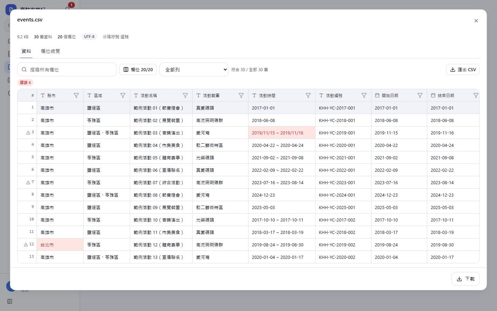
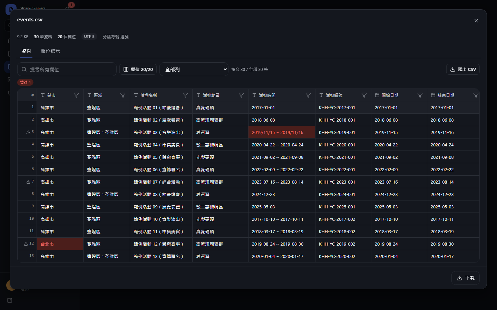
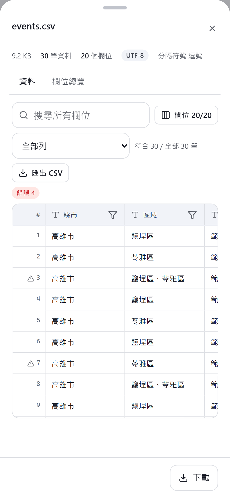
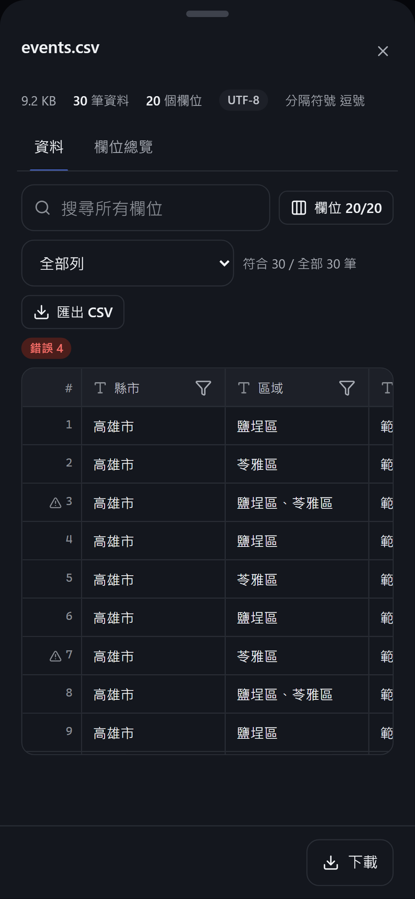

**值篩選：只看核心**

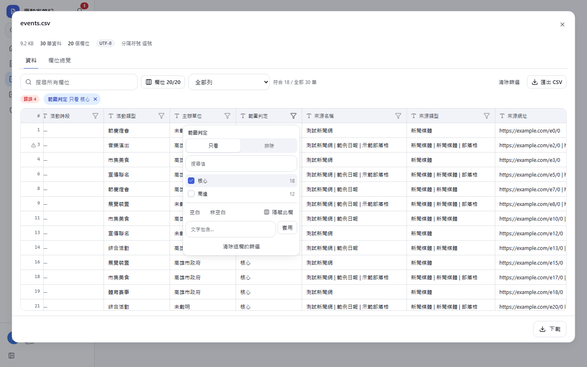
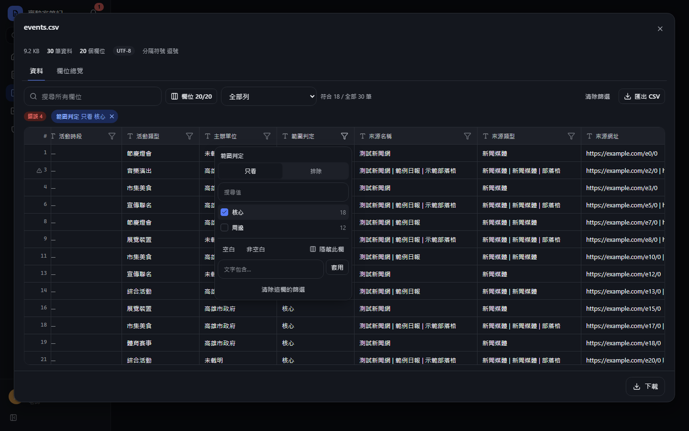

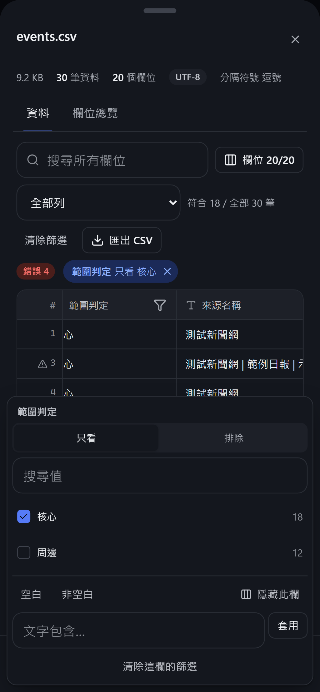

**欄位總覽**

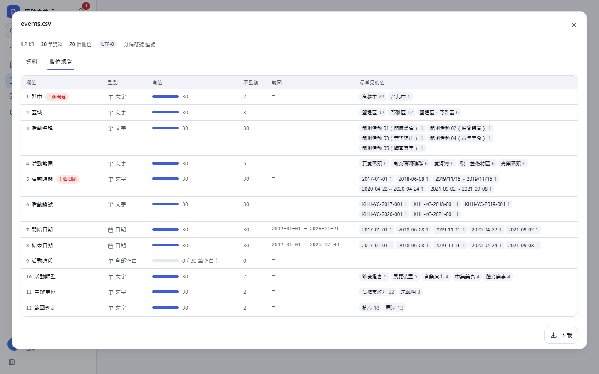
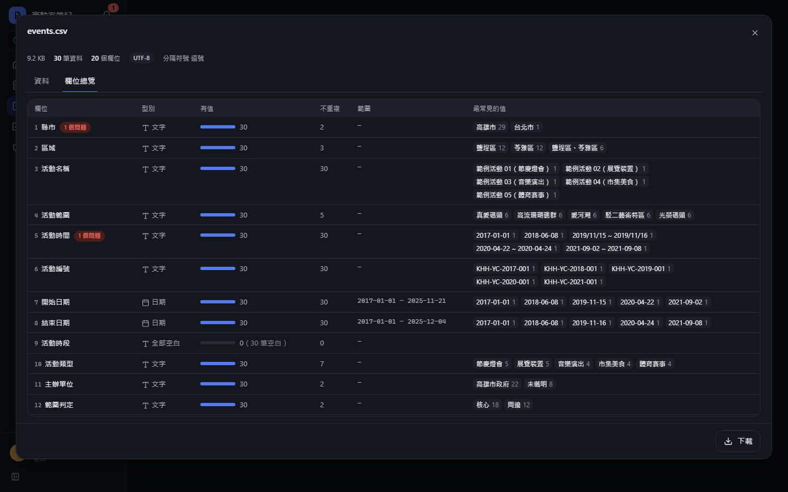
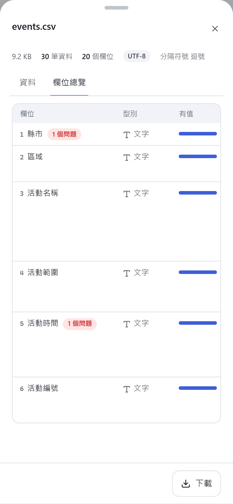
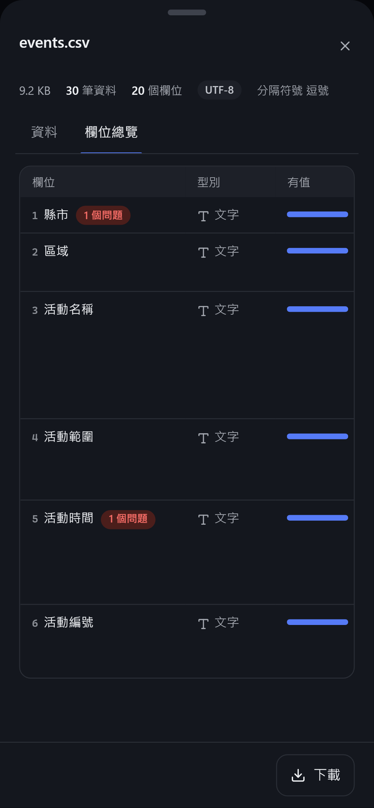

**手機：篩選從底部滑出**

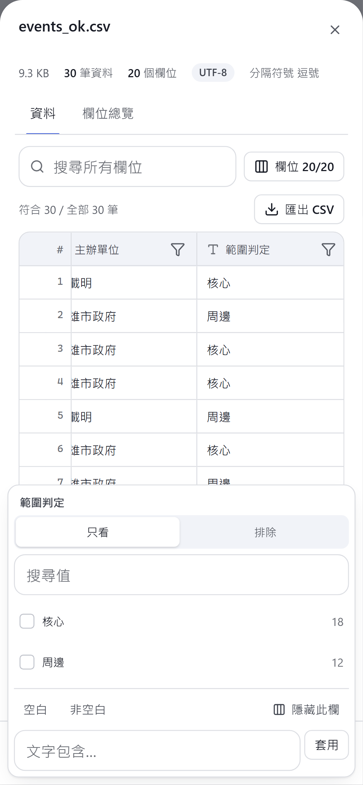
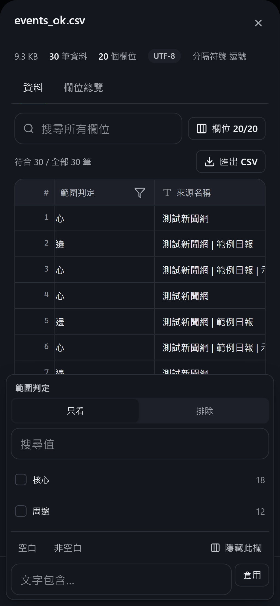
