# [MS-55] 評測結果標出有問題的列與欄位

> 狀態：完成

## 內文

### 需求
格式驗證類的作業，評測結果只有一串文字訊息，老師與學生要自己對照是哪一列、哪一格出錯。評測程式要能指出問題所在的列與欄位，資料檢視器直接把這些格子標出來，並能只看有問題的列。

### 來源
使用者 2026-10-20 對話（同 MS-54）：「我只是要驗證一下他們的檔案有沒有格式正確……而不是學生把資料上傳上來，只看的到通過與否或是分數。」

### 驗收條件
- [x] 評測結果的每個項目可選填列號與欄位名稱（以及嚴重度：錯誤／警告），評測程式合約文件寫明格式；舊的評測程式不需修改
- [x] 提交卡片的項目依「錯誤／警告」分組顯示數量，帶列號的項目可點，點了開啟資料檢視器並跳到該列、標出該格
- [x] 資料檢視器中有問題的儲存格以顏色標示（錯誤與警告不同色），滑過顯示訊息；欄位總覽顯示每欄的問題數
- [x] 檢視器提供「只看有問題的列」「只看錯誤」的篩選，可與其他篩選同時使用
- [x] 學生只看得到自己提交的標示；評測程式與隱藏資料不外流

### 測試流程
1. 上傳一份第 3 列日期寫成 2024/1/27、第 5 列缺來源網址的檔案
2. 提交卡片顯示「錯誤 2」，點第 3 列那一項，檢視器跳到第 3 列並標出「活動時間」
3. 按「只看有問題的列」只剩 2 列

---

# 跟其他票的關係

- Blocks：MS-56
- Blocked by：MS-54
- Related：MS-21

---

# Commit-1

## 內文

原本評測結果只有一串文字，要自己對照是哪一列、哪一格出錯。
現在評測程式的每個結果可以加上列號、欄位名稱與「錯誤／警告」（合約寫在設計文件，舊評測程式不用改）。提交卡片會顯示「錯誤 N」「警告 N」，問題排在前面，帶列號的項目顯示「第 7 列 · 來源網址」，點了直接打開資料檢視器、跳到那一列並捲到那一欄，側邊列出這一列的內容與錯誤訊息。檢視器裡錯誤格是紅色、警告格是黃色，滑過顯示訊息，列號前有警示符號；欄位總覽顯示每欄有幾個問題；「只看有問題的列」「只看錯誤」可與其他篩選一起用。學生只看得到自己提交的內容與標示。
驗收：有 4 個錯誤的檔案，卡片顯示「錯誤 4」，點「第 7 列 · 來源網址」打開檢視器並顯示「必填，不能空白」；「只看有問題的列」剩 4 筆；欄位總覽的「來源網址」標「1 個問題」。

### 測試結果

| 項目 | 結果 |
|---|---|
| 完整測試套件（vitest） | 通過 53 / 53 |
| E2E（Playwright，4 種裝置×主題） | 完整套件通過 108 / 108（6 項限定裝置略過） |
| 型別檢查 | 0 錯誤 |
| lint | 0 錯誤 |

### 截圖

**提交卡片：錯誤數量與位置**

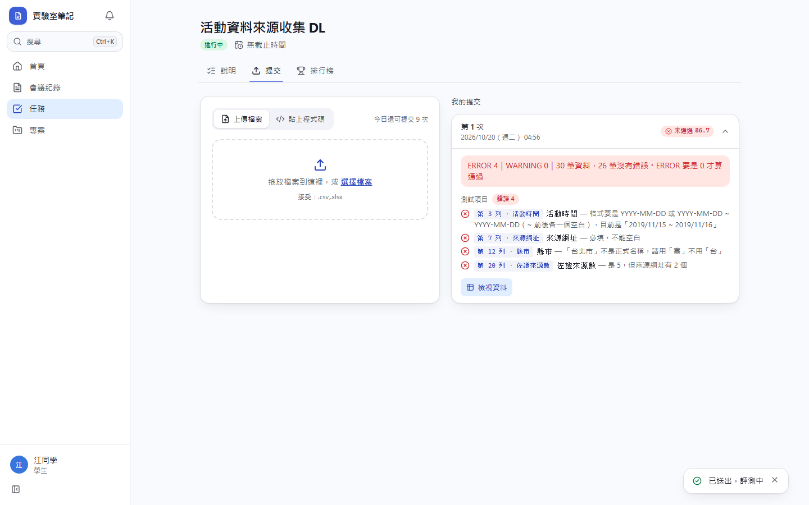
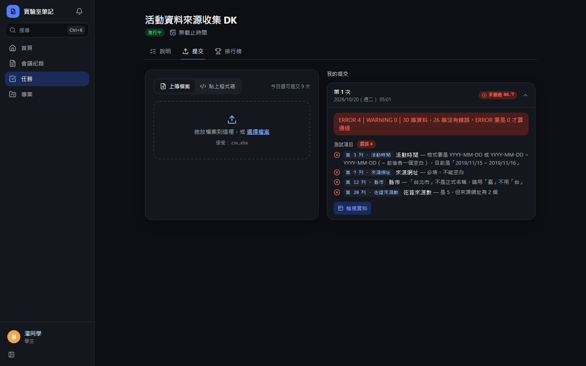
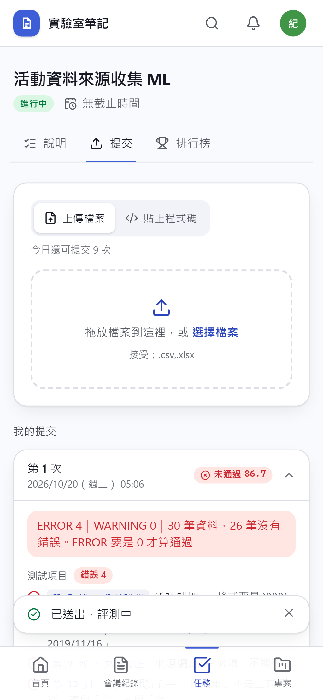
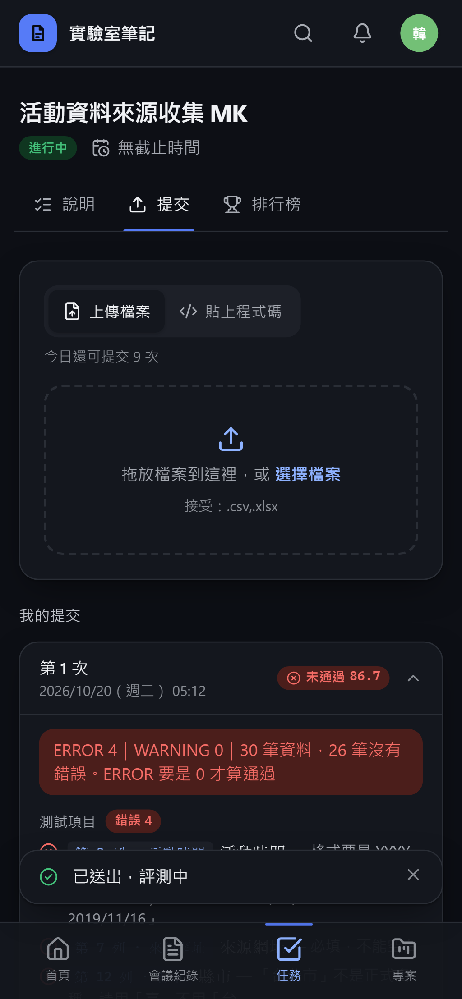

**點錯誤後跳到該列**

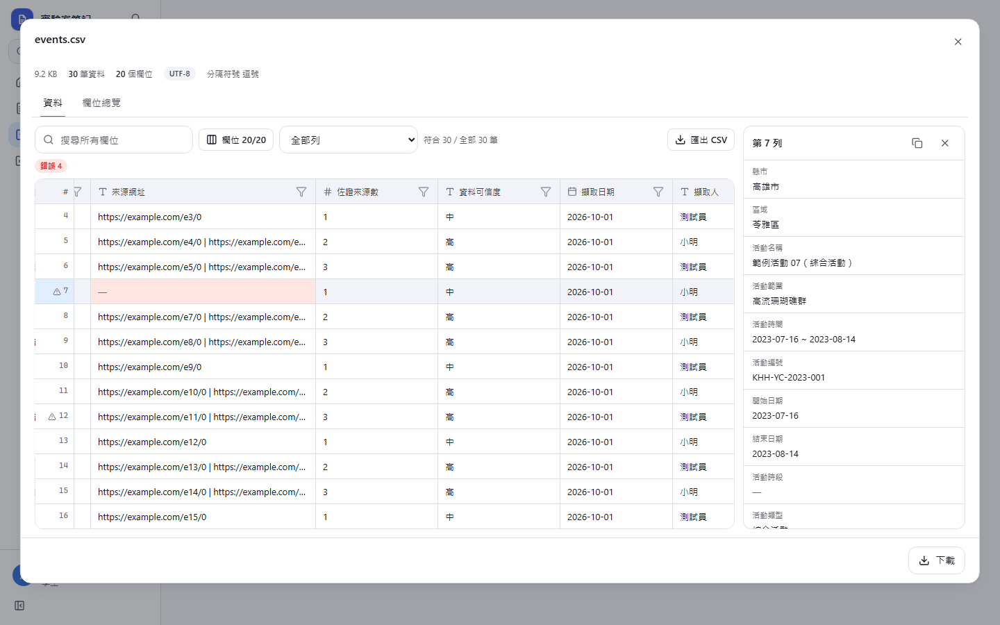
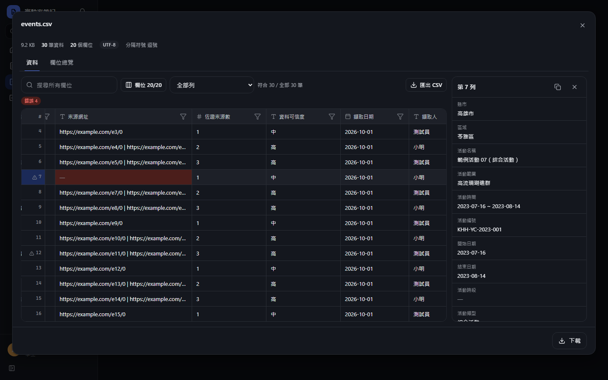
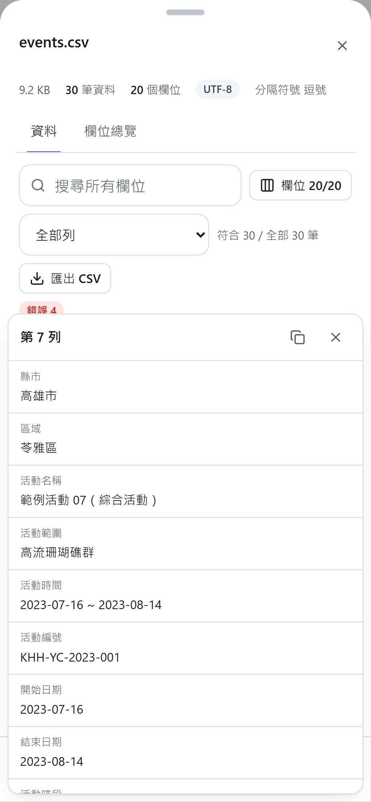
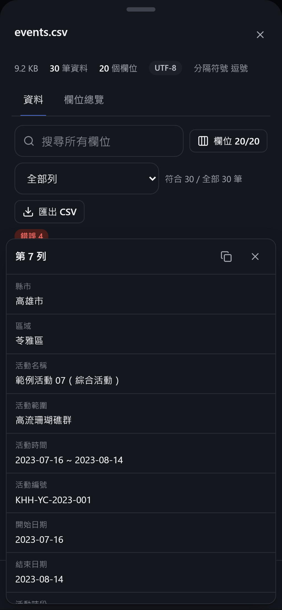

**只看有問題的列**

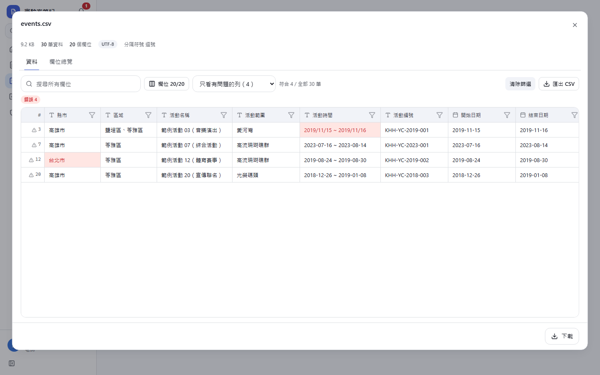
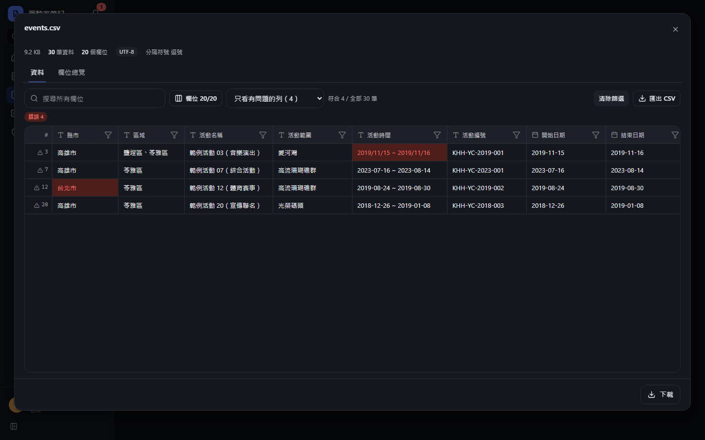
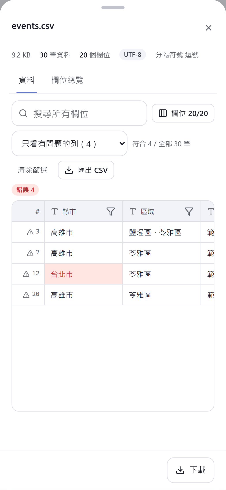
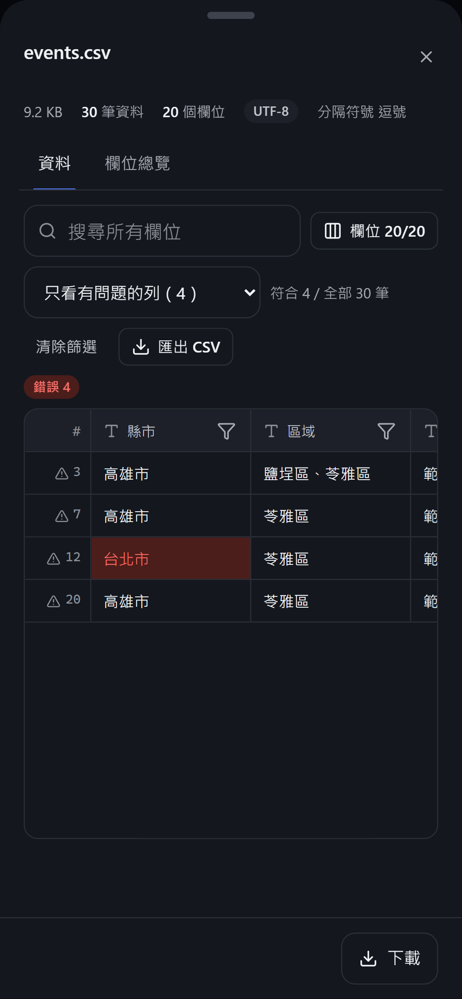
