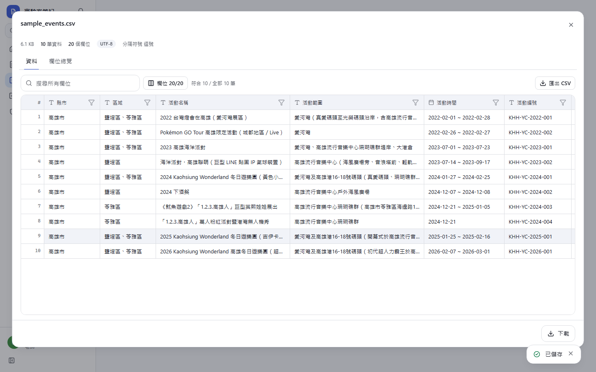
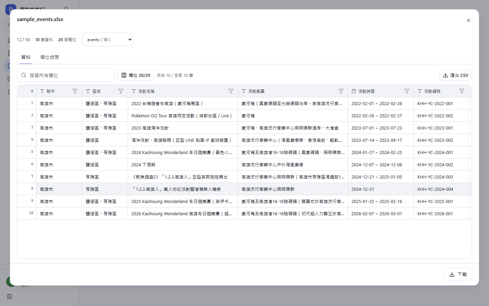

# [MS-56] 提供活動資料格式驗證評測範本

> 狀態：完成

## 內文

### 需求
作業 BAB-6（活動資料來源收集）要學生交 20 欄格式固定的 CSV／XLSX，交之前要跑驗證、ERROR 要是 0。要有一份可以直接上傳到平台的評測程式，依 sample_events.xlsx「欄位規格」逐列檢查，結果在平台上標出每個錯誤的位置，並附上範例資料。

### 來源
使用者 2026-10-20 對話：「有時候也會讓學生上傳不同類型的檔案，像這次一開始的要求是這個，我預期他們給 csv，然後我只是要驗證一下他們的檔案有沒有格式正確」（附 BAB-6 PDF、sample_events.csv、sample_events.xlsx）

### 驗收條件
- [x] 評測程式接受 UTF-8 CSV（含 BOM）與 XLSX；Big5 等非 UTF-8 的 CSV 回報明確錯誤
- [x] 檢查表頭：20 欄、前 5 欄順序固定、欄位只能多不能少
- [x] 依欄位規格逐列檢查：必填、縣市名稱（用「臺」）、高雄市 38 區、日期格式與「活動時間」一致、單日活動、活動編號格式與唯一、活動類型與來源類型限定值、來源名稱／類型／網址筆數一致、佐證來源數、可信度為中／低時備註必填、擷取日期不晚於今天
- [x] 每個錯誤標出列號與欄位；年份完全沒有資料只算警告
- [x] ERROR 0 才算通過；分數為通過檢查的列數比例
- [x] 範例 sample_events.csv／xlsx 實際上傳到平台通過；另附幾份帶錯誤的範例，各自得到預期的錯誤

### 測試流程
1. 建立任務，上傳評測程式，接受 .csv、.xlsx
2. 上傳 sample_events.csv → 通過，警告列出 2016–2021 沒有資料
3. 上傳帶錯的範例 → 未通過，錯誤標在對應的列與欄位

---

# 跟其他票的關係

- Blocks：無
- Blocked by：MS-55
- Related：MS-54

---

# Commit-1

## 內文

作業 BAB-6 要學生交 20 欄格式固定的活動資料，原本只能讓學生自己在本機跑驗證腳本。
現在有可直接上傳的評測程式（examples/tasks/event-sources/grade.py，只用 Python 標準函式庫），依 sample_events.xlsx「欄位規格」逐列檢查：檔案要是 UTF-8 CSV 或 XLSX（Big5 直接說明怎麼另存）、表頭 20 欄且前 5 欄順序固定、必填、縣市用「臺」、高雄市 38 區與「、」分隔、日期格式與「活動時間」一致、單日活動不寫區間、活動編號格式與唯一、各欄限定值、來源名稱／類型／網址筆數一致、佐證來源數、可信度中／低要寫備註、擷取日期不晚於今天，期間內沒有資料的年份列為警告。每個錯誤都帶列號與欄位，平台上直接標在那一格；ERROR 0 才算通過，分數是沒有錯誤的列數比例。同一支程式也能在本機當驗證腳本：python grade.py --file 檔案.csv --from 2016-10-07 --to 2026-10-07。另附產生 4 份帶錯範例的腳本與說明文件。
驗收：作業附件 sample_events.csv 與 sample_events.xlsx 實際上傳到平台試跑都是 ERROR 0；帶錯範例分別得到 ERROR 8（各種常見錯誤）、缺欄位（分數 0）、非 UTF-8、單日寫成區間，錯誤都在預期的列與欄。

### 測試結果

| 項目 | 結果 |
|---|---|
| 評測程式本機驗證（範本＋4 份帶錯範例） | 結果全部符合預期 |
| E2E：作業範本 CSV／XLSX 上傳試跑 | 通過 |
| E2E（Playwright，4 種裝置×主題） | 完整套件通過 108 / 108（6 項限定裝置略過） |
| 型別檢查 | 0 錯誤 |
| lint | 0 錯誤 |

### 截圖

**作業範本 CSV 在平台上通過**

**作業範本 XLSX（可切換工作表）**

**學生交的檔案有錯：位置標在卡片上**

