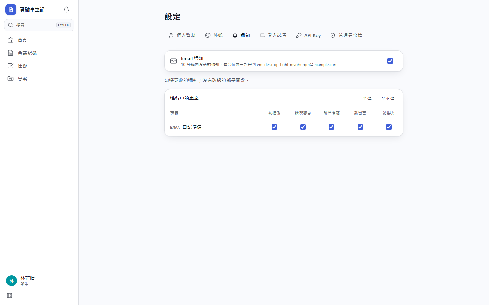
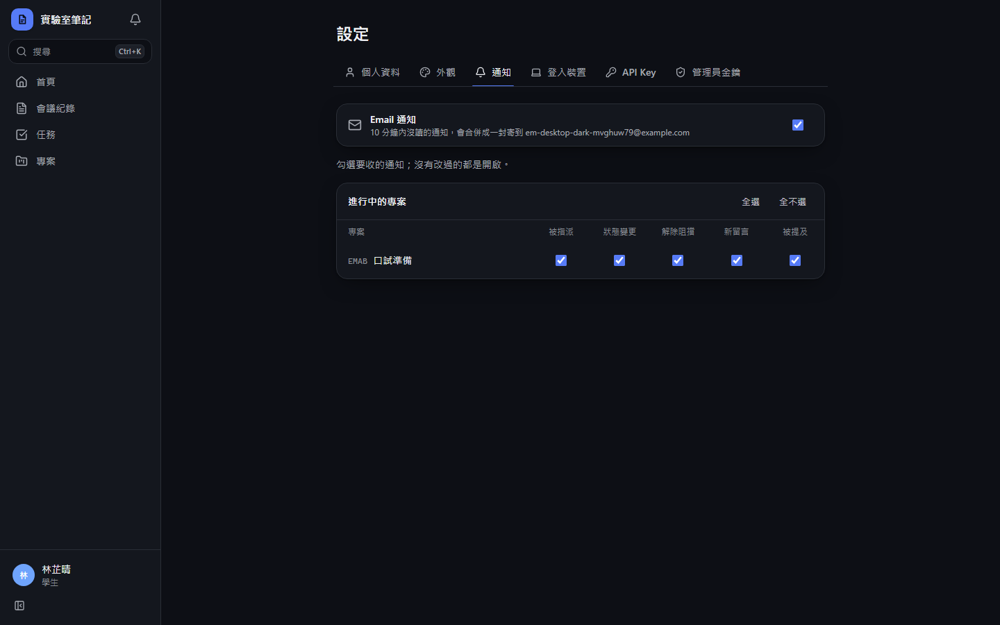
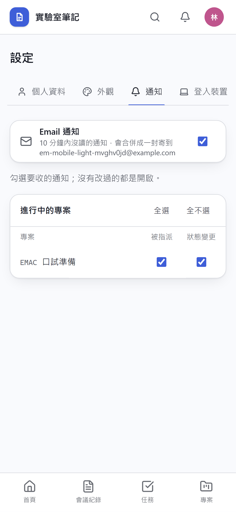
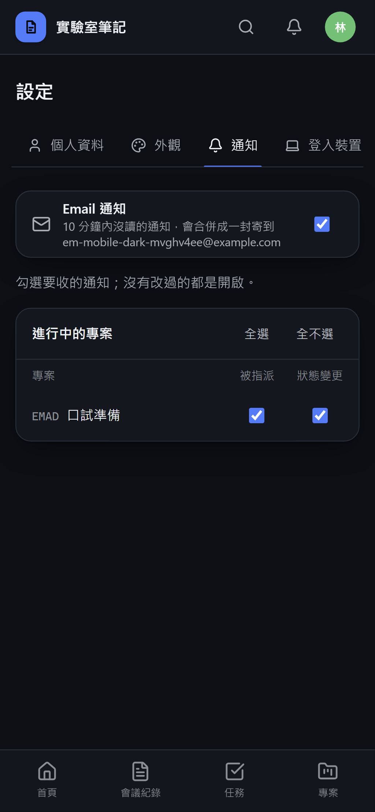
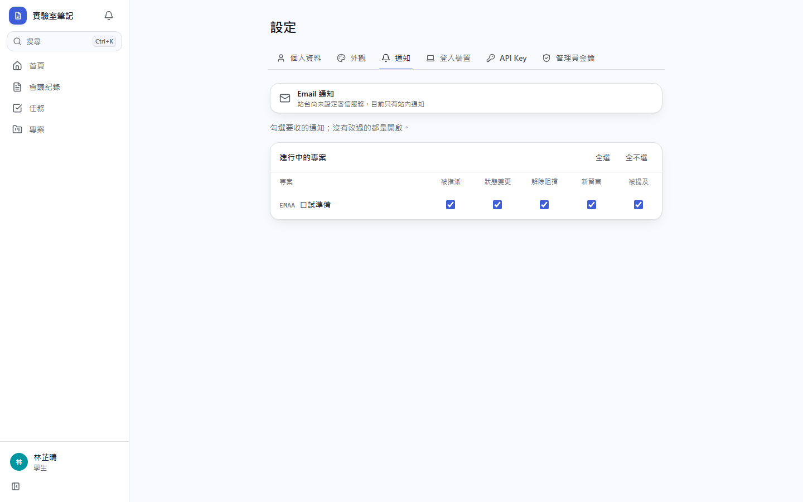
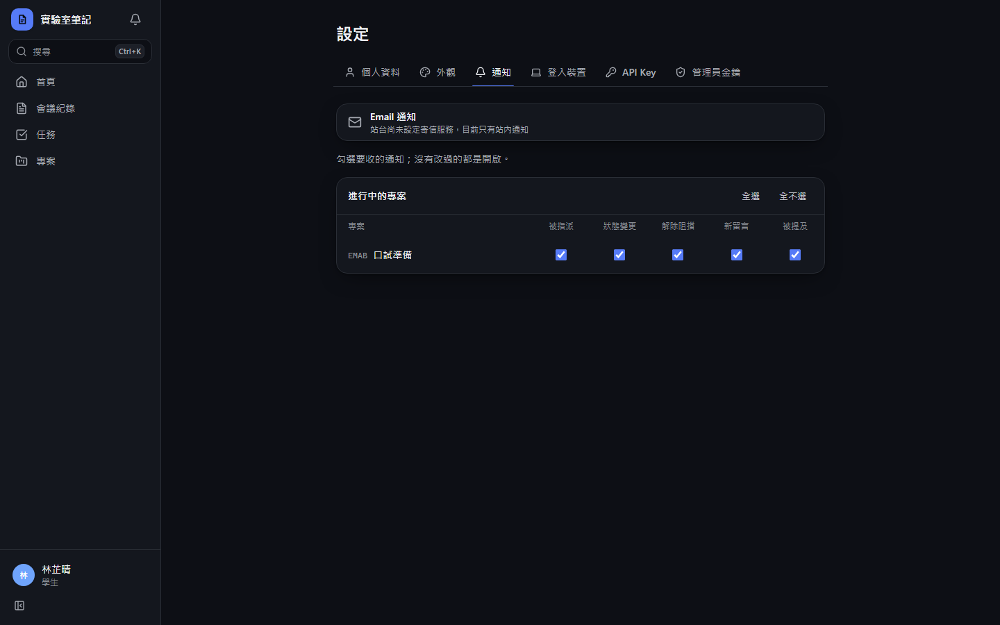
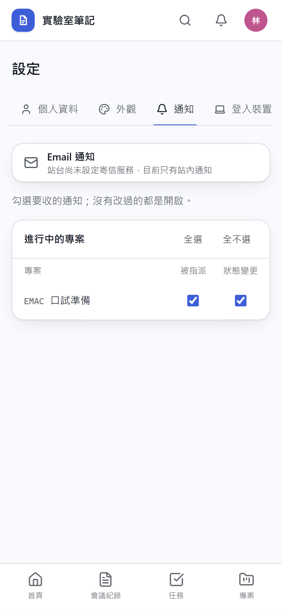
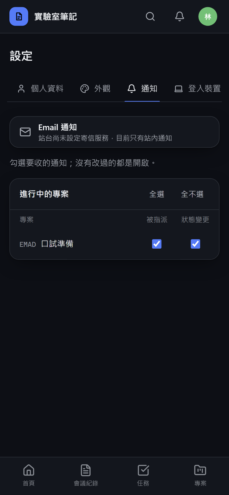

# [MS-57] 用 Email 寄送未讀通知

> 狀態：進行中

## 內文

### 需求
沒開著網站的人收不到站內通知，被指派、被提及或評測結果出來都要等下次登入才知道。通知在一段時間內沒被讀，就寄一封 Email 給收件人，信中列出這段時間所有未讀通知並可點回網站；每個人可以自己關掉 Email 通知。寄信使用 Resend 的免費方案（每日 100 封、每月 3,000 封），寄件網域為站台自己的網域。

### 來源
使用者 2026-10-20 對話（「我想要用 Resend，可以幫我串上去嗎」）；設計：`design/05-project-management.md` §10；待確認 #3 改為要做

### 驗收條件
- [ ] 通知產生後 10 分鐘內沒被讀，收件人收到一封 Email；10 分鐘內在站內讀了就不寄
- [x] 同一人同一批的多則未讀通知合併成一封，信中逐則列出內容，每則可點回對應的議題、會議紀錄或任務
- [x] 已寄過的通知不會重寄；同一張票之後又有新動態（合併進同一則通知）時會再寄
- [x] 信件語言跟收件人的介面語言一致（中文或英文），主旨帶站台名稱與未讀數
- [x] 設定頁可開關 Email 通知，預設開啟；關閉後不再收信，站內通知不受影響；「專案 × 事件」偏好關掉的通知也不寄
- [x] 沒有網站流量時也會準時寄出（不依賴有人開著網站）
- [x] 站台沒設定寄信金鑰時完全不寄，設定頁顯示 Email 通知未啟用；寄信服務失敗只記 log，不影響站內通知，稍後重試
- [x] 上線時不會把過去累積的舊通知一次寄出

### 測試流程
1. A 把議題指派給 B，B 不開網站；10 分鐘內 B 收到一封列出該通知的 Email，點連結打開議題
2. A 在 1 分鐘內再留言兩次，B 收到的信只有一封
3. B 在設定頁關閉 Email 通知，A 再指派一張票，B 只收到站內通知
4. C 被指派後 5 分鐘內在站內點開通知，C 不會收到 Email

---

# 跟其他票的關係

- Blocks：無
- Blocked by：MS-41
- Related：無

---

# Commit-1

## 內文

原本只有站內通知，沒開著網站的人要等下次登入才知道被指派、被提及或評測結果出來。
現在通知 10 分鐘內沒被讀，就把這個人所有還沒讀的通知合併成一封 Email 寄出，每則都附連結可點回議題、會議紀錄或任務；10 分鐘內在站內讀了就不寄，同一張票之後又有新動態會再寄。信件用收件人的介面語言，主旨帶站台名稱與未讀數。寄信時間由排程決定，不需要有人開著網站；上線時只會處理最近一天內的通知，不會把舊通知一次寄出。設定 → 通知最上方多了「Email 通知」開關（預設開啟），關掉後只剩站內通知；站台還沒設定寄信金鑰時，這裡改為說明目前只有站內通知。寄信服務出錯只記錄下來，通知保留到 15 分鐘後重試。
以模擬的寄信服務驗證了：延遲到期才寄、同一人合併成一封、不重寄、新動態再寄、已讀與關閉 Email 的人不寄、英文介面收英文信、寄信失敗後重試成功、建立通知後排程已設定。實際寄到信箱要等站台設定 Resend 金鑰與寄件網域後驗證。

### 測試結果

| 項目 | 結果 |
|---|---|
| 完整測試套件（vitest） | 通過 57 / 57（新增 Email 4 項） |
| E2E Email 設定開關（四種組合） | 通過 4 / 4 |
| 型別檢查 | 0 錯誤 |
| Lint、色碼、對比度檢查 | 通過 |

### 截圖

Email 通知開關（站台已設定寄信金鑰）

站台未設定寄信金鑰

---
