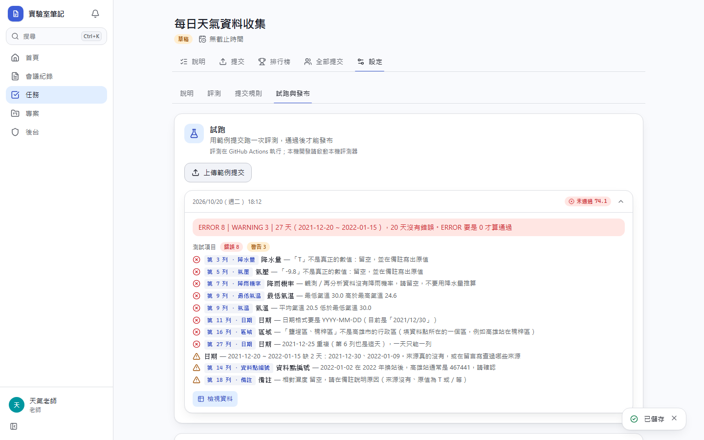
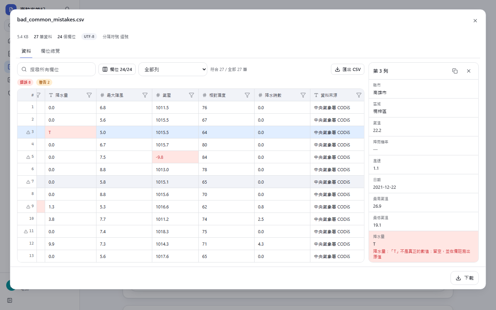

# [MS-58] 提供每日天氣資料格式驗證評測範本

> 狀態：完成

## 內文

### 需求
天氣版的資料蒐集作業要學生交一天一列、24 欄的天氣資料（CSV／XLSX），交之前要通過驗證、ERROR 要是 0。要有一份可直接上傳到平台的評測程式，依作業規則逐列檢查，每個錯誤標出列與欄位，並附可直接貼上的任務說明與設定方式。

### 來源
使用者 2026-10-20 對話：「給我一分天氣的版本」（附作業說明：近 10 年真愛碼頭旁每日天氣、24 欄、CODiS 高雄站 467440／467441、三個容易踩的坑、三人分工）

### 驗收條件
- [x] 接受 UTF-8 CSV 與 XLSX；Big5 回報明確錯誤；表頭 24 欄、前 5 欄順序固定
- [x] 檢查每日一列（日期格式、不重複）、期間內缺天列為警告；可用隱藏資料指定期間，未指定時以檔案自己的起訖日期為準
- [x] 數值欄位必須是合理範圍內的數字；T、/、--、-9.8 等代碼報錯並提示留空寫備註；最低 ≤ 平均 ≤ 最高、最大陣風 ≥ 平均風速
- [x] 降雨機率：預報資料必填、觀測／再分析必須留空
- [x] 高雄站編號只能是 467440／467441，換站前後用錯給警告；座標與距真愛碼頭公里數不一致給警告
- [x] 每個錯誤帶列號與欄位，在平台上標在對應的格子；ERROR 0 才通過，分數為沒有錯誤的天數比例
- [x] 附正確與帶錯的範例，在平台上試跑得到預期結果

### 測試流程
1. 建立任務並上傳評測程式，接受 .csv、.xlsx
2. 試跑帶錯範例 → 未通過，錯誤標在對應的列與欄
3. 試跑正確範例 → 通過，可以發布

---

# 跟其他票的關係

- Blocks：無
- Blocked by：MS-55
- Related：MS-56

---

# Commit-1

## 內文

天氣版的資料蒐集作業原本只有學生自己在本機跑的驗證腳本。
現在有可直接上傳的評測程式（examples/tasks/weather/grade.py，只用 Python 標準函式庫）：檢查 24 欄表頭與前 5 欄順序、一天一列與缺天、數值欄位的格式與合理範圍（T、/、--、-9.8 等代碼會要求留空並在備註寫原值）、最低／平均／最高氣溫與陣風的關係、降雨機率只在預報資料填寫、高雄站 467440／467441 換站前後的編號、座標與距真愛碼頭公里數是否一致、網址與擷取日期。每個錯誤標出列與欄位，平台上直接標在那一格；ERROR 0 才通過，分數是沒有錯誤的天數比例。三人區間不同，組員任務不指定期間（以檔案自己的起訖日期檢查缺天），合併任務再用隱藏資料指定完整十年。附範例產生器與說明文件（含可直接貼上的任務說明）。
規則依作業文字整理；拿到「欄位規格」與 validate_weather.py 後若有差異，改評測程式開頭的常數即可。
驗收：在平台上試跑帶錯範例得到 ERROR 8｜WARNING 3，點「第 3 列 · 降水量」打開檢視器、該格標紅並顯示「不是真正的數值」；正確範例（跨 2022 換站的 27 天）ERROR 0，試跑通過。

### 測試結果

| 項目 | 結果 |
|---|---|
| E2E：平台試跑天氣範例（桌機） | 通過 |
| 評測程式本機驗證（正確＋2 份帶錯範例） | 結果全部符合預期 |
| 型別檢查 | 0 錯誤 |
| lint | 0 錯誤 |

### 截圖

**帶錯範例的評測結果**

**點錯誤後在檢視器標出該格**

