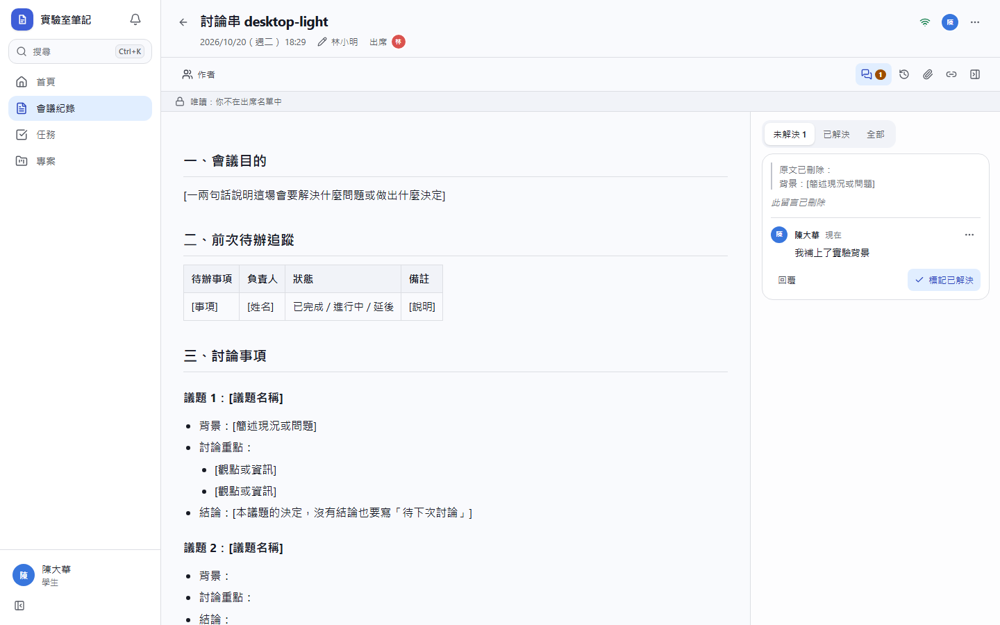
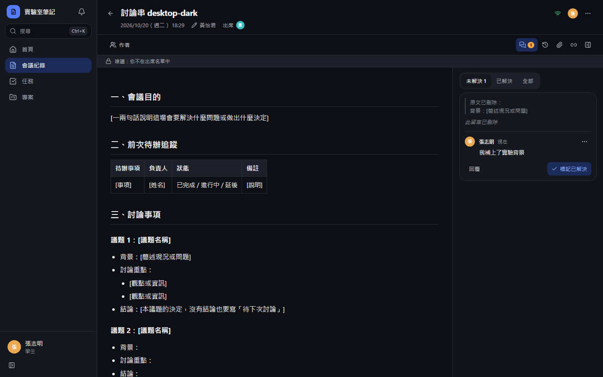
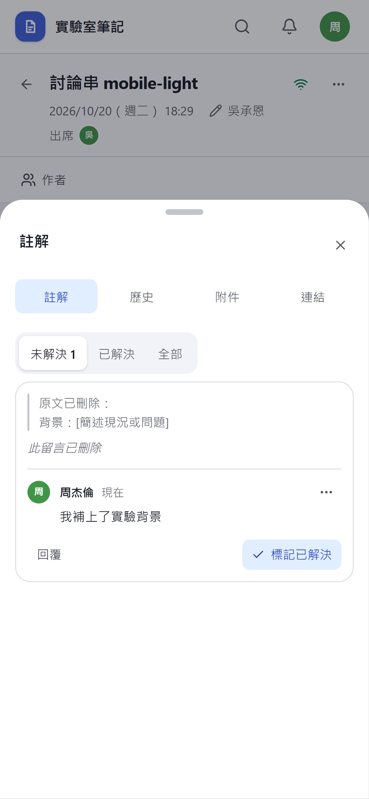
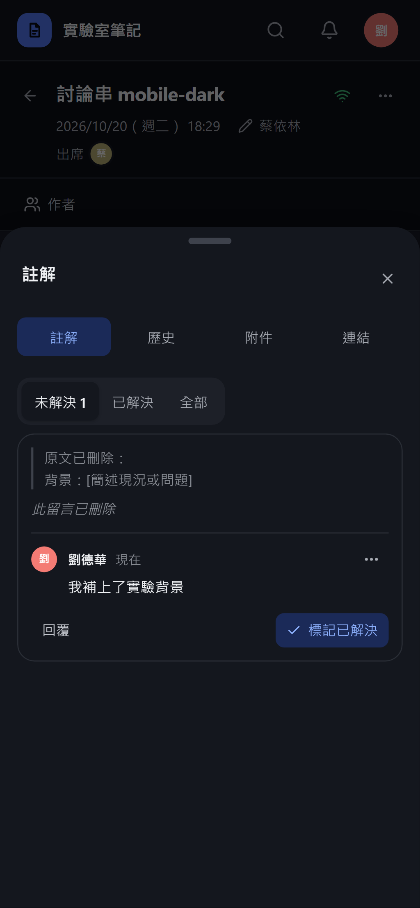
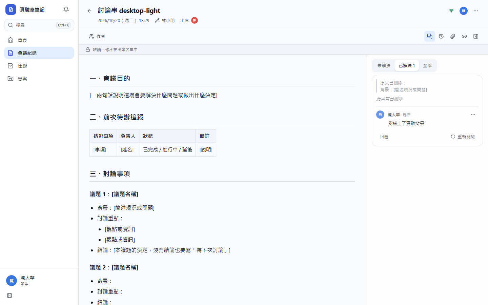
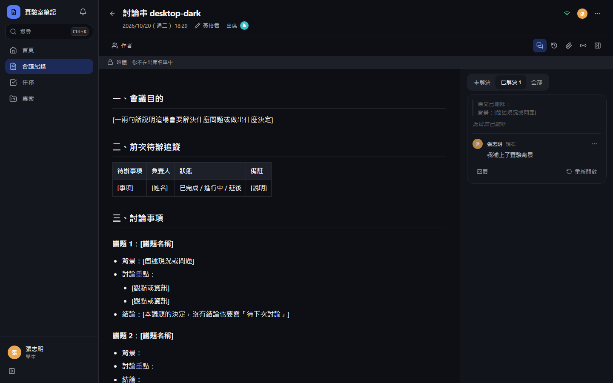
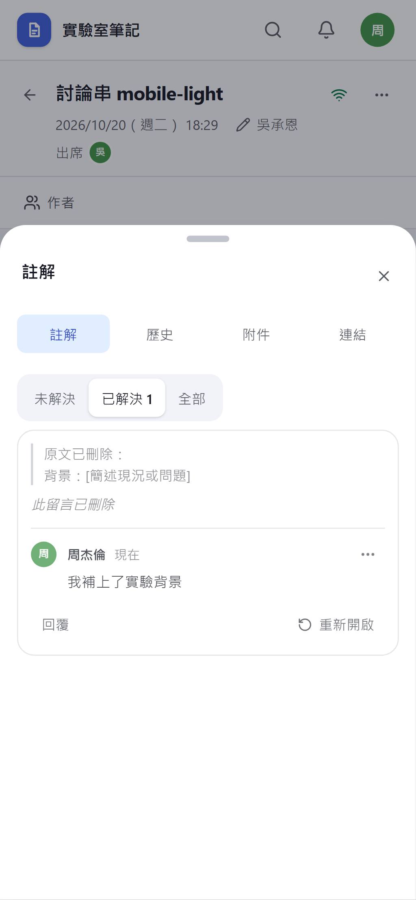
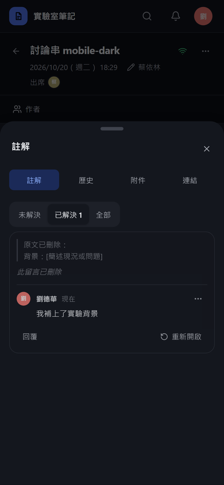

# [MS-59] 修正刪除首則留言後無法解決討論串

> 狀態：完成

## 內文

### 需求
會議紀錄的註解討論串，第一則留言被作者刪除、底下還有回覆時，按「標記已解決」會跳出「找不到這個項目」，討論串一直卡在未解決。這種討論串要能照常解決、重新開啟與回覆；連回覆也都刪光、已經沒有內容的討論串要自動消失，不再佔用未解決數。

### 來源
使用者 2026-10-20 對話（截圖：「此留言已刪除」的討論串按「標記已解決」出現「找不到這個項目 錯誤代碼 a4d75164」）

### 驗收條件
- [x] 第一則留言已刪除、還有回覆的討論串可以標記已解決、重新開啟，也能繼續回覆，不出現錯誤
- [x] 這種討論串顯示「此留言已刪除」占位與原本引用的文字，不顯示被刪除的內容
- [x] 被刪除的回覆不再留下占位
- [x] 第一則留言與所有回覆都刪除後，討論串從列表消失，無法再回覆或解決
- [x] 會議紀錄列表與註解按鈕上的未解決數和畫面上的討論串一致

### 測試流程
1. A 在會議紀錄加註解，B 回覆，A 刪掉自己的註解
2. B 打開註解面板，看到「此留言已刪除」與 B 的回覆，按「標記已解決」
3. 討論串移到「已解決」，可以按「重新開啟」
4. B 刪掉自己的回覆，討論串從面板消失

---

# 跟其他票的關係

- Blocks：無
- Blocked by：無
- Related：MS-15

---

# Commit-1

## 內文

第一則留言刪掉後，討論串仍顯示在未解決，但按「標記已解決」會出現「找不到這個項目」，因為解決時找的是那則已刪除的留言；回覆全部刪光的討論串也會一直留在未解決、無法處理。
現在只要討論串裡還有回覆，就能照常標記已解決、重新開啟與回覆，第一則留言顯示「此留言已刪除」占位，內容不會再被傳回。被刪除的回覆直接消失，不留占位；第一則留言與所有回覆都刪掉後，整串從面板消失，也不再算進會議紀錄列表與註解按鈕的未解決數。被刪除留言的作者不會再收到該串的回覆通知。
依使用者截圖的情境重現：刪掉第一則留言、保留回覆，按「標記已解決」後討論串移到「已解決」且沒有錯誤；刪掉最後一則回覆後討論串消失。

### 測試結果

| 項目 | 結果 |
|---|---|
| 完整測試套件（vitest） | 通過 58 / 58（新增刪除首則留言的討論串 1 項） |
| E2E 刪除首則留言後解決、全刪後消失（四種組合） | 通過 4 / 4 |
| 型別檢查 | 0 錯誤 |
| Lint、色碼、對比度檢查 | 通過 |

### 截圖

第一則留言已刪除、還有回覆

標記已解決後

---
